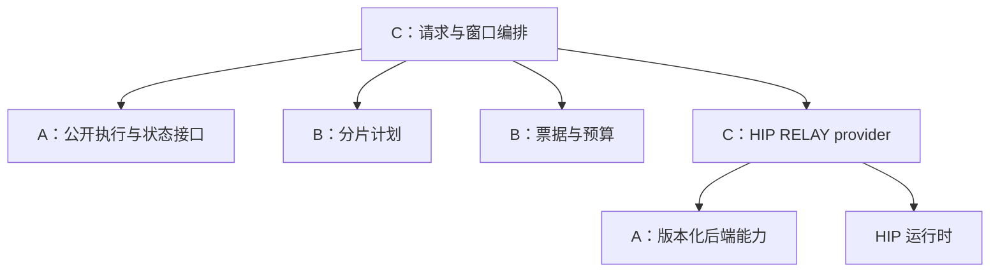

[GUIDE: Apply ASD-STE100 to source code, Mise-en-place to code design and thinking framework. Adapt Gall’s Law, Chesterton’s Fence, and Poka-yoke. Invoke Goodhart’s Law and Via Negativa when needed. Treat these principles as Wittgenstein’s Ladder. Build the real thing, not its imitation. Try to falsify it.] [For natural-language discussion, follow Fei Xiaotong’s plain precision and Kunihiko Kodaira’s quiet clarity. Avoid officialese, performative rhetoric, translationese, and textbook cadence. Let the subject shape the prose.]

AXIOM
1. [开发者] AXIOM 必须直接对应使用者或开发者真正在乎的事，并标注理由。
  - 理由：不写理由，规则就无从验证，也判断不了该删还是该留。
2. [开发者] LEMMA 必须是 AXIOM 或其他 LEMMA 的推论，并标注推理过程。
  - 理由：推理写明白，结论才能被复核、被推翻。
3. [开发者] SPEC 必须是 LEMMA，且能被生产或测试代码证明成立，并标注证明。
  - 理由：代码证明不了的规范落不了地。
4. [开发者] 所有代码和文档都是以上三者的衍生品，而且在满足它们的前提下最简实现。
  - 理由：需求要有出处，实现要能删、能改。
5. [使用者] 如果软件不能让用户满意，则需要进一步演绎出更多 LEMMA/SPEC。
  - 理由：用户满意与否是最终的验收标准。
6. [开发者] 如果演绎出更多 LEMMA/SPEC 的过程中发现无法判定句，考虑归纳分析出新的 AXIOM。
  - 理由：不补公理，演绎就卡在无法判定的地方。
7. [开发者] 在前六条可满足时，AXIOM、LEMMA、SPEC 三者的复杂程度越低越好，称之为奥卡姆剃刀。
  - 理由：体系越简单，越看得懂，越守得住。
8. [开发者] 每个库先作为完整个体成立，能独立理解、构建、验证和使用；组合时才决定它与谁协作。在公开行为契约不变时，库的内部实现与库之间的协作关系应能分别改变。先有最简完整实现，再做可拆的改进。
  - 理由：维护一个库不应要求同时理解整套系统。拆开后各自仍有完整职责，换一种合作方式不必改参与者的内部，才是真正减少了维护负担。
9. [使用者] 系统具有良好封装：用户无需理解系统内部概念；只要用户能理解系统用法，不必强求用户的理解和真实发生的事件一致。
  - 理由：认知负担该落在系统身上。实现层的概念不重要，用户只需学会用法；要求用户的理解与真实事件一致，就是让用户替系统背实现细节。
10. [使用者] 在用户已明确授予的权限范围内，程序信任用户的决定，不重复请求同一授权，也不增加与目标无关的操作限制；防呆针对会造成不可撤销后果的误操作。
  - 理由：让用户反复确认已经决定的事，会打断工作，并增加用户要理解的东西。授权边界由具体项目明确，不能由一份通用模板替所有项目预授；边界内的防护应针对真实误操作，而不是重复审批。
LEMMA
1. [AXIOM: 1, 2, 3, 6, 7] 接手项目时，有时 SPEC 其实应该重命名为 LEMMA 或上溯到 AXIOM：从实现细节反推原始需求，称之为第一性原理。
  - 推理：AXIOM 1–3 给出各层判定标准，旧条目据此可重判；AXIOM 6 遇无法判定句本就要求上溯；AXIOM 7 要求体系最简，重整常优于新增。
2. [AXIOM: 7] 有时可以把 AXIOM/LEMMA/SPEC 的集合重组，就像数学上的公理系统变换，目的是简化理论。
  - 推理：AXIOM 7 要求复杂程度最低，公理系统变换正是达到最简的手段。
3. [AXIOM: 4, 5] 很多代码是可以删除的。如果发现事实上不能删除，要形式化成 AXIOM/LEMMA/SPEC。
  - 推理：AXIOM 4 要求最简实现，能删先删；删不掉的承载着用户在乎的事，按 AXIOM 5 演绎成 LEMMA/SPEC。
4. [AXIOM: 4, 7, 8] 抽象要能指出当下的收益：消除的重复、隔离的边界（独立职责、第二个使用方、测试替身、外部契约），或实测支撑的收益。指不出就先用具体实现，不为想象中的使用方预建框架。
  - 推理：AXIOM 7 要求复杂程度最低，AXIOM 4 要求最简实现，AXIOM 8 要求职责独立。第二个实例是收益的证据之一，不是封装独立职责的前提；只有一层间接而没有实际收益的抽象应删掉。
5. [AXIOM: 4, 7; LEMMA: 3] 例外集中管理，统一登记在本文末尾的《例外清单》：兼容层、开关、废弃接口、做不到正交的耦合对。每项写清使用方与解除条件，条件满足即删。写不出使用方与解除条件的，不建；已建的现在就删。
  - 推理：LEMMA 3 要求删不掉的东西形式化。AXIOM 7 要求复杂程度最低：分散的例外盘不过来，集中一处才能盘点、到期清理。写不出使用方的条目没有用户在乎，按 AXIOM 4 应删。
6. [AXIOM: 4, 7, 8] 对象是对自己的行为和状态负责的个体，不是交给外部流程摆弄的数据容器。以这样的对象组织职责；对象私有的字段、集合、缓存和跨调用状态可以直接可变，不必先改写成不可变状态传递。外部只能通过公开消息请求它做事、取得结果，不能代它维护内部不变量。
  - 推理：AXIOM 8 要求能够独立理解和验证；状态的合法变化若要靠外部同时照看，就无法独立判断正确性。AXIOM 4、7 要求最简实现，因此约束的是状态归属与可观察行为，不是可变字段的数量。局部指所有权边界，不只指函数内的临时变量。
7. [AXIOM: 8; LEMMA: 6] 独立库 A、B 的协作由组合者 C 拥有：C 分别向 A、B 发出消息、接收结果并安排后续动作；A、B 各自决定如何响应自身的消息，不持有或调用对方，也不认识 C 的工作流。协议表达本库的请求、事实与结果，必要的协议转换在 C；独立不等于没有公开协议。
  - 推理：若 A 内部安排 B 的调用次序、重试或提交，协作关系仍然写在 A 里。把 B 换成接口、泛型服务参数、回调、闭包、服务定位器或通用发送器，只隐藏了名字，没有移走这份职责；依赖注入不是协作独立的证明。把 B 交给 C 调度，与把 B 注入 A，由 A 调度，是两件事。
8. [AXIOM: 4, 7, 8; LEMMA: 6, 7] C 本身也是完整个体，拥有这一段协作的协议、顺序及必要的在途状态，不是无所不知的总控。A、B 保留自己的领域判断；C 不读取它们的私有字段、不复制它们的业务账本、不靠继承或反向回调改写它们的行为。组合出的整体可以继续参与更外层的组合。
  - 推理：协作关系已从 A、B 移出（LEMMA 7），必须由 C 独立负责，不能藏进全局设施。把 A、B 的判断也搬到 C，只是把大泥球换了位置。因此“组装不做决定”应理解为不代替参与者做领域判断，而不是禁止 C 组织协作；纯启动接线与有状态的协作对象也不必混成一个东西。
9. [AXIOM: 4, 7, 8; LEMMA: 6, 7, 8] 组合优于继承：新增协作或可拆改进，优先新增或修改组合者，不扩张公共基类、全局上下文或服务接口树。采用 Smalltalk / Actor 所启发的对象自治与消息边界，不为风格建设运行时；这里选择由 C 组织独立库的协作，并不把这一拓扑当成 Actor 模型的定义。
  - 推理：可拆组合不要求参与者知道新用途，符合 AXIOM 8。消息可由有明确类型的普通成员调用和返回值承载；只有真实并发或交付需求出现时才引入邮箱、队列、调度器或持久协议。泛型、函数、继承和依赖注入都是局部工具，不因用了就算解耦，也不因不用就算解耦；判据仍是 LEMMA 6–8。
SPEC
1. [AXIOM: 8; LEMMA: 4, 7] 每个实际库是独立子模块：移除兄弟库和组合者的源码后，只凭本库源码、工具链与声明依赖的产物，仍能构建并运行本库测试；源码与包依赖图无环，独立库 A、B 之间没有依赖边，由 C 依赖二者。测试、资源子目录不是另一个库，仅含 AGENTS.md 的草稿不算已实现。各库规则写在自身 AGENTS.md，GUIDE 只在根目录一份。
  - 证明：[TODO] 在隔离环境中逐库构建并运行本库测试，检查源码与包依赖图；按公开声明的交付形态，在只提供实际交付物及声明依赖的消费环境中使用，不回退到开发工作区或未交付文件。记录实际命令、测试路径、结果与证明范围。这些只证明构建与交付边界，不证明运行时协作独立。
2. [LEMMA: 7, 8] 对声明独立的 A、B，验收时移除对方的实例、服务接口、回调和组合者，直接给本库公开消息，仍能验证本库响应；不得用一个模拟对方调用顺序的替身补洞。改变 C 的参与者选择或合法协作顺序时，不修改 A、B 的内部实现。只换一个同接口实现不算此项证明。
  - 证明：[TODO] 为 A、B 分别建立不注入对方服务的行为测试，再用实际组合测试验证 C。检查协作顺序是否仍藏在某个参与者内部；不能给直接调用改名为“消息”就宣告完成。记录已证明的协作及尚未移出的依赖。
3. [LEMMA: 6, 8] 每份可变状态只有一个修改者；跨边界的消息和视图不暴露可被双方修改的内部别名。验证至少覆盖两个实例互不影响、外部修改输入或返回值不能改写内部状态；若存在异步等待、重入或并发，还须验证这些时刻不会绕过对象的不变量。对象可以跨调用持有状态，不要求全系统串行。
  - 证明：[TODO] 验证实例隔离、输入所有权和返回视图分离；逐个验证实际存在的异步、重入与并发边界。记录测试路径、覆盖的边界和未覆盖项，不把某个对象的局部证明写成全系统证明。
4. [LEMMA: 7, 8] 每种真实协作由 C 自己的 SPEC 说明如何接收参与者结果、推进以及结束；测试使用真实 A、B，覆盖成功与失败路径，涉及外部效果时覆盖重复及未知回执。发送、接收、持久提交与业务完成不得相互冒充；C 只能据参与者给出的事实推进。
  - 证明：[TODO] 用真实参与者验证完整协作；按实际语义构造失败、重复及未知结果的反例。记录命令、测试路径、结果及剩余边界，不以接口形状检查、模拟调用或文档声明替代真实协作证明。
适用范围

LEMMA 7–9 约束的是声明独立的职责库之间的协作，不要求每个函数、内部类、标准库调用都增加一个 C。私有实现可以直接组合；暂时无法分离的跨库直接依赖按 LEMMA 5 登记，不能仅把双方改称上下层就宣称独立。

子目录规则若把“泛型化服务注入”等同独立，或把“只接线”解释成协作无人负责，须按本体系修订，不作为新实现的依据。

本模板不指定编程语言、构建工具、包管理器、宿主平台或迁移路线。具体选择应由项目自己的 AXIOM / LEMMA / SPEC 说明，不从模板中的命名推定实现方式。

例外清单

[TODO] 接入项目时盘点。每项记录：事项 / 使用方 / 暂时保留的理由 / 可验证的解除条件。完成盘点且确无例外时写“无”；未盘点不等于没有例外。

TODO
- 补充具体项目中使用者与开发者真正在乎的事，写清理由；由此推导项目的 LEMMA / SPEC，不把现有实现细节直接提升为公理。
- 将各 SPEC 的证明栏替换为实际代码、测试与验证记录；未落实部分保留 [TODO]。不得将草稿、构建通过或局部测试写成全系统已满足。
- 盘点既有规则与本体系的冲突，明确需要修订的规则和实现。记录未落实项不等于豁免新规则，修改规范不等于实现已经符合。


# TP5-最新设计保姆级指南

> **本轮单流性能修复补记（2026-10-19）**：Qwen3-8B Q8_0 / 五 RX 6800 的相同固定单请求，四个独立配对 block 确认原生重放前/修复后为 9.1784/54.9584 token/s，速率比 5.98781，95% CI [5.29900,6.76615]。采用有界整步 HIP 原生重放、两 kernel RELAY、无 activation 重量化的 Q8/F32 投影与保序 CPU SIMD；公共 relay ABI 1 不变，私有 provider ABI 为 2，通用 GGML_HIP_GRAPHS 仍关闭。FA on/off 完整 16-token 生命周期、KV 256→512 的 288-token 全 logits、第 8 epoch abort、host C/C++ ASan 与新安装搬迁均已实际通过，原数值门不变。FA 仍默认 off；当前四请求试验未确认双窗额外收益，不能沿用旧镜像 1.71597 倍结论。当前身份和范围见 `fork/audit/tp5-performance-20261019.json`、`fork/VALIDATION.md`；紧随其后的实现、速度、安装补记及正文旧状态保留原生重放前证据，不代表本轮新镜像。master 的 60–67 token/s 是另一模型/量化/Vulkan 负载，不作为本模型同条件加速比。

> **当前实现状态补记（2026-10-19）**：下文 2026-10-18 的设计、固定比较对象和历史判断保持原身份；不要把它们当成后来代码的当前状态。现在已有可安装的 [`fork/tp5-compose`](fork/tp5-compose/README.md)：真实 Qwen3-8B Q8_0、五张 RX 6800 / HIP gfx1030、CPU ordered-F32 relay、整链预提交、两个独立 context。FA 默认 **off**，依据固定工作负载实测最快的合格模式选择；显式 **on 也有完整数值/生命周期资格**，不是禁用或不支持。精确 on profile 复用已有 fused online F32 kernel，保留 F32 操作数，不以 F16 舍入或拆开的 QK/softmax 图替代。最终 `acceptance-fa-final` 的四请求各八 token 完整 logits、慢消费者、取消与真实 native-drain abort 门全部通过；32 行 / 4,861,952 logits 在 `.002 + .001*abs(reference)` 门下超差 0，max_abs `2.193450927734375e-5`。五卡 arithmetic oracle 为 Q8/F32 170 例、最终 FA **180 例**（含 always-masked K/V NaN）；FA-on trace 是五卡各 144、合计 720 次融合 FA launch，off trace 为 0。
>
> 当前 manifest 共 **48 个已审 A 路径**（已经包含两个新增 Q8/F32 文件），组件为七 B / 七 C。85 条隔离命令通过属于保存的 **45-path 前 FA 候选**，不能提升为最终 FA 构建完整重跑 archive 隔离的资格。最终 HIP 已完成七 B / 七 C 构建安装与 11/11 A seams；最终安装包另已通过真实搬迁及公开消费者的选定合同。当前 48-path 精确源码身份、末尾 guard 与最终机器索引看各自最终回执，不用阶段通过代替所有门全绿。LFM2 MoE TP5、其他模型/后端、长上下文、MTP、RERoT+TP5 与通用性能收益均不从这里获得支持。以 [当前验证记录](fork/VALIDATION.md)、[机器索引](fork/audit/tp5-acceptance-20261019.json) 为准；原失败证据和历史 Vulkan FA/TOPK 失败保留，不放宽数值门。
>
> 后续实际回执：FA-off 八 token main/slow/cancel/abort 全通过；FA-on 32-token **main-only** 对照的 128 行 / 19,447,808 logits 超差 0、max_abs `9.059906005859375e-5`，不冒充 32-token 生命周期全矩阵。当前源码 host-only ASan 在四个原始 193-token prompt、两个 context、每请求生成两 token 下退出 0；此前四 token main+abort ASan 保留原候选身份。Leak detection 关闭，不声称 GPU sanitizer、全场景 ASan 或无泄漏。合法无输出 prefill 的空 tensor 由 strict preflight 跳过，不造 logits、不缩短 prompt。共享 F32 kernel 在 K/V 读取前跳过 -INF masked key，改善共享 banded kernel 的 masked-nonfinite 语义；普通 FA 路由/精度不变，不笼统宣称其他后端一切不变。
>
> **速度裁决**：`per-stream-fa-final/summary.json` 有 12 个进程、三个配对 block，固定四请求 × 193 prompt token × 32 teacher 输出。每流几何平均 token/s：off/1窗口 **8.9853**、off/2窗口 **15.4185**、on/1窗口 **7.7510**、on/2窗口 **13.4642**。两窗口 on/off 比 **0.87325**，95% CI **[0.83966,0.90818]**，on 慢约 **12.7%**，不晋级为性能默认。只有 n=3 独立 block；每请求 31 个 ITL，p99 不稳定；TTFT 是 admission-to-first-commit，排除模型加载和网络。原 `per-stream-fa` 失败与 `per-stream-fa-prefill-fixed` 较慢结果保留。用户关心速度不等于要求默认 on，先前的相反假设已按数据纠正。

> 同一 off 工作负载的两/一窗口速率比 **1.71596659**，95% 配对 t 区间 **[1.28598327,2.28971978]**（`per-stream-fa-final/default-decision.json`），仍仅 n=3，不扩写为通用并发收益。TTFT 还排除 context startup 与 admission 前 queueing，不能当作端到端时延。

> **最终安装包证明**：`hip-package-proof/summary.json` 通过选定合同。15 组件（A+七 B+七 C）fresh install 到 stage 后改名 relocated；外部消费者配置/构建与所有 GPU 调用期间，原 stage 与旧 install 前缀真实不存在，证明后才恢复。只用 `find_package(TQTP5Compose)`、安装公共头/imported targets，编译路径无旧前缀/私有源码头，`ldd` 指向 relocated libraries。外部两请求显式 on/双 context/五 rank/预算 0，直接 CLI 默认 off 双请求、单请求自动一窗口/off、三请求一窗口/on 均实际通过。实际 helper `share/TQTP5Compose/real-tp5.py` 的搬迁 predict4 main-only 全 logits 通过；初次猜错 share 路径的失败保留，未重复成功 setup。最终包 trace 绑定五个 BDF，on=720（144/卡）、off=0；native libraries 与 12 个性能进程相同，每个性能 case 均显式 on/off。W0 请求 delay/W1 abort 的组合场景两 completed mask=31、unknown=0、预算 0、exit1；**精确 held-borrow 分支未单独 instrument，不声称分支覆盖**。

> 文档日期：2026-10-18。用途：对照固定旧 TP5 源码，修订《设计稿.md》，形成可逐步实现、可拒绝非法配置、可独立审查的工程设计。本文不是已完成的 ROCm TP5 发布声明。
>
> 目标保留为五张 GPU 共同承担模型计算、CPU 完成跨 rank 合并、两个独立窗口交错。对“每个大算子严格五等分”“零复制”“双端忙等”“每流性能提升”的要求分别建立合同，避免一个口号掩盖另一个条件不成立。
>
> 续补版本：在原有比较与修订之上，新增第 51–54 章的完整 GLU 计划算例、逐调用执行与故障轨迹、验收证据信封，以及已实际运行的 CPU 局部计划检查器。全篇共 55 章，包含四个可提取的完整 Python 程序；原附件及固定比较版本保持原有身份。

## 全文导航

正文共 55 章。来源标记可以点击跳转到固定文件和证据范围；第 50、54 章合计保留四个可提取的完整 Python 程序，第 54 章另附四个可直接运行的 JSON 输入。

### 版本、职责与执行合同

- [00. 阅读方法与当前结论](#chapter-00)
- [01. 固定比较对象，避免把三个版本混在一起](#chapter-01)
- [02. 旧 TP5 与新稿的逐项对照](#chapter-02)
- [03. 将目标写成可检验的产品合同](#chapter-03)
- [04. 从一份真实模型生成工程输入](#chapter-04)
- [05. A/B/C 边界如何延续](#chapter-05)
- [06. 公开接口先表达所有权，再表达速度](#chapter-06)
- [07. 计划编译器如何处理布局](#chapter-07)
- [08. 一个从准备到提交的具体例子](#chapter-08)
- [09. 静态计划与运行期调度的边界](#chapter-09)

### 容量、接线与实施决策

- [10. 显存、主机内存与准入：逐个所有者记账](#chapter-10)
- [11. 稳定 ID、逻辑槽与资源代次](#chapter-11)
- [12. A 的执行接线：先补真实缺口](#chapter-12)
- [13. LateBind：应继承数学条件，不继承模式数量](#chapter-13)
- [14. 通信成本模型只帮助选择，不能替代完成信号](#chapter-14)
- [15. 从普通 Decode 扩展到投机和恢复](#chapter-15)
- [16. 文件、日志和诊断对象也是公开接口](#chapter-16)
- [17. 实施顺序与实际操作](#chapter-17)
- [18. 需要记录的设计决定](#chapter-18)
- [19. 开始实现前应能回答的问题](#chapter-19)

### 模型几何与分片数学

- [20. 先把模型几何钉牢，再决定五卡怎么分](#chapter-20)
- [21. 用逻辑索引描述切分，避免“行”和“列”互相颠倒](#chapter-21)
- [22. 量化块、头和工作组：三个不能混用的分割单位](#chapter-22)
- [23. GQA：把头依赖画清楚，才知道 KV 能放在哪里](#chapter-23)
- [24. GDN：Q/K、V、卷积历史和矩阵状态是四套索引](#chapter-24)
- [25. LFM2.5：单独建立 shortconv 适配器](#chapter-25)
- [26. MoE：容量均衡、路由均衡和张量并行是三件事](#chapter-26)
- [27. norm、残差、非线性与精度：在哪一步可以继续分片](#chapter-27)
- [28. embedding、logits 与采样：把“最后一小步”做成完整协议](#chapter-28)
- [29. 把数学设计落成可审查的计划、实例和反例](#chapter-29)

### HIP RELAY 与请求生命周期

- [30. 把 CPU RELAY 的目标写成可以验收的合同](#chapter-30)
- [31. HIP 能力资格：先知道平台答应了什么](#chapter-31)
- [32. 通道、代次与两种 credit](#chapter-32)
- [33. 内存发布：先证明写完，再讨论 fence](#chapter-33)
- [34. CPU 服务循环：让需要的前进者始终能运行](#chapter-34)
- [35. 失败、取消与物理排空](#chapter-35)
- [36. 双窗口：独立状态、独立可变输入、独立前进](#chapter-36)
- [37. KV、recurrent 与采样：什么才算窗口提交](#chapter-37)
- [38. Graph capture、固定地址与阶段内存](#chapter-38)
- [39. 落地次序、反例与验收矩阵](#chapter-39)

### 数值、性能与公开交付

- [40. 先定义资格：什么证据允许我们把 TP5 交给别人使用](#chapter-40)
- [41. 数值资格：从局部部分和一直看到公开 token](#chapter-41)
- [42. 将 logits 工具做成可交付的测量仪器](#chapter-42)
- [43. 每流性能怎样计：先把时间戳和分母分清](#chapter-43)
- [44. 因果实验：双窗口到底省了什么](#chapter-44)
- [45. 统计与证据流水线：让结果能够被别人重新算出来](#chapter-45)
- [46. 从 M0 到公开发布：每一步留下一个可独立使用的结果](#chapter-46)
- [47. 失败、取消、随机状态与流式输出：把运行的尾部做完整](#chapter-47)
- [48. 开源交付：源码、安装包、文档和证据一起成型](#chapter-48)
- [49. 运行手册与发布裁决：从现象回到最小责任](#chapter-49)

### 可运行 CPU 附录

- [50. 可直接运行的 CPU 附录：先让错误变成可重复的反例](#chapter-50)

### 完整工作例、执行验收合同与局部计划程序

- [51. 从张量目录到可拒绝的计划：一个完整工作例](#chapter-51)
- [52. 逐调用执行合同与故障轨迹](#chapter-52)
- [53. 交给实现者的验收输入、错误结果与首轮执行清单](#chapter-53)
- [54. 可运行的局部计划检查器：把分片选择、拒绝理由和边界字节写成结果](#chapter-54)

- [附录 A：来源目录与证据边界](#sources)
- [附录 B：术语速查](#glossary)

<a id="chapter-00"></a>

## 00. 阅读方法与当前结论

### 00.1 先明确这份指南解决什么

新版 TP5 需要解决的核心问题，是如何在受 PCIe、量化几何、模型状态和执行队列共同约束的五卡系统上，使有用计算与通信等待重叠，同时保持每个请求的数值和状态语义。把文件中的 `4` 改成 `5`，把 Vulkan 同步函数换成 HIP 函数，或把一次 `llama_decode` 包装成 `begin/finish`，都不足以得到这个系统。

本指南把新稿里有价值的方向保留下来：模型分片先编译成不可变计划；计算与状态具有明确所有者；CPU 合并采用明确定义的数值顺序；GPU 工作尽可能在窗口启动时预提交；窗口之间只用已证明的依赖交错；最终用每条请求的延迟和吞吐验收。修订的重点，是补上这些方向之间缺失的接口和限制。[S-DRAFT](#source-s-draft)

最先落地的交付应是一个能回答“这个模型、这份量化、这五张设备、这个窗口方案是否可用”的计划编译器，加上一个能拒绝覆盖活跃数据的生命周期协议。它们通过以后，再接真实算子和整链执行。这样得到的失败信息可以指导设计，失败不会被无效性能数据掩盖。

### 00.2 四项必须立即修改的结论

第一，分片规则必须来自实际模型。旧 `qwen4exp` 的 24 个 Q 头、512 个专家、640 维专家中间层，与 Qwen3-Next-80B-A3B 的配置不是一回事。旧 manifest 还绑定更早的源提交，不能拿它当当前运行时事实。模型名字相似、都是 GDN/MoE，不能代替逐张量几何校验。[S-O-MANIFEST](#source-s-o-manifest)[S-MATH-06](#source-s-math-06)

第二，完整专家分配属于 EP；旧 TP5 对主要专家线性层使用的是专家内部 TP。新稿改变的不只是实现细节，而是计算负载分布。EP 能均衡静态权重字节，却不能保证一次 token 路由的计算均衡。五卡各持有约五分之一专家，不等于五卡每一步各完成约五分之一工作。[S-O-PLAN-CPP](#source-s-o-plan-cpp)

第三，输入区和输出区的生命周期不同。CPU 读完五份输入，只能说明输入可回收；输出仍可能被一个慢 GPU 读取。输出银行必须等全部实际消费者完成最后一次读以后才能覆盖。RELAY 的数据提交也不等于请求的 KV、循环状态、随机状态和输出游标一起提交。

第四，参考执行器和目标 RELAY 必须分开命名。本文的 `cpu-staged/reference` 可以在 CPU 得到结果后提交下一段 GPU 工作，用于验证算术和搬运。目标 `tp5-relay` 则要求计算、等待和后续消费在窗口启动时已经进入可执行的设备链；CPU 在层间只处理数据和状态字，不补交后续算子。第 30–39 章使用的 `mapped-relay` 是该目标模式下基于映射主机页的实现名称；它与 `tp5-relay` 共用上述严格执行合同。参考执行通过不能写成目标 RELAY 已完成。[S-O-TP5](#source-s-o-tp5)

### 00.3 证据标签

| 标签 | 本文含义 | 可以支持的结论 |
|---|---|---|
| 新稿 | 本轮上传的《设计稿.md》 | 用户提出的方向、接口草案、待修订假设 |
| 源码确认 | 本轮读取固定 commit 的具体函数或声明 | 该版本的代码路径、数据字段、分支条件 |
| 旧报告 | 旧仓库文档或用户提供的此前会话记录 | 该记录曾经声称的实验结果及其限定条件 |
| 官方资料 | 版本化平台文档、模型作者配置、规范 | 被文档明确覆盖的 API 或模型事实 |
| 本文设计 | 本次重新提出的接口、状态机、选择规则 | 后续实施要遵守的合同；不是当前软件能力 |
| CPU 检查 | 本轮实际执行的小型合成反例或协议模型 | 被执行脚本的狭窄性质；不推出 GPU 正确性 |
| 待资格 | 必须在目标模型和五卡机器上取得的证据 | 当前不能声称已经成立 |

正文的 `[S-…]` 对应文末来源目录。提到旧文件时，用 commit 加文件加符号定位；行号只作阅读辅助。本文没有重新运行五卡 ROCm、旧五卡 Vulkan 或真实大模型推理，也没有获得新 clean 分支的完整源码。此前会话中 120 次请求执行、47 个安装步骤等结果，仍按历史记录处理。[S-HISTORY](#source-s-history)

### 00.4 按职责阅读

| 读者要完成的工作 | 优先章节 | 阅读后的实际产物 |
|---|---|---|
| 决定能否做、先做哪个模型 | 01–04、20–23、45–46 | 目标配置与可行性决定 |
| 维护 A/B/C 构建边界 | 05–08、12、47 | 最小公开接口、模块依赖、安装消费者 |
| 实现分片与模型适配 | 20–29、51、54 | 张量计划、显式 head map、算子参考与可运行局部检查器 |
| 实现 HIP 与 CPU RELAY | 30–36、52 | 平台资格、双向 credit、整链执行与逐调用合同 |
| 实现双窗口与请求生命周期 | 09–11、37–39、52 | 窗口票据、writer lease、部分提交与失败回收轨迹 |
| 判断正确性和速度 | 40–44、48–49、53 | 全向量资格、每流指标、配对实验与负例证据信封 |
| 从最小程序理解协议与计划 | 50、54 | 能运行并修改的 CPU 协议模型、局部计划与输入样例 |

读者不需要先相信所有优化会成功。每一项增强都有自己的启用条件和移除条件；失败时仍能保留已经成立的较小部件。

<a id="chapter-01"></a>

## 01. 固定比较对象，避免把三个版本混在一起

### 01.1 本轮使用的版本身份

| 名称 | 固定身份 | 本轮访问情况 | 用法 |
|---|---|---|---|
| 维护基线 A | `cda0f9256665845cd9d6f3a0176880883f653a3d`，release `b10298-2.0.0` | 读取了头文件、context、model、arch、HIP 构建及 CUDA/HIP 公共实现的相关范围 | 判断哪些接口已经存在 |
| 旧 fork O | `2777543b2358c88cd1c2000f7fa342b764a0e213` | 从 `AtomicBot-ai/atomic-llama-cpp-turboquant` 读取旧 TP5 计划、Meta、Vulkan collective、shader、测试与诊断工具 | 与新设计做源码级比较 |
| clean C0 | 会话报告为 `6de088714`，分支 `clean/fork-20261018` | 本轮仅有用户提供的历史会话记录；未取得该分支完整树 | 继承 A/B/C 方向，不虚构新增接口的当前状态 |
| 新设计 N | 本轮附件《设计稿.md》 | 完整读取，原文件 25,179 字节 | 修订输入 |

这里称 A 为“维护基线”，不把它自动等同为没有扩展的官方 llama.cpp 主干。获取到的 A 提交信息为 AtomicBot release 合并，内容也已有 TurboQuant、MTP 和阶段相关代码。版本的来源、树内容与本项目采用的维护边界是三个不同问题。对照必须以固定文件内容为准。[S-A-COMMIT](#source-s-a-commit)[S-A-CONTEXT](#source-s-a-context)

新稿把 O 称为“上游”，会使读者误以为 O 新增的物理循环槽和 TP5 代价采样器已经属于 A。本文统一写 A、O、C0，不使用含混的“现在的上游”指代三个对象。

### 01.2 已核对的接口差异

| 新稿引用或暗示 | 固定源码中实际情况 | 修订方法 |
|---|---|---|
| `n_seq_recurrent` 是上游多序列物理槽 | O 有此实验字段，A 的公开 context 参数没有它 | 如需独立物理循环槽，单列新增能力，不能据此承诺 A 已支持 |
| `n_seq_max_pp` 可直接用于窗口 | O 有此字段，A 对照头文件没有 | 先确定窗口模型，不靠旧字段名拼接 |
| `n_rs_seq` 与驻留槽等价 | A 与 O 都把它描述为每序列的循环状态回滚快照数量 | 预算时分开驻留请求数和快照深度 |
| `llama-decode-cost.h` 提供逐算子设备代价 | O 文件记录 host 端 setup、graph、alloc、input、submit、finish 区间；A 相同路径不存在 | 保留 host 账；设备事件和 kernel 代价另建数据集 |
| `llama_decode` 可用一次 commit 回滚整个窗口 | A 明确说明 abort 或 fatal 可能留下已处理 ubatch | 接口层必须暴露部分副作用，不能伪装事务 |
| `llama_memory_seq_rm` 可删除任意后缀 | A 明确允许部分删除返回 false | 只在被支持的状态模式使用；否则快照恢复或重算 |
| TENSOR 模式只需给模型加白名单 | `src/llama-arch.cpp` 实际是拒绝列表；Qwen3-Next/Qwen3.5 默认通过，QWEN4EXP 明确拒绝 | 校验真实入口、图构建、后端支持与状态布局，不能只改开关 |
| HIP 需要重造整套分片通信入口 | A 的 HIP 构建已经复用 CUDA 目录源文件，并有 communicator 相关入口 | 先证明可复用范围，再新增缺失合同 |

以上属于本轮源码阅读结果。[S-A-HEADER](#source-s-a-header)[S-O-HEADER](#source-s-o-header)[S-O-DECODE-COST](#source-s-o-decode-cost)[S-A-ARCH](#source-s-a-arch)[S-O-ARCH](#source-s-o-arch)[S-A-HIP-CMAKE](#source-s-a-hip-cmake)[S-A-CUDA](#source-s-a-cuda)

### 01.3 不拿历史路径的存在当运行命中

O 同时包含 TP5 计划、Qwen4EXP 相关逻辑，以及会在普通 TENSOR 建模入口拒绝该架构的检查。仅看“函数存在”不能证明当前二进制从哪条入口进入它；也不能据此断言所有旧 TP5 使用方式都已失效。启动资格必须记录实际 load/split 参数、被选模型适配器、plan 摘要和实际 collective 提交计数。只有这条路径被本次请求走过，才计为命中。[S-O-MODEL](#source-s-o-model)[S-O-ARCH](#source-s-o-arch)

同样，`--tp5-latebind aggressive` 是用户的请求，不是机制已生效的证据。旧文档明确曾纠正过某个混合精度 GGUF 的 LateBind 没有捕获目标张量。新系统在日志里同时输出 requested、resolved、executed 三层状态，减少再次误读的机会。[S-O-TP5](#source-s-o-tp5)

### 01.4 本轮审查覆盖范围

本轮完整读了上传新稿；对旧实现采用核心合同的深读方式，而不是重复上一轮 714 文件审查。重点包括不可变分片计划、模型中的 HC 数学、Meta 的 collective 与读回边界、Vulkan RELAY 的 bank 和 generation 生命周期、直接消费 shader、诊断 tape 的 reader/writer，以及公开状态 API。较大的 context、Meta 和 collective 文件按相关符号读取，未声称逐行验证整个旧仓库。

因此，本文可以说明“旧实现用什么职责闭合过哪些问题”“新稿哪条假设被具体源码反驳”，不能说明“旧实现所有组合均正确”“所有保留模式都已运行”。完整复现应按 40–49 章另行执行。

<a id="chapter-02"></a>

## 02. 旧 TP5 与新稿的逐项对照

### 02.1 分片和模型数学

| 主题 | O 的实现或记录 | 新稿的变化 | 本文决定 |
|---|---|---|---|
| MoE routed experts | gate/up 沿中间输出维分片，down 沿输入维产生部分和 | 改为整专家集合分卡 | 两者保留为独立候选，按实际专家并集与负载验收；不能把 EP 称为旧 TP 的等价迁移 |
| GQA | 使用明确 Q→KV 映射，并登记 KV 副本 | 声称整头切天然可以让 Q/KV 同 owner | 先解模型几何；必要通信、镜像或低并行度必须显式选择 |
| GDN | V/state head、QK 重用、conv 段布局相互绑定 | 只给 V-head 连续区间 | 计划中增加显式映射和 state schema；按模型适配器生成 |
| norm/HC | HC、router、部分 norm 和 PLE 使用镜像；LateBind 有专门捕获 | norm/RoPE 一句“复制”，HC 只提几个系数 | 区分参数镜像、数据搬运、重复计算；HC 数学单列，不套到没有 HC 的模型 |
| embedding | 初期完整镜像 | 按词表行分片并写“无通信” | owner 查表后仍需向使用者分发 hidden；绑定权重共享另算 |
| logits | 词表输出行分片，Meta 特定边界执行 gather | 用“归约”泛指 | 把 sum、gather、broadcast、selection 分成不同 collective 类型 |
| 未识别张量 | 某些计划路径默认 MIRRORED | 宣称零重复 | 新严格配置必须拒绝未分类大张量；参考配置可显式镜像并报告 |

表中 O 的事实以具体计划和 Meta 分支为依据，不以旧设计文档的理想布局代替实际加载布局。[S-O-PLAN-H](#source-s-o-plan-h)[S-O-PLAN-CPP](#source-s-o-plan-cpp)[S-O-META](#source-s-o-meta)

### 02.2 通信和执行

| 主题 | O 中有价值的处理 | 新稿不足 | 新接口需要保证 |
|---|---|---|---|
| 全链预提交 | RELAY 将继续执行所需的等待与消费者预先录入 | `begin/finish` 未交代谁持续执行 CPU 合并 | RELAY progress 与结果 delivery 分开；所有活跃窗口均有前进者 |
| 主 Y 与 sidecar Q | 不同 generation、不同消费者完成边界 | 一个 gen/credit 混用 | 每个独立载荷有明确 readiness 与最终读者 |
| 双 bank | 依赖具体队列顺序和传递 credit | 从“双窗口”直接推导“两 bank 足够” | 环深度由最大未退休生产数量推导 |
| 失败 | 某些 native 失败禁止 fallback；未 drain 时保留资源 | “超时后排空回收”缺少排空失败的去向 | sticky first error、停止提交、隔离资源、证明 native completion 后回收 |
| 缓存 | 计划键、对象代次、输入绑定、运行状态存在复杂耦合 | 只要地址固定就 capture | 静态代码身份与每次输入身份独立，缓存重放不得携带旧 epoch |
| 内存模型 | 旧路径有热复用与 payload 校验等平台诊断 | 直接把 HIP fence 与 acquire/release 当全证明 | 按官方支持、实际内存类型、原子宽度与指令逐项资格 |

新设计应保留 O 对“实际发生过的读写”和“仍可能访问资源的设备工作”的谨慎处理。可以换模块组织和后端实现，不能删除它们原本防止的数据破坏。[S-RELAY-OLD-COLLECTIVE](#source-s-relay-old-collective)[S-RELAY-OLD-CONSUME](#source-s-relay-old-consume)[S-RELAY-OLD-PROBE](#source-s-relay-old-probe)

### 02.3 旧经验的三种去向

**直接保留的是合同。** 例如非零偏移、所有者代次、首个失败、输出活性、输入行身份、固定执行证据、安装隔离。这些合同不依赖旧 shader 的拼写方式。

**重新实现的是平台机制。** Vulkan memory type、BAR 映射、SPIR-V barrier 与 HIP mapped host、系统作用域原子之间没有机械替换关系。新路径应从硬件和运行时实际提供的语义开始设计，而不是逐函数翻译。

**重新测量的是收益。** 旧负结果对理解瓶颈有用，但其关闭条件通常绑定 workload、数值模式、频率、driver 和窗口形状；旧正结果同样不能跨模型继承。改变这些条件可以重新提出假设，同时说明旧结论为什么不再直接适用，而不是忽略历史。

### 02.4 一个应保留的旧实现思路：先公布主要结果

O 的 LateBind 整链把主 activation 的 P1 发布排在 sidecar 预计算之前，使 CPU 可以先开始合并 Y，GPU 再做 sidecar。这个做法背后的可复用原则是：先发布已经完整、下游可独立使用的结果；不要让它等待一个不同消费者才需要的后续产物。[S-O-TP5](#source-s-o-tp5)[S-RELAY-OLD-COLLECTIVE](#source-s-relay-old-collective)

迁入新系统时，不照搬 `P1/Q/P2` 的固定名字。计划编译器把每个产物写成 `value_id`，为其生成生产结束点、consumer 集合和发布切片。独立产物可以独立提交；共享存储则仍要遵守共同的最后读者。是否分成多个门铃，由省下的依赖等待与新增流量一起决定。

<a id="chapter-03"></a>

## 03. 将目标写成可检验的产品合同

### 03.1 把“对称”拆成四个要求

| 要求 | 定义 | 初版如何处理 |
|---|---|---|
| 角色对称 | 五个 rank 使用同样种类的执行接口，没有一个 GPU 永久承接全部 dense | 作为结构目标 |
| 数学所有权 | 一个输出元素或状态更新的规定贡献有唯一生产者，跨 rank 部分和属于一个数学计算的分工 | 作为正确性硬门 |
| 容量平衡 | 每卡的持久权重、state、KV、scratch 在各自预算内 | 作为准入硬门 |
| 时间平衡 | 给定 workload 中各卡有用计算时间接近 | 作为性能目标，受不可分工作单元约束 |

“所有算子在五卡上恰好同时五等分”可以成为某个特定配置的附加目标，却不能当作任意 GQA/MoE/量化模型都能满足的先验。计划编译器应先计算几何下界。若下界已经大于目标比值，输出原因与替代方案，停止在错误约束上调 kernel。

### 03.2 “不重复计算”的准确口径

一个矩阵点积可以拆为五份局部点积，再合并为一个结果。这不属于重复计算。五卡各自重算完整 router 或完整 RMS reduction，则属于重复计算，即使耗时很小也应登记。五卡各读取一个已经由 CPU 求出的 RMS 系数，只是复制数据。五卡分别对自己唯一拥有的不同元素施加同一系数，是分片计算。

建议计划输出三个账本：`compute_owners` 记录哪个数学子域在哪个 rank 求值；`replicas` 记录同一逻辑数据有哪些额外物理实例；`transfers` 记录这些实例如何得到及失效。这样不会为了把复制清单写成零而把复制藏在通信缓冲、归一化或共享前缀里。

“零重复”也不能延伸到禁止所有失败恢复中的重算。正常路径不重复与故障后恢复前缀是两个产品模式。恢复模式必须计入额外工作，不能混进正常吞吐。

### 03.3 CPU 合并器不构成“主 GPU”

无主卡指没有 GPU 永久负责所有大投影和状态更新。CPU 可以拥有全局路由选择、跨 rank 合并、一次采样和窗口账目。这些是系统协调者的职责。它也可能成为瓶颈，所以 CPU worker 的读取、求和、广播、polling 和 NUMA 成本必须测量。

应避免把“归约移到 CPU”直接写成“释放了五卡算力，因此更快”。GPU 可能在 CPU 合并时仍因同一 stream 的等待不能推进；CPU memory bandwidth 也可能被五路 payload 加五路下行耗尽。只有有用工作实际占据被释放的时间，才产生净收益。

### 03.4 首个正式支持配置

建议首版只资格一个模型适配器、一个确切 GGUF 集合、五个物理 GPU、一个经过验证的 ROCm/driver 组合、两个窗口、每个请求普通自回归解码。温度为零的全 logits 参考先完成，随后扩大到精确定义的随机采样。

MTP、grammar、LoRA、动态批形状、前缀共享、取消恢复、多用户 HTTP 流式服务分别增加合同。它们不应全部出现在第一个“支持”标签里。与此同时，接口中保留 request identity、state version 和 sampler owner，使后续扩展不必推翻已正确的部分。

首版还必须允许启动时拒绝不合法配置。例如五卡上的某个下投影中间轴只有两个不可拆量化块时，拒绝该具体 TP 配置是正确行为。系统可以给出输出轴分片或其他精度存储方案，供用户明确选择；不能悄悄退成两张卡计算后仍标五卡对称。

### 03.5 合格与默认是两次决定

某个模式通过完整数值、状态、超时和重用测试，才进入“合格配置集合”。它在合格集合内通过预先定义的每流性能门，才考虑成为默认。某模式很快但长状态测试失败，不能靠平均 NLL 或短文本补票；某模式正确但没有净收益，可以保留为诊断参考或关闭默认。

release 状态推荐分为 `unsupported`、`reference-only`、`experimental`、`qualified`、`default`。`unsupported` 是能力不足；`failed` 是这次执行失败。两者也不要混写成一个 bool。

<a id="chapter-04"></a>

## 04. 从一份真实模型生成工程输入

### 04.1 四份不可变输入

计划生成前准备四份数据：源版本身份、模型张量清单、平台能力报告、工作负载合同。它们都以值传递到计划编译器，不能由 planner 在内部临时读取全局环境变量。

源版本身份至少含仓库 URL、完整 commit、工作树是否干净、构建选项、编译器版本、依赖版本和实际 DSO 摘要。模型清单至少含每个分片文件的字节数与 SHA-256、GGUF 架构、词表、各层类型、每个 tensor 的 dtype、`ne[]`、`nb[]`、文件区间与共享存储身份。平台报告必须标出探针结果的版本和有效范围。工作负载合同包含 context、驻留请求、窗口数、实际行上限、回滚深度和输出采样模式。

不要把文件名中的 `Q2`、`Q4` 当全模型类型。一个 GGUF 可以混合不同 tensor dtype，重要 projection 也可能恰好使用另一格式。LateBind、量化块和内存估算都必须看实际 tensor。[S-O-MANIFEST](#source-s-o-manifest)[S-O-TP5](#source-s-o-tp5)

### 04.2 检查顺序

1. 确认所有模型分片存在且身份一致，检查索引和文件范围。
2. 解析 tensor 元数据，不分配 GPU 大缓冲。
3. 由架构适配器生成每层语义角色、Q/KV 与 QK/V 映射。
4. 给所有显著张量分配语义类别；未识别的大张量拒绝进入严格模式。
5. 生成候选 shard 方案，并校验量化、完整 head、stride 与 byte extent。
6. 为每个跨 rank 值选择正确 collective 类型。
7. 计算每卡与主机峰值存储，再检查生命周期区间是否重叠。
8. 写出计划摘要和拒绝原因；全部静态条件满足后才加载权重。

这种顺序减少“加载八十多 GB 以后才发现一个 head map 不成立”的试错成本。

### 04.3 张量记录的建议格式

下面是新格式示例，不是旧 manifest 的兼容文件。数值只是示范字段组织。

```json
{
  "schema_version": 1,
  "tensor_id": 41,
  "name": "blk.0.ffn_down_exps.weight",
  "role": "moe_down",
  "shape": [512, 2048, 512, 1],
  "storage_type": "example_type",
  "block_elements": 256,
  "block_bytes": 0,
  "quant_axis": 0,
  "logical_experts": 512,
  "storage_id": "weight_store_0",
  "source_file": "model_part_01",
  "source_offset_bytes": 0,
  "source_size_bytes": 0,
  "validated": false
}
```

示例故意保留 `validated=false` 和零字节字段，说明它不是可直接运行的真实计划。生产 parser 必须拒绝缺少实际量化字节尺寸、超出文件范围、重复 ID 或相互矛盾的 shape。不要把此示例拿来测试真实容量。

### 04.4 源码锚点不是永久行号

维护指南时使用 `commit + path + symbol + semantic test`。例如旧 `llama_decode_cost` 的语义是 host 区间，不是某行恰好调用 `ggml_time_us`。以后文件移动，只要测试仍验证“不得把嵌套 scope 相加、不得把异步提交当纯设备执行”，合同就仍可维护。

核对一项引用时，先读函数本体和调用方，再读其注释。O 的 GDN 计划本身就说明部分理想预排列没有由普通 loader 实现，需要原有 repeated-segment 路径处理。只抄 header 中的目标表，会把“计划描述”误写成“实际落盘布局”。[S-O-PLAN-H](#source-s-o-plan-h)[S-O-PLAN-CPP](#source-s-o-plan-cpp)

### 04.5 启动前输出应帮助人作决定

一个被拒绝的计划应输出：“模型 X 第 7 层 down 的输入维 512；量化块 256；要求 5 个非空且独立的输入分片；可分单元只有 2，因此该分片策略不可用。”这比 `unsupported tensor` 更容易解决。

一个通过的计划应输出每卡权重、KV、state、双窗口工作区、未退休传输容量和预留空间；还要输出复制次数最多的前几个逻辑对象、预计通信字节最多的边界，以及哪些条件只是基于测量模型而不是硬保证。

<a id="chapter-05"></a>

## 05. A/B/C 边界如何延续

### 05.1 保留此前拆分的理由

此前 clean 工作把 A 视为固定维护基线，B 视为不依赖 A 和兄弟库的标准 C++17 能力，C 负责模型、请求、调用次序和公共包组合。这个方向仍适合 TP5。它能让分片数学、预算、票据和错误语义在没有模型、HIP 或完整源树时接受审查。[S-HISTORY](#source-s-history)

但 TP5 的整链图分段、设备 stream、张量生命周期和状态提交目前不都能由 A 的已有公开接口表达。不能为了保持“A 改动少”的数字好看，就在 C 里包含 A 私有头、拦截内部符号、解析源文本或复制一套未经维护的 context。这会把耦合藏起来，并不会减少它。

### 05.2 最小职责集合

| 部件 | 拥有的内容 | 不应偷偷拥有的内容 | 归属建议 |
|---|---|---|---|
| `PlanCompiler` | 模型值描述、布局规则、不可变计划和拒绝原因 | HIP stream、模型对象、真实 tensor 指针 | B |
| `RelayLedger` | ticket、输入/输出退休、失败状态、环容量 | 设备内存可见性的自行猜测、真实内存释放 | B |
| `AdmissionBudget` | token 与驻留槽账目、reservation 代次 | KV 删除、sampler reset、GPU 同步 | 复用现有 B 的合同 |
| `RequestSession` | token 历史、随机状态、writer lease、输出游标 | 其它请求的可变状态 | C |
| `ExecutionAdapter` | A 的 context 与状态 API、prepare/submit/drain 的衔接 | 重新实现模型数学 | C；缺失的通用契约在 A 增补 |
| `HipRelayProvider` | 已授权 native lane、mapped 缓冲、HIP kernel、completion receipts | 架构猜测、请求公平策略 | C 的平台实现或明确登记的 A 后端扩展 |
| `ResultCollector` | 已提交结果、tape、按请求对外交付 | 通过读取结果驱动唯一的 RELAY progress | C |

初版可以将前两个 B 部件放在同一安装包的独立组件中，不必立刻增加大量小仓库。关键是它们能独立构造、独立失败、独立测试，通过值消息显式组合。

### 05.3 A 的必要增补不能装成已经存在

真正缺失的公开合同可能包括：可检查的模型布局导出、保留 native stream 生命周期的后端能力、不可变 rank 子图的准备、每次执行独立输入槽、窗口 completion 与明确的部分状态进度、native drain 证明。这些应先形成最小 RFC，然后逐项实现与登记。

本指南后文出现的 `prepare_window`、`submit_window`、`drain_window` 等名称都属于新提议，不是对现有 llama API 的调用说明。基线只暴露 `llama_decode`，就不能假装已经获得可重入的 window session。包装函数的命名不会改变被包装对象的可变输入、调度器缓存或状态副作用。[S-A-HEADER](#source-s-a-header)[S-A-CONTEXT](#source-s-a-context)

### 05.4 依赖图



图中没有 B→A、B→HIP 或 Plan→Ledger 的隐藏依赖。C 将 planner 输出转换为执行消息，再把 provider 证明的完成事实交给 ledger。A 不反向依赖 B；若 A 需要 plan 数据，由版本化值结构传入，不能链接自有 planner。

### 05.5 三条边界检查

首先，B 的安装消费者只应包含自己的公开头和标准库。其次，C 在源树被移走后仍应能使用安装后的 A/B 编译，不能靠相对 include 找到内部结构。最后，禁用 TP5 时 A 的默认模型路径仍可运行；新增 callback、缓存或环境变量不能改变无消费者的旧路径。

此前会话里已建立 A 变更 manifest 和安装搬迁测试。本轮设计沿用这种维护方法，但不虚构 clean 分支当前已经提供本文新 API。[S-HISTORY](#source-s-history)

<a id="chapter-06"></a>

## 06. 公开接口先表达所有权，再表达速度

### 06.1 输入、计划、票据各有自己的寿命

模型元数据在模型加载完成后不变；计划在模型、平台资格或配置变化后重建；执行票据每次窗口唯一；输入与输出缓冲在该票据退休前固定；请求状态跨多个窗口延续。把这五类寿命塞进一个 `Win { seq0, seq1, inflight, epoch }` 会遗漏模型身份、动态行数、输出读者与失败状态。[S-DRAFT](#source-s-draft)

建议对外暴露不可变 `PlanHandle`、会话级 `ExecutorHandle` 和每次执行 `WindowTicket`。Handle 可以内部保存指针，但对外有 issuer、generation 和显式 close。票据不能由任意整数构造出一个“看起来合法”的句柄。

### 06.2 值类型示意

下列 C++17 结构是合同示意，尚不是可链接的 A API；实际实现需确定 C ABI、整数编码和错误对象的存储方式。

```cpp
enum class CollectiveKind : uint32_t {
    sum,
    gather,
    broadcast,
    reduce_scatter,
    select
};

struct ValueSpan {
    uint64_t value_id;
    uint64_t offset_bytes;
    uint64_t size_bytes;
    uint32_t storage_type;
    uint32_t owner_rank;
};

struct WindowKey {
    uint64_t run_id;
    uint64_t executor_id;
    uint64_t sequence;
    uint64_t plan_generation;
};

struct RowKey {
    uint64_t request_id;
    uint64_t state_generation;
    int64_t token_position;
    uint32_t local_slot;
    uint32_t input_index;
};
```

`ValueSpan` 的区间用字节，`RowKey` 的位置用 token。不要让一个字段在某个分支指元素、另一个分支指 bytes。`storage_type` 的数值需要版本化注册表，不能把当前进程中的私有 enum 当永久文件格式。

### 06.3 操作合同

| 操作 | 前置条件 | 成功后的事实 | 失败后允许的状态 |
|---|---|---|---|
| `inspect_model` | 模型身份和文件范围有效 | 返回值描述，无 GPU 大分配 | 不产生半份可用计划 |
| `compile_plan` | 模型、平台、工作负载值描述完整 | 完整 immutable plan 或结构化拒绝 | 无设备副作用 |
| `prepare_executor` | plan 已验证、容量已预留 | 所有需要的 native 对象归 executor 所有 | 仅回收已经明确初始化且无在飞使用的对象 |
| `reserve_window` | 所有 row 的 writer lease 已取得 | 独立输入/输出槽和唯一 ticket | 不推进模型位置 |
| `submit_window` | descriptor 与输入不可变、transport 已启动服务 | 返回实际已提交集合和 completion 句柄 | 可以部分提交；失败必须记清 submitted ranks |
| `poll_result` | ticket 有效 | 只查询状态，不驱动唯一前进者 | 不改请求状态 |
| `commit_request` | 模型状态与采样结果满足提交合同 | 单请求前缀和输出游标一起推进 | 不能提交半行或错误 branch |
| `retire_window` | 全部读者完成，native work 已 drain | 缓冲可复用 | 未证明 drain 时保持隔离 |

这里最容易被忽略的是 `submit_window`。五个 rank 并不拥有一个跨设备原子提交调用。第 0、1 卡提交成功，第 2 卡失败时，前两张卡可能已经在运行并等待后续数据。错误返回必须携带实际提交集合；调用者不能按“函数返回 false，所以没有副作用”释放全部资源。

### 06.4 错误是一个值，不是最后一行日志

`ErrorRecord` 至少含稳定 code、首次出现时间、run/window/channel/stage/rank、预期与观察的 generation、实际提交集合、drain 状态和简短说明。后续 stdout 写入错误不能覆盖第一项设备超时；cleanup 错误附加到 secondary errors。

不允许把非法参数改成默认值继续。比如 ring depth 为零、requested rows 大于 capacity、rank 缺失、一个 tensor 的切片不覆盖全域、sampler 模式不受支持，都应在修改执行状态前拒绝。

### 06.5 能力协商与 ABI

如果后端使用函数表，表头含 `abi_major`、`struct_size` 和 capability bits。调用者先检查需要的字段在表中，再取函数指针。声明支持整链 RELAY 的 provider 必须同时支持准备、提交、状态观察、错误传播和安全 drain；缺一个就不能仅凭 `allreduce` 函数存在通过资格。

能力值还需绑定平台指纹和实际内存类别。`supports_system_atomic=true` 太宽，应该说明位宽、load/store 或 RMW、对齐、分配方式、CPU/GPU agent 组合、已用编译选项。实际操作如果超出资格范围，返回不支持，而不是隐式转另一种同步。

<a id="chapter-07"></a>

## 07. 计划编译器如何处理布局

### 07.1 先完成语义，再优化布局

planner 的第一阶段不寻找最快分片，只生成一个完整且可检查的依赖图：每个算子读哪些逻辑值，写哪些值，更新哪些 state，哪部分是线性归约，哪部分是非线性或序列依赖。第二阶段才给逻辑值安排物理 shard。第三阶段选择搬运和融合，第四阶段计算生命周期与容量。

这样可以在优化失败时删除第三阶段某个增强，而保留前两阶段的正确语义。也避免只用张量名字选择 split axis，碰到 fused gate/up、不同模型的 QKV 排列或 tied embedding 时默默算错。

### 07.2 严格的域覆盖

对一个本应唯一计算的输出域 D，计划必须证明各 rank 子域的并集等于 D，任意两份子域不相交。对部分和，则证明每个需要参与归约的 K 元素恰好被一个 partial 覆盖，consumer 只在全部 partial 到齐后使用结果。对镜像，明确一个逻辑 owner 与多个只读副本，不能把每份副本都当独立状态 owner。

覆盖证明要考虑空区间、不均分区间、每层不同形状、strided view 与量化块。总长度相等不是充分条件：两张卡都拿 `[0, 128)`、漏掉 `[128, 256)` 时，总长度也可能正确。

### 07.3 显式映射比隐式整数比值可靠

旧平衡 QSA 方案中的一张卡同时持有来自两个全局 GQA 组的 Q 头，不能用本地 `Nq/Nkv` 推断它们的对应关系。O 为此增加了明确 head map。新模型适配器应把这类映射作为主要输入，而不是异常分支。[S-O-PLAN-H](#source-s-o-plan-h)

同一个思想用于 GDN：V head 的 owner 可以连续或成对安排，Q/K 的全局对应关系仍由模型语义决定。仅保存 begin/len 不够表达重排、复制和局部索引。通用 `ShardSpec` 应允许一组逻辑 span 与显式 index map，并声明其如何映射到底层字节布局。

### 07.4 collective 类型由消费者决定

完整输出分片用于下游需要全向量时，可能需要 gather 或 broadcast；部分和输出用于下游时，需要 sum 或 reduce-scatter；词表 logits 用于全量 tape 时，需要 gather；用于精确 greedy 时可以合并最大值与 token ID；用于任意 top-p 或 grammar 时，数据需求可能扩大。不能让一个 `needs_relay` bool 决定这些不同语义。

每个通信步骤记录：输入 shard 类型、逻辑 shape、dtype、运算、生产者集合、消费者集合、输出布局、误差策略。这样 planner 才能检查“错误地对 logits 做逐位置 sum”或“只取局部 top-k 却声称精确 top-p”。

### 07.5 计划摘要必须对语义敏感

摘要输入包括模型文件身份、量化类型、模型适配器版本、head map、算子拓扑、consumer 集合、通信 dtype、reduction order、workspace capacity、native kernel 版本和平台能力版本。只用 tensor 指针、图节点数或 hidden size 做 key，会让语义不同的计划复用缓存。

运行期 token 值、request ID、active rows、epoch 不属于静态计划摘要；它们进入不可变的执行帧。plan 可以重用，frame 必须每次更新并取得新的 storage lease。若实现把 active rows 捕获进 kernel launch，又想用更小的 active rows 重放，就必须有经资格的 capacity kernel，不能靠修改说明文件宣布安全。

<a id="chapter-08"></a>

## 08. 一个从准备到提交的具体例子

假设两个窗口各包含两条请求，每条在本次普通 decode 中消费一个输入 token。模型适配器已经生成合法的 five-rank plan；窗口 0 对应请求 10、11，窗口 1 对应请求 12、13。以下只是生命周期例子，不指定真实模型维度。

首先，C 为四个请求取得预算 reservation。为每个本次参与窗口的请求取得 writer lease，冻结 token、position、local seq slot 和 sampler 前置状态。已等待准入的其它请求没有 local slot，不能因为数组中有位置就参与构图。

其次，executor 为两个窗口分别取得 frame 与工作区。它们可以共享只读权重和 plan，但不能同时写同一个输入 tensor、recurrent state 或输出 logits buffer。RELAY worker 在第一个 GPU submit 之前进入可服务状态。

然后提交窗口 0 的五个 rank 链，记录成功提交集合；提交成功后再提交窗口 1。某个窗口若仅部分提交失败，整个受影响 communicator 进入失败收敛，另一个窗口是否继续由共享资源隔离合同决定，不能靠猜测“请求不同所以没关系”。

执行期间，CPU 持续服务所有有活跃 ticket 的通道。每个 channel 在生产者全部 ready、所属 frame 的 native 提交已封口且尚未失败时完成合并、发布对应 output generation。封口前可以登记 ready，但不能发布正常成功；封口表示全部所需提交 accepted 且没有 unknown，不表示设备已执行成功。GPU 自主通过已经预提交的消费者继续，不等待主循环再调用某个 finish；具体事件顺序见第 52.4 节。

某个窗口结果先完成时，可以先退休它的传输读者和临时资源；对外是否必须按提交顺序交付，由产品层决定。请求状态提交成功、sampler 更新和输出游标推进后，该请求才有下一输入。禁止为了填满另一个窗口提前消费还未采样得到的 token。

四请求不是四条完全独立的设备世界：它们共享五张卡、CPU 合并器、PCIe 和只读权重缓存。因此交错必须用同样总请求数和相同输入工作量对照，不能将四请求总吞吐除以四充当每流测量。

<a id="chapter-09"></a>

## 09. 静态计划与运行期调度的边界

### 09.1 静态安排什么

静态部分可以固定 tensor shard、head map、buffer capacity、kernel 选择、每层依赖、合法发布 slice、bank 布局和优先规则。对重复 decode，这些通常可以跨很多 token 复用。

静态部分不应该预言动态 MoE 路由、请求结束、token 采样结果、取消到达、某张卡的实际延迟或某个 channel 已经完成。这些事实仍通过消息输入计划的执行实例。

“运行期不做任务队列”可以表示不引入通用工作窃取框架，但不能表示运行期没有状态选择。至少仍需决定哪个窗口输入已准备、哪个 channel 可发布、哪个 ticket 可退休、哪些请求已经停止。将这些决定做成小型确定性状态转换即可。

### 09.2 两窗口的准备条件

一个窗口可以发起，至少需要：全部输入 row 的前驱已提交；每个请求 writer lease 可得；frame 与算子 workspace 不被另一票据占用；预计产生的 channel slots 已有 credit；所有参加 rank 仍健康；配置没有在准备后变化。

如果只检查 `inflight=false`，可能在旧输出仍被 collector 读取时覆盖 buffer。如果只检查 `previous committed`，可能把请求层提交误当 device 最后读者完成。准备条件必须从多个职责获得明确消息，再由 C 合成。

### 09.3 先发起不等于无限提交

“先发起所有可发起窗口，再等待”只在可发起条件包含容量和 credit 时成立。若在 CPU 尚未服务通信前把若干占满 GPU 的等待 kernel 全发出去，可能阻止 producer 获得资源。初版只允许经过资格的固定并发深度；扩大窗口数需要重新检查 wait-for 图、occupancy、bank 数和 CPU service 能力。

每个窗口的进展至少分成 `prepared`、`partially_submitted`、`running`、`result_ready`、`request_committed`、`retired`。状态名不能代替事实；每条边都要说明由谁、在看到什么证据后转换。

### 09.4 FIFO 收取的适用范围

FIFO 可以简化对外的确定性结果顺序，但不能阻止后发窗口的 RELAY progress、native completion 观察或资源退休。否则一个慢请求会把已经完成的其它请求资源也锁住，随后放大容量压力。

对于 HTTP 流，通常以每请求顺序为硬约束，不必跨请求按全局先发先到交付。对于离线 benchmark，可以固定提交顺序报告，但必须保留真实完成时间，不能把人为排队误记成 GPU 时间。

### 09.5 Prefill 与 Decode

此前 clean 的 Prefill 优先选择与阶段工作区释放是可继承的编排能力，但它们不自动解决 TP5 的并发 workspace 所有权。Prefill 常有不同图形状、更大临时内存和更大通信块；不能把同一 token 小 payload 的 busy-wait 参数照搬到大 prefill。

初版可以先让 Prefill 独占需要的大工作区，在其完成并取得相关 drain 后，再进入两个 Decode 窗口。后续若允许 Decode 中途插入 Prefill，应先预留 workspace，明确哪几个窗口暂停、哪些通道必须服务到底，以及阶段释放是否会触及另一窗口共享的资源。相关收益需要单独测量，不能以之前单 context 的释放测试作多 context 证明。[S-HISTORY](#source-s-history)

<a id="chapter-10"></a>

## 10. 显存、主机内存与准入：逐个所有者记账

### 10.1 不能只用总模型字节除以五

每个 rank 的常驻权重由实际 shard、量化 packing、镜像、tied storage 和额外预打包共同决定。某些小张量镜像，某些非均匀 head 使特定 rank 更大，某些底层 kernel 需要独立 packing。两套 context 可以共享同一个只读模型对象，但也可能各自产生 backend cache 或 repack。是否共享必须从实际分配记录确认。

O 的 manifest 给出了历史模型的权重、KV、GDN 和通信预算，但其 `source_commit` 不是 O 的最终提交，且不同条目的单位与生成条件需配合工具解释。本设计不把其中数字原样代入新模型。新的预算文件每个数值都带单位，推荐统一用无符号字节数，展示层再换算 GiB。[S-O-MANIFEST](#source-s-o-manifest)

### 10.2 设备峰值公式

对 rank r，在运行状态 t 的驻留预算为：

\[
M_r(t)=W_r+P_r+K_r(t)+S_r(t)+C_r(t)+G_r(t)+R_r(t)+D_r(t).
\]

其中 W 是主权重，P 是额外 packing 与镜像，K 是 KV，S 是循环与卷积状态，C 是本次计算工作区，G 是 graph/native 提交资源，R 是该卡设备端传输/接收区，D 是尚未退休的读回、快照和旧计划。检查的是 `max_t M_r(t)`，不是分别记录每个阶段的最低值。

预留空间记为 E_r；准入要求 `max_t M_r(t)+E_r <= available_r_at_start`。这里的计量原点 t0 必须位于本轮所有已纳入 M 的分配之前；`available_r_at_start` 是这个原点的可用量，不能把标称 16 GiB 全部当可用。如果权重已经装入，再查询到的 free bytes 已扣除了权重，不能将它与包含 W 的完整 M 直接比较。此时要么将本进程已计入 M 的存活分配加回可用量，要么只用 free bytes 与后续增量峰值比较。记录采用的口径，禁止混用。计划还需记录运行中增长条件，防止初始通过而在第二个窗口 capture 或第一个 snapshot 时超额。

### 10.3 主机内存另立账本

主机预算包括模型映射页的实际驻留、pinned inbox、输出广播区、线程栈、tape 缓冲、parser 数据、诊断 trace 和未 drain 的隔离区。mapped host 在五卡上得到五个地址别名，不代表物理主机页分配了五份；为每个 rank 分别创建的 inbox 才按五份算。反之，同一个逻辑输出在五个 rank 的本地 VRAM 各有副本，就要计五份设备存储。

CPU RELAY 常见的一次完整 SUM，若每个 rank 上行 P 字节、每个 rank 都接收完整 P 字节，端点的逻辑传输为 5P 上行与 5P 下行；CPU fold 的逻辑读取和写入另立账本。这些数值跨越不同资源边界，不能直接相加后称为 DRAM 必要流量下限。cache 命中、写入分配、PCIe 请求粒度、NUMA 跨节点传输与 staging 都会改变实物流量。分别证明 PCIe、主机内存与 CPU load/store 账的计数口径，再用对应计数器验证；既不能将五路传输简写成一次 P，也不能将一次物理访问在多本账中累计成多次 DRAM 访问。

### 10.4 KV 公式与状态公式分开

普通 attention KV 的逻辑载荷近似为每层、每 sequence、每存活 token 的 `H_kv × (d_k b_k + d_v b_v)`，再加具体缓存布局的 padding、量化 metadata、cell、序列索引与副本。存储类型若按 block 编码，不能用名义 bits/8 代替实际 row size。

GDN state 往往随驻留 sequence 和 state head 增长，而不随完整上下文长度线性增长；但其 rollback snapshot、卷积历史、replay ingredients 会随对应策略增长。某个模型还可能同时有 full attention KV 与 recurrent state，必须两份都算。

驻留物理槽、可寻址逻辑 sequence ID、回滚快照数量是三个维度。A 的 `n_rs_seq` 描述每 sequence 快照，不是把 n 个请求塞进 n 个驻留 state 槽的替代参数。[S-A-HEADER](#source-s-a-header)

### 10.5 两窗口不代表所有存储乘二

| 对象 | 两窗口下通常如何增长 | 判断依据 |
|---|---|---|
| 模型只读主权重 | 可以共享，不应自动乘二 | 同一 storage owner 与 backend 实际分配 |
| request state | 按实际驻留请求数增长 | 每请求唯一写者与 head owner |
| 输入 frame | 至少需要互不覆盖的活跃实例 | 每次执行的读者生命周期 |
| 算子 workspace | 按实际并发 live range，可能接近两份 | 是否存在同时在飞的写入与读取 |
| graph 对象 | 可能共享定义，执行实例可能分开 | native runtime 合同 |
| inbox/output bank | 由每通道未退休数量决定 | 不能从窗口数量直接推导 |
| sampler | 按请求数，不按 rank 数 | 每请求单一随机状态所有者 |
| snapshot | 按分支、请求和深度增长 | 后端恢复合同和有效期 |

如果把单 context 的 6 GiB KV 分成两个 context，各 3 GiB，并不自动保证共享池的容量效率还在。跨 context 的池共享属于独立分配器合同。初版可以接受显式分区的损失，同时在报告中写清；后续再验证共享。

### 10.6 一个带单位的容量算例

以下只是演算样例，所有数值都是假设，不能写成 RX 6800 实测。

| 最大占用 rank 的项目 | GiB |
|---|---:|
| 主权重 | 11.50 |
| 额外 packing 与明确镜像 | 0.18 |
| 常驻 KV | 1.20 |
| recurrent 与卷积状态 | 0.12 |
| 两窗口同时在飞的 compute workspace | 0.90 |
| 其它持久对象与计划缓存 | 0.40 |
| native 提交与设备传输区 | 0.10 |
| 明确保留空间 | 1.25 |
| 合计 | 15.65 |

如果实际可用只有 15.40 GiB，计划就失败，即使标称显存是 16 GiB。如果新增第三份 0.20 GiB snapshot 后合计变成 15.85 GiB，也必须重新准入。不能因为各项目看起来都很小而绕过合计。

修正顺序应是先确认重复分配、workspace 峰值与无消费者缓存是否真实必要，再考虑降低驻留请求、缩短 KV 容量或切换明确的存储方案。更换量化属于新的数值条件，需重新资格；不能把它当纯容量开关。

### 10.7 准入预算与真实释放的顺序

现有 `AdmissionBudget` 的思想可以复用：先按请求已知上界预约 token 与 slot；请求暂时放不下就等待，永远放不下就明确拒绝。预算对象只记数，不接触模型。[S-HISTORY](#source-s-history)

回收顺序必须为：完成本批全部输出读取，取得相关 native completion，成功删除该请求在 A 中的状态，关闭 sampler/branch 等相关使用，最后将 reservation 还给预算。reservation 析构不能自动把仍被 GPU 使用的槽位算为空闲。

在 TP5 中，还需把“所有 rank 的对应 shard 都已清理”合成一个状态回收事实。仅 rank 0 删除成功，不能使全局槽位获得新的 generation。

### 10.8 阶段释放与图 capture 的冲突

已经 capture 的图若引用某块 workspace 的固定地址，释放该 workspace 以后，图对象即使还存在也不能直接重放。反过来，为了保持 capture 把整个 Prefill 大 arena 永久保留，会抵消阶段释放的收益。

建议将 `workspace_generation` 放进执行定义身份。释放某个 executor 拥有的 compute 缓冲时，先确保所有使用它的窗口、读回和 capture 实例已退休，再使相应定义失效。只释放本 executor 的资源；共享对象由共享 owner 负责，不能用单 context 的释放调用越权回收。

此前会话的 compute bytes 降零，指特定分配器拥有的临时计算缓冲；不能扩展解释为进程显存归零或所有捕获图自动仍可用。[S-HISTORY](#source-s-history)

<a id="chapter-11"></a>

## 11. 稳定 ID、逻辑槽与资源代次

### 11.1 请求 ID 不等于设备序列槽

请求 ID 在整个输入队列中稳定，可用于结果、取消和日志。A 的 sequence slot 是可以复用的本地资源。rank ID 是一次运行中与物理设备绑定的角色。窗口 ID 是编排槽，window sequence 是每次执行的新身份。它们不能共用同一个整型数组下标而不加区分。

例如请求 900 可能使用 local seq slot 1，第 73 次窗口在 rank 3 上更新它的 state shard。请求结束后 slot 1 给请求 901，但旧请求的输出读者或取消消息仍可能迟到。`state_generation` 使这些迟到消息明确失效。

### 11.2 不可伪造的借用关系

生产实现中的 reservation/ticket 应由 owner 签发，调用方不能手填 generation。C++ 可以用受限构造器与私有 issuer token；C ABI 可用 opaque handle 加内部 generation table。文件中的可打印 ID 用于诊断，不应同时就是可直接操作资源的授权句柄。

CPU 示例为了教学使用显式整数 issuer；实际应用应保证同一进程、同一运行或恢复会话中的 issuer 唯一。跨进程 checkpoint 重新导入时，重新签发本次运行的句柄，不能把旧地址或旧 issuer 原样复活。

### 11.3 writer lease 的含义

每个请求状态在同一时刻只能有一个活动 writer。两个独立窗口可以处理不同请求，但不能同时推进同一请求的同一状态版本。只读共享前缀与写入分支有不同 lease；写前复制必须完成后才允许分支更新。

writer lease 不只是 mutex。它包括输入前缀版本、预期下一个位置、branch identity 和允许的状态变换。若调用方拿到 lease 后改变输入 token，提交必须检测 frame 与 lease 的不一致。

### 11.4 随机状态与输出游标

每次采样恰好消费规定次数的随机数，并与 token 提交一致。某行被拒绝、重算或取消时，是否回滚随机状态必须由 sampler 模式定义。不能为了重复得到同一个 token，在每一行临时重置相同 seed；那不是同一随机过程。

输出游标表示已经向外部交付到哪一个 committed token。取消发生时，已经发送的字节无法撤回。下一次重试是否继续同一个请求，必须使用新 attempt 身份或明确恢复协议，不能从 KV 位置猜测客户端已经看到什么。

这些字段在离线批处理的第一版也有价值，因为 tape、性能日志和错误恢复都需要区分“算过”“状态已提交”“已输出”。

### 11.5 完成是一组相互独立的事实

| 完成事实 | 说明 | 不能推出 |
|---|---|---|
| producer complete | 该 rank 的本次计算结果已产生 | CPU 已可见 |
| input ready | transport 证明 CPU 可读取 payload | 其它 rank 也 ready |
| reduce complete | CPU 已消费所需输入并得到完整输出 | GPU 已可见/已消费 |
| output generation published | 消费者可按平台合同开始读 | 所有读者已结束 |
| GPU computation complete | 窗口设备链结束 | sampler 和请求已提交 |
| request committed | 该请求状态与输出前缀推进 | collector 已读完 logits |
| window retired | 该窗口全部资源可复用 | 整个 communicator 可以销毁 |
| communicator drained | 所有实际提交的 native 工作结束 | 所有主机结果文件已发布 |

这种拆分会让类型稍多，却减少失败时靠猜测释放资源的分支。对象可以分别完成自己的职责，C 再显式合成全局状态。

<a id="chapter-12"></a>

## 12. A 的执行接线：先补真实缺口

### 12.1 从现有路径得到什么

A 的公开接口能加载模型、创建 context、提交 batch、获取结果、查看及操作部分序列状态。GGML 的 backend 层还提供异步计算与同步原语。HIP 构建复用 CUDA 目录的 kernel 与 vendor 映射，并已存在 communicator 相关处理。这些是需要利用的基础。[S-A-HEADER](#source-s-a-header)[S-A-GGML-HEADER](#source-s-a-ggml-header)[S-A-HIP-CMAKE](#source-s-a-hip-cmake)[S-A-CUDA](#source-s-a-cuda)

这些基础没有自动授予 C 任意取出模型内部 tensor、重排所有算子、借用内部 stream、同时重入 context 或对任意前缀事务提交的能力。若接口没有公开，设计就应写清需要增补什么，而不是在指南伪代码中悄悄调用一个不存在的函数。

### 12.2 推荐把增补拆成三个独立补丁

第一个补丁导出可验证的模型执行描述：架构标识、tensor 角色、shape、storage type、状态能力。描述可以由 A 内部适配器生成，供 C 复制成值。其生命周期和版本明确，避免 C 依赖私有 `llama_model` 布局。

第二个补丁提供后端准备与提交合同：让 provider 在持有正确 stream 和 buffer lease 的前提下，为 rank 段准备计算、发布、等待和消费。这个接口应明确能否提前录入全部依赖，是否允许两份 frame 并存，以及失败时实际提交到哪一步。

第三个补丁补齐窗口结果与状态进度的外部观察：返回完成 receipt、已处理的 ubatch/row 范围、state version 与是否具备恢复能力。它不需要第一天承诺任意投机前缀；先对普通 decode 闭合成功、取消与失败即可。

三者各自通过边界测试后，再在 C 中组合。这样不需要一次改写整个 context 主循环，也能让新能力的实际代价在 diff 中可见。

### 12.3 为什么仅替换 allreduce 不够

普通 allreduce callback 通常在图执行遇到边界后调用。它即使能执行 CPU sum，也不说明边界之后的 GPU 工作已经预提交。严格 RELAY 要求 provider 在提交前知道完整 rank 链，能将等待与 consumer 插在正确的 native stream，并保持它们引用的输入与输出稳定。

因此，collective `prepare` 和执行定义是实质需求。只替换数值合并函数，得到的可能是同步 CPU collective 或 `cpu-staged/reference`。这个结果可以有用，但不能借用严格 RELAY 的性能标签。

### 12.4 不启动第二套不受控制的设备世界

C 可以使用 HIP API，但必须和 A 对设备、stream、buffer 的所有权保持一致。如果 A 已经有对应 rank backend，provider 应使用经公开能力授权的 native lane，或由同一执行 owner 明确创建附属 stream，并建立依赖。不能仅凭相同 device ordinal 就认为两个独立 stream 集合会按计划顺序执行。

尤其不要同时加载两份相同模型权重，只为了获得两个“完全独立 context”。两窗口可以独立其可变状态，而共享只读模型；真实 sharing 是否成立需从分配账和执行 trace 确认。

### 12.5 编译可用不等于运行时支持

使用 `CMAKE_HIP_ARCHITECTURES=gfx1030` 表示生成相应目标代码，不证明某个 ROCm 版本正式支持该设备，也不证明其系统原子、mapped memory 与并发 kernel 符合本协议。不得把强制架构覆盖或禁用检查作为默认资格步骤。

构建文档应该先列出确切工具链，再将静态链接、HIP graphs、RCCL 等选项的适用范围与 A 的 CMake 条件核对。A 已对 HIP 静态链接作出限制；安装测试应使用其真实支持的方式。[S-A-HIP-CMAKE](#source-s-a-hip-cmake)

### 12.6 默认关闭与精确配置

新的执行模式使用显式配置对象。环境变量只在最外层读取一次，转换为确定值后进入 planner。非法枚举、过大整数、未知字段和冲突组合在准备前报错。配置记录 requested 与 resolved；运行结束记录 executed，不能以“启动时打开了开关”证明使用了优化。

缺少 RELAY 平台资格时，显式 `mode=tp5-relay` 返回不支持。用户若选择 `mode=cpu-staged`，可以运行参考路径，但命令输出和结果目录都使用不同模式名。不会在发生设备超时后转到参考路径继续提交同一批输入。

<a id="chapter-13"></a>

## 13. LateBind：应继承数学条件，不继承模式数量

### 13.1 先区分 HC stream 与请求流

旧 Qwen4EXP 的 HC residual stream 是模型内部的 C 维；manifest 示例 C=4。四条 HTTP 请求是 batch 的请求维；两个执行窗口是调度维。三者可以同时存在。新稿中的“四个 RMS 系数”来自特定 HC 数学，不能解释为“四个请求各一个系数”，也不应该出现在没有 HC 的模型适配器里。[S-O-MANIFEST](#source-s-o-manifest)[S-O-QWEN4](#source-s-o-qwen4)

本文统一用 `hc_stream`、`request`、`window` 表示这三个概念。使用英语字段时也保持区分，避免 `stream_id` 同时指 HIP stream、用户流和 HC 内部流。

### 13.2 旧 HC 的模型公式

以下公式根据 O 的 `build_hc_mix` 和 `build_hc_combine` 理解其数据依赖；它不是所有 Qwen 模型共有的结构。令第 c 个 HC residual 为 R_c，hidden 宽度为 H，HC 数量为 C。每个 HC 分支先按自己的 H 维做 RMS，乘对应 gamma，得到 N_c。这里 gamma 指加载后实际参与乘法的 norm 权重；若转换器已经把原模型的 `(1+w)` 折入该权重，运行时不能再加一次 1。将 N_c 拼接后，经过 down、缩放 `1/C`、SiLU、up、sigmoid 得到 gate；gate 作用到 N 后沿 C 求均值生成当前子层输入。inject 另由线性层得到。子层输出 Y 按 `2·sigmoid(inject/C)` 散射回各 HC residual。[S-O-QWEN4](#source-s-o-qwen4)

用符号写出主要依赖：

\[
N_c=\gamma_c\odot R_c\left(H^{-1}\sum_h R_{c,h}^2+\epsilon\right)^{-1/2},
\]

\[
U=\operatorname{SiLU}(W_d\operatorname{concat}(N_1,\dots,N_C)/C),\quad
G=\sigma(W_u U),
\]

\[
X=\frac1C\sum_c G_c\odot N_c,\quad
R'_c=R_c+s_cY,\quad s_c=2\sigma(I_c/C).
\]

读取这组式子的用途，是找出哪些工作必须等待完整 Y，哪些线性统计量可能提前。不能因为出现低秩 W_d，就把 RMS、sigmoid 或 quantization 也当线性部分。

### 13.3 延后系数绑定的合法位置

设下一次归一化系数为 rho_c，则下一次 down 的某个输出可写成：

\[
u_j=\sum_c \rho_c \left\langle W_{d,j,c},\gamma_c\odot R'_c\right\rangle.
\]

在 rho_c 尚未知时，可以预先计算括号内的线性项。rho_c 到齐以后，再完成加权求和。这是“晚绑定”的数学入口。是否可以更早计算 R'_c 相关项，取决于 Y 的 partial 分布、旧 R 的 owner 和 scatter 系数是否已经稳定。

例如把 Y 写成各 rank partial 之和，线性收缩可以分解；但旧 residual 项不能在每个 rank 各加一次后再求和，否则会得到五倍 residual。实现必须给 residual contribution 指定唯一 owner 或明确等价分配，而不是依靠相同数据镜像自然抵消。

### 13.4 RMS 中丢不掉的交叉项

RMS 需要完整平方和：

\[
\|R_c+s_cY\|^2
=\|R_c\|^2+2s_c\langle R_c,Y\rangle+s_c^2\|Y\|^2.
\]

如果 Y 是五个 full-hidden partial 之和，则 `sum_r ||Y_r||²` 缺少不同 rank partial 的交叉项，不等于 `||Y||²`。可以在 CPU 得到完整 Y 后计算平方和，也可以设计包含全部交叉项的充分统计协议，但不能只为了少一道门铃省掉数学项。

另一方面，如果 Y 已经按互不重叠的 hidden 坐标分片，各 rank 的平方和可以相加。两个布局下的公式不同。LateBind 的资格必须绑定输入布局，而不能只检查字节数相同。

### 13.5 wire 和 sidecar 必须描述同一个数值对象

若主路径先将 partial Y_r 量化为 F16 再合并，而 sidecar 用量化前 F32 的 Y_r 计算，sidecar 代表的就不是主路径那个 Y。提升 CPU 累加精度无法消除这个对象不一致。

同理，activation quantization 一般不满足 `Q(a+b)=Q(a)+Q(b)`。O 因此为 reference、exact-F32 与 aggressive-Q8 区分条件；其中 exact 指不额外引入对应 Q 统计量的量化近似，并不表示所有 F32 重结合逐位相同。[S-RELAY-OLD-COLLECTIVE](#source-s-relay-old-collective)[S-O-TP5](#source-s-o-tp5)

新版建议先实现唯一 reference 和一个数学条件完整的 exact 候选；aggressive 近似作为独立精度产品模式，记录额外误差来源。不要第一天恢复旧版本所有环境变量组合，再让验收面对无法解释的巨大矩阵。

### 13.6 LateBind 会增加哪些工作

提前计算 sidecar 可能增加 W_d 的读取、额外收缩、统计量写入、CPU 合并和 output broadcast。它也可能把一次完整收缩展开为多个 partial 收缩。即使每一项在展开后的公式里有唯一含义，也不能因此声称总 FLOP 与原路径完全一样。

应同时记录原语义 contraction 是否只执行一次、展开后总工作量增加多少、关键路径减少多少。只要最终每流性能没有提升，sidecar 可以移除，原模型数学与 transport 仍应完整工作。

### 13.7 推荐迁移次序

先让没有 LateBind 的五卡 CPU 合并路径通过；然后在支持 HC 的专用模型适配器上，选择一处完整的 HC 边界做 exact 线性分解；把 Y 和 Q 的 producer、consumer、generation、最后读者写入计划；测试主 Y 提前发布是否确实与 Q 计算重叠；最后再逐层扩大。

每次扩大都要核对实际 capture 命中数、被替代的原节点是否还在执行、sidecar 的布局与 active rows 是否一致。若实际模型没有所需 HC tensor，输出不适用；不能用开关已启用或者历史速度反证当前机制命中。

<a id="chapter-14"></a>

## 14. 通信成本模型只帮助选择，不能替代完成信号

### 14.1 分开三张时间表

设备表包含 kernel、实际传输、等待和设备链跨度；主机表包含提交、CPU polling、合并、广播、采样与文件输出；用户表包含准入等待、TTFT、每 token 可见时刻、结束时刻。三者可能重叠，不能相加当端到端时间。

O 的 `llama_decode_cost` 自己标明 host scope，并提醒外层 decode 包含 ubatch。新计划若要估算逐算子设备耗时，需要从独立 profiling 记录生成，不能拿 `submit_us` 替代 GPU busy。[S-O-DECODE-COST](#source-s-o-decode-cost)

### 14.2 简单的边界成本式

对一个 CPU 合并边界，估算可写为 `producer_skew + upload + CPU_read_reduce + download + visibility + consumer_wait`。这些项不一定全串行：slice 管线可能重叠其中几项。估算器必须说明用的是串行上界、经验回归还是 trace 关键路径，不要把全部项目相加后再宣称它解释了实测。

对于 Qwen/MoE decode，还需估算本窗口激活的专家并集。把窗口拆小可能重复读取更多专家权重，也可能因为两窗口专家重叠而得到 cache reuse。行数只是影响并集的一项因素，不能从另一引擎的“两行更好”推导普遍最小窗口为两行。

### 14.3 消息分片的收支

较小 slice 可以早发布，使 consumer 提前开始；同时增加 flag、descriptor、状态检查、CPU 扫描与边界次数。较大 segment 能摊薄固定成本，但使慢 producer 阻挡更多数据。计算 tile、可消费 slice 和 ring segment 应独立描述，只有实际消费者能够在该边界独立推进时，才把它作为发布 slice。

不允许为了早发布而把一个需要跨 tile reduction 的输出冒充完整 slice。也不能把一半 row 的归约当整行 ready，再让消费者依赖偶然的执行速度读剩余数据。

### 14.4 下行广播策略

可以为每个 rank 准备本地输出副本，也可以让所有 rank 从同一 host output 读取各自需要的范围。两者在 PCIe 读取放大、cache、NUMA、可见性、访问延迟与输出 credit 上不同。planner 的 consumer 集合和平台资格决定哪种可用。

共享 host 输出不需要人为复制五份物理主机页，但可能发生五次设备读取。每卡本地输出副本增加显存，可能减少之后重复远程读取。选择要用实际 byte traffic 和关键路径证明，不靠“zero-copy”名字判断快慢。

### 14.5 忙等预算也是资源预算

CPU busy-wait 消耗逻辑核、共享 cache 和功耗；GPU busy-wait 消耗 residency、wave slot、寄存器及可能的 LDS。小 workgroup 也不自动拥有前进性保证。若 producer 排在被 wait kernel 挡住的同一 stream 后面，降低线程数不能解除顺序死锁。

初版先固定 worker affinity 与窗口深度，测出 CPU 是否有足够服务能力。监控线程和日志线程不应在 hot loop 中分配、持共享锁或格式化长文本。它们通过有界消息缓冲接收数据；trace 溢出要报告 dropped events，不能默默缺失后仍计算覆盖率。

<a id="chapter-15"></a>

## 15. 从普通 Decode 扩展到投机和恢复

### 15.1 不把 MTP 行当并行请求

普通两请求窗口中的两行，可以属于两个彼此独立的状态轨迹。MTP 验证窗口中的多行，通常属于同一请求的候选前缀；后面的行依赖前面的候选，且可能被拒绝。物理行数相同不说明状态副作用和可并行性相同。

因此 `active_rows` 之外还需 row role、request、branch、position 与 accepted-prefix identity。调度器不能只看到“两行”就把普通 decode 和 speculative verify 重用为同一未资格图。

### 15.2 首先定义提交边界

用户可见 token、目标状态、draft 状态、recurrent state、sampler 状态和输出游标应描述一个一致的前缀。GPU 算过某候选行，不能使它在 rejection 后仍污染 accepted 前缀。

A 的部分删除和 snapshot API 有各自限制；`ON_DEVICE` snapshot 还可能在同序列取得新快照时使旧快照失效。实现前要写出具体模型与状态模式的恢复能力表，而不是把所有 state 都抽象成可任意切片的 KV。[S-A-HEADER](#source-s-a-header)

### 15.3 可以选择的恢复方式

如果后端提供可验证的任意接受前缀提交，可直接使用；如果只支持有限深度快照，就把窗口深度限制到该能力；如果没有相应能力，先恢复到已知检查点并重算确定前缀，或保持该模式不支持。重算的输入 token 与随机数消费规则必须固定。

方案的性能不同，正确性合同相同：任何对外承诺的前缀都能在恢复后重现其状态。不能因为恢复慢就让拒绝行继续留在循环状态里。

### 15.4 共享前缀与 COW

只读共享前缀可以节省容量，但它引入引用计数与写前复制。所有 rank 的前缀 shard 必须具有同一逻辑版本；某 rank 的 COW 分配失败时，不能让其它 rank 已经写入共享原件。

推荐事务分成 prepare 和 apply：prepare 预留新槽、workspace 与 metadata，并完成所有 rank 的静态与 host 预检查；apply 才提交副作用。host 预检查成功不承诺 native 提交或设备执行不会失败。任何 rank 在提交或执行阶段失败，都按实际已提交集合进入失败恢复，不把 prepare 成功当跨 GPU 原子性。

### 15.5 故障后不扩大声称

一个 HIP runtime 错误可能使整个设备上下文不再可继续服务。若恢复语义无法证明，终止本次 executor，保留独立日志，重新启动并从外部已提交前缀恢复。不能在同一个受损 context 上调用几个 clear 就声称完全恢复。

对于离线程序，明确返回非零、保存已完成请求与失败信息，比输出一个貌似完整但包含错误状态的文件更有用。对于服务，失败 attempt 与新 attempt 的身份分开，已发送内容不得被重新编号或悄悄覆盖。

<a id="chapter-16"></a>

## 16. 文件、日志和诊断对象也是公开接口

### 16.1 三种文件各自的职责

模型 manifest 描述不可变输入；execution trace 描述这次实际发生的事件；qualification report 描述从哪些证据得出的判定。三者通过 hash 和 ID 关联，不能把推测的计划事件塞进 trace，或在 report 中只写一个没有来源的 PASS。

每份报告至少说明 source、model、platform、plan、workload、numerical mode、execution mode、命中计数、失败/排除样本、判定门与实际结果。缺少字段时应为 incomplete，而不是默认 zero。

### 16.2 TP5LOG2 的位置

TP5LOG2 可以继续作为全词表 logits 的简单载体，但它不能单独表达复杂多请求、多窗口、branch 和 state generation。兼容做法是配套严格 sidecar，逐行映射到 token、request、position、输入前缀与执行 frame。另一个选择是版本化新格式，并提供只读转换工具。

转换时不能凭行号猜测请求。reader 要检查有限值、尺寸、范围、截断与尾部数据，还要检查语义上合法的输入 token 与行身份。重复录制相同输出，只能证明该路径在该输入下可重复，不能替代独立参考。[S-Q-OLD-LOGITS](#source-s-q-old-logits)

### 16.3 安全发布完整文件

诊断 writer 在同目录创建排他临时文件，写完数据和必要 footer，检查所有写入/flush/close，再以不覆盖既有文件的方式发布。失败时保留明确错误，不把部分文件作为正式结果。目标已有文件或 symlink 时，不静默覆盖。

在某个平台无法保证所需原子发布语义时，工具应声明受支持的平台或采用该平台的等价机制。`exists()` 以后再 `ofstream` 有竞争窗口，不能充当排他创建。这是旧录制器需要重新设计的一个具体边界。[S-Q-OLD-RECORDER](#source-s-q-old-recorder)

### 16.4 不让诊断改变被测路径

读取 full logits、每层同步、输出详细日志可能改变图 capture、设备 overlap 或采样路径。资格模式和性能模式分别记录，不能用带强同步的 trace 解释没有同步的快路径却不标明扰动。

性能模式也必须保留低成本 route-hit、工作量、失败与结果 hash。若关掉所有检查才能测到快路径，就需要独立证明抽样诊断和实际性能执行共享同一数学与生命周期实现。

### 16.5 首个失败与后续证据

失败报告先保存触发窗口、stage、rank 和观察到的 flag，再记录 cleanup 过程。不要在排空完成前删除唯一的异步错误信息。错误字段不包含用户 prompt 全文，除非该资格数据集已经明确可公开；公开发布可用固定无隐私 fixture 重现。

这里的日志节制服务于可审查性：必要字段完整，重复的环境转储和每 token 长文本减少。trace 保持有界，可以先保留失败前后环形片段，再由独立 writer 发布。

<a id="chapter-17"></a>

## 17. 实施顺序与实际操作

### 17.1 第一阶段只建立可重复输入

准备固定代码 checkout、模型身份、构建目录、独立安装前缀和结果目录。任何已有用户数据目录保持原有内容；每次实验用新 run ID。记录文件要从真实命令结果生成，禁止手填“成功”后再补执行。

下面为静态核对示例，需在读者自己的获准 checkout 执行；本轮没有执行这些 GPU 构建命令。

```bash
git rev-parse HEAD
git status --short
git show cda0f9256665845cd9d6f3a0176880883f653a3d:include/llama.h
git show 2777543b2358c88cd1c2000f7fa342b764a0e213:src/llama-tp5-plan.h
```

如果仓库不包含这些对象，应从明确的来源获取固定提交；不要让移动中的 master 自动替代。源码核对完成以后再编译所需工具。

### 17.2 第二阶段做模型无关探针

从普通 CPU 值对象测试开始，检查区间覆盖、量化块、ticket、credit、资源代次和错误传播。随后用小 HIP 程序验证真实分配、可见性、system atomic load/store、跨工作组完成和有界等待。探针用实际将进入生产的 flags、原子宽度、编译选项与 code path。

单卡探针通过后扩到五卡，改变生产者快慢顺序、重复复用同一地址，注入缺失 rank 与延迟 consumer。每个失败先确保能 drain 或安全隔离，才开始大模型。30–39 章给出完整平台与协议步骤。

### 17.3 第三阶段接一个完整算子边界

选一个线性部分和边界，固定输入与权重，在单卡参考、CPU 分段参考、五卡目标 RELAY 上比较完整输出。每次只改变通信或分片中的一个维度；不要同时更换量化、融合、线程数和模型。

此阶段主要证明正确性、路由和资源循环。只有一个算子被 TP 化时，端到端性能未必已经提高，因为新增框架成本尚未摊薄。可以记录回归并分析，不把“单点改动立即整模型不慢”作为阻止后续合理研究的硬门。晋级整模型默认仍需要端到端净收益。

### 17.4 第四阶段扩大到单窗口模型

按层与算子家族扩大：普通线性与 residual、attention/GDN 状态、MoE、embedding/head、norm 与模型特有模块。每次对照同一输入轨迹，首先 teacher forcing，再自由生成。对有状态算子，检查邻接请求不受影响、dirty slot 重用和合法恢复。

完整单窗口正确以后，再加入第二个窗口。这样一旦发生跨窗口差异，可以分开判断数值批形状、slot alias、graph reuse 和 transport 生命周期，而不是同时面对全部未知。

### 17.5 第五阶段验证双窗口的真实收益

固定四条请求，对比一个四行窗口与两个两行窗口；固定两条请求时，也测一个两行与两个一行，但不预设后者必须更好。每次记录真实专家并集、吞吐和每请求 ITL，并保持总 accepted token 与参考口径一致。

只有同时满足数值/状态门、每流性能门和稳定性门，才把交错作为正式配置。若 overlap 很高但每流没有改善，trace 可能显示额外权重读取、CPU 带宽、stream 阻塞或公平性问题；按证据定位，不把一个比例当最终答案。

### 17.6 第六阶段交付可维护软件

最后处理安装包、help、错误码、默认值、配置 schema、兼容性、许可证、CI 和复现文档。完成源树删除与安装前缀搬迁后，让一个新的消费者只通过公开包运行。图形 API 编译通过不能替代实际设备资格；CI 无 GPU 的测试也必须保留其范围标签。

生产 HIP 后端与整模型实现不在本轮执行；本轮交付的是这份具体设计、第 50 章的 CPU 合同与复现程序，以及第 54 章已实现并实际验证的 CPU 局部计划检查器。后续按 46–49、51–53 章的门逐项接入真实算子和执行器，就可以把“局部工具完成”“设计完成”和“发布资格完成”分别管理。

<a id="chapter-18"></a>

## 18. 需要记录的设计决定

### 18.1 决定记录的最小格式

每个决定写明问题、可选方案、被保留的假设、来源、实际反例、选择理由、验收、失效条件和重新打开条件。无需写长篇历史；读者应能看出这项机制防止什么，删掉后要补什么证据。

例如“双窗口与两 bank 分离”的决定，失效条件不是“未来性能更快”，而是实现证明另一个更弱的 slot 身份或回收条件仍足够。这个证明需要覆盖所有同时在飞的生产与消费顺序。

### 18.2 本文建议的初始决定表

| ID | 决定 | 原因 | 重新考虑的条件 |
|---|---|---|---|
| D01 | 维护基线与旧 fork 分开引用 | 防止把私有字段误当已安装 API | 更换固定基线并完成内容审查 |
| D02 | plan 从实际 GGUF 生成 | 模型家族和量化可能不同 | 只有明确支持另一输入格式时才扩展 |
| D03 | SUM/GATHER/BROADCAST/SELECT 分开 | 数学结果不同 | 不合并为一个含混 bool |
| D04 | 输入和输出 credit 分开 | 最后消费者可能晚于 CPU reduce | 有等价的传递完成证明且已做反例测试 |
| D05 | 第一版普通 decode，无任意投机承诺 | A 的状态恢复并非通用事务 | 对具体模型和模式取得前缀提交资格 |
| D06 | cpu-staged 只作参考 | 保持目标 RELAY 的真实含义 | 产品明确新增独立模式，不重用原标签 |
| D07 | LateBind 后置且单独资格 | 它同时改变数学结合和关键路径 | reference 与平台协议已闭合 |
| D08 | 失败后禁止未证明安全的 fallback | 部分 GPU 可能仍写旧缓冲 | 完整 drain 后以新 executor/new run 重启 |
| D09 | 性能默认由每流指标决定 | aggregate 或覆盖可掩盖慢流 | 工作负载合同明确改变产品目标 |
| D10 | A 的缺失合同公开增补 | 避免私有头和符号拦截 | 已有公开 API 能表达同等生命周期 |

### 18.3 保留旧机制之前要问的三个问题

它现在还有消费者吗？它防止的失败在新布局或新后端中仍可能出现吗？如果不用它，哪个更小的合同可以替代？例如旧 pinned-readback 退休队列只在存在相应异步读回事务时需要；新执行器若重新引入这一 fast path，就必须同时补回 ownership 与 drain，不能只复制“pin”调用。

同样，旧 recurrent eager clearing 优化如果只是减轻旧 fork 自己增加的写入，就不应该在 A 已经有延迟初始化时照搬。对 TP5 的新 state owner，需要验证正确的清理与重用，但不需要恢复已经消失的额外开销。[S-HISTORY](#source-s-history)

### 18.4 目标冲突时明确选择

五卡完全均衡、完整 head 单 owner、量化块不可切、没有 KV 镜像、没有额外 allgather，这些条件在某些模型上不能同时满足。记录冲突后，应选择可行且可测的配置，而不是让一个未注明的 fallback 暗中放宽条件。

例如保留原量化完整块而增加 activation gather，可以继续避免重复乘加；选择时间维 attention 分片，可以避免 KV 镜像但增加非普通 SUM 的 softmax 合并；选择最少 KV 复制可以简化 attention kernel，却增加常驻容量。每种方案有明确交换，20–29 章给出数学与适用范围。

<a id="chapter-19"></a>

## 19. 开始实现前应能回答的问题

### 19.1 对每个张量

它属于哪个模型语义？逻辑坐标如何映射到文件字节？量化块在哪个维度？谁计算每个贡献？谁保存状态？哪些是镜像？如果本地 head 数不能表达全局映射，映射表在哪里？如果要跨 rank 合并，为什么运算是 SUM 或 GATHER？遇到未识别的 tensor 如何拒绝？

这些问题全部能由 plan 与模型适配器回答以后，才进入 GPU 优化。实现者不应该在 kernel 里凭 tensor 名临时猜测。

### 19.2 对每个缓冲

谁分配它？哪个 ticket 写它？它何时对 CPU/GPU 可见？谁是最后读者？返回的完成意味着最后读结束还是仅仅入队？超时后哪一项证据允许释放？地址重用如何使旧 graph/route table 失效？如果 bank 数从二变三，哪个证明或测试会发现遗漏？

如果回答是“同一 stream 所以应该没事”，继续检查这个 stream 中 producer、wait 与 consumer 的实际顺序；如果回答是“用了 fence”，继续检查 fence 与生产者的完成关系。

### 19.3 对每个请求

稳定 request ID、local seq slot、state generation、accepted prefix、sampler state 和输出游标在哪里？一个请求能否同时出现在两个窗口？取消是否仅停止新工作，还是要求回滚已执行候选？一个 rank 失败后其他 rank 的状态如何标为不可用？共享前缀是否在首次写入前复制？

这些问题决定系统能否长期运行，而不只是启动一次并输出一句文本。

### 19.4 对每个性能结论

比较的是同一模型、同一量化、同一有效 token 数、同一请求到达方式吗？快路径实际命中了多少次？测试是否因 tracing 关闭了 capture？ITL 来自 token 还是 chunk？失败样本被算在哪里？最慢流怎样？置信区间是否建立在独立配对单位上？温度、功耗、频率或其它进程是否影响了对照？

回答不完整时，结果可以叫诊断观察，不进入默认晋级。只有界定了比较对象，优化才有可维护的意义。

<a id="chapter-20"></a>

## 20. 先把模型几何钉牢，再决定五卡怎么分

本部分把“每个大算子分成五份”展开为可以计算、可以拒绝、可以核对的设计。这里的接口、分片策略和测试步骤都是**拟议设计**；它们没有在本次文档工作中被实现为 ROCm TP5，也没有得到五卡实测资格。旧代码中可确认的行为、官方模型配置中的数字、本文推导的结论，各有自己的来源和边界。

新稿的价值在于，它开始把计算所有权、通信完成和窗口交错作为同一个系统的问题来考虑。需要先改正的是几何假设：五张卡不等于每个模型维度都能五等分；一个头只有一个所有者，不等于使用这个头的所有计算都能均衡；按专家数平均分配，也不等于每个 token 的专家工作平均分配。这些问题在装载模型之前就能查出来，不应留到内核调优阶段。

### 20.1 三种来源分别能证明什么

| 来源 | 本文怎样使用 | 不能据此承诺的事 |
|---|---|---|
| 用户提供的新《设计稿.md》 | 确认希望实现的行为、目标和术语 | 不把接口草图当成已存在的代码 |
| 旧 fork 的固定提交 `2777543b2358c88cd1c2000f7fa342b764a0e213` | 核对实际构图、张量形状和模型适配代码 | 不把旧 fork 的扩展自动称为固定维护基线 A 已有接口 |
| 模型作者公布的固定配置 | 为本文算例提供真实几何 | 不替代具体 GGUF 的 tensor 目录、量化类型和文件摘要 |

旧代码中的 `qwen3next.cpp`、`qwen35.cpp`、`qwen35moe.cpp`、`lfm2.cpp` 和 `lfm2moe.cpp` 已按相关实际函数读取。本文引用旧代码时只确认该固定提交中读到的行为；没有把这些文件中所有实验路径重新验证一遍。[S-MATH-01](#source-s-math-01)[S-MATH-02](#source-s-math-02)[S-MATH-03](#source-s-math-03)[S-MATH-04](#source-s-math-04)[S-MATH-05](#source-s-math-05)

### 20.2 不能混成一个模板的三个实际算例

下表是后文算例的输入。Qwen3.5 的数据只描述其文本模型；视觉编码器、多模态位置输入和 MTP 必须另列能力，不随文本路径自动取得资格。模型配置来自作者的配置文件；具体部署仍应从实际 GGUF 重新生成这张表。[S-MATH-06](#source-s-math-06)[S-MATH-07](#source-s-math-07)[S-MATH-08](#source-s-math-08)

| 几何 | Qwen3-Next-80B-A3B-Instruct | Qwen3.5-35B-A3B 文本部分 | LFM2.5-8B-A1B |
|---|---:|---:|---:|
| 隐藏宽度 $D$ | 2048 | 2048 | 2048 |
| 主干层数 | 48 | 40 | 24 |
| 完整 attention 的 Q 头数 | 16 | 16 | 32 |
| 完整 attention 的 KV 头数 | 2 | 2 | 8 |
| 完整 attention 的每头维度 | 256 | 256 | 64，由 $2048/32$ 得到 |
| GDN 的 Q/K 头数 | 16 | 16 | 不适用 |
| GDN 的 V 头数 | 32 | 32 | 不适用 |
| GDN 的 K/V 每头维度 | 128 / 128 | 128 / 128 | 不适用 |
| 专家总数 | 512 | 256 | 32 |
| 每 token 路由专家数 | 10 | 8 | 4 |
| 路由专家中间宽度 | 512 | 512 | 1792 |
| 共享专家中间宽度 | 512 | 512 | 该配置没有这项共享专家结构 |
| 循环结构 | GDN + 短卷积 | GDN + 短卷积 | 门控短卷积 |
| 词表大小 | 151936 | 248320 | 128000 |

因此，新稿里 `[5,5,5,5,4]` 个 Q 头、`640 → 5×128` 的共享专家、`512` 个专家等例子，不能一起标成“Qwen3-Next 几何”。即使某个旧 TP5 专用模型恰好采用这些数字，它也只能成为另一个有明确模型身份的适配器。

表中数字还有一个容易忽略的后果：Qwen 的完整 attention 投影宽度是 $16×256=4096$，大于隐藏宽度 2048。不能在代码中偷用 `head_count * head_dim == hidden_size`。Q/G 联合投影若每个 Q 头带一个同宽 gate，则输出又是 8192。使用隐藏宽度去计算 Q/G 偏移，会把完全合法的模型切错。

### 20.3 本稿首先消除的六个矛盾

**第一，两个 KV 头不能靠共址自然铺满五卡。** 如果所有引用某个 KV 头的 Q 头都只能在它的唯一 owner 上执行，两个 KV 头最多提供两个 attention owner。要使用五卡，必须登记只读 KV 镜像、远端访问、时间维分片，或另一种 attention 算法。

**第二，16 个完整 Q 头本身也不能满足每算子 1.15 的平衡线。** 理想等价头的平均负担为 3.2 个头，至少一张卡承担 4 个，比例下界为 1.25。这个下界甚至还没考虑 KV、量化和后端 tile。调整线程块不能消除整数下界。

**第三，宽度 512 的 down 输入若按 256 元素量化块切分，只有两个块。** 原格式、不复制块、五份非空、只沿该输入轴切分，这四个条件不能同时满足。可行替代是改分片方向、显式允许不同存储类型，或给模型标记不支持这种严格策略。

**第四，GDN 的卷积通道不是一段纯 V。** 它至少包含 Q、K、V 三个有不同头数的区段。Q/K 到 V 的映射还因适配代码而异。按 V 头编号对整个 packed projection 直接取同一 `begin/len` 是错误的。

**第五，词表分片的 logits 不能按下标相加。** rank 0 的本地第 7 项与 rank 1 的本地第 7 项代表不同 token。它们需要带全局 token ID 的拼接、选择或分布统计。只有同一逻辑输出的部分和才能做 SUM。

**第六，词表分片的 embedding 查表后仍有数据分发。** owner 找到 token 行后，下一层如果要求五卡都拥有完整隐藏向量，就需要把这行送到其他卡。查表运算无需归约，不代表整个输入路径无需通信。

这些都不是否定 TP5 的理由。它们决定 TP5 应有一个**显式可行性计划**，而不能只有“tensor 支持”布尔值。

### 20.4 把目标改成可以判断的三个合同

建议将“零重复”和“零主卡”拆成以下三个合同。每个合同都有独立统计，不能用其中一个替代另一个。

1. **状态唯一写入合同。** 每个逻辑 KV 单元、循环状态元素、卷积历史元素，在给定模型、层、序列、代次、位置下恰有一个写入所有者。只读副本有来源版本，不能升级为第二个写入者。
2. **大运算分配合同。** 每个逻辑输出元素的有效乘加项只计入一次；允许的重复、额外打包、padding 和归约运算分别登记。不是所有小算子都必须启用五卡。
3. **临界路径合同。** 以实际工作负担和完成时间检查是否形成固定瓶颈。把大部分 dense 长期留在同一卡上，要在报告中看得出来；一个只传递几个标量的采样协调者不自动构成大运算主卡。

可先提供两个公开策略：`balanced` 尽量减少最长临界路径，并报告无法精确均分的原因；`strict` 要求用户指定的复制、量化、所有者和均衡约束全部成立，否则在装载前给出具体拒绝项。这里的名称是接口提案，不能写成当前已有命令行参数。

拒绝信息应像“第 11 层 down 权重的输入维度为 512，块长 256，合法非空片数最多为 2”，而不是“TP5 不支持此模型”。前者给出可行动的原因；后者只会把缺陷推到后续运行。

### 20.5 适配器输出的最小模型档案

模型档案是只含值的产物，不持有 backend、GPU 指针或可变状态。它至少应含以下内容：模型摘要；架构标识；每层类型；每层 Q、K、V 头数及各自头维；Q/G、QKVZ、beta/alpha 的排列方式；专家数量与中间维度；门控函数及其参数；norm 的归约域和 epsilon；RoPE 的实际维度和分段；权重是否绑存；每个 tensor 的形状、字节跨度、存储类型和量化块；每个状态张量的逻辑索引。

其中“每层”不能缩成“全模型一个数”。混合模型可能有 dense 前导层、完整 attention 层、循环层，以及主干外的 MTP 层。适配器必须对这些差异进行枚举，再让独立的分片规划器做选择。

档案生成成功，只证明输入结构可解释。后续还要分别通过数学切分检查、量化存储检查、后端能力检查、容量检查。四个检查的失败结果应保持原始原因，不能因为最后一个检查成功就覆盖前面的失败。

<a id="chapter-21"></a>

## 21. 用逻辑索引描述切分，避免“行”和“列”互相颠倒

### 21.1 全文固定的矩阵约定

本文采用列 token 的数学写法：

\[
W\in\mathbb{R}^{N\times K},\quad X\in\mathbb{R}^{K\times M},\quad Y=WX\in\mathbb{R}^{N\times M}.
\]

$K$ 是一次点积的归约维度；$N$ 是输出特征；$M$ 是本次输入行数，即被组合到矩阵中的 token 行。本文不以“row parallel”或“column parallel”作为合同主键，因为不同库对权重的摆放约定会把这两个名称反过来。

GGML 常见权重声明是 `ne[0]=K, ne[1]=N`，输入是 `ne[0]=K, ne[1]=M`，输出是 `ne[0]=N, ne[1]=M`。`ne[0]` 表示张量的首个逻辑轴，通常也是连续行内轴，不是数学上“矩阵有多少行”的同义词。量化行大小必须用具体类型的块信息计算。GGML 的 `ggml_blck_size`、`ggml_type_size`、`ggml_row_size` 及 view 的字节偏移接口是检查这种存储关系的公开入口。[S-MATH-09](#source-s-math-09)

| 语义 | 数学区间 | 常见 GGML 权重轴 | 本地产物 | 后续所需组合 |
|---|---|---|---|---|
| 切输出 | $W[N_r,:]$ | `ne[1]` | 完整的 $Y[N_r,:]$ | 若需要完整 Y，做 GATHER |
| 切归约输入 | $W[:,K_r]$ | `ne[0]` | $P_r=W[:,K_r]X[K_r,:]$ | 同一坐标做 SUM |
| 切 token 行 | $X[:,M_r]$ | 输入 `ne[1]` | 完整的 $Y[:,M_r]$ | 保留 token ID 后重排 |
| 切专家 | $W_e, e\in E_r$ | 常见 `ne[2]` | 部分专家贡献 | 依 token、hidden 坐标加权 SUM |

代码中的分片类型宜直接叫 `output_axis`、`input_axis`、`token_axis`、`expert_axis`。发布文档可以附习惯名称，但任何判断都应落在 $N,K,M,E$ 和实际 tensor 轴上。

### 21.2 两种矩阵切分的证明

将输出下标集合 $\{0,\ldots,N-1\}$ 划成互不重叠的 $N_r$。由于每个输出下标对应完整点积，

\[
Y_{i,t}=\sum_{j=0}^{K-1}W_{i,j}X_{j,t},\qquad i\in N_r.
\]

rank $r$ 只计算自己的输出下标，其他 rank 不参与该值。结果没有“部分和”的含义。把五段按全局下标放回，即得到完整 Y。若将它们逐元素相加，等于把不同特征混到一起。

再将归约下标集合 $\{0,\ldots,K-1\}$ 划成 $K_r$。此时：

\[
P_{r,i,t}=\sum_{j\in K_r}W_{i,j}X_{j,t},\qquad
Y_{i,t}=\sum_{r=0}^{4}P_{r,i,t}.
\]

五份 $P_r$ 的坐标和含义相同，才允许 SUM。一个可靠的通道描述必须携带“逻辑输出 ID、坐标区间、组合算子”，而不能仅携带长度。长度相同的五个 buffer 不一定可相加。

### 21.3 一个不依赖模型的最小反例

令 $X=(1,2)^T$，$W$ 的两行为 $(1,0)$ 和 $(0,3)$。完整输出为 $(1,6)^T$。如果按输出切给两个 rank，它们分别得到 1 和 6；需要拼成两个不同位置，不能加成 7。

如果按输入切，第一个 rank 得到 $(1,0)^T$，第二个得到 $(0,6)^T$，逐元素加法才得到正确结果。这个二卡、二维反例很适合作为通信语义的第一个单元测试。五卡实现必须通过它，不能因实际模型输出看起来像自然语言而跳过。

### 21.4 配对 gate/up/down 时，完整性应落在每个中间元素

带 SwiGLU 的 FFN 可写成：

\[
g=W_gx,\quad u=W_ux,\quad a=\operatorname{SiLU}(g)\odot u,\quad y=W_da.
\]

按中间特征集合 $I_r$ 切 gate/up 的输出，rank 获得完整的 $g_{I_r}$ 与 $u_{I_r}$。它可以计算这些位置的 SiLU 和乘法，因为每个非线性的输入已完整。随后 down 切同一中间集合的输入：

\[
y=\sum_r W_d[:,I_r]\big(\operatorname{SiLU}(g_{I_r})\odot u_{I_r}\big).
\]

这里“非线性前必须完整”并不等于“非线性前必须把全部中间向量收齐”。必须完整的是每个元素所依赖的归约域。逐元素 SiLU 只依赖一个完整的 $g_i$；RMSNorm 则依赖指定域内的平方和；softmax 依赖其归一化域。这三者不能用一个模糊的 `needs_full_tensor` 标志代替。

反例是把 $g$ 按输入维切成部分和 $g_0+g_1$，在本地分别做 SiLU 后再求和。取 $g_0=1,g_1=-1$，完整 SiLU 为 0，而两个本地 SiLU 之和约为 0.462。这个错误可以通过标量算例直接拒绝，不需要模型测试。

### 21.5 给数据加上“目前是什么”的类型

规划器应区分至少四种值状态：

| 值状态 | 描述 | 可以执行的操作 |
|---|---|---|
| `complete` | 该坐标范围中的值已包含所有应有贡献 | 依该范围本身的点操作 |
| `sum_part` | 同一输出坐标的一部分加法贡献 | 同结构线性操作，或指定 SUM |
| `ordered_part` | 全局向量中的不相交区间 | 本地区间操作，或按下标 GATHER |
| `state_view` | 带序列、版本和权限的持久状态片 | 授权读；唯一 owner 写 |

例如 `sum_part` 不能直接进入 sigmoid。`ordered_part` 可以进入逐元素 sigmoid；若要做跨整段的 softmax，则需要另一个统计协议。`state_view` 的“同一地址”不代表同一请求，版本是类型的一部分。

值状态还应包含精度和有效范围。例如一个 buffer 物理容纳 4 行，本次只有 2 行有效；后两行既不是零，也不是可以写回状态的 token。计算图捕获必须保留这个区别。把物理容量伪装成实际行数，会使静态图把旧行重新消费。

### 21.6 逻辑切分、物理所有权和副本分别记录

同一个完整隐藏向量可以逻辑上只有一个生产者集合，物理上却在五个 GPU 存有只读副本。这是广播后的五个副本，不是五次矩阵计算。同样，一个量化块的 scale 可能被多个本地计算单元读取，但不代表它包含的所有权重乘加都被重复执行。

建议为每个 tensor 同时保存三张映射：

1. `compute_owner(index)`：谁计算该逻辑输出或乘加项；
2. `write_owner(index, version)`：谁推进可变状态；
3. `read_copies(index, version)`：哪些设备持有可读副本。

三者不应挤进一个 `owner_rank` 字段。embedding 是最直观的例子：词表行的长期存储 owner、一次 lookup 的生产者、下一层输入的读者可能是三个不同集合。

### 21.7 通道的组合语义不能藏在调用方

一个消息通道至少声明以下内容：操作种类；输入逻辑对象；epoch 所属窗口；输入有效坐标；输出坐标；需要哪些 producer；需要哪些 consumer；计算精度；输出的全局排列；错误时的处理。

| 通道操作 | 输入含义 | 输出含义 | 典型位置 |
|---|---|---|---|
| `sum` | 同坐标的部分和 | 完整值 | 按 K 切的输出投影 |
| `gather` | 不相交坐标区间 | 按全局下标排好的向量 | 输出轴分片、词表 logits |
| `broadcast` | 一个完整值 | 多个只读副本 | embedding 行、路由结果 |
| `max` | 同一归一化域的候选最大值 | 全局最大值 | 稳定 softmax |
| `softmax_merge` | 最大值、质量和、加权值 | 合并后的 attention 摘要 | 时间维 attention 分片 |
| `select` | 有 token ID 的候选集 | 按固定比较器的全局候选 | greedy、top-k |

原新稿中的单一 `relay_wait_and_sum` 可以保留为一个最小 SUM 原语，但不能成为所有模型通信的统一数学接口。RELAY 是承载这些消息的机制；它不决定张量的数学组合规则。

<a id="chapter-22"></a>

## 22. 量化块、头和工作组：三个不能混用的分割单位

### 22.1 先检查存储格式，再检查后端 tile

量化块是解释权重字节所需的最小格式单元。它包含一组量化码及 scale 等元数据。工作组 tile 是内核怎样安排并行计算的单位。完整 head 是某些 norm、RoPE 和 attention 运算的语义单位。三个单位可能恰好对齐，也可能互相冲突。

固定维护基线 A 的 GGML 格式定义中，K 类超块长度 `QK_K` 为 256。其他类型的块长必须逐 tensor 查询，不能由文件名中的“Q4”或“Q8”推测。行大小接口给的是块实际字节数，不能一律用“元素数 × 4 bit”。[S-MATH-10](#source-s-math-10)[S-MATH-09](#source-s-math-09)

正确顺序是：解释 tensor 的逻辑轴；找到格式不可拆单元；找出消费者要求共址的语义单元；求出所有合法边界；最后才选择内核 tile 和 padding。先按 tile 平均分配，再修边界，容易留下空片、重叠或悄悄复制。

### 22.2 不是每个轴都要满足同一个块长

对于常见 `W.ne=(K,N)` 的行量化矩阵，块编码沿 $K$ 方向。切完整输出行，也就是切 $N$，一般不会从中间拆开一个编码块。此时词表大小不必是 32 或 256 的倍数，才能沿词表行划成五个区间。

切输入 $K$ 方向时，则必须按格式保留块解释。将一行量化码在任意字节处截断，不会得到两个可独立解释的新量化矩阵。即便总元素数能五等分，边界不落在合法块位置仍应拒绝。

还要单独检查后端打包。输出轴切分在数学与 GGUF 层面合法，不代表后端为 MMQ、MMVQ 或矩阵内核准备的 packed buffer 允许随意 view。需要由该 backend 宣布 `output_slice` 是否可直接取子视图、需要离线重排，或者不支持。重新打包可以合法，但它必须保留数值解释并进入容量账。

### 22.3 五份非空的最小必要条件

若某轴共有 $D$ 个元素，最小不可拆粒度为 $a$，且 $D\bmod a=0$，则可分配单元数为 $U=D/a$。在五个 rank 上分成非空且不重叠的片，至少要求 $U\ge5$。理想等价单元下，最慢/平均负担的整数下界为：

\[
R_{\min}=\frac{\lceil U/5\rceil}{U/5}.
\]

这个公式不预测 GPU 毫秒数。它是一个足够便宜的拒绝条件：如果连理想情况下都超过目标，真实内核不可能仅靠把同样工作排得更整齐来保证目标。

| 算例轴 | 粒度 | 单元数 | 最均匀分配 | 理想比例下界 |
|---|---:|---:|---|---:|
| 16 个完整 Q 头 | 1 头 | 16 | 4/3/3/3/3 | 1.25 |
| 32 个独立 V 头 | 1 头 | 32 | 7/7/6/6/6 | 1.09375 |
| 32 个 V 头但两头必须同址 | 2 头 | 16 | 8/6/6/6/6 头 | 1.25 |
| FFN 中间 512，K 块 256 | 256 元素 | 2 | 五份非空不可能 | 不适用 |
| FFN 中间 1792，K 块 256 | 256 元素 | 7 | 512/512/256/256/256 | 1.42857 |
| FFN 中间 7168，K 块 256 | 256 元素 | 28 | 1536/1536/1536/1280/1280 | 1.07143 |

只要本次使用的权重类型不是这个粒度，重新计算即可。表不是对任何 GGUF 的类型断言；它是在明确假设下得到的规划反例。

### 22.4 配对分片要同时满足上游和下游的粒度

attention 的 Q 投影按完整 head 输出切分通常很自然；但它的输出接入 $W_o$ 后，head 区间成为 $W_o$ 的输入轴。如果每头宽度为 64，而 $W_o$ 的输入量化块为 256，就至少要按 4 个相邻头为一个存储单元，除非另有能够保持原格式的装载方式。

对 LFM 算例，32 个 Q 头变成 8 个这类单元。`[7,7,6,6,6]` 的头分配虽然满足完整 head，却不满足每个相邻 K 分片的 256 边界。这里应使用联合约束，不能让 Q 投影的局部检查独自批准整个 attention 子图。

最简单的共同粒度可由最小公倍数得到：$a=\operatorname{lcm}(a_1,a_2,\ldots)$。但 packed QKV、非连续 head 映射或多区段分片不一定能由一个 lcm 概括。对这些形状，规划器应输出显式区段列表，而不是把 lcm 越做越大，最后强迫整个 tensor 变成不可分。

### 22.5 一个重要替代：中间向量汇集，down 按输出轴切分

宽度 512 的 FFN 不必永远卡在“down 只有两个 256 块”。可以改变组合方式：

1. gate 和 up 仍按输出中间维分片，例如 103/103/102/102/102；每片是一组完整点积，原量化行保持完整。
2. 每个 rank 本地做 SiLU 和乘法，得到自己完整的中间元素。
3. 将中间向量按全局中间下标 GATHER，使需要执行 down 的 rank 获得完整 512 元素。
4. down 改按输出隐藏维分片，例如 410/410/410/409/409；每张卡计算自己的完整输出行。
5. 输出保持分片，或按下一算子的需求 GATHER。

这种设计使所有 weight 矩阵都只切完整输出行，不需要把原量化行的 K 轴拆开。代价是增加激活传输；收益是避开格式改写和极小块数的分配限制。它是可验证的候选，应和“gate/up 输出切 + down 输入切”做同模型、同量化、同输入行数的对照。

以 $M=2,I=512$ 和 F32 中间激活为例，一份完整中间矩阵是 $2×512×4=4096$ 字节。这个数只是逻辑 payload；若送到五个设备、经过 CPU 内存、使用双 bank，实际读写字节和缓冲容量需分别计算。不能用 4096 字节直接当作整条通信成本。

### 22.6 四种格式处理政策应明确区分

| 政策 | 保留原字节 | 数值是否可能变化 | 必须记录的东西 |
|---|---|---|---|
| 原格式完整行切分 | 是，允许复制到本地 packed 存储 | 理论解释不变，内核累加仍可能变 | 原行号、目标区间、packed 校验 |
| 原块边界上的 K 切分 | 是 | 点积次序变化 | 块范围、归约顺序 |
| 解码原权重到 F16/F32 | 否，但可保留原解码值的定义 | 取决于目标精度及计算路径 | 解码规则、增加容量、单独数值资格 |
| 重新量化成另一种类型 | 否 | 会引入新的量化误差 | 新模型身份、量化命令、质量报告 |

最后一种不能由 loader 静默决定。用户选择了一个 GGUF，不等于授权实现自行重新量化并继续声称使用原模型。若只是为了让分片好看而改模型表示，必须让这种选择出现在计划和结果中。

### 22.7 padding 不应被一概禁止，也不应被伪装成零工作

合法 padding 是内核为了对齐而分配或计算额外物理元素，并保证这些元素不会进入逻辑输出、norm 统计、softmax 分母、router 候选、KV 或状态。它增加开销，但不必改变数学模型。非法 padding 是补出假头、假专家或假 token，再把它们当真实值处理。

“禁止补零偷懒”可以改写成可检查的规则：逻辑元素不能增加；padding 元素有独立有效性掩码；归约只覆盖逻辑域；写回只覆盖有效范围；额外乘加和字节进入开销账。这样既保留可移植后端的合法实现空间，又能抓住真正的语义偷换。

一个针对 norm 的负向用例：逻辑向量长度 3，物理对齐到 4，第四元素填 0。若平方和仍除以 4，结果就已经改变；“padding 是零所以无害”在这里不成立。

### 22.8 装载阶段的检查必须在分配之前完成

建议先以只读 metadata 构造完整计划，再一次性验证：所有逻辑元素被覆盖；没有未登记重叠；每个量化片的起止合法；shape 与 stride 不溢出；输出片能被消费者解释；tied 权重指向同一逻辑对象；rank 私有权重与只读副本分别计费；任何被标成非空的工作确实非空。

只有这些条件全部通过，才为各 rank 分配大 buffer。失败后再撤销数十 GiB 的部分装载，既浪费时间，也容易让错误恢复变成另一套复杂协议。

装载结束后仍需做两种核对。第一种是按 manifest 检查全局权重行到本地 packed 行的映射；第二种是用小输入对一个真实分片权重做 matmul 对照。字节相同能证明拷贝，不能证明内核使用了正确的 stride；数值近似相同也不能证明装载没有悄悄保留第二份完整权重。两个证据回答不同问题。

<a id="chapter-23"></a>

## 23. GQA：把头依赖画清楚，才知道 KV 能放在哪里

### 23.1 先写出一个 Q 头真正读取什么

对一个输入位置 t、一个 Q 头 h，令对应 KV 头为 g(h)。在常见连续分组布局中，若 Q 头数是 KV 头数的整数倍，映射可以写成 `g(h) = floor(h / group_size)`；但实现必须使用模型适配器给出的映射，不能把这个公式硬编码为所有后端布局。

该 Q 头计算：

\[
s_{h,t,j}=q_{h,t}^{\mathsf T}k_{g(h),j}\cdot c+b_{h,t,j},\qquad
p_{h,t,j}=\frac{\exp(s_{h,t,j})}{\sum_{u\in A(t)}\exp(s_{h,t,u})},
\]

\[
o_{h,t}=\sum_{j\in A(t)}p_{h,t,j}v_{g(h),j}.
\]

A(t) 是该行实际允许访问的位置集合，含 causal、滑动窗口、序列隔离等约束；b 表示适用的 mask 或 bias；c 是真实模型缩放系数。一个 owner 方案必须保证这些操作取得同一版本的 q、k、v 及 mask。仅检查 `n_head % rank_count` 无法证明这一点。

### 23.2 “KV 唯一 owner + Q 共址”的不可能性证明

假设每个 KV 头只存储在一个 rank，并且所有依赖该头的 Q 运算必须在同一个 rank。把所有 Q 头按 g 分组，那么每一组只能整体放到一个 rank。可独立放置的组数最多等于 KV 头数。

Qwen 算例有 2 个 KV 头，因此 attention 的非空执行 rank 数最多为 2。把 16 个 Q 头写成 4/3/3/3/3 并不能解除依赖：跨过去的 Q 头仍然需要原 KV 头的历史。此时只有三种诚实描述：它们没有跨过去；它们取得了只读 KV 数据；或者 attention 已换成另一种分片算法。

这是关于指定所有权约束的证明，不是“五卡 attention 不可能”的证明。后面的镜像方案和时间维方案都可以利用五卡，只是不能再声称上述约束全部不变。

### 23.3 三种可维护的 attention 策略

| 策略 | 持久 KV 怎么存 | 计算怎么分 | 优点 | 需要承担的成本 |
|---|---|---|---|---|
| KV 组共址 | 每组一个 owner | Q 组跟随 KV | 合同简单，无 KV 副本 | 组数少时有空闲 rank |
| Q 头分片、KV 只读镜像 | 每个 KV 有唯一写入者，若干版本化读副本 | Q 头独立执行 | 可复用常规 attention 内核 | 容量、每步更新、版本同步 |
| KV 时间维分片 | 每个逻辑位置只在一个时间分片 | 各 rank 扫自己的位置，再合并 softmax 摘要 | 不靠大量 KV 复制也能用五卡 | 需要专门的分布式归一化与输出合并 |

第一版无需把三种策略都实现。建议先为目标模型选择一个可复查方案，保留其代价；在同一数值合同下，再用第二种方案作替换实验。强行同时实现三种，会让失败的来源扩散到装载、mask、数值和生命周期四处。

### 23.4 Q 头分片时，复制的是什么

将 Q 头分配给五卡，每个 Q 头只计算一次。KV 头可以保留一个权威写入者，但将对应位置的 K/V 更新送到所有依赖它的 rank。此时镜像是持久只读数据副本，而不是第二次执行 K/V 投影。

副本清单至少包括：层；KV 头；全局位置区间；序列身份；状态代次；写入 owner；读者位图；有效前缀；类型；逻辑字节；物理分配字节。新 token 的镜像更新未完成时，读者不能消费下一层相关 attention。

还要分清“所有头在每卡都复制”和“只复制本卡需要的头”。对于 KV 只有 2 个的模型，五卡均分 Q 时，有些 rank 只需要其中一个 KV 头；跨组边界的 rank 才可能需要两个。依赖位图应由 Q 映射生成，而不是默认所有 rank 都需要整个缓存。

这种设计违反的是“完全零 KV 物理副本”，并不违反“每个 KV 单元只有一个有效写入 owner”。文档应准确使用后一种合同，避免把不可避免的数据分发误当成全部计算被复制。

### 23.5 时间维分片的正确合并不是普通五路 SUM

另一种办法是把允许访问的位置集合 A(t) 分成不相交的五段 A_r(t)。各 rank 对自己存储的 K/V 计算局部摘要：

\[
m_r=\max_{j\in A_r}s_j,\quad
\ell_r=\sum_{j\in A_r}\exp(s_j-m_r),\quad
z_r=\sum_{j\in A_r}\exp(s_j-m_r)v_j.
\]

令全局最大值 m 为五个 m_r 的最大值，则：

\[
\ell=\sum_r\exp(m_r-m)\ell_r,\qquad
z=\sum_r\exp(m_r-m)z_r,\qquad o=z/\ell.
\]

这个等式由把每个局部指数重新标到相同最大值直接得到。它不需要共享全部 score，但需要每个 Q 头、每个输入行的最大值、质量和及值向量。直接将五个局部归一化输出相加是错的，因为每段分母不同。

一个极小反例：rank 0 只有一个 score 为 0、value 为 0 的位置；rank 1 只有一个 score 为 0、value 为 10 的位置。两个局部 attention 输出为 0 和 10，直接相加得 10；全局 softmax 各给一半权重，正确结果是 5。

### 23.6 空片、mask 和极值应先于性能处理

时间分片中，一个输入行可能在某些 rank 上没有允许访问的位置。局部摘要应显式标记 `empty`，或使用能够跳过该分片的协议。不能任由 `m_r=-inf` 进入 `exp(m_r-m)` 并在全空行中制造 `-inf - -inf`。

若模型语义允许全 mask 行，应定义输出是什么；若不允许，应在数学边界报告错误。不要把 NaN 清成零后继续写状态。极大正负 score、只有一个可见 token、窗口刚滑动、序列前缀共享后分岔，都需要单独用例。

多行 Prefill 的每一行有自己的 causal 上界。物理 tile 中第 3 行不能因为同批第 4 行已经写了 KV，就读取未来位置。时间分片的完成标记只说明字节可读，不赋予这行访问那些字节的语义权限。

### 23.7 时间维分片需要的数据路径

query 必须到达存储时间片的 rank。可以先按 Q 输出行生成，再汇集或按需要广播；这会复制 query 激活，但没有重复 Q 投影。新 K/V 只写到本位置的时间 owner；这要求位置到 rank 的映射稳定且可查。

短上下文时，如果每个序列只有几条历史，时间维也无法保证五卡负载均衡。长上下文下，分片边界可以按有效 KV 字节而不是位置数规划，但不同序列、不同 mask 和稀疏块会影响实际有效工作。声称“时间切分天然均衡”仍然过宽。

如果使用循环分配的 KV block，各 rank 的位置可能不连续。attention 内核要消费显式的逻辑位置表；RoPE 位置和 mask 位置不能由本地 block 下标代替。唯一所有权关系是 `(seq, logical_position, kv_head, component)`，不是一个裸指针范围。

### 23.8 Q/G 联合投影要保持配对关系

在已读取的 Qwen 构图中，完整 attention 的 Q 投影包含 Q 与 gate，随后按头内特征分开，Q 做 norm 和 RoPE，attention 输出再乘 gate 的 sigmoid，最后进入输出投影。[S-MATH-01](#source-s-math-01)[S-MATH-02](#source-s-math-02)[S-MATH-03](#source-s-math-03)

分片器应描述的是每个 head 的两个相关区域，而不是“Q 投影输出前半给一组 rank、后半给另一组”。如果存储采用每头 `Q_h, G_h` 交错，简单取整个 tensor 的前半并不会得到所有 Q。

一个安全的适配器输出为 `q_rows[head]`、`gate_rows[head]`、`output_columns[head]`。在任一张卡上执行 gated attention 时，必须能证明这些下标对应同一个 head。带 LoRA 或其他权重 scale 时，这些附加项也必须跟随逻辑映射。

### 23.9 RoPE 和 Q/K norm 的归约域

完整 head 共址时，head 内 RMS 或 L2 norm 可以本地完成；RoPE 的旋转配对也留在本地。若进一步把一个 head 的特征拆开，norm 所需的平方和和 RoPE 所需的配对元素可能跨 rank，必须增加对应统计与交换。

模型若只旋转 head 的一部分维度，未旋转部分不能被重新排列成旋转输入。多段 RoPE 还要保留段号与位置来源。不能根据“RoPE 是点操作”就把任意 feature slice 当成独立运算，因为每次二维旋转至少依赖一对坐标。

对任何新 head 布局，先用单头小向量做可逆的映射检查：打包前后各坐标身份相同；旋转配对未拆错；norm 域不包含 gate；输出投影列恢复到正确 head 次序。再运行真实长上下文，能显著缩短定位路径。

### 23.10 KV 容量必须使用真实布局

未压缩的逻辑 KV 元素数可按每层、每序列、每个有效位置逐项求和：

\[
B_{KV}=\sum_l\sum_s T_{l,s}
\left(H^K_l d^K_l b^K_l+H^V_l d^V_l b^V_l\right).
\]

其中 b 是每个元素的实际存储字节；对块量化应换成行块字节公式。物理容量还要加 padding、block 表、对齐、镜像和 allocator 保留，不能只写 `max_cells * head_dim`。

为理解量级，假设 Qwen 算例的 12 个完整 attention 层都用 F16 K/V，两个 KV 头各宽 256，每序列长度 32768。逻辑 KV 为 768 MiB/序列；四序列为 3 GiB。这里没有包含 GDN 状态、镜像和物理对齐，也没有断言实际 GGUF/运行参数会采用 F16。这是由明确几何与类型假设算出的容量练习。

若采用时间分片，可把这部分唯一 KV 近似分到五卡，但实际检查仍应取每卡最大占用。若采用 Q 头分片并镜像，则用读者位图计算每张卡实际存储的头数；不能把总量除以五后再称余量充足。

<a id="chapter-24"></a>

## 24. GDN：Q/K、V、卷积历史和矩阵状态是四套索引

### 24.1 不要把线性 attention 当成缩短了 KV 的普通 attention

GDN 使用持续更新的矩阵状态。每个输入 token 会改变下一步依赖的状态；普通 attention 的 K/V 则通常按位置追加。两者都要按序列隔离，但它们的存储下标、可回滚操作和跨卡切分方法不同。

已读取的旧 GDN 公共构图路径显式检查 Q/K、V、gate、beta 和 state 的形状；其相关路径要求 K 与 V 的头维相等，并将 state 视为每个 V 头一张方阵。不能在新 `ShardSpec` 中省略这项前置条件，转而声称可以自动支持任意不同的 K/V 维度。[S-MATH-11](#source-s-math-11)

### 24.2 用一个明确的数学方向定义状态

为了讨论所有权，本文把每个 V 头的状态记为 S，形状为 `value_dim × key_dim`。这只是数学记号；实际 GGML 的轴顺序由适配器另行映射。令 q、k 已完成该模型要求的归一化和缩放，a 为衰减、b 为更新系数，一种便于检查依赖的写法是：

\[
U_t=a_tS_{t-1},\quad e_t=v_t-U_tk_t,\quad
S_t=U_t+b_te_tk_t^{\mathsf T},\quad y_t=S_tq_t.
\]

这段公式用于解释“哪个值依赖哪个状态”，不能直接替代所有 GDN 内核。具体模型的 gate 变换、缩放放置、融合次序及 chunk 算法必须与参考路径逐项对应。若存在向量衰减、不同矩阵方向或其他模型变体，适配器应输出不同的运算描述。

从该依赖可见，按 V 头切分时，每个头的矩阵状态可独立更新；按一个状态矩阵的 value 行切分时，每行也有局部结构，但其输入 q/k 会被多 rank 使用。继续切 key 维则使 `U_t k_t` 和 `S_t q_t` 产生跨 rank 部分和，必须在更新前解决依赖。

### 24.3 Q/K 头和 V 头不一定一一对应

令 `key_heads=16, value_heads=32`。如果每个 Q/K 头服务两个 V 头，32 个 V 状态并不意味着有 32 份独立 Q/K 输入历史。Q/K 投影和卷积可以计算一次，再把对应的 q/k 激活送给需要它的 V owner。

“按 V 头切”只回答状态和 V/z/门控向量的 owner；尚未回答 Q/K 投影 owner、Q/K 卷积历史 owner，以及 q/k 激活的读者。必须把这些问题都填进计划，才能声称没有重复 Q/K 计算。

### 24.4 两个 Qwen 路径的头映射不能混用

在固定旧代码的张量布局中，`qwen3next.cpp` 对 Q/K 使用显式的 repeat-interleave 构图；`qwen35.cpp` 与 `qwen35moe.cpp` 的非融合分支沿 head 轴直接 repeat，并把融合分支的广播留给 GDN 算子。这些是已读代码中可见的不同映射构造，不应由一个统一的 `head / ratio` 假设覆盖。[S-MATH-01](#source-s-math-01)[S-MATH-02](#source-s-math-02)[S-MATH-03](#source-s-math-03)

以 4 个 K 头、8 个 V 头的缩小布局说明区别：

| V 头编号 | 0 | 1 | 2 | 3 | 4 | 5 | 6 | 7 |
|---|---:|---:|---:|---:|---:|---:|---:|---:|
| repeat-interleave 对应 K 头 | 0 | 0 | 1 | 1 | 2 | 2 | 3 | 3 |
| 沿 head 轴平铺 repeat 对应 K 头 | 0 | 1 | 2 | 3 | 0 | 1 | 2 | 3 |

如果把第一种映射用于第二种布局，tensor 形状可能完全相同，数值也可能始终有限，但状态会吸收错误的 q/k。靠检查 shape 或 NaN 抓不到这个错误。

正式适配器应产生显式 `qk_for_value[value_head]`，并以加载后的权重排列、构图及实际融合算子共同确认。上表不是允许开发者只换公式而不核对 converter；权重转换时也可能已经重排了 head。

这两种映射首先证明的是旧实现的行为差异，不能单靠旧代码认定哪一种已经符合模型作者规范。取得新适配器资格时，还应以固定权重和输入对照独立的模型参考实现，核对转换前后的头身份及中间输出；只让旧融合路径和旧非融合路径互相比对，仍可能共同继承同一个错误。未完成这项独立核对时，支持表应保持“映射已解释，模型资格待验证”。

### 24.5 QKVZ 与 beta/alpha 应用多个区段描述

Qwen3-Next 的旧构图保留了两类输入投影表示：一类单独提供 mixed QKV 和 z，另一类 legacy packed QKVZ。后者按 K 头分组再拆 Q、K、V、z；beta/alpha 也有相应的组合布局。Qwen3.5 的相关路径则有单独 beta、alpha 投影。[S-MATH-01](#source-s-math-01)[S-MATH-02](#source-s-math-02)

因此，一个 V owner 的权重行集合通常包含若干不同 tensor、不同区段。正确设计可以是：V 行列表；z 行列表；beta 行列表；alpha 行列表；引用的 Q/K 头列表。不能只对每个 tensor 填同一组 `begin[5]` 和 `len[5]`。

计划中保留“原 tensor 的全局行”十分重要。装载时可以重排成 owner 喜欢的连续本地布局，但应同时生成反向索引。数值诊断导出的 `v_head=17` 必须仍是模型的第 17 个头，不能变成重排后本地第 17 行。

### 24.6 卷积历史包含三类通道

令 K 头数为 Hk、V 头数为 Hv、头维分别为 dk、dv。mixed 卷积通道数为：

\[
C_{conv}=2H_kd_k+H_vd_v.
\]

两个 K 型区段分别是 Q 和 K，最后才是 V。在算例中，通道数为 `2×16×128 + 32×128 = 8192`。卷积核宽度 4 时，历史通常保存前 3 步相应输入；实际截取和写回须以构图为准。

按 V 头划 owner 后，V 通道和它的状态自然同址；Q/K 通道则可以按 Q/K 头单独归属。卷积是沿时间在同一个通道内进行，因而通道分片不需要跨通道 halo；但每个通道仍必须保留正确的时间历史。所谓“halo 在 owner 内”应解释成这条具体条件，而不是一张空白保证。

### 24.7 两种简单 GDN 所有权方案

**方案一：按 Q/K 组共址。** 把一份 Q/K 头及其依赖的全部 V 头、z、beta、alpha、卷积历史、矩阵状态放到同一 owner。它最容易验证，但在 16 个组上分五卡的理想比例下界为 1.25。组内两个 V 头不能为了凑 7/7/6/6/6 而拆开后仍说没有数据分发。

**方案二：V 状态按 7/7/6/6/6 分配，Q/K 单独唯一生产并分发。** 每个 V 状态只更新一次，Q/K 投影和卷积也只计算一次。Q/K owner 把本步完成的 q/k 激活发给相应 V owner；这是小激活的只读分发，不需要复制整张矩阵状态。

以 128 维 q 和 k、F32 为例，一个 Q/K 头每 token 的两条向量共有 1024 字节。是否值得为它增加一次消息，取决于能减少多少最长 rank 工作和额外同步；不能只比较这 1024 字节而忽略消息时延。若一个 Q/K 头的两个 V 头本来就同址，不必发送第二份。

### 24.8 更细的状态行分片可以研究，但不是无代价升级

将每个状态矩阵的 value 行划给五卡，能让所有 V 头都由五卡分担不同状态元素。按前面的数学方向，每个 rank 可计算自己的 `e_t` 分量和外积行。q/k 需要多读者；v 和 z 的分量则跟随状态行 owner。

这个方案会触及 GDN 输出的 gated norm。如果 norm 的域是一个完整 value head，那么分散在五卡的 y 行必须先贡献平方和，合成同一个 norm 系数，再应用本地 z gate。若把每个 rank 的局部 value 片单独 RMS，输出就不是原模型。

此外，value 维 128 的任意五分割未必满足输出投影原量化格式。可沿完整输出行采用上一章的 GATHER 替代，或提供专用格式保持内核；不能把状态可分的数学事实扩张成整条 GDN 链已经可无通信分片。

### 24.9 输出归约和状态更新是不同的边界

每个 V owner 更新完本地状态后产生 y，随后进行 gated norm 和 z 的 SiLU 乘法，再进入 GDN 输出投影。按输出投影的 K 轴分片，RELAY 合成完整隐藏向量；这是下一层的输入边界，不是“把状态再五路相加”。

状态可以在该层 owner 上更新完成，而整个窗口尚未成功提交。若后续层失败，系统仍需处理这些已经改变的可变状态。因此“state 不跨卡归约”并不等于“窗口 commit 不需要覆盖 state”。事务和回滚章节必须将每个状态 owner 纳入接受或放弃的集合。

对第一版非投机、失败即销毁请求状态的路径，可以保持较小合同：一个成功 token 推进全部层；任何中途失败使该请求状态失效，必须从检查点或 prompt 重建。若要支持保留旧前缀继续运行，就需要真实的恢复证明，不能只把输出隐藏起来。

### 24.10 GDN 容量算例

假设 state 使用 F32，每个 V 头保存 `128×128` 状态，则单头为 64 KiB，32 个头为 2 MiB/层/序列。Qwen3-Next 算例的 36 个循环层得到 72 MiB/序列，四序列为 288 MiB。这个数字只含主矩阵状态。

按同一 F32 假设，8192 个卷积通道、3 步历史为 96 KiB/层/序列；36 层合计 3.375 MiB/序列。另有 allocator 对齐、回滚快照、复制共享前缀所需的私有副本、临时输出及任何旧实验状态。它们必须另外计数。

对 7/7/6/6/6 的 V 分片，最重 rank 每层承担 448 KiB 的矩阵状态，平均是 409.6 KiB。应使用前者乘层数与序列槽数，再加其他 owner 负担。总 state 除以五会低估最重卡。

### 24.11 跨 Prefill 形状的资格必须独立

逐 token 递推与 chunk GDN 在数学上可能表达同一个映射，但融合方式、临时精度和求解顺序可以不同。已读取的旧 chunk 构图还有自己的形状限制与路径选择。[S-MATH-11](#source-s-math-11)

因此验收顺序应为：固定单步 state 输入对照；固定一条 teacher-forced 序列逐步对照；同一 chunk 形状的开关对照；最后再比较不同 chunk 形状。若最后一项出现差异，保留完整中间状态和 logits，不能把它直接归咎于 TP5，也不能把同形状通过写成跨形状等价。

尤其要保存第一次明显偏离的层、head、位置及误差。只保留最终文本，会使分片映射错误、状态版本错误和算法数值差异看起来一样。

<a id="chapter-25"></a>

## 25. LFM2.5：单独建立 shortconv 适配器

### 25.1 它不是 GDN 的另一个参数组

LFM2.5-8B-A1B 的配置和已读旧构图表明，它由完整 attention 和 shortconv 层混合，前导 dense 层之后使用 MoE。旧 `lfm2moe.cpp` 加载这些层的 tensor，实际 shortconv 构图复用相应的 LFM2 路径。它没有每个 V 头的 GDN 方阵状态。[S-MATH-04](#source-s-math-04)[S-MATH-05](#source-s-math-05)[S-MATH-08](#source-s-math-08)

让 LFM 通过“recurrent 模型”的通用入口并不错误；错误在于进一步假设所有 recurrent 模型都有 q/k/value head、beta、alpha 和同样的回滚结构。适配器应显式报告 `shortconv`，并给出它自己的状态索引。

### 25.2 从已读构图提取最小语义

忽略此处不讨论的前后 norm 和残差，shortconv 可以按以下依赖理解：输入投影产生三段 b、c、x；先计算 `b * x`；沿每个通道做因果短卷积；再乘 c；最后做输出投影。旧代码按三段 view 从一个 `3D` 投影中取值，并把卷积所需历史读写到状态中。[S-MATH-04](#source-s-math-04)

用本文数学记号写为：

\[
\begin{bmatrix}b_t\\c_t\\x_t\end{bmatrix}=W_{in}h_t,\qquad
u_t=b_t\odot x_t,
\]

\[
v_{t,i}=\sum_{j=0}^{L-1}w_{j,i}u_{t-j,i},\qquad
y_t=W_{out}(c_t\odot v_t).
\]

这里的 b、c 是构图中的投影值，不能因为名字像“gate”就擅自插入 sigmoid 或 SiLU。分片设计首先要保留实际算式，再讨论融合。

### 25.3 历史里保存的是卷积输入，不是原始 hidden

上式需要的过去值是 u，即 `b*x`。若缓存原始 hidden，下一步就还需要过去的输入投影及 gate 才能重建卷积输入。若缓存 x 而忽略 b，结果也不同。

一个最小反例：令过去一步 b=2、x=3，当前卷积核只取过去一步且权重为 1。正确历史贡献是 6；存 x 只能得到 3。用小整数便能查明状态语义，不必等待长文本退化。

缓存槽的逻辑身份应包含层、序列、代次、通道、历史位置。通道重排后，过去历史也要按同一映射重排。只重排权重而不重排恢复的 snapshot，是很隐蔽的跨版本恢复错误。

### 25.4 按通道切分的完整责任

为 rank r 分配隐藏通道集合 C_r。它需要输入投影中 b、c、x 三段各自对应 C_r 的行；同样的卷积核通道；同样的历史通道；输出投影中对应 C_r 的输入列，或改用输出轴策略所需的完整中间向量。

三段投影在原 tensor 中相距 D，而不是一个连续的长度 `3*len(C_r)` 区段。装载器可以把它们重排成局部连续布局，但必须用三个源区间明确描述。直接按整个 `3D` 均分，可能让某张卡拿到大量 b 而没有配对的 c/x。

该算子不需要跨通道 halo，因为卷积发生在时间方向。每个通道的历史连续性却不可丢失。两个交错窗口若处理不同序列，可以各有状态；同一个序列的下一 token 则必须等待前一个 token 的历史更新获得正确提交资格。

### 25.5 Q/K head 切分仍受 LFM 自己的几何限制

LFM 算例有 32 个 Q 头和 8 个 KV 头，每个 KV 服务 4 个 Q。若按 KV 组整体共址，8 组分五卡，最均匀也为 2/2/2/1/1 组，对应 8/8/8/4/4 个 Q 头，理想最大/平均为 1.25。

如果允许所需 KV 镜像，Q 可以按 7/7/6/6/6 分配；但若输出投影类型沿 K 使用 256 块，64 维 head 又引入每 4 个相邻头的格式约束。这里同时出现 GQA 组和量化块，不能只选其中一个检查。

这些限制不影响 shortconv 按通道分片本身，但会影响整个模型的最长 rank。负载计划需要把 attention、shortconv、dense 和 MoE 按层序列合起来，而不能把一种算子的最佳分割直接套到全模型。

### 25.6 shortconv 与 GDN 的容量差别

在该配置的因果路径算例中，卷积核宽度为 3，需要 2 步历史。若历史使用 F32，一个 shortconv 层每序列为 `2×2048×4=16384` 字节，即 16 KiB。18 个 shortconv 层为 288 KiB/序列，四序列为 1.125 MiB。这是历史数据的逻辑容量，不含对齐与 allocator。

同样按 F16 K/V、长度 32768 计算，6 个完整 attention 层、8 个 KV 头、每头 64 维，共需 384 MiB/序列，四序列为 1.5 GiB。不要将前述 Qwen 的每层 2 MiB GDN 状态套在 LFM 上；也不要因 shortconv 历史很小就遗漏更大的 KV。

模型权重绑存另有影响。该 LFM 配置启用 tied embedding；在实际 loader 中是否保持物理共享，需要看装载和设备布局。分片计划应将它们登记为同一个逻辑权重对象的两个使用方式，物理上若多分配一份，也必须计费，不能因模型“tied”就假定显存零增加。

### 25.7 推荐的 LFM 适配验收顺序

先给单个通道、短卷积核和三步输入写一个标量参考，核对历史 shift。随后验证多个通道的独立性：只改变通道 3，其他通道的卷积状态应完全不变。再加两个序列，检查同位置和不同位置混合时状态不会互相污染。

通过这些检查后，把真实投影接进来，依次对照 b、c、x、u、卷积输出、c 乘法、输出投影。只有在这些中间量吻合后，才做多层 teacher-forced logits 对照。最后运行使用过的槽位再次承载相同请求，检查和新槽位一致。

跨窗口验收应至少包含：A/B 两序列交错；A 完成后 slot 重用于 C；A 被取消而 B 继续；恢复合法 snapshot 后推进一 token；对错误模型或错误通道排列的 snapshot 拒绝。这里需要的是对真实状态合同的证据，不能用一个“reset 已经调用”布尔值替代。

<a id="chapter-26"></a>

## 26. MoE：容量均衡、路由均衡和张量并行是三件事

### 26.1 先固定一个 token 的数学定义

令路由器产生 E 个专家分数，由模型规定的规则选出集合 S(t)，并得到相应权重 w。一个 token 的路由专家输出可写为：

\[
y_t=\sum_{e\in S(t)}w_{t,e}\,f_e(x_t).
\]

这里至少有四个独立事项：分数怎样从 hidden 产生；选专家时是否加额外 bias；权重从 softmax、sigmoid 还是另一种函数得到；选中后是否重新归一化以及再乘什么 scale。旧 Qwen 和 LFM 构图都调用 MoE 构建入口，但传入的配置和 bias 不完全相同。[S-MATH-01](#source-s-math-01)[S-MATH-03](#source-s-math-03)[S-MATH-04](#source-s-math-04)[S-MATH-05](#source-s-math-05)

不能把“top-k”三个字当成完整模型合同。特别是选择时使用的修正分数和最终加权使用的原概率可能不是同一个量。适配器应分别命名 `selection_score` 与 `mix_weight`，再明确它们的关系。

### 26.2 整专家 EP 做了什么

将专家集合分成 E_r，rank r 只保存并执行自己的整专家。对 token t，本地贡献是：

\[
p_{r,t}=\sum_{e\in S(t)\cap E_r}w_{t,e}f_e(x_t),\qquad y_t=\sum_r p_{r,t}.
\]

这种策略的权重容量可以接近均分。但一次 token 激活的是 S(t)，并不是全部专家。某 rank 保存 103 个专家，另一 rank 保存 102 个，无法说明本次各自执行几个被选专家。

对 512 专家、top-10 的缩小业务负载，只要排名前 10 恰好全在一个 rank 的集合中，该 rank 就执行全部路由专家工作，其他四个贡献零。这个输入完全符合模型语义。把专家按轮转而不是连续编号分配，能改变哪些路由向量成为反例，却不能消灭反例。

### 26.3 两行窗口不足以让随机均值成为保证

为了看清规模，可以用一个理想模型：每个被选专家独立、均匀地落在五个 rank。若一个窗口有 A 个专家激活，本地激活数的均值为 A/5，方差为 `A*(1/5)*(4/5)`。

两行、每行 top-10 时 A=20，均值 4，标准差约 1.789；相对标准差约 44.7%。这只是独立均匀假设下的纸面分析，真实路由往往有相关性，不能拿它预报实测。但它足以说明：一个很小的窗口没有理由自动收敛到五路接近相同的工作量。

实际成本也不只由激活次数决定。同一窗口多次使用同一个专家，可能共享权重读取或合并矩阵操作；20 次不同专家激活和20次重复激活的读权重成本不同。计划器至少应记录每 rank 的不同被选专家数、token-expert 对数和实际权重字节，不能只数 route ID。

### 26.4 每个专家做 TP，又是另一种合同

把每个专家的中间维 I 分成 I_r，每个 rank 拥有每个专家的一部分 gate/up/down。无论路由到哪一个专家，五个 rank 都执行它的相应分片。这种策略在激活分布上更稳定，但对每专家中间宽度、量化块和内核效率有更直接的要求。

前述成对切分为：

\[
f_e(x)=\sum_r W^e_d[:,I_r]
\left(\operatorname{SiLU}(W^e_g[I_r,:]x)\odot W^e_u[I_r,:]x\right).
\]

把专家加权与 rank 求和交换，可得到：

\[
y=\sum_r\sum_{e\in S}w_e\,p_{r,e}.
\]

在实数数学上，先本地合成全部被选专家，再做一次 hidden 向量 SUM，与逐专家分别 SUM 等价。浮点执行次序不同，应作为确定的数值策略记录。通常没有必要为每个专家都单独发一条完整 hidden 归约消息，但这需要输出语义相同且完整覆盖全部被选专家。

### 26.5 中间宽度小的专家，优先比较两条可行路线

路线 A 是上一式的成对 TP：gate/up 输出切，中间元素本地非线性，down 输入切，最后 SUM。它通常节省激活 GATHER，但要求每个 I_r 是 down 的合法 K 片。

路线 B 是完整行分片：gate/up 输出切，本地非线性，按 `(token, expert, intermediate)` 汇集中间结果，down 输出切，rank 内按专家权重累加自己那段 hidden。下一层若需要完整 hidden，再做 GATHER。路线 B 可以保持原量化行完整，并让很小的专家中间维也利用五卡。

| 项目 | 路线 A：成对 TP | 路线 B：中间 GATHER + down 输出切 |
|---|---|---|
| gate/up 权重切分 | 输出轴 | 输出轴 |
| down 权重切分 | 输入归约轴 | 输出轴 |
| 中间向量是否送到其他 rank | 通常不需要 | 需要 |
| down 输出含义 | 同坐标部分和 | 不同坐标完整片 |
| 输出组合 | SUM | 按全局下标 GATHER，或继续分片 |
| 小 K 块数问题 | 可能阻断 | 不以 K 切分避开该阻断 |
| 核对重点 | 分片量化块与部分和精度 | 中间候选行身份与 gather 排列 |

这两条路线不应在同一次性能对照中同时改变权重量化。先用同一模型存储和输入形状比较通信、内核时间与数值差异，才能看清切分选择的作用。

### 26.6 专家×中间维混合布局只提供折中，不提供万能均衡

可以将不同专家的中间片采用不同 rank 旋转分配，或把一部分专家做 TP、一部分做 EP。这有助于利用历史路由统计与不同 tensor 的大小，但它也把计划从一维区间变成二维映射。

若每个专家只有两个不可拆块，旋转它们的位置不能保证任意 top-k 都覆盖五卡。它只改变经常一起被选的专家是否容易压到同一 rank。报告应给出“在这份路由数据上的负载改善”，不能写成“结构上保证均衡”。

第一版建议选择一种简单策略并提供完整所有权证明。等真实 route trace 显示某种稳定偏斜确实值得处理，再增加可移除的布局优化。不能先为了满足均衡图表而引入常驻缓存、专家迁移和任意任务队列。

### 26.7 shared expert 的 scalar gate 要算到一次

共享专家通常每 token 都执行，其输出可能再乘一个来自 hidden 的标量 gate。若共享专家按中间维拆成部分和，并且该标量对所有 rank 相同，可以先分别乘标量再 SUM，也可以先 SUM 再乘标量。两者的数学值一致，浮点舍入顺序不同。

计算 gate 的小投影、sigmoid 及广播也应登记。若五卡都计算相同 gate，可以把它作为允许的控制计算重复；若由一个 owner 计算一次后广播，则需要一条小消息。选择应基于实际成本，而不是为了让“零重复”计数为零而增加更昂贵的同步。

共享专家的宽度必须来自实际模型，不能把旧模型的 640 当成 Qwen3-Next 的512。640若按128粒度可以五等分，并不能证明512在相同约束下也可以。

### 26.8 router 本身如何分配

最简单的可核对实现是把 router 作为小控制运算完成一次，得到全局专家 ID 和权重，再广播给执行 rank。它引入一个控制 owner，但不等于把所有 dense 计算留在主卡。

如果 router 也值得分片，可以按专家输出轴计算不同分数，随后执行带全局专家 ID 的 top-k。每 rank 的局部 top-k 足以构造全局 top-k，前提是采用相同全序比较器且使用选择所需的完整最终分数。若路由权重需要全专家归一化统计，还要另行取得那些统计。

是否复制 router 权重、是否重复算 router、是否让 CPU 做最终选择，应分别列在账本中。删除旧复制路径之前先量出它的总成本；不能因为复制存在，就自动把一次远端控制往返视为改进。

### 26.9 静态动作表必须容纳动态路由数据

专家分数来自本次 hidden，因此未来选择哪些专家不能在装载时知道。可以静态确定专家存储位置、rank 拓扑、最大行数、消息缓冲和执行模板；不能静态确定每个 token 的确切专家地址，除非运行的不是正常模型路由。

使用动态 route ID 的 grouped GEMM 可以仍是一张静态图：图的形状和指针稳定，输入数据中的专家下标变化。这是合法且常见的设计形式，但运行期显然不只检查 epoch 和 credit，还要读取 route ID、有效行数和相应 mask。

整专家 EP 还需要定义无本地工作的情况。本地集合为空时，可以发送该 token 的零贡献，也可以让通道使用经确认的 producer mask。不能默默跳过发布，而让 RELAY 等一个永远不会到达的 rank。producer mask 属于这一 epoch 的语义输入，应防止沿用上一轮路由。

### 26.10 专家 ID 和 token 行不能靠排列猜测

grouped GEMM 往往把 token-expert 对重新排序，以便连续读取权重或形成较大矩阵。每条本地工作必须能恢复全局 token ID、所选专家 ID、route slot 和混合权重。排序后的第 3 行不一定是原批第 3 个 token。

输出合成应使用显式映射，把每个贡献放回正确 token。重复专家 ID若违反模型输入合同，应拒绝；如果是内部批表示允许同一专家服务多个 token，则必须把两种“重复”分清。任何局部 expert ID 都要与全局 expert ID 的映射绑定，不能跨模型或跨计划复用。

一个强反例是两个 token 路由到相同两个专家，但权重互换。只比较专家 ID集合会通过；如果输出按错 token 行合成，结果会改变。测试应给它们不同输入，并检查带权贡献在重排前后完全对应。

### 26.11 MoE 资格用例应针对失衡和空路径

至少准备以下输入：全部被选专家落在一个 EP rank；五个 rank 各有工作；某个 rank 连续多轮为零；两个 token 完全共享专家；两个 token完全不共享；同专家不同权重；路由分数恰好相等；selection bias 改变 top-k 但混合概率规则不变；路由数为1；路由数等于专家总数。

这些用例先在小型可控 MoE 上验证索引和归约。再从真实模型录制 route trace，检查生产负载是否触发相同边界。应区分“合成反例通过”与“真实模型跑到了这个分支”；前者证明逻辑，后者证明入口。

任何性能报告应附每层每rank的 route 分布、不同专家权重字节、有效 token-expert 数与完成时间。只有这些数据能解释为什么专家数平均却仍然慢，或为什么较少计算的一卡反而因通信等待更长。

<a id="chapter-27"></a>

## 27. norm、残差、非线性与精度：在哪一步可以继续分片

### 27.1 一张算子合法性表

| 运算 | 输入完整域 | 分片可以直接继续吗 | 缺少完整域时要做什么 |
|---|---|---|---|
| SiLU、sigmoid、逐元素乘法 | 每个目标元素及其配对输入 | 可以，元素已完整时 | 先合成同一元素的部分和 |
| 残差加法 | 同一逻辑坐标的两项 | 可以，坐标与版本一致时 | 先对齐片或合成分支 |
| RMSNorm | 模型指定的整条 norm 域 | 只在域已同址时直接做 | 汇合平方和，广播同一系数 |
| Q/K head norm | 指定 head 的特征域 | 完整 head 同址时可以 | 做该 head 的统计协议 |
| RoPE | 每个旋转对及其位置 | 配对共址时可以 | 交换配对元素或改布局 |
| softmax | 同一归一化集合 | 集合已同址时可以 | 全局 max 与质量和，或摘要合并 |
| top-k | 所有最终分数中的最高 k 项 | 本地候选可先筛 | 用全序比较器做全局选择 |
| 状态递推 | 同一序列的上一版本状态及本步输入 | 所有依赖闭合时可以 | 等待依赖，禁止猜测完成 |

这张表应成为规划器的规则来源。每个规则有输入类型、输出类型和需要的通信；不能让内核调用处各自猜测是否已经完整。

### 27.2 RMSNorm 可以分布式计算，但必须共享同一个分母

RMSNorm 可写为：

\[
r=\left(\frac{1}{D}\sum_{i=0}^{D-1}x_i^2+\epsilon\right)^{-1/2},\qquad
y_i=x_i r\gamma_i.
\]

若 x 是按特征不相交分片的完整值，每个 rank 只计算自己片中的平方和，CPU 或指定执行者合成总和并算一个 r，再把 r 送回。乘 gamma 可以仍由各 feature owner 完成。这样没有重复整个 norm 统计，也无需先汇集所有 x。

如果 x_r 是同一 x 的部分和，而不是不同坐标，不能把各自平方和相加：`(a+b)^2` 还包含交叉项。必须先合成 x 的完整元素，或设计明确包含交叉项的变换。后者通常比直接合成更复杂，不能由一个 norm 标量技巧自动获得。

### 27.3 一个能抓住“局部 norm 冒充全局 norm”的用例

取向量 `(1,1,3,3)`，分成两个长度2的片。忽略epsilon时，全局平方均值为5，系数为 `1/sqrt(5)`。局部片的均值分别为1和9，若分别归一化，两片都会变成 `(1,1)`。

后者改变了原向量的相对幅度。因为所有输出仍有限、范围也很正常，这个错误很容易穿过“数值没有爆炸”的检查。验收必须检查norm域，而不是只检查输出范围。

再加入不等长分片，例如2元素和3元素。各 rank的局部均值不能直接等权平均；要合成平方和与真实元素计数。物理padding同样不能进入计数。

### 27.4 残差只能加到逻辑输出一次

假设一个分支输出为 `p0+p1+p2+p3+p4`，残差为 x。如果每个rank先算 `pr+x`，CPU再求和，就得到 `sum(pr)+5x`。这不是浮点误差，而是模型被改写。

合法做法有三种：先SUM分支再加一次残差；只让指定部分和承载一次残差；或把输出按不相交坐标分片，每个坐标owner只在本地加该坐标的残差。第二种做法会使“部分和”携带额外角色，必须在计划中清楚标记；第一种通常最容易诊断。

在多分支层中，attention输出、共享专家、路由专家和残差的相加顺序也应固定。可以为了融合减少读写，但每条逻辑边的系数要先由符号检查确认，再测数值。

### 27.5 复制 norm 权重和重复 norm 计算不是同一个计数

把一条 gamma权重放到五卡，是只读常量副本。让五卡对同一个完整hidden都做平方和，是重复计算。让五卡分别对不同特征片做乘gamma，是不同逻辑元素各算一次。账本必须把这些情形区分开。

小norm是否值得做一次后广播，应由总延迟决定。若相同hidden本来已在五卡，而norm统计只有几个微秒，增加CPU往返可能更慢。可以保留重复norm作为显式小运算例外，再通过测量决定是否去掉；不必为了原则上的“零”增加整个系统的成本。

复制常量的容量上限也应由实际tensor目录相加，不要写一个对所有模型都成立的“<1 MB/卡”。主干层数、norm数量、维度以及MTP额外层都会影响总量。

### 27.6 FP64 归约不能修复已经发生的 F16 局部损失

将五个F32部分和转成FP64再求和，可以降低最后这五项加法的舍入误差。它不会恢复本地点积中被截掉的信息，不会修复错误head映射，不会纠正过早量化，也不会使CPU与GPU的指数函数完全相同。

例如本地已经把 `10000 + 1 - 10000` 算成0，CPU再用FP64合并0也无法找回1。更高精度要放在有误差风险的归约层级，而不是只在链尾贴一个精度标签。

应分别记录：输入权重解码精度；乘法精度；本地累加精度；发布payload精度；CPU归约精度；输出转换精度；状态存储精度。一个统一的 `use_f32=true` 不足以描述这条链。

### 27.7 固定归约顺序只保证确定性的一部分

CPU按rank0到rank4合成部分和，可以固定这一层加法次序。它不能保证每个GPU内核产生的部分和也按固定次序，不能消除并行原子累加引入的运行差异，也不能保证不同后端选择同一融合内核。

因此“可复现”应有明确范围：同二进制、同设备、同计划、同输入形状、同精度路径是否按位一致；更换计划后是否在数值预算内；更换后端后是否满足模型质量资格。这些是三层不同承诺。

对五项CPU求和，可同时提供固定顺序F32和固定顺序FP64作为明确策略。比较时检查整条网络的首次差异与状态误差，不只检查最终top-1是否偶然未变。

### 27.8 不把“低于量化噪声”当成无需定义的容差

量化误差不是一个全模型固定常数。不同tensor、head、层和输入分布的影响不同；网络中的增益、门控和状态递推又会改变误差传播。没有基准定义时，“低于量化噪声”无法执行，也无法被证伪。

可执行的做法是为每个算子记录参考值、最大绝对差、相对L2、必要时的归一化误差、top候选差距和首次越界位置；为状态记录一步误差与固定输入长序列上的增长。参考路径应写明是在同量化权重上改变切分，还是与更高精度权重对照。

容差批准以用途为准。诊断模式可以要求更强的数值一致性；吞吐模式可以有不同预算，但必须保持用户选择明确并通过质量测试。不能在测试失败后随结果放宽门槛，再称预先设计的容差通过。

### 27.9 greedy 分歧不等于全部计算错误，也不等于无害

如果前两名logits差距很小，有限数值差就可能改变greedy选项。之后自回归输入不同，文本自然迅速分叉。因此先用固定token输入的teacher-forced录制比较分布，能把“第一次数值变化”与“生成分叉后的输入变化”分开。

反过来，若最大logit差已经很大，不能因为生成仍通顺就解释成普通舍入。应检查错头、错token行、遗漏残差、mask、状态版本和路径形状。文本通顺是弱证据，完整中间量才有定位能力。

状态模型还要将teacher-forced长度延伸到足以观察累积的范围。单token误差很小不提供任意长序列稳定性证明；可以在规定长度和负载集合上取得资格，但不能宣称无限期误差不增长。

### 27.10 一次资格只改变一个数值变量

建议按次序比较：单卡原计划；五卡切分但相同激活存储；相同五卡计划增加CPU归约；相同计划更换归约精度；最后加入双窗口。若一次同时改量化类型、batch大小、采样、归约精度和图捕获，出现差异后无法归因。

每个对照都保存实际输入token、位置、序列ID、有效行数、路由、权重摘要、计划摘要和中间录制索引。输出文件不是越多越好；保留能判定第一处差异的最小完整证据，才适合长期维护。

<a id="chapter-28"></a>

## 28. embedding、logits 与采样：把“最后一小步”做成完整协议

### 28.1 embedding 的词表行分片

设embedding权重为 `E[vocab, hidden]`。输入token v对应一条完整行 E[v,:]。按词表行分片后，这条行只有一个长期存储owner；查表后，下游需要它的rank必须得到相应数据。

若第一层各rank的矩阵都切输出轴，所有rank都需要完整hidden，因此需要广播这条行。若第一层切输入轴，可以只把各rank需要的hidden片送过去，但embeddingowner仍需进行分发，且第一层输出变成部分和。两条路线都合法，通信语义不同。

多token批应允许不同词表owner同时产生各自的行，再按全局token行号组装。不要让某个rank因为负责了当前batch的大部分token行就被默认成永久输入主卡；owner由token和计划共同决定。

### 28.2 无效 token、重复 token 和 tied 权重

负token、超词表token、特殊占位embedding输入要有独立规则。不能对无效token执行 `% vocab_size` 或截断成最后一行。多模态直接embedding输入没有词表lookup，应由相应入口验证hidden尺寸和位置语义，不能冒用文本token路径。

重复token可共用只读权重行，但每个输入位置仍是不同的逻辑token行。缓存某个embedding行可以减少传输，前提是模型权重版本和任何适配权重未变；缓存命中不能省去正确的本批行身份。

tied embedding/head意味着两种运算可引用同一个逻辑权重。它不意味着这两种运算需要相同的最佳物理布局。若为了head吞吐另建packed副本，计划应保留逻辑别名及新增物理字节。释放其中一个使用者时，不能提前销毁另一个仍在使用的存储。

### 28.3 词表 head 按输出行切分时，不存在 logits 的同坐标 SUM

给rank r分配全局词表区间 V_r，计算 `logit[v] = dot(head[v,:], hidden)`。它得到的是不同token的完整分数。CPU可按全局tokenID GATHER整个词表，也可只做满足当前采样合同的选择和统计。

如果head改按输入hidden轴切，则每rank产生全词表部分和，这时才需要按tokenID SUM。两种方案的payload规模、后端效率和采样前置条件明显不同。一个`needs_relay`布尔值无法区分它们。

生产诊断模式应能够输出完整词表向量，让top候选优化之外的差异也可观察。完整输出不必同时复制到五个GPU；可以由CPU按全局下标逐段写入文件或交给单一采样器。

### 28.4 greedy 的精确候选合并

若每个rank已得到本地所有token的最终分数，那么本地最大项足以找出全局最大项。比较器必须定义同分时的规则，例如较小的全局tokenID优先。五个本地结果携带tokenID和分数，CPU用同一比较器选择一次。

同分规则不能在GPU按局部下标、CPU按rank号。一个分片计划改变tokenowner，不应仅因候选来自不同rank就改变同分token的选择。

有限值合同也要明确。若模型输出NaN，默认诊断应失败并指出来源；如果允许正无穷、负无穷，要给出与原采样器一致的规则。将所有非有限值默默改成零会把上游错误包装成合法采样。

### 28.5 为什么“每卡 local top-k”足以构成 global top-k

使用固定全序比较器。如果token x不在所属rank的前k名，则这个rank已经至少有k个token排在x之前。这k个token在全局排序中仍排在x之前，所以x不可能进入全局前k。

因此，收集五卡各自最多k项，合并后再取全局k项，就能精确构造同一比较器下的global top-k。这个结论不要求各rank词表片等长，也不要求k能被五整除。

它的前提是本地比较所用的分数已经包含所有会改变排名的前置处理。若先取raw-logit top-k，再让CPU加入token bias、重复惩罚或grammar，就不再满足证明。

### 28.6 一个“先筛选，再加 bias”的反例

取两个token，raw logits分别是10和9。若先只保留top-1，则第二项丢失。现在用户给第二项加bias=100，正确最终最高分应为109，但候选集里已没有它。CPU在剩余候选上再认真排序也无法补回缺项。

重复惩罚和grammar都有类似问题。高分token如果全部被grammar禁用，正确输出可能位于raw排序很后面。只有把可改变排名的处理在本地筛选前精确应用，或取得完整候选域，才能保证等价。后续若采用候选扩展，必须同时满足第28.8节的精确性与预提交执行合同；首版使用完整GATHER。

这也是为何一个经过验证的greedy紧凑路径，不能自动升级为支持任意sampler chain的通用紧凑路径。程序应先检查当前链的能力合同，再选择优化入口。

### 28.7 精确 top-p 不能由固定少量 top-k 保证

top-p需要找到累计概率达到p的最短全局排序前缀。这个前缀可能很长。考虑1000个相同logit、p=0.9：按固定同分规则，需要约900个token进入前缀。若五个rank各只发送10项，最多50个候选，显然无法表示同一分布。

本地top-k加全局归一化统计，并不会凭空得到未发送token的身份。统计能告诉CPU“尾部还有多少质量”，但不知道tail中应该进入nucleus的具体token，仍不足以完成精确采样。

若sampler链先固定global top-k，再在这k项上做top-p，情况不同：先精确构造global top-k，再按该链规定在截断集合上归一化和执行top-p即可。必须写出顺序，不能把它描述成对任意top-p都成立的技巧。

### 28.8 两种精确 top-p 路线

**路线一：首版使用完整GATHER。** GPU到CPU的完整logits传输及其完成条件预先纳入执行计划；CPU取得所有经过前置处理的logits后，调用已确认的参考采样链。整个词表的读取容量和源logits寿命在提交前落实。这条GATHER仍可使用同一mapped-relay，不意味着降级为cpu-staged；完整候选域和传输模式是两个选择。它作为首版资格与功能兜底，不在候选不足后临时补发GPU工作。

**路线二：后续的有界候选扩展。** 数学上先获得精确全局归一化统计，再从每rank取得有序候选和它尚未发送部分的上界。CPU合并当前全局前缀；累计质量不足或未知部分可能插入前缀时，需要更多候选，直到能够证明前缀完整且跨过p阈值。但如果CPU此时才新提交GPU continuation，它就不满足本指南严格预提交RELAY的目标。

严格路径只允许两种后续实现：预先提交最大轮次已知的候选执行链，或向已经存在且有前进保证的persistent worker发送控制消息。CPU反馈仅选择已声明的动作，不能成为正常执行所需的临时GPU补发。计划必须预声明每轮消息身份、最大轮次、候选范围、跳过轮次的完成规则，以及最终全量出口；每轮身份在通道身份之外明确关联request、window、segment、round与ticket。全量出口也必须已经包含在执行链或worker能力中。

源logits持有独立读租约，直到所有候选轮次、全量出口及其读者完成或按终止合同退出，才能归还对应的output credit。不能因第一轮候选已发送，就让下一窗口覆盖源向量。轮数达到上限但尚未证明nucleus完整时，走预声明的全量出口；若该出口的容量与寿命无法预先保证，应在提交前选择路线一或明确拒绝。不能截断候选后继续声称精确top-p。优化目标是常见输入减少传输，最坏情况下仍需要全词表工作。

### 28.9 精确全局归一化统计怎样合成

每rank对本地最终logits计算局部最大值m_r，以及相对该最大值的指数和z_r。令全局最大值m为各m_r最大值，则全局分母为：

\[
Z=\sum_r\exp(m_r-m)z_r.
\]

任何已知token的概率是 `exp(logit-m)/Z`。这给出了一个稳定的分片统计协议，但仍要固定指数函数、累加精度与转换。若需要与某个CPU参考按位相同，仅靠实数等式不够；通常可以取得的是明确数值容差内的分布一致性。

若采样前温度为T，统计必须使用链规定的 `logit/T` 结果。若温度为零采用greedy，不应继续除以零。若全体token被屏蔽，应报告该grammar或约束状态无合法候选，不能从旧缓存随机挑一个。

### 28.10 grammar 状态和随机状态各自只有一次推进

grammar的合法性取决于已接受token前缀。候选筛选可以读取该前缀状态，但只有最终接受的token应推进它。五个rank分别尝试候选再各自推进grammar，会产生五个不同前缀，不能靠最终只显示一个token来掩盖。

同样，随机采样器应由稳定请求身份持有其状态。窗口A先完成还是B先完成，不应改变另一个请求已定义的随机流。实现不能用全局线程局部RNG给所有请求依次取数，再宣称调度改变不影响固定seed。

若优化链的拒绝采样或回退消耗额外随机数，是否仍保持原参考流必须明确。可以设计独立子流，但这会改变复现合同，不能静默切换。投机token、最终token和诊断抽样更不能混用同一未记账的随机游标。

### 28.11 sampler 能力表建议

| 请求能力 | 首版可核对路径 | 允许紧凑化的证明条件 |
|---|---|---|
| greedy，无改变排名的后置处理 | 每rank最终最大项 | 固定全序，处理已完成 |
| 固定top-k | 每rank最终top-k，CPU合并 | 比较器与前置链一致 |
| top-k后top-p | 精确global top-k后原链 | 重归一化顺序一致 |
| 纯top-p | 首版完整GATHER | 后续须通过第28.8节的有界预提交候选协议资格 |
| 任意grammar与bias组合 | 完整最终logits/原采样器 | 能在筛选前精确执行约束 |
| 需要完整分布的诊断、熵或logprob | 完整或完整统计流 | 每个请求输出字段有独立定义 |
| 未知自定义sampler | 保留参考入口 | 不默认推测可交换或可截断 |

能力检查应由一个独立对象把sampler请求转成值类型计划。GPU执行器只执行已批准的候选或完整路径；不要让某个内核看到`temperature>0`后临时决定如何近似。

### 28.12 完整 logits 文件应保留这些身份

每行logits至少绑定模型摘要、计划摘要、序列/请求身份、输入token位置、输入tokenID、该行是消费后预测下一token的说明、词表大小、全局token排列以及数值类型。分片录制还应记录各rank负责的词表区间和完整性状态。

CPU写文件时可以按有界区段流式处理，避免把所有历史logits累积在内存。发布完整文件前，要确认每个逻辑行和每个词表项恰好到达一次；重复区间、缺失rank、尾部多余数据、非有限值和行身份错配应成为明确错误。

如果沿用既有TP5LOG2工具链，应以实际格式读写合同为准，不在TP5重构中顺手改含义。全词表对照与只比较argmax/最大logit应分别报告。后者有诊断价值，但覆盖不了分布中其余数十万项。

### 28.13 采样优化的停止条件

当候选协议的往返、排序和语义验证成本已经高于完整词表GATHER时，应保留完整路径。若为了减少几个KiB传输需要引入复杂的多轮协议，却无法降低每流ITL，就没有必要把它推入默认生产路径。

验证也应有明确边界：能证明固定top-k等价，就发布这一项；纯top-p尚未闭合，就使用完整路径。把未支持的组合清楚路由到参考实现，是完整软件行为，不是留一个“以后处理”的隐式缺陷。

<a id="chapter-29"></a>

## 29. 把数学设计落成可审查的计划、实例和反例

### 29.1 四个独立责任，最后显式组合

本部分建议的最小组合包含四个没有backend私有指针的职责：模型档案读取者；逻辑分片规划器；存储约束验证器；通信需求推导器。它们分别输出完整值对象，由编排层把这些对象组合为实际执行计划。

模型档案读取者回答“这是什么模型”；规划器回答“哪些逻辑工作由谁负责”；存储验证器回答“这些片怎样解释真实字节”；通信推导器回答“每个消费者还缺什么完整值”。任何一个责任失败，都应保留其原始输入与原因。

GPU backend能力、具体内核选择、图捕获和双窗口驱动在之后接入。数学计划本身可以在没有GPU、没有模型权重数据的机器上进行结构检查；但这只证明计划结构，不能称为推理验证。

### 29.2 一个更完整的分片描述提案

以下C++片段是接口形状提案，未在本次任务中编译或执行。它故意不持有A的tensor或context，避免让纯规划库依赖模型运行时。

```cpp
enum class axis_kind {
    input,
    output,
    token,
    expert,
    head,
    state_row
};

enum class value_kind {
    complete,
    sum_part,
    ordered_part
};

enum class join_kind {
    none,
    sum,
    gather,
    broadcast,
    softmax_merge,
    select
};

struct index_range {
    uint64_t begin;
    uint64_t count;
};

struct tensor_part {
    uint64_t tensor_id;
    uint32_t rank;
    axis_kind axis;
    std::vector<index_range> ranges;
    value_kind result;
    join_kind join;
};

struct head_map {
    std::vector<uint32_t> qk_for_value;
    std::vector<uint32_t> value_owner;
    std::vector<uint32_t> qk_owner;
};

struct state_key {
    uint64_t model_id;
    uint64_t plan_id;
    uint64_t request_id;
    uint64_t generation;
    uint32_t layer;
    uint32_t head;
};
```

`ranges`存在是因为packed QKVZ、GDN头映射、专家×中间维布局可能需要多个不连续源区间。若实际第一版只支持连续切分，可以限制为一个range并清楚拒绝其他结构；不应删掉区段语义，再把复杂模型硬塞进去。

### 29.3 静态计划与运行实例分开

静态计划保存模型几何、权重片、head映射、状态尺寸、通信种类、最大容量和内核能力要求。运行实例保存本次请求ID、序列代次、逻辑位置、有效行数、route ID、epoch和具体buffer租约。

同一计划可服务多组请求，但运行实例不能互用状态。一个`plan_id`相同只说明布局一致，不说明两个请求的内容相同；一个`slot_id`相同只说明复用了物理位置，不说明仍是同一代次。

graph cache key至少要覆盖会改变数学布局或字节解释的计划部分。若缓存只按shape，而不同模型的Q/K→V映射相同shape不同含义，复用就可能执行错误的head排列。

### 29.4 计划检查的顺序与失败语义

推荐依次执行以下检查；每一步只读取输入并返回结果，不先修改GPU状态：

1. 检查维度、rank数、词表和专家数合法，所有整数乘加可表示。
2. 检查每层架构分支明确，MTP/视觉等未取得资格的分支没有被误包含。
3. 检查各逻辑分片覆盖完整范围，重叠仅出现在登记的只读副本。
4. 检查每个状态元素只有一个写入owner，并且消费者引用同一逻辑版本。
5. 检查每个量化range起止、row stride、packed布局与具体type一致。
6. 检查gate/up/down、Q/G、Q/K/V/state等配对映射一致。
7. 从数据依赖推导SUM、GATHER、broadcast与统计通道，检查没有把不同坐标相加。
8. 检查所有非线性取得完整归约域。
9. 计算每rank容量和理想负担下界，给出无法达到目标的精确理由。
10. 输出不可变计划摘要，之后才允许实际装载。

错误应携带层、tensor、axis、范围、约束和实际值。例如`expected block boundary=256; got begin=103`。不要仅返回一个整型`-1`，让调用者靠日志文本猜发生了什么。

### 29.5 一个可手算的五卡线性实例

使用K=10、N=11、M=2的小矩阵，元素全部选小整数，不使用量化。输入两列刻意不同，权重每行也不同。先由单线程标量参考求完整Y。

输入轴方案将K切为五片，每片2个元素。各rank得到11×2的部分和，再做同坐标SUM。输出轴方案将N切为3/2/2/2/2，各rank得到不同输出行，再做GATHER。两种结果都应与标量参考完全一致；在小整数乘加未超出精确表示范围时，可以要求按值精确一致。

随后故意交换rank1和rank2的输出区间标签。数据数值和长度不变，但GATHER身份检查应失败。再把输出轴通道改成SUM，类型检查应在执行前失败。这比只测试一条正确路径更能确认计划器实际拥有语义。

### 29.6 一个五卡 FFN 实例

取hidden宽度10、中间宽度15、batch两行。按中间维切成五片，每片3元素。以标量公式计算gate、up、SiLU、乘法和down，保存每个中间量。再按成对TP执行同样数学关系，核对完整中间元素和最终SUM。

负向变体一：只交换某rank的gate片和up片映射，形状依然相同，结果应被配对检查或数值对照抓住。负向变体二：把SiLU放在输入分片部分和上，使用`1 + (-1)`的特制输入应明显失败。负向变体三：每rank加残差，检查结果出现五倍残差。

再把中间宽度改成14，要求五份等长非空应明确拒绝；若允许不等长，规划为3/3/3/3/2并完整覆盖。不要在测试中默默把最后一片补成不存在的第15元素。

### 29.7 head 映射的“每头带标签”测试

给每个Q/K头使用不同的可辨识输入，例如头j的k只有第j个测试坐标非零；给每个V头另一个唯一值。分别执行repeat-interleave与平铺repeat映射。输出应能直接反推出每个V究竟读取了哪个K。

测试使用至少一个跨rank边界的V对，例如V6与V7放在不同rank但引用同一个Q/K头。确认Q/K只生产一次，两个消费者都拿到正确本步版本，状态更新没有复制或遗漏。

再运行同shape不同映射的两个计划。故意复用同一graph cache key时，计划身份检查应阻止它；如果测试只比较shape，就会漏掉这一类错误。

### 29.8 时间分片 attention 的独立参考

构造5个KV时间片，每片长度不同，其中一片为空。每个输入行有自己的可见位置上界，选取不同score与value，使各局部softmax分母明显不同。

标量参考先在完整允许集合上求max、指数和与输出。分片路径则分别求m、l、z，再按前述公式合成。分别检查最终输出和全局分母；只检查输出可能被某些相同value巧合掩盖。

负向用例包括局部归一化输出直接SUM、忽略空片、把本地位置当全局位置、让未来token进入mask、把另一序列的KV并入。每个用例都应有明确失败原因或数值差，避免出现“测试输入刚好看不见错误”的情况。

### 29.9 采样的穷举小词表资格

对词表大小5到15的微型例子，可以枚举多种分片与分数排列。包含相等分数、负数、极值、局部不足k、空词表片和tokenID非连续的情况。完整排序参考与分片top-k应使用同一个书面比较合同，由两种独立组织方式实现。

对top-p使用均匀分布、单项支配、阈值恰好落在累计边界和大量同分的情况。对bias使用“原排名后面的token经bias跃升”为首要反例。grammar测试让raw top候选全部非法，确保程序得到下一个合法候选或清楚报告无合法项。

随机采样检查不要只比较某一次token。先检查最终概率向量或候选分布；再用固定随机输入值比较逆CDF选择；最后才验证真实RNG状态在窗口交错、取消和恢复中的推进。这样可以区分分布构造错误和随机游标错误。

### 29.10 建议保存的数学资格清单

| 编号 | 要证明的合同 | 正向证据 | 必须出现的反例 |
|---|---|---|---|
| GEO-01 | 模型几何来自实际文件 | metadata与tensor目录一致 | 用旧640替代实际512 |
| AXIS-01 | 输出切用GATHER | 小矩阵等于标量参考 | 改成SUM |
| AXIS-02 | K切用同坐标SUM | 完整覆盖所有乘加项 | 漏一个K片 |
| QUANT-01 | 原量化块未被非法拆开 | 起止均为合法边界 | begin=103、block=256 |
| PAIR-01 | gate/up/down使用同一中间索引 | 中间量可反向定位 | 交换一个up片 |
| GQA-01 | Q访问正确KV头 | 每头标签可追踪 | 少KV组却声称自然五卡 |
| GQA-02 | 时间分片归一化正确 | m/l/z与完整参考一致 | SUM局部normalized输出 |
| GDN-01 | Q/K→V映射准确 | 两类repeat布局分别通过 | 同shape互换映射 |
| GDN-02 | 每个state元素只写一次 | owner与generation完整 | 陈旧owner写新请求 |
| CONV-01 | 历史保存正确卷积输入 | 三步标量对照 | 保存x替代b*x |
| MOE-01 | route重排保持token身份 | 带权贡献对应 | 两token权重互换 |
| MOE-02 | 空本地专家有完成语义 | 零贡献或正确producer mask | 跳过发布导致等待 |
| NORM-01 | 分母使用正确逻辑域 | 不等长片统计一致 | 平均局部均值 |
| RES-01 | 残差只出现一次 | 符号系数与数值一致 | 五rank各加一次 |
| VOCAB-01 | 全局tokenID保持 | 分片重排不改候选 | 按局部下标裁决同分 |
| SAMPLE-01 | global top-k精确 | 与完整排序一致 | raw筛选后才加bias |
| SAMPLE-02 | top-p不丢尾部资格 | 完整GATHER，或合格有界扩展覆盖均匀分布 | 固定50候选代替900项 |
| NUM-01 | 数值策略明确 | 分层误差与首次偏离记录 | 用FP64尾归约掩盖本地损失 |

清单中的“通过”必须有实际运行记录才能填写。本次文档提供的是测试设计，不预填任何五卡结果。

### 29.11 接真实模型时逐步缩小不确定性

第一步只在单个无状态矩阵上验证真实量化装载和rank部分输出。第二步验证一个完整FFN或单层attention的前后中间量。第三步加入该层的真实KV或state。第四步才运行固定teacher-forced多层序列。每一步保持sampler和窗口交错关闭，直到数值与身份明确。

之后按同一输入形状增加两序列、槽位复用、相同配置阶段释放，最后增加双窗口。多序列与双窗口不是同一项测试：前者检验状态隔离，后者还检验执行重叠中的所有权与生存期。

一旦失败，先保留最小模型层、输入行和状态快照，再剥离可选优化。若关闭图捕获后问题消失，才去查capture地址与输入更新；若关闭跨rank切分仍失败，先查参考模型路径；若只在某种路由或头边界失败，回到对应映射。这样的顺序避免把所有差异都归给RELAY。

### 29.12 模型支持应以“能力集合”发布

支持表至少有以下维度：精确模型身份；量化类型组合；attention策略；GDN或shortconv适配器；MoE策略；最大有效行数；prefill形状；序列槽数；greedy/采样能力；完整logits输出；MTP；多模态；异常恢复范围。

第一版可以明确支持某个文本模型、某种量化、非投机、两序列与完整CPU采样。只要它在公开接口、错误处理和安装路径上完整成立，就是可发布的最小产品。以后每次增加一个能力，复用已有数学合同并补充新的边界用例。

模型架构名进入某个split入口不等于整条执行路径取得资格。必须记录实际命中的后端、实际分片模式、各rank有效工作和实际通信种类。日志只出现“TP5 enabled”而没有route命中与owner清单，不能证明按设计执行。

### 29.13 本部分对新稿的最终改写要求

分片表应从一张固定示例表升级为模型档案生成的具体计划；“五等分”改成带粒度和性能目标的合法分配；“KV天然不复制”改成逐层选择并登记的attention所有权策略；“GDN按V头就足够”补成Q/K、V、卷积、state的显式映射；“MoE专家五等分”分清EP与TP；“logits归约”分清SUM、GATHER和精确选择；“norm允许复制”分清常量副本、重复计算和局部不同元素；“运行期只检查epoch/credit”补成静态执行模板消费合法动态模型输入。

这些修改让目标保留了原来的方向，同时使每一项都能被小反例检验，再由真实模型取得资格。设计中最重要的产物不再是一句“五卡对称”，而是一份能说明每个逻辑值由谁产生、何时完整、谁能修改、怎样组合、为什么数值仍对应原模型的计划。

<a id="chapter-30"></a>

## 30. 把 CPU RELAY 的目标写成可以验收的合同

本章起的接口和状态机是改进后的设计，除明确标为“已读旧代码”的内容外，均不表示已有 HIP 实现，更不表示已在五张 RX 6800 上通过。目标仍是五张卡参与计算、CPU 负责指定集合操作、GPU 在已提交的执行链中等待并自主继续、两个独立窗口交错。为了逐步证明这一目标，需要一个容易观察的参考路径，但参考路径不能冒充最终 RELAY。

### 30.1 两条路径必须有不同名字

| 路径名 | CPU 的职责 | GPU 在等待后如何继续 | 能证明什么 |
|---|---|---|---|
| cpu-staged/reference | 等待本段完成，读五份输入，计算结果，发下一段 | CPU 在结果就绪后提交下一段 | 算术、分片、搬运、状态、输出行映射 |
| mapped-relay | 持续观察已发布输入，做集合操作，发布输出代次 | 预先提交的 GPU 等待点观察正确代次，自主进入消费者 | 本稿要求的双端忙等 RELAY |
| mapped-relay + two-windows | 在两个窗口的独立通道之间持续前进 | 两组已提交链在各自依赖满足时继续 | RELAY 目标及双窗口交错是否带来每流收益 |

第一条是资格工具。它的存在不能让不支持系统作用域同步的平台被标成“TP5 RELAY 可用”。显式请求 mapped-relay 而平台不满足合同时，返回 NOT_SUPPORTED，并给出未通过的能力项。用户若要运行参考路径，应另行显式选择。不能在日志里写 mapped-relay，实际进入 cpu-staged/reference。

这个区别也适用于提交计数。把 CPU 归约包在名为 relay 的函数里，随后由 CPU 启动 P2，并不能证明 GPU 自主继续。验收时需要实际轨迹：五个 rank 的整条 producer/wait/consumer 链已经提交；CPU 此后只写协议允许的 payload、代次和终止信息；正常前进不再依靠逐层补发 GPU continuation。

### 30.2 旧实现中应保留的是哪些合同

以下来自旧固定提交 2777543b2358c88cd1c2000f7fa342b764a0e213 的实际代码阅读，不能扩写成 HIP 上已经成立的结论。

| 已读位置 | 代码所表达的合同 | 新设计应如何接收 |
|---|---|---|
| ggml-vulkan-relay.h | 探针是显式选择的有限实验；失败未证明排空时保留资源 | 分开“请求失败”和“资源已安全退休” |
| tp5_relay.comp | 等待失败时整个 workgroup 在读 payload、改 state 前退出 | 失败分支必须控制实际数据路径 |
| tp5_relay_copy_f32.comp | 精确匹配 generation，检查有效长度；成功消费后才写 done | 身份与 live range 是结果合同的一部分 |
| tp5_relay_arm_bank | 检查上一代身份和完成信息，再重设控制字 | 重设必须持有可复用证明 |
| tp5_relay_submit_epoch_chain | 整链预提交；通过同队列后续生产事件证明前一消费者已完成 | 传递 credit 必须依赖真实边，不能仅靠数值加一 |
| ggml_backend_vk_tp5_comm_free_safe | 失败后排空实际已提交的工作；不能只看逻辑计数 | 记录逐 rank 的实际提交，而非只记录 allreduce 次数 |
| ggml-vulkan-tp5-liveness.hpp | 按实际存储范围检查别名读者，决定能否省略本地输出 | 省一次 store 前，先证明全部读者与最后写者 |

这些项目不要求搬入旧 Vulkan 句柄、环境变量开关和私有图对象。它们要求新实现提供同样明确的证据。来源：[S-RELAY-OLD-PROBE](#source-s-relay-old-probe)、[S-RELAY-OLD-CONSUME](#source-s-relay-old-consume)、[S-RELAY-OLD-COPY](#source-s-relay-old-copy)、[S-RELAY-OLD-COLLECTIVE](#source-s-relay-old-collective)、[S-RELAY-OLD-LIVENESS](#source-s-relay-old-liveness)。

旧代码还明确记录了一个足以影响迁移方式的教训：payload 的物理位置改变后，重设计数器、发布有效行数以及检查空闲状态的路径也必须指向同一位置。只改数据指针，会出现生产者写甲地址、CPU 检查乙地址、检查却永远“通过”的情况。新设计因此不让调用方分别传 payload 地址、flag 地址、reset 地址；它们必须由一个已经验证的 ChannelBinding 产生。[S-RELAY-OLD-COLLECTIVE](#source-s-relay-old-collective)

### 30.3 不把“GPU context”与 llama_context 混用

一个 rank 是计划中的逻辑计算参与者。一个 HIP device 是实际设备。一个 HIP stream 是该设备上的提交顺序。一个 llama_context 则拥有模型执行所需的序列状态、图输入、输出、调度器和相关缓存。这四者不是同一种对象。

新设计使用以下映射：

| 对象 | 数量由什么决定 | 主要身份 |
|---|---|---|
| Rank | 本目标固定为 5 | rank_id、device BDF、设备代码目标 |
| RankExecutor | rank 与独立执行域共同决定 | executor_id、stream 集合、arena 代次 |
| Window | 本目标通常为 2 | window_id、window_generation |
| Sequence | 活跃请求决定 | request_id、slot_id、slot_generation |
| Channel | 数学边界与传输分段决定 | plan_id、operator_id、segment_id |
| NativeCompletion | 实际提交决定 | rank_id、stream_id、submission_id |

不能因为创建了两个 llama_context，就推定有十个独立 GPU 计算域；也不能因为一个 context 支持多个 seq，就推定其可变图输入可以同时被两次异步执行占用。对多窗口的每项共享，要检查到实际 backend、stream、工作区、描述符、输出数组和库 handle。

### 30.4 六个完整职责，再做显式组合

推荐实现边界如下。这里的“对象”可以是 C++ 类、C 句柄或结构加函数，不要求继承体系，也不要求每个对象对应一条线程。

1. **Plan**：验证形状、分片、依赖、参与者、有效范围和最大资源需求；生成不可变动作表。
2. **SlotLedger**：管理通道槽位、输入租约、输出租约、代次和消费者确认；不访问 HIP。
3. **Reduction**：根据数学操作、类型和精度策略，把已经稳定的输入变成输出；不等待 GPU。
4. **Transport**：负责 HIP 地址映射、实际搬运、系统作用域控制字、原生完成查询；不决定模型语义。
5. **WindowDriver**：持有请求、位置、状态写租约、采样器和输出顺序；决定下一窗口是否可提交。
6. **RunOwner**：持有上述对象的寿命，处理停止、排空和不可回收隔离；提供唯一关闭入口。

组合关系尽量是直接调用和显式消息。例如，Transport 报告 InputPublished，SlotLedger 验证身份，Reduction 只接收稳定的 ReadView，Transport 发布 OutputPublished，WindowDriver 最终接收 WindowCompleted。没有必要让 Reduction 反向找到 WindowDriver，也没有必要让 SlotLedger 持有模型 context。

错误处理也应遵循这一边界。预算不足由 SlotLedger 返回 WAIT；形状错误由 Plan 返回 INVALID_PLAN；某次 HIP 提交状态不明由 Transport 返回 SUBMISSION_UNKNOWN；终止是否已经排空由 RunOwner 返回 RETAINED 或 CLOSED。不要把这些全压成 bool。

### 30.5 通信操作必须携带数学种类

原稿多处把“汇集”统一叫归约，会给接口留下危险空间。以下操作必须分别定义：

| 操作 | 输入的数学含义 | 输出规则 |
|---|---|---|
| Sum | 五份覆盖同一坐标域的部分和 | 在规定精度下逐坐标相加 |
| Gather | 五份不相交坐标片段 | 按全局坐标拼接，禁止相加 |
| Broadcast | 单一 owner 产生的完整值 | 分发给登记的读者 |
| ReduceScatter | 多份部分和，读者只需各自片段 | 先按坐标归约，再分给各自 owner |
| CandidateMerge | 带 token ID 和排名规则的候选 | 依采样合同合并，不按浮点向量相加 |

词表分片和 embedding owner 查表尤其需要这个区别。一个 token 的 embedding 只有其词表 owner 生成有效行，随后可能需要广播；“该行独立”并不表示其它 rank 天然取得了这行数据。词表 logits 按 token ID 分片，也不能把五段等长数组当成相同坐标做 sum。

所有操作使用同一套身份和寿命协议，但必须有不同的 shape validator。将传输协议复用到数学上不相同的操作，是合理组合；让一个未标类型的函数猜测操作含义，会把错误藏进快路径。

### 30.6 本章的具体交付清单

本章完成时，仓库应能交付三个可独立审阅的文件：协议说明、纯 CPU 的 SlotLedger 实现、使用假 Transport 的有限前进测试。它们应能说明每个消息由谁产生、谁可以消费、什么时候可以重用存储。此时不需要模型，也不需要五张 GPU。

这一步的通过条件是能拒绝错误，而不只是能运行成功例子：错误 channel、错误窗口、陈旧槽位代次、超过有效范围、缺 rank、重复 rank、输出尚有读者时要求重用，都应有精确结果。没有这些失败行为，后续的热缓存测试很难判断失败来自设备可见性，还是软件已经允许了非法复用。

2026-10-19 状态：本章交付清单已由独立 B 库 `fork/relay`（安装目标 `TQRelay::relay`）落地。`channel_ledger` 与 `run_submissions` 实现第 32、35、50、52 章的设备无关合同，`compile_glu_plan` 移植第 54 章的局部计划检查器；协议边界见 `fork/relay/README.md` 与其 `AGENTS.md`，CPU 反例测试见 `fork/relay/tests/`，实际运行记录见 `fork/VALIDATION.md`。这仍然只覆盖单线程 CPU 所有权模型；HIP 可见性、GPU 前进性与整模型资格按本章之后的 M0c、M1 各门另行收集。

<a id="chapter-31"></a>

## 31. HIP 能力资格：先知道平台答应了什么

### 31.1 把“能访问”与“能同步”分开

HIP 分配成功回答的是内存资源问题。它不能单独回答以下问题：五卡是否都能访问；CPU 与 GPU 是否能在内核运行期间进行有序的发布与消费；所用原子操作是否具有系统作用域；同一地址反复复用是否仍成立；错误后是否能终止全部已提交工作。

AMD 的 HIP 7.0.1 coherence 文档区分 fine-grained 与 coarse-grained 内存，并说明映射标志与同步可见性的关系；应按固定版本的说明选择明确标志，不能依赖环境变量默认值。[S-RELAY-HIP-COHERENCE](#source-s-relay-hip-coherence)

建议将平台资格记录拆成如下表格：

| 资格项 | 必需证据 | 不能用来代替它的证据 |
|---|---|---|
| 五卡身份固定 | 每卡 BDF、型号、设备架构目标、驱动标识 | 上次启动时的 device index |
| 地址可访问 | 同一分配在五卡逐一读写并校验 guard | hipHostMalloc 返回成功 |
| 运行期可见 | GPU 与 CPU 正在运行时的双向发布测试 | kernel 完成后做 memcpy 比较 |
| load/store 协议 | 实际整数宽度、对齐、scope、order 的验证 | 一个 atomicAdd 烟测 |
| RMW 协议 | 具体操作、地址类别和整条总线路由资格 | 普通 load/store 正常 |
| 全局生产完成 | 多 workgroup 覆盖、最后完成判定 | lane 0 调用了 fence |
| 热复用 | 多代次、延迟读者、非零 offset、不同 live size | 只做一次握手 |
| 终止与排空 | 部分 rank 提交失败后的实际完成证明 | CPU 线程已经 join |
| 双窗口独立前进 | 两窗口设备时间线与共享资源审计 | 创建了两个 context |

UNKNOWN 是有意义的结果。某个查询接口不存在、某项测试没有运行、某个总线路径读不到属性时，不能填 true。最终 mapped-relay 资格需要所有强制项为 PASS；非强制性能项可以保留测量值或 UNKNOWN。

### 31.2 RX 6800 与 gfx1030 的资格怎么写

本目标指定 RX 6800/gfx1030。架构目标相同，只能说明一部分代码生成条件相同，不能直接证明每个产品、操作系统、驱动、HIP 版本和 PCIe 拓扑都获得相同资格。当前官方兼容页面与历史固定版本页面的展示口径也可能不同。发布材料应固定实际使用的版本，链接对应兼容表，并逐项记录实际产品；没有足够证据时就保留“本组合待资格验证”。[S-RELAY-HIP-COMPAT](#source-s-relay-hip-compat)

这不是放弃该目标。它决定代码如何报告状态：支持普通 HIP 计算不等于支持本稿的持续系统握手；一个样机通过也不等于所有 gfx1030 主机通过。项目可以提供明确的实验支持范围，但不能用架构字符串替用户完成主板、PCIe switch 和驱动组合的确认。

不要在指南里要求用户通过修改设备型号上报来绕过资格。若为了调试使用任何兼容覆盖开关，必须在证据中保留原始硬件身份与有效覆盖值；这类结果不能自动晋升成未经覆盖的正式支持结论。

### 31.3 原子 load/store 与原子 RMW 是不同的要求

尽可能将跨 CPU/GPU 协议设计为单写者消息：每个 rank 独占自己的 ready 与 error 字，每个 consumer 独占自己的 ack 字，CPU 单写 output_generation。这能减少跨 agent 的 RMW，但不能免除 load/store 的系统可见性要求。

AMD 的硬件原子支持文档明确按位置、粒度、作用域和操作分类。它对 gfx10 指出了 host memory 上某些不受 PCIe 支持的 RMW 可能不执行的情况。该表讨论的是 RMW，不能据此把所有 SPSC load/store 一概判为失败；同样，SPSC 握手通过也不能授权跨 CPU/GPU 的 fetch_add 或 CAS。[S-RELAY-HIP-ATOMICS](#source-s-relay-hip-atomics)

因此，能力集至少拆成：

~~text
mapped_access
system_load_store_u32
system_load_store_u64
system_rmw_u32_cas
system_rmw_u64_cas
device_rmw_u32_add
bounded_device_wait
native_drain
~~

这里是建议的能力名，不是现有 HIP 枚举。实际实现要把每项映射到已固定工具链、已证明的设备行为与已运行的测试。初版不需要的能力不应被暗中用到。例如，若采用每个 consumer 一个 ack，不应又为了压缩控制字在 host memory 上加入多 GPU 的 atomicOr。

### 31.4 总线路由是每个 rank 的属性

CPU RELAY 目标不需要 GPU 之间进行 P2P 数据通信，因此 P2P 矩阵应作为平台诊断信息，而不是不加区分的强制门。真正需要检查的是每个 GPU 到用于 RELAY 的 host 内存之间的路径，以及协议实际需要的事务能力。

AMD 的 PCIe atomics 说明强调 requester、路由桥和 completer 的条件；有 PCIe switch 时，不能只看显卡 endpoint。[S-RELAY-HIP-PCIE](#source-s-relay-hip-pcie) 项目可以读取并保存 PCI 拓扑信息，但运行探针不应擅自修改 PCI 配置寄存器、IOMMU、内核模块参数或 BIOS。发现缺少能力时，报告具体 BDF 与失败操作即可。

一个五卡集合的资格由最弱参与者约束。四张卡的 host 握手正常，第五张经过不同 switch 失败时，不能删去该卡继续报告 TP5 成功。若提供减少 rank 的诊断模式，结果名应明确标为别的集合规模。

### 31.5 控制区与 payload 区分别选内存

控制区以频繁的小整数访问为主，payload 区以连续数据读写为主。两者的缓存策略、NUMA 放置和 CPU 读写方向不同，不应把一组分配标志应用到全部内存后就认为最优。

建议初版采用三个清晰区域：

| 区域 | 主要写者 | 主要读者 | 寿命 |
|---|---|---|---|
| Control | CPU 与各自独占字段的 GPU | 对应协议另一端 | 整个 run |
| InputPayload | rank GPU | CPU reduction | 输入租约 |
| OutputPayload | CPU reduction | 登记的 GPU consumers | 输出租约 |

AMD host memory 文档解释了 Portable、Mapped、Coherent、WriteCombined 与 NUMA 标志；WriteCombined 对 CPU 读取不一定合适。CPU 要反复读取的 inbox 不应仅因“跨 PCIe 可能更快”就使用不利 CPU 读的配置。[S-RELAY-HIP-HOST](#source-s-relay-hip-host)

性能比较也要分方向。GPU→host 生产与 CPU→GPU 消费可能采用不同 payload 存储；控制字始终要满足同一身份合同。若将某个 payload 从 host RAM 改到可映射 VRAM，必须连同其生产、消费、reset、guard 和错误路径一起换绑定，不允许只改数据 copy。

### 31.6 C++ 对象寿命与原子表示

原稿中一个普通 uint64_t ready 字段，并不能使 CPU 对它的并发访问自动成为有定义的原子操作。volatile 也不提供 C++ 线程间同步。C++ 对象需要合适的大小、对齐和有效寿命；release/acquire 的成立需要正确的同步关系。[S-RELAY-CXX-LIFE](#source-s-relay-cxx-life)、[S-RELAY-CXX-ORDER](#source-s-relay-cxx-order)

新实现应采用两层表示：

- 纯 CPU 参考模型可以使用标准原子对象，测试软件状态机。
- 实际设备线格式使用固定宽度、固定偏移的 WireControl，由单独的平台适配器负责 CPU 和 GPU 的原子访问。

不能把 std::atomic<uint64_t> 指针直接 reinterpret 成 HIP 设备整数指针，然后仅凭两个类型“看起来一样大”声称 ABI 和跨 agent 同步正确。若使用编译器原子 builtins 访问线格式，适配器必须固定编译器、类型、对齐和无锁要求，并检查设备端生成代码所请求的 scope 与 order。若它可能调用 CPU 侧锁实现，该实现就不适合与 GPU 在同一字段上同步。

每个控制对象在 GPU 首次获得地址前完成构造和初始值写入。GPU 仍可能访问时，不得以 memset 清除整个控制块，不得更换其 C++ 对象寿命，不得把底层 vector 扩容搬走。再次初始化只发生在新 run，或已经取得该对象全部读写者退出证明之后。

### 31.7 建议的平台证据格式

下面是格式示例，空值表示待测，不是通过：

~~json
{
  "schema": 1,
  "target": "tp5-mapped-relay",
  "build_id": null,
  "hip_runtime_version": null,
  "compiler_version": null,
  "host_arch": null,
  "control_word_bits": 64,
  "memory_flags_requested": [],
  "ranks": [
    {
      "rank": 0,
      "pci_bdf": null,
      "reported_name": null,
      "gcn_arch_name": null,
      "mapped_access": "NOT_RUN",
      "system_load_store": "NOT_RUN",
      "hot_reuse": "NOT_RUN",
      "native_drain": "NOT_RUN"
    }
  ],
  "qualification": "NOT_RUN"
}
~~

五个 rank 都必须出现，实际报告不能只保存 rank 0。请求标志、实际生效配置和失败原因都要存在。探针程序若遇到无法识别的 HIP 错误码，应保留原始值并判失败，不能归到“预期超时”然后输出 PASS。

<a id="chapter-32"></a>

## 32. 通道、代次与两种 credit

### 32.1 一条消息的完整身份

epoch 不是充分身份。同一层的两个窗口可能都处于第一个 token；同一窗口有多次相同形状的归约；不同通道可能复用相同 ring 下标。建议在控制面使用完整 MessageId：

~~cpp
// Design example. This is not a released ABI.
struct MessageId {
    std::uint64_t run_id;
    std::uint64_t plan_id;
    std::uint64_t window_id;
    std::uint64_t window_generation;
    std::uint64_t channel_id;
    std::uint64_t segment_id;
    std::uint64_t ticket;
};
~~

字段可以在静态绑定中压缩，但不能丢掉相应语义。例如 run_id 和 plan_id 在整条通道寿命内不变，可以放入 ChannelBinding；设备热路径只读取 ticket。这样做的前提是绑定本身不会在旧任务仍在飞时被重用，而且 host 检查的是同一份绑定。缩短 wire header 不等于删除身份检查。

MessageId 与 BufferId 分别回答“这是什么工作”和“这是什么存储”。BufferId 还应包括 allocation_id、allocation_generation、offset、capacity。相同地址后来分配给新 buffer，不能使旧计划命中缓存。

### 32.2 输入 credit 与输出 credit

输入信用代表 CPU 已经读完一份 rank input，GPU 可以重用那份 input 存储。输出信用代表所有登记消费者已经读完 CPU 的结果，CPU 可以重用 output 存储。这两者的写者、读者和授予时刻不同。

| 名称 | 谁授予 | 谁使用 | 授予前必须成立 |
|---|---|---|---|
| input_released[rank] | CPU reduction owner | 对应 rank 的下一生产者 | CPU 不再访问该 input 字节范围 |
| output_released[consumer] | 对应 GPU consumer | CPU output owner | 该 consumer 不再访问 output 字节范围 |
| native_completed[rank] | 原生完成观察器 | RunOwner | 对应实际提交的命令已结束 |
| sequence_committed | 状态协调者 | WindowDriver / 输出层 | 该序列的状态与输出合同已完成 |

CPU 把五份 input 加完，就可以归还 input credit；此时 GPU 可能还未开始读取 output，不能同时归还 output credit。CPU 发出 output_generation 只允许消费者开始读，也不表示它们已经读完。

如果为了简化初版把输入和输出放在同一个 bank 生命周期里，则 bank 的复用条件必须同时包含输入已释放和全部输出消费者已释放。以后可以拆成输入环与输出环，减少不必要的占用；不能先删掉其中一半条件再期待测试补救。

### 32.3 一个最短覆盖反例

假设一个输出 bank 存有 epoch 7 的四个 float，rank 4 已读前两个值，然后被设备调度延迟。CPU 已完成求和，于是错误地将“consumed=7”理解为 bank 可以复用。epoch 9 恰好映射到同一 bank，CPU 写入新结果。rank 4 恢复后读后两个值，拿到的是 epoch 9 的后半行。

最终消费向量由两代数据拼成，可能完全有限，甚至量级正常。检查 NaN、检查 output_generation 曾经等于 7、检查五个 ready 都出现过，都无法排除这次错误。必须让 rank 4 在最后一次旧数据读取之后发出 output_released=7，CPU 收齐全部消费者确认之后才允许覆盖。

这个反例还说明 checksum 的边界。CPU 在写 output 时算出的校验值不能证明 GPU 实际消费的那一版数据；debug 若要检测消费错误，需要对真正读入的值做验证。正式正确性仍来自寿命与同步合同，不能依靠概率校验弥补非法并发。

### 32.4 状态机不要共享一个四态枚举

输入与输出各有自己的状态机。推荐使用两个小状态机，组合时显式检查：

| 输入状态 | 可以执行 | 不能执行 |
|---|---|---|
| FREE | 分配 ticket，保留写租约 | 读取旧 payload 当新结果 |
| RESERVED | 填入完整身份和有效范围 | CPU 归约 |
| PRODUCING | rank 写 payload | CPU 读取、其它代次覆盖 |
| READY | CPU acquire 后读取 | rank 修改本代 payload |
| READING | CPU 完成 reduction 所需读取 | 提前归还 credit |
| RELEASED | 归还给输入槽分配者 | 让旧 ReadView 继续存活 |

| 输出状态 | 可以执行 | 不能执行 |
|---|---|---|
| FREE | 保留输出槽与消费者集合 | 被 GPU 当作新结果读取 |
| WRITING | CPU 写结果及元数据 | 发布 generation |
| PUBLISHED | GPU acquire 后消费 | CPU 重写任一有效字节 |
| READING | 收集各 consumer 的确认 | 少一个 consumer 就回收 |
| RELEASED | 复用输出槽 | 让旧 GPU view 继续读取 |
| QUARANTINED | 等待原生排空或进程隔离处理 | 重新投入普通分配池 |

输入 FREE 不推出输出 FREE。单个 consumer 完成不推出输出 RELEASED。逻辑错误状态也不推出 QUARANTINED 内存可释放。

### 32.5 有效范围与参与者集合

每条消息至少携带 operation、element_type、active_rows、row_stride、element_count、payload_bytes 和 required_producers。输出还需要 required_consumers。Plan 在加载期确定最大值，运行期只提交合法前缀或合法已定义形状。

producer mask 要区分“没有贡献”和“缺少消息”。例如某 rank 在一个 token 上没有命中本地专家，它仍需要按该通道合同发布合法零贡献或显式 empty contribution。CPU 不能把迟到的 rank 默认为零；否则设备故障会变成静默数值偏差。

consumer mask 也不能总写死为五个 rank。某些 ReduceScatter 结果只属于部分 owner；某些广播确实需要五个 rank。允许缩小集合的依据只能是 Plan 的数学读依赖，不能是“那张卡这次比较慢”。

元数据必须先验证再决定循环范围。错误的 payload_bytes 不应被用于先做一次 memcpy 再检查。采用减法式边界检查，先检查 offset≤capacity，再检查 bytes≤capacity−offset，避免 offset+bytes 在极端输入上溢后误判合法。旧 liveness helper 已采用这类有界检查，值得在新通道实现中统一使用。[S-RELAY-OLD-LIVENESS](#source-s-relay-old-liveness)

### 32.6 exact ticket 与单调确认不是随便替换

消费者等的是一条特定消息，应采用精确身份匹配。观察到旧 ticket 可继续等待；观察到不可能的未来 ticket 通常表示非法覆盖、错通道或错绑定，应立即触发协议错误。直接使用 observed≥expected，会把部分身份错误掩盖成成功。

某些累计 credit 可以使用单调大于等于，但需要同时满足：同一生产序列、不会跳过未释放项、无回绕、确认只来自合法 owner。最简单的初版使用每槽精确 released_ticket；明确要归还哪一代，就必须看到哪一代。后续若增加 watermark，必须另有证据证明它覆盖连续已完成区间。

原稿 epoch−2 也需要初始状态处理。无符号 epoch 为 1 时直接减 2 会回绕。建议以 ticket 从 1 开始、0 表示“从未使用”，并在 ticket≤bank_count 时采用首次使用分支。达到最大可表示 ticket 前，应停止新提交、排空、换 run 与全新绑定；不能让 64 位“很难耗尽”替代溢出处理。

### 32.7 两个窗口和两个 bank 是两条轴

窗口数说明有多少独立的计算/状态前进链；bank 数说明一个通道同时保留多少份存储。两者不能画等号。

假设 W0 和 W1 各自有四个 segment，一个慢消费者使某个输出存活较久。即使只有两个窗口，也可能需要超过两个输出槽才能避免背压。反过来，单个窗口有多个层的预提交链时，也可能需要两个或更多 bank；它仍只有一个窗口。

初版推荐每个窗口拥有独立通道实例，通道内各有明确的 input/output bank。这样先消除跨窗口 alias，代价计入内存账。以后若共享通道池，使用完整 ticket 分配和读者计数来证明合法复用，不能简单将 window_id 的最低位当成 bank。

设计 bank 数量时可使用一个预算下界：

\[
K \ge \left\lceil L_{\mathrm{hold}} / T_{\mathrm{issue}}\right\rceil
\]

其中 L_hold 是该存储从开始写入到最后读者释放的寿命上界，T_issue 是同一通道连续新消息的最小发起间隔，不能解释为同一个物理槽再次被使用的间隔。这只是容量估算；正确性仍由 credit 保证。实测寿命超过预算时必须背压，而不是覆盖。输入环与输出环应各自估算，因为它们的最后读者不同。

### 32.8 SlotLedger 的建议接口

~~cpp
// Design-only interface. No HIP types are used here.
enum class ReserveCode {
    accepted,
    wait_for_capacity,
    invalid_message,
    stopped
};

struct Lease {
    MessageId message;
    std::uint64_t allocation_generation;
    std::uint32_t slot;
};

struct ReserveReply {
    ReserveCode code;
    Lease input;
    Lease output;
};

class SlotLedger {
public:
    ReserveReply reserve(const MessageSpec & message);
    CheckReply mark_input_ready(const Lease & input, std::uint32_t rank);
    CheckReply release_input(const Lease & input, std::uint32_t rank);
    CheckReply mark_output_published(const Lease & output);
    CheckReply release_output(const Lease & output, std::uint32_t consumer);
    StopReply stop(const Failure & failure);
};
~~

Lease 是权限与身份的值，不应在析构时自动把仍在设备使用的物理资源变成空闲。便于使用的 RAII 可以负责“未提交预约”的自动取消；已经提交的 Lease 只能通过明确完成消息退休。这一区分能避免异常展开时发生 use-after-free，也能让失败路径保持可审查。

<a id="chapter-33"></a>

## 33. 内存发布：先证明写完，再讨论 fence

### 33.1 原稿“最后一块”少了哪一步

“最后 workgroup 调用 system fence，再写 ready”只有在它确实知道所有相关 workgroup 的写入都完成时才有意义。block index 最大的 workgroup 不一定最后执行；一个 workgroup 内的 barrier 不能等其它 workgroup；最后一个线程的 fence 也不能替尚未运行的 workgroup 完成工作。

HIP 文档将 fence 与线程组同步分开描述。fence 用来约束内存操作的观察顺序，group barrier 用来约束参与线程到达某点。设计必须同时满足“数据真的已经产生”和“消费者可以按合同看见数据”。[S-RELAY-HIP-LANGUAGE](#source-s-relay-hip-language)

一个可复现的坏设计是：grid 有 100 个 workgroup，workgroup 99 抢先执行完，写 ready。CPU 开始归约时，workgroup 17 还未写自己的区间。即使 ready 使用正确的系统 release，CPU 得到的也是合法发布的半成品。这是完成判定错误，换更强的 fence 不会修好。

### 33.2 首个真实 mapped-relay 生产者的保守选择

先选择最容易证明的完整实现：计算 kernel 在 rank 的明确 stream 上产生本地结果；随后一个有序的 publish kernel 将一个 segment 复制到 host input 区，并发布 ready。这个 publish kernel 已经包含在预提交链里，CPU 不在中途重新提交它，因此仍能满足 mapped-relay 的目标语义。

第一版 publish kernel 可以只用一个 workgroup，通过循环覆盖整个 segment。它也许不是最快的，但消除了多 workgroup 完成合并的问题。每个数据写者按平台合同完成自己的系统可见性动作，所有参与线程到达一致的组同步点，指定线程才发布 ready。这个顺序需要真实 HIP 编译和硬件探针确认，本文没有将其声明为已验证内核。

后续再把数据复制融进矩阵 kernel，消除本地中间写入和独立 publish dispatch。晋升前要补齐多 workgroup 的完成证明、别名读者检查和融合后的数值对照。能省一次 dispatch 不足以授权省掉输出的最后读者。

### 33.3 三种全局完成方案的取舍

| 方案 | 完成证明来源 | 优点 | 必须补的约束 |
|---|---|---|---|
| 有序尾 kernel | 前一 kernel 的 stream 依赖已完成 | 容易审阅，便于定位 | 每条依赖边和所有生产 stream 都包含在内 |
| 每组完成记录 + 独立发布者 | 每个组写入自己的完成字，发布者收齐 | 分段灵活，可定位缺组 | 发布者自身不得阻塞尚未调度的生产组 |
| 单 kernel 的最后到达计数 | 每组完成后正确参与计数链 | 可能减少 dispatch | 初始代次、内存顺序、计数范围、重入与前进保证 |

推荐按表格顺序推进。第三种不是一个通用模板可以覆盖的“优化技巧”。如果每组通过 device RMW 增加 counter，应证明计数读写的作用域、payload 可见性怎样沿链传到最后发布者，以及 counter 在上一代完全结束后如何重设。若 counter 在 host memory，另需系统 RMW 资格；不要悄悄增加平台前提。

最后到达者不能依赖固定 workgroup 编号，不能把“计数达到 N”建立在可能重复计数的路径上，不能在部分 workgroup 因空行直接退出后仍等待原始 N。Plan 应按本次实际启动的有效组定义 expected_groups；错误路径与补齐组如何参与，也必须明确。

### 33.4 消费完成同样需要全局证明

输入发布的问题会在输出消费一侧再出现一次。一个 workgroup 读完自己的片段，不能替其它 workgroup 归还 output credit。若五个 rank 分别有多个读者组，输出 owner 等待的必须是每个 rank 的最后读者证明。

初版可以在每个 rank 使用一个有序 consume-copy kernel，把 host 输出完整复制到本 rank 的 VRAM staging 区。复制结束后，host output 的读租约即可释放；后续矩阵计算只读独立 VRAM staging，不再延长 host output 的寿命。这样归还 credit 的边界清楚，也便于对照直接从 mapped host 读取的路径。

若后续消费者直接在多个计算 kernel 中读 mapped output，必须把所有这些 kernel 的末端依赖纳入最后读者。不能仍在最前面的 wait kernel 返回时就确认“已消费”。等待完成只表明可以读，不能表明读已经结束。

### 33.5 release/acquire 的检查表

一条合法发布链需要回答五个具体问题：

1. producer 对哪些字节拥有独占写权限？
2. 这些字节的所有写者在何处被证明完成？
3. 哪一个原子发布动作把这些写入对消费者公开？
4. consumer 在哪一个成功 acquire 后才读取 payload？
5. consumer 的最后一次读取如何被 output owner 观察？

CPU 与 GPU 之间没有可省略的“魔法可见”边。CPU 看见 ready 后应先校验 MessageId 与有效范围，再读取 input。CPU 写 output 时，应先完成结果和头部字段，再 release 发布 generation。GPU acquire 成功后再读头部与数据；此后直到它释放读租约，CPU 不能改这些字节。

单个控制字只能证明绑定里明确规定的范围。例如 ready 为 segment 3 发布，不能授权 CPU 顺手读取 segment 4 的统计量。若统计量与主向量分两次完成，就需要不同的就绪信号，或推迟到二者都完成后统一发布。旧 LateBind 的侧带数据问题正说明“主输出好了”不一定表示其它数学输入也好了。[S-RELAY-OLD-COLLECTIVE](#source-s-relay-old-collective)

### 33.6 消费者不能通过推测读取来绕过等待

“先把 payload 搬到寄存器，再检查 generation，不匹配就丢掉”会在非法寿命区间读取正在被改写的内存，也可能将读取重排到 acquire 之前。即使最后没有使用这些值，也不符合本协议的读权限合同。读取动作必须在合法 acquire 之后。

设备编译器优化也在审查范围内。应检查生成代码是否保留了每次轮询需要的 load，是否使用了要求的 scope 与 order，是否将 payload load 提前到等候之前。源码里有 while、volatile 或注释，不能取代这一检查。

为此，能力探针与生产内核使用同一个低层 AtomicAccess 适配器。测试一个特制原子函数，生产代码却走普通整数读写，不构成覆盖。适配器可小到只有 load_acquire、store_release 与受控 pause，但必须是一处被真正调用的实现。

### 33.7 GPU 等待不是免费占位

AMD 的协作组文档提醒了独立线程调度差异，并要求跨 grid 同步使用相应的协作启动方式。不能在一个 wave 中让一半 lane 等另一半 lane 生产，再假设二者像 CPU 线程一样各自前进。[S-RELAY-HIP-COOPERATIVE](#source-s-relay-hip-cooperative)

更普遍的死锁不只来自 occupancy。至少有以下四类：

| 死锁 | 等待关系 | 为什么增加 spin 次数无效 |
|---|---|---|
| 同 stream 顺序反转 | wait 在 producer 前面，producer 排在同 stream 后面 | 后面的任务根本不能开始 |
| 资源占满 | 等待组占住所有可用驻留资源 | 必需生产组没有驻留机会 |
| CPU 服务循环 | GPU 等 gen，CPU 等整个图完成后才做 reduction | 唯一能发布 gen 的线程没有运行 |
| 持锁循环 | 调度线程持有 Transport 锁等待，RELAY worker 需要同一把锁发布 | CPU 互相等待，GPU 只是受害者 |

每个 wait 节点都要有依赖证据：谁能使条件变真；它是否已经提交或能被独立调度；它需要的资源是否被这个 wait 占住；它是否需要当前线程持有的锁。只要其中一项无法回答，不能把该 wait 放进常驻链。

### 33.8 超时是诊断出口，不是进度证明

有限 spin 或时间预算可以防止无限占用，但不能把一个没有前进保证的设计变正确。一个可预见的环等待，即使两秒后返回错误，仍然是设计错误；不是“有超时所以安全”。

CPU 的 _mm_pause 是 x86 侧等待提示，不是 GPU 指令。GPU 的有界等待应由独立设备适配器实现，使用该工具链与设备支持的方式。不能把 CPU 内建函数复制进 HIP device 代码。若用循环次数限制，应同时记录循环次数与实际时间；DVFS、并发和不同编译器会改变每次循环的耗时，次数不等于毫秒。

正常 busy wait 与终止控制也要分开。终止标志由其 owner 发布，所有等待点在有限间隔内检查。发现终止只意味着本节点停止正常运算；RunOwner 仍需取得全体实际 GPU 提交的完成证明，才能释放控制区和 payload。


<a id="chapter-34"></a>

## 34. CPU 服务循环：让需要的前进者始终能运行

### 34.1 原稿 begin/ready/finish 循环中的死锁

原稿让 ready 判断窗口是否完成，又让 finish 内部处理 RELAY。若“完成”的含义是整个 GPU 图已经结束，这个顺序会形成闭环：GPU 等待 CPU 发布 gen；CPU 只有在 ready 为真后才进入 finish；finish 才会执行归约并发布 gen。

~~mermaid
flowchart TD
    A["GPU 等待 output generation"] --> B["整个图尚未完成"]
    B --> C["ready 返回 false"]
    C --> D["finish 没有执行"]
    D --> E["CPU 没有发布结果"]
    E --> A
~~

改法不是把 ready 的返回值放宽，而是让 RELAY 服务独立于窗口结果收取。独立 worker 在首次 native submit 前完成注册并进入可服务状态，begin 返回后继续服务该窗口的通道；或者由明确独立的主循环持续调用非阻塞的 progress_all_channels，并在提交前证明服务已经就绪。finish 只处理已就绪结果的状态与交付，不是唯一能够让 GPU 前进的地方。

### 34.2 把 poll_once 做成完整而有限的一步

建议 CPU worker 对每个归属通道执行一个有界动作，而不在某一条通道内等所有 rank 到齐后才返回。一个迟到 rank 不应阻止另一个窗口已经齐备的消息被处理。

~~cpp
// Design example. Transport and ledger behavior must be qualified separately.
StepReply RelayWorker::poll_once() {
    if (run_.stop_requested()) {
        return progress_stop();
    }

    Channel & channel = channels_.next();
    const Readiness readiness = transport_.inspect(channel.expected());

    if (readiness.has_error()) {
        return run_.fail(readiness.failure());
    }
    if (!channel.frame_submission_sealed()) {
        return StepReply::no_progress;
    }
    if (!readiness.all_required_inputs()) {
        return StepReply::no_progress;
    }

    const ReserveReply output = ledger_.reserve_output(channel.expected());
    if (output.code == ReserveCode::wait_for_capacity) {
        return StepReply::no_progress;
    }
    if (output.code != ReserveCode::accepted) {
        return run_.fail(output.failure());
    }

    return reduce_and_publish(channel, output.output);
}
~~

这段代码展示职责，尚未给出真实类定义或 HIP 实现，不能直接称为可编译运行的 worker。关键合同是：inspect 不覆盖数据；frame_submission_sealed 查询当前 ticket 所属 frame 的提交封口事实；reserve_output 不修改正在被读的 bank；reduce_and_publish 只读合法输入，并在正式发布前再次遵守第 34.6 节的停止与封口条件；失败进入统一停止流程。封口的定义及 unknown 提交的处理见第 52.4 节，查询不得持锁等待提交侧。若一个 reduction 很大，可以按独立元素区间进行有界计算，但同一元素的 rank 相加顺序不能被线程到达次序改变。

### 34.3 线程数由服务预算决定

“每通道一个线程”可以作为小规模试验，不能当作可扩展的默认实现。模型可能有许多层与分段，大量自旋线程会竞争 CPU 核心、缓存与内存带宽，并挤占模型调度、采样和系统服务。

一个更容易控制的实现是固定 N 个 RELAY worker，每个 worker 拥有一组静态分配的通道。worker 不共享某条通道的 reduction 状态，不争抢同一 output bank。通道分配由计划生成或启动配置完成，不需要运行时的工作偷取队列。

N 的初始选择应依据实际 CPU 核数、NUMA 拓扑和归约字节预算，而不是直接等于层数、rank 数或窗口数。验证时报告：worker 数、CPU 亲和性、是否使用 SMT 兄弟核、CPU 利用率、归约耗时与轮询延迟。减少平均延迟但让 p99 变差的配置不能只报告前者。

### 34.4 正常忙等的边界

用户目标采用双端忙等，CPU 活跃服务环可以用 _mm_pause，并避免把 sleep/yield 放到正常关键路径。这个约束不表示整个进程从启动到关闭都必须不断自旋。没有任何活跃 run 时的管理线程，与正在为已提交 GPU 链服务的线程，应有不同职责。

在活跃环内，pause 不代表等待条件已经被满足，也不代表让出了 CPU 核。worker 仍需轮询错误、检查停止请求，并在多个归属通道之间维持前进。若使用独占 CPU 亲和性，启动时输出实际亲和性，不应只打印用户请求值。

不要将旧引擎中 yield 的延迟观察变成所有系统上的固定定律。新实现应以同机同负载对照选定 wait 策略；但在用户指定的最终目标中，不应悄悄改成睡眠式服务然后仍把结果归入双端忙等 RELAY。

### 34.5 reduction 的数值合同

Reduction 接收的每个输入已经通过身份、形状、有效长度和有限值策略检查。它的操作种类来自 Plan，不从 channel 编号猜测。五份部分和的累加顺序固定为已登记 rank 顺序；若启用其它精度模式，必须有独立的 precision_policy ID。

建议至少保留以下模式：

| 模式 | 用途 | 要求 |
|---|---|---|
| scalar-f64-reference | 小用例和诊断参考 | 使用 double 累加已存在的部分和，不宣称等于原始矩阵精确和 |
| ordered-f32 | 默认候选 | 每个元素按固定 rank 顺序累加 |
| pairwise-f32 | 可选候选 | 固定二叉归约树，单独数值资格 |
| compensated-reference | 排查归约误差 | 输出补偿算法参数与比较结果 |
| vectorized-ordered-f32 | 性能实现 | 各 lane 的 rank 顺序与 ordered-f32 一致 |

将 CPU 累加器改成 FP64，只能改善 CPU 合并已有部分和时的误差，不能消除 GPU 各自 GEMM 已产生的局部舍入，也不能恢复量化权重丢失的信息。因此精度预算要同时检查分片 GEMM、输入布局、CPU 合并和后续状态更新。不能以“RELAY 用 double”作为整模型数值正确的证明。

向量化应在元素维并行，以保留每个元素的固定 rank 顺序。线程池按到达顺序合并 rank 部分和，或编译器在 fast-math 下任意重排，都需要单独明确的策略，不能标成同一确定性模式。

### 34.6 输出发布前还要检查哪些事

进入发布动作前，应同时满足以下条件：

- 此 MessageId 仍属于当前 active run，未被停止。
- 所属 frame 已满足提交封口：所有必需 native 尝试 accepted，没有 unknown；封口只允许正常进展，不替代设备完成或成功证据。
- 所有必需 producer 已经发布同一数学操作，并各自匹配 Plan 规定的坐标域。Sum 要求对应相同坐标的部分和；Gather 可以使用不等长片段，但全体必须按 Plan 完整、无重叠地覆盖目标域。
- CPU 已取得对应 input 的稳定读视图。
- 对应 output 租约仍有效，且旧消费者已全部释放。
- reduction 未产生不允许的非有限值，输出字节数精确等于约定值。
- 元数据、payload、padding 与 guard 的写入职责没有重叠。
- 这次发布尚未发生，不能重复发出相同 ticket 的第二份结果。

最后一项很重要。重复 ready 通知可以被幂等地观察，但重复写 output 并不一定无害，因为 GPU 可能已经开始消费第一份。重复结果发布应由 ledger 拒绝；若只是重复调用查询函数，则返回已有状态，不能再写 payload。

停止请求可能在 reduction 进行期间到达。此时 worker 完成自己已经开始的有限 CPU 操作即可，然后根据协议选择丢弃未发布 output，或走已经定义的终止路径。不能一边观察到 stop，一边仍发布成功 generation 以“帮助 GPU 快点走完”，这会把失败工作伪装成成功。

### 34.7 输入可以早归还，但不能留悬空视图

CPU 完成 input 读取之后，input credit 可以早于 output consumption 归还。这是两种 credit 分离带来的实际收益。要安全使用它，Reduction 不得把 input 裸指针保存在延迟任务里，校验器也不能在归还后继续重新读原始 payload。

如果需要保留诊断证据，应在归还前复制需要的最小片段到独立拥有的 CPU 存储。诊断 copy 的字节数与时间应从基准主路径中分离标记；不能因为开启调试导致 input 长时间占用，再把其等待算成原协议成本。

ReadView 的生命周期可以通过作用域和类型来限制，但最终仍要以真实调用路径为准。建议让 release_input 接受一个已关闭的 ReadSession，关闭动作清空所有可复用视图。日志函数不要保留 payload 指针供另一线程稍后打印。

### 34.8 错误记录保持单一含义

CPU 有唯一的 RunOwner 保存首个全局失败。各 GPU 可以有自己的固定错误槽，用于报告本 rank 的首次失败。不要让五张 GPU 和 CPU 同时争抢同一个 host CAS 字来记录“第一名”，除非确实需要且已资格验证相应系统 RMW。

错误记录建议包括 code、MessageId、rank、stage、expected_ticket、observed_ticket、active_bytes、submission_id，以及本地诊断时间。全局首个错误是协调顺序上的首个已观察错误，不应误写成物理上绝对最先发生的错误；跨设备时钟尚未对齐时，尤其不能凭时间戳排序确定根因。

日志中应该保留原始错误，不要被后续 timeout 覆盖。例如 rank 2 首先提交失败，rank 4 随后等待超时；最终错误应指向提交失败，等待超时列为派生现象。这样使用者才能判断该改协议、改容量，还是处理平台问题。

<a id="chapter-35"></a>

## 35. 失败、取消与物理排空

### 35.1 五种“完成”需要不同名字

| 完成名 | 说明 | 可以因此释放什么 |
|---|---|---|
| InputReadComplete | CPU 已读完 input | 相应 input 租约 |
| OutputReadComplete | 所有消费者已读完 output | 相应 output 租约 |
| MathComplete | 本窗口全部数学节点结束 | 不再被结果/状态引用的临时计算对象 |
| StateCommitted | 状态与所接受输入前缀一致，逻辑位置已更新 | 不再需要的回滚快照 |
| NativeDrained | 实际提交到各设备的所有相关命令结束 | 满足其它引用条件的 stream、图、arena、映射页 |

一种完成不能冒充另一种。CPU 所有通道都已发布，并不保证最后 GPU consumer 已退出；结果 token 已经得到，也不保证图尾的异步读回已完成；取消请求已经被 CPU 接收，更不表示 GPU 不会再访问 host 内存。

旧安全关闭路径明确区分了逻辑 allreduce 计数与实际成功提交的 native 工作，并在无法排空时保留资源。这条经验应在新 RunOwner 中保留，而不能被一个普通析构函数抹平。[S-RELAY-OLD-COLLECTIVE](#source-s-relay-old-collective)

### 35.2 部分五卡提交是正常需要覆盖的失败点

五个 rank 通常不是一个原子 API 调用同时提交。可能 rank 0、1 已接受命令，rank 2 失败，rank 3、4 尚未提交。此时有两个事实：

1. 该窗口不能作为成功窗口继续。
2. rank 0、1 的命令可能正在等待一个永远不会到来的五路结果。

因此，在提交任何 rank 之前必须准备全部停止控制区和生命期 owner。每成功提交一个 rank，立即记录实际 native submission。失败后停止继续普通提交，发布终止请求，排空所有已接受和副作用未知的 native 尝试；只有已证明无副作用的拒绝及尚未尝试的 rank 可以排除。若某次调用的副作用状态不明，必须将它记为 UNKNOWN_IN_FLIGHT，而不是简单归为“没有提交”。

建议的数据结构如下：

~~cpp
// Design-only lifetime record.
enum class SubmitState {
    not_submitted,
    accepted,
    unknown_in_flight,
    completed
};

struct RankSubmission {
    std::uint32_t rank;
    std::uint64_t submission_id;
    SubmitState state;
    NativeHandle completion;
    std::vector<OwnerHandle> retained_owners;
};
~~

NativeHandle 不是可以跨后端猜测的 void 指针。它由 Transport 私有实现拥有，关闭时使用该实现的完成规则。retained_owners 在第一次可能提交之前就准备好，避免提交后分配 vector 失败，反而丢失需要保留的资源。

### 35.3 事件记录也可能失败

一个常见遗漏是：kernel launch 已经成功进入 stream，但随后记录完成 event 失败。调用方若只在 event 创建成功后标记 in-flight，就可能认为没有工作，立即释放 kernel 正在读的输入。

新实现应先登记“即将进入可能有副作用的提交阶段”，再调用原生 API；根据结果更新 accepted、not_submitted 或 unknown。记录 event 失败时，可以尝试以该 stream 的有界原生同步确认完成；不能因为缺少 event，就宣布工作不存在。

cpu-staged/reference 的内存可见性也要由适配器明确实现。一个 query 返回 completed，是否已经为所选内存类别提供 CPU 可读性，必须按固定 HIP 文档与实际 event 配置判断。该参考路径的目标是提供可靠对照，不能在这里使用尚未证明的零成本同步假设。

### 35.4 终止路径与普通 credit 路径分开

正常 output credit 的含义是“消费者已经完成合法数据读取”。终止时消费者可能没有读 payload，而是因为 abort 提前退出。不能用同一个 success ack 把它伪装成正常消费。

推荐每个参与者的终止记录使用不同状态：

| 状态 | 含义 |
|---|---|
| ABORT_OBSERVED | 该节点看见了终止请求 |
| EXITED_WITHOUT_CONSUME | 该 consumer 在读 payload 之前退出 |
| EXITED_AFTER_PARTIAL_WORK | 节点可能已改写部分临时值或状态 |
| NATIVE_COMPLETED | 对应实际命令确认结束 |
| RECOVERY_READY | 状态已恢复到明确可继续的前缀 |

前两项可以帮助诊断，但只有 native 完成加上完整引用检查，才能决定回收。EXITED_AFTER_PARTIAL_WORK 的状态应视为不可信，直到有明确恢复方案完成。不会读半成品不等于不会写入其它状态；一般计算图中的其它 kernel 也未必自动识别 abort。

### 35.5 失败后不能只靠 NaN 阻止错误输出

旧消费者的某些失败路径用 NaN 使下游容易暴露错误；这是一个可观察的诊断措施，不能升级成完整事务协议。[S-RELAY-OLD-COPY](#source-s-relay-old-copy) 非有限值可能在后续算子中被处理、被截断，也可能只污染局部状态。正式输出层必须检查窗口错误状态，禁止失败窗口发布 token。

推荐在成功输出的最后一道门要求：

~~text
window.math_complete
AND window.protocol_status == OK
AND window.native_status == OK
AND window.state_status == COMMITTED
AND result.message_id == window.message_id
~~

若一项未知，就不能发出成功结果。调试模式可以附上中间 NaN、错误 stage 和消费校验信息，但不能依靠它们代替这道门。

### 35.6 不能排空时，保留比释放正确

当原生 drain 无法证明完成时，释放 mapped host pages、销毁图、销毁 backend 或把 arena 交给新请求都可能造成 GPU 访问无效内存。RunOwner 此时应进入 QUARANTINED，将完整 owner 集合保留下来，并拒绝在该执行域继续接收普通请求。

关闭接口应能返回：

~~cpp
// Design-only close result.
enum class CloseCode {
    closed,
    retained_in_flight,
    device_lost
};

struct CloseReply {
    CloseCode code;
    Failure first_failure;
    std::uint64_t retained_host_bytes;
    std::uint64_t retained_device_bytes;
    std::uint32_t pending_rank_mask;
};
~~

析构无法表达“关闭失败但资源必须活着”时，不应让调用方通过析构获得错误安全感。可以用独立 worker 进程承载整个 GPU 执行域，由监督进程处理不可恢复状态；但进程退出也不应被写成用户态已经证明设备 DMA 完成。需要按平台错误恢复与驱动资源回收结果记录，必要时明确告诉运行者该设备域需要恢复。

不能为了让泄漏测试通过而释放仍在飞资源。正常路径的资源增长是 bug；失败隔离保留是有意识的安全状态。报告必须区分这两者，同时给出保留原因、数量和是否还能关闭。

### 35.7 单请求取消与整个 run 失败

一个请求被取消，通常不意味着已经提交的 GPU 工作立即停止。最简单的首版语义是：停止为该请求增加新窗口，让当前已提交窗口正常排空，丢弃不再需要的输出，再释放其序列状态与预算。这样取消延迟有上界，但无需在每个算子增加抢占协议。

如果一个窗口包含两个请求，只取消其中一个时，不应让另一请求拿到被破坏的批形状或不完整归约。已提交的窗口按原计划完成；输出层分别决定是否交付各请求结果。改变 active_rows 必须发生在下一次提交前，不能把飞行中的行数改小。

系统协议失败则不同。错误身份、未满足同步合同、部分 rank 提交失败可能影响整个通信集合，初版应使对应 run 停止。仅凭“另外几条请求表面正常”就继续复用通道，会将协议损坏传播到后续代次。

### 35.8 超时参数如何成为可解释的配置

至少区分三种时限：

| 时限 | 起点 | 结束条件 | 失败说明 |
|---|---|---|---|
| handoff deadline | 该消息开始等待生产完成 | 必需 inputs 全部就绪 | 某生产者、路径或 CPU 服务未前进 |
| device wait budget | 等待节点实际开始执行 | output ticket 合法或 abort | GPU 等待未完成 |
| drain deadline | run 已停止新提交 | 全部已提交 native 工作完成 | 资源不能安全回收 |

不能拿一个 timeout_ms 覆盖所有阶段。设备排队时间、CPU 排队时间和实际忙等时间也应分别记录。只增加 device spin_max 可能掩盖 CPU 服务被锁住，或者让一次错误占用设备更久。

测试中的人为 delay 是受控故障注入，不能被计入正常性能样本。故障测试的通过条件是预期错误被准确识别、状态不被错误提交、资源寿命得到处理，而不是“程序最终返回了非零”。

### 35.9 关闭顺序应当能画成一条有依据的链

正常关闭推荐按以下顺序进行：

1. 停止新窗口准入和新通道预约。
2. 让已接受的正常工作完成，或发布统一终止请求。
3. 持续服务必须完成的 RELAY/终止消息，不能过早停止 worker。
4. 等待实际 native 提交完成，记录逐 rank 结果。
5. native drain 已成立后注销通道，确认 CPU 对控制字、payload 和延迟日志的全部观察与读写视图结束，再停止并 join worker。
6. 退休 graph executable、descriptor 与 scratch 引用。
7. 释放 device buffer 与映射句柄。
8. 最后释放 backing host 分配并销毁 run。

具体后端可能要求调整个别对象的销毁次序，但必须保留“全部设备访问以及 CPU 控制字与载荷观察结束在 backing 存储释放之前”这一关系。某个 worker 在第 3 步仍是 GPU 前进的必要条件，就不能在第 2 步先 join 掉它；结束 payload ReadView 也不能代替注销仍会轮询控制页的 worker 注册。第 52.8 节给出相同关闭合同的逐调用说明。

<a id="chapter-36"></a>

## 36. 双窗口：独立状态、独立可变输入、独立前进

### 36.1 窗口的精确定义

窗口是一次已经获得输入、状态写租约、输出容量与通信容量的有限执行单元。它不是“一个 vector”、不是“某次函数调用持续的时间”，也不是“两个同时存在的请求”。

对普通自回归 decode，一个窗口通常为每个所含序列消费一个已知 token，得到预测下一个 token 的 logits。四条独立请求可以分成两个窗口，每个窗口两行；同一请求的下一个 token 尚未采样前，不能凭空提交它的下一行。若一个窗口有多行来自同一请求，要明确它们是已知 prompt、teacher-forced token，还是需验证的投机候选。

双窗口的最小独立条件如下：

| 对象 | 能否共享 |
|---|---|
| 只读模型权重 | 可以，前提是 backend 访问与寿命支持 |
| 可变图输入 | 不能在旧执行未读完时复用 |
| 输出数组与 row mapping | 需要独立持有或明确版本 |
| 可写 KV/recurrent state | 同一序列同一版本仅一个写者 |
| RELAY control 与 payload | 可以分池，但必须拥有独立租约 |
| scratch 与 graph arena | 仅在证明生命周期不重叠时复用 |
| sampler 与随机状态 | 每序列独立拥有，更新顺序明确 |
| backend handle 与 stream | 必须审查实际共享和串行约束 |

### 36.2 两个 llama_context 是隔离起点，不是完成答案

从两个 context 开始，可以减少单 context 可变输入和调度器重入的风险。每个 context 先只拥有自己的请求集合，模型权重尽可能共享；但应通过实际对象和内存统计证明权重没有被重新加载两份。

仍需逐项检查如下隐藏串行来源：

- 两个 context 的 backend 是否指向同一 stream 或同一命令队列。
- 矩阵库 handle 是否共享，调用是否持有全局互斥锁。
- 输入上传是否经过共享 staging buffer。
- graph cache 是否把相同形状绑定到同一组可变地址。
- 全局同步是否等待了另一个窗口。
- 输出访问器、采样器或计时器是否隐式同步整个设备。
- scratch 分配器是否只有一个当前计划，第二窗口会重设第一窗口的内存。
- shared model 对象是否保存了与当前执行相关的可变 backend 状态。

这些是审计问题，不是断言现有 HIP 后端一定具有每一种问题。只有找到实际路径、记录调用及设备轨迹，才能判断某项成立。两个 CPU 线程同时进入函数，也不能证明 GPU 同时执行。

### 36.3 单 context 异步不能靠改名得到

会话维护基线 A@cda0f925 的 process_ubatch 路径会应用 memory context、复用或重建 graph result、设置输入并提交调度器；其中还明确指出在特定 pipeline 情况下，要先同步以免覆盖上一图仍在读取的输入。decode 也维护 context 内输出与批次状态。这个实际调用路径不足以支持“将 llama_decode 改名为 begin 就可重入”的结论。[S-RELAY-A-CONTEXT](#source-s-relay-a-context)

若后续采用单 context 双窗口，必须把每次在飞执行所需的可变数据变成独立 ExecutionFrame，并完成下列职责隔离：

1. batch token、position、seq mapping 的稳定快照；
2. graph result 与已分配 tensor binding；
3. 输出 buffer、输出行 ID 和异步读回目的地；
4. memory update 的准备状态与实际提交状态；
5. 每次执行的错误、计时和实际 native completion；
6. 与该 frame 有关的 sampler/state transaction 身份。

公共接口必须说明 frame 的生命期。调用者能否在 begin 返回后修改原始 batch，取决于是否已经完成快照，不能让用户猜。若暂不实现稳定快照，就要求调用者将拥有的输入对象保留到明确的 input_read_complete；但这种要求应通过句柄体现，避免临时栈数组被提前销毁。

### 36.4 推荐的窗口接口

~~cpp
// Design-only interface. It describes ownership, not an existing llama API.
struct WindowRequest {
    std::uint64_t window_id;
    std::vector<InputRow> rows;
    StateLease state;
    OutputReservation output;
};

struct WindowTicket {
    std::uint64_t run_id;
    std::uint64_t window_id;
    std::uint64_t generation;
};

enum class WindowStatus {
    prepared,
    submitted,
    running,
    result_ready,
    committed,
    failed,
    retired
};

PrepareReply prepare_window(WindowRequest request);
BeginReply begin_window(PreparedWindow && window);
PollReply poll_window(WindowTicket ticket);
FinishReply finish_window(WindowTicket ticket);
RetireReply retire_window(WindowTicket ticket);
~~

prepare 失败应没有 GPU 提交。begin 可能部分提交，必须返回包含实际状态的结果。poll 只查询，不承担唯一的 RELAY 前进职责。finish 验证结果和状态合同，不在其中等待一个尚未具备输入的通信操作。retire 明确物理 owner 是否已经可释放。

若某个 begin 可能为了准备图而耗时较长，应在测量中单列 prepare 与 submit；不能把同步工作藏进“非阻塞 begin”。接口所谓非阻塞，是不等本窗口数学完成，不是保证调用绝不会在驱动或分配器里等待。

### 36.5 先发起再收取，需要补上前进与公平

改进后的控制循环应保持以下顺序，而非盲目永远优先发起：

1. 处理已观察到的错误与停止。
2. 为所有活跃通道提供一次有限前进机会。
3. 退休已经完成的资源，回收可以安全回收的容量。
4. 提交依赖和预算都已满足的窗口。
5. 处理已完成窗口的状态与结果。
6. 无动作可执行时进入有界 pause 轮询。

如果 RELAY worker 独立运行，第 2 步可以只是检查其健康状态，但 worker 本身必须持续工作。第 3 步不能被无限新提交饿死，否则即使 GPU 都完成了，窗口也会因为旧 lease 未退休而耗尽容量。

这个循环不要求复杂动态任务队列。两个固定窗口、每个窗口一条静态动作链，用小状态机就能实现。复杂度应来自实际依赖和寿命，而不是为了“并发”先引入通用 executor 框架。

### 36.6 按发起序收取不应阻断另一窗口

对于同一个请求，输出必须按位置顺序交付；对于两个独立请求，早发起的窗口较慢，不应阻止后发起但已经完成的窗口释放资源和交付自己的结果。

可以把“逻辑交付顺序”与“完成退休顺序”分开。即使某个上层批处理接口要求按输入列表打印结果，底层仍应及时处理已完成窗口的 GPU completion 和 output credit，再把结果保存在独立的待交付队列里。不能因为等待 W0 的打印顺序，让 W1 的通信银行一直不归还。

反例是 W0 的一个 rank 被故障注入延迟，W1 已经完成。若 finish 必须按发起序且阻塞调用，主线程无法为 W1 发下一窗口；双窗口事实上退化为一个被最慢窗口牵引的串行驱动。这种退化会在每流 ITL 上出现，不应被“两个窗口都曾 submitted”掩盖。

### 36.7 GPU 等待组与另一窗口的生产者

mapped-relay 整链中，某个窗口的 wait kernel 可能先于另一窗口的 producer 进入设备。必须证明 wait 不会阻止 producer 的提交顺序或驻留资源。仅把它们放到两个 stream，不是充分证明；stream 之间允许并发，不保证任何两个资源需求组合都能同时驻留。

初版可采用受限的等待 kernel 形状，并记录其 workgroup 数、寄存器、LDS 与 wave 数。每个设备上最多允许的等待节点数应有明确上限。若等待节点因数学图结构需要同时驻留很多组，应先重新分段，而非寄望调度器“总能腾出地方”。

设备轨迹应显示另一窗口的有效生产计算在等待区间内执行。GPU 利用率工具显示 busy 并不能区分是在做有用 GEMM，还是大量 wait waves 正在轮询。覆盖率的分子必须只计另一窗口的有用计算区间。

### 36.8 窗口行数不能从旧量级数据变成硬定理

附件中另一引擎的 2+2 窗口表现，是选择起始实验点的依据。它不证明所有模型、专家命中分布、量化类型和 PCIe 拓扑下都需要“每窗口至少两行”。分两次执行同一权重确实可能增加权重流量，但批次形状也会改变 kernel、缓存、路由局部性与通信量。

本项目的对照至少应有：四请求单窗口四行、四请求双窗口各两行；若支持两请求，则另测单窗口两行与双窗口各一行。每个变体固定 prompt、生成长度、采样、精度和容量。单窗口四行是有价值的真实对照，不应因为目标采用双窗口就省去。

同一请求的多行投机窗口另列，不与多请求两行窗口混用分母。候选行不是已经输出的有效 token；目标验证、拒绝、恢复和重算都计入该变体成本。没有这个区别，窗口越宽可能只是在多算未接受的工作。

### 36.9 需要独立记录的内存开销

双窗口并不意味着全部内存乘二。只读权重可以共享，四个请求各自状态只计各自所需；但独立 graph arena、临时输出、输入快照、回滚快照和 RELAY 银行可能增加。

建议按每个 owner 记账：

~~text
rank_memory =
    shared_weight_bytes
  + owned_sequence_state_bytes
  + window_0_compute_bytes
  + window_1_compute_bytes
  + relay_device_staging_bytes
  + graph_cache_bytes
  + library_workspace_bytes
  + reserved_slack_bytes
~~

host pinned 内存另列，不能因为它没有出现在 GPU memory_used 中就省略。对于两个 context，各 context 报告的总量可能重复包含共享权重；需要用 allocation identity 去重后得到物理占用，再保留各对象的逻辑引用数。

容量不足是提交前的 WAIT 或明确拒绝，不能在 W0 正在运行时释放 W1 仍被捕获图引用的 arena。降低窗口并发、减少允许驻留请求或调整配置，应发生在明确调度边界，不得通过覆盖临时区“省内存”。


<a id="chapter-37"></a>

## 37. KV、recurrent 与采样：什么才算窗口提交

### 37.1 RELAY 发布不是序列事务提交

CPU 发布 generation，表示一条集合操作的输出可以被 GPU 消费。它没有说明其它层已算完，也没有说明当前序列的 KV、recurrent state、卷积历史和采样状态已成为可恢复的一致版本。

必须分别使用 channel_published、math_complete、state_committed 和 result_delivered 之类的名称。原稿将 RELAY 收齐、gen 可见与序列 commit 连在一起，会让错误恢复失去边界。一个窗口可能经过几十次成功 channel_published，最后一层失败；这些通信成功不能让半更新状态被当成完整前缀。

新实现的首版建议只支持无投机的有限 decode 窗口。每序列同时最多一个状态写窗口。窗口计算失败后，若没有合格恢复能力，该序列或执行域转为不可继续，丢弃其未来输出。不要以“先支持前缀提交”的名义，在没有模型恢复机制时只回退逻辑 token 计数。

### 37.2 维护基线 A 实际答应的范围

会话维护基线 A 的 public header 明确说明：decode 发生 fatal error 或 abort 时，已经处理完的 ubatches 可能留在 context memory；部分序列删除也可能返回 false。n_rs_seq 是用于 recurrent 回滚的每序列快照数，仍受具体架构与模式支持约束。它与旧 fork 的独立 recurrent 物理槽配置不是同一个参数。[S-RELAY-A-HEADER](#source-s-relay-a-header)

因此，下列推断都不能成立：

- llama_decode 返回错误，所以所有模型状态自然回到调用前。
- 任意 recurrent 架构都能靠 seq_rm 删除后缀来恢复。
- 增大序列槽数，就自动获得任意投机长度的快照。
- context 提供多个 seq，就自动提供五个 rank 的跨设备事务。
- 普通异步调度入口已经为调用方保存全部 frame 状态。

新 TP5 的 StateDriver 要在自身能力表中区分：整个序列可释放、完整快照可保存恢复、任意前缀可恢复、有限深度前缀可恢复、仅某个模型实现可恢复。窗口策略只消费它实际具备的能力。

### 37.3 每个序列必须有唯一可写版本

建议为每个逻辑序列维护如下记录：

~~cpp
// Design-only sequence state. Positions count consumed input tokens.
struct SequenceVersion {
    std::uint64_t request_id;
    std::uint32_t slot_id;
    std::uint64_t slot_generation;
    std::uint64_t state_version;
    std::int64_t committed_input_position;
    std::uint64_t accepted_output_count;
    std::optional<std::int32_t> pending_input_token;
    std::uint64_t sampler_version;
};
~~

committed_input_position 与 accepted_output_count 不能混成一个 n_past。举例：模型已经消费位置 10 的 token，state 对应输入前缀到 10；从该位置 logits 采样得到位置 11 的 token。这个输出 token 可以交给用户，但模型状态尚未消费它。下一次 decode 才将其作为 pending_input_token 输入。

如果只保存 KV/recurrent snapshot，而没有保存 pending_input_token、位置、输出计数和 sampler 状态，恢复后可能重复消费最后一个 token，或者跳过一个输入。状态封装应同时保存这些关联信息，并验证同一 state_version。

同一序列允许有只读快照、只读共享前缀和一个当前写者。两个窗口不能同时对同一 state_version 增加 token，除非建立了明确的分支、写时复制与后续选择协议。首版用独占 StateLease 拒绝第二写者，接口比依赖调用者自觉更可靠。

### 37.4 物理共享池并不等于状态串线

多个序列可以共用一个物理 KV 池；安全取决于 cell 所属、逻辑位置、引用关系和写权限。原稿“任何多 seq 共用一份池都是错的”过于绝对，应改为“不能让不同逻辑状态在没有合法共享/写时复制合同的情况下别名到同一可写内容”。

在五卡分片中，还要把逻辑状态所有权与物理分配分开。某个 value head 的 state owner 是 rank 3，并不意味着它必须拥有一块每请求单独 malloc 的 buffer；它可以来自 rank 3 的统一池，但必须用 slot_generation 与 head 区间保证新旧请求不会混用。

共享前缀是只读资源。第一次分支写入前，必须在需要改写的粒度上取得独占内容或完成复制。不能因为前缀 KV 可以共享，就推定所有 recurrent state 也适合按同样粒度共享。StateDriver 需要对 KV、recurrent matrix 和短卷积历史分别说明共享与恢复方式。

### 37.5 五卡状态提交是一项协调协议

对于一个已完成窗口，每个 rank 只能证明自己负责的状态片段已经产生。CPU 协调者要收集五个 rank 的完成与错误结果，验证它们属于同一窗口、同一序列版本、同一接受前缀，再更新对外可见的 SequenceVersion。

这不是宣称五卡硬件提供原子事务。实际 device state 可能已经在计算过程中就地写入；协调者能控制的是何时宣布它们成为可继续使用的逻辑版本。若中途失败，需要恢复旧版本或使该执行域失效，不能仅仅不增加 state_version 就假装旧物理状态仍完整。

初版提交点可以定义为：全部实际数学命令完成、结果合法、所有必需状态片段均成功、输出行映射一致。提交前外界不得基于未完成状态安排下一次同序列写入。提交完成后才将新 pending token 交给下一窗口准备。

### 37.6 投机前缀应分三个阶段引入

第一阶段只有普通 decode：每序列每窗口消费一个已知 token，没有拒绝的中间行。验证状态隔离、位置与槽位复用。

第二阶段支持多行已知输入：如 prompt 或 teacher forcing。接受前缀就是全部行，主要验证 chunk 边界、状态推进和输出行选择。多行改变批次形状，仍需与相同形状对照；跨形状差异另作诊断。

第三阶段才支持投机候选。每个序列的接受长度可能不同，所有状态组件必须恢复到该长度。若 StateDriver 不能直接恢复中间前缀，可以使用“保存窗口前状态→验证→恢复窗口前状态→重算已接受前缀”的正确参考方法。它有额外成本，应明确计入；不能省掉重算却继续宣称状态等价。

只有参考恢复通过后，才引入每步快照、ingredient replay、复制写时状态等加速方式。每种加速必须单独验证其保存了重建所需的全部信息，以及快照在另一个窗口运行时不会被覆盖。

### 37.7 一个部分接受的具体例子

序列 S 在位置 40 后提交四个候选输入，计算到位置 44。验证只接受前两个候选，因此目标状态应对应位置 42，位置 43、44 的所有可写影响必须消除。

需要同时检查：

| 状态组件 | 正确目标 |
|---|---|
| Attention KV | 只保留合法已接受位置及原有前缀 |
| Recurrent matrix | 精确对应处理到位置 42 的状态 |
| 卷积短历史 | 尾部历史只包含接受前缀 |
| 位置与环指针 | 指向下一合法写位置，不沿用到 44 的游标 |
| sampler | 只含协议要求接受的采样更新 |
| 请求输出游标 | 只统计已交付的接受输出 |
| pending token | 与恢复后的下一次输入一致 |
| 各 rank state_version | 全部关联同一个新逻辑版本 |

只删除 KV 的两行，无法倒转已经原地递推到 44 的 recurrent matrix。只恢复 matrix，不恢复卷积历史也不完整。只恢复设备状态而不恢复 sampler，可能导致下一输出不同。这里的正确参考应先把整个封装恢复到窗口前，再按定义重算到 42，作为后续快路径的比较对象。

### 37.8 快照 API 也有寿命合同

维护基线 header 对 ON_DEVICE 序列状态快照有一个容易漏掉的约束：对同一 seq 再次获取该模式快照，可能使此前同模式快照失效。新设计不能把多个返回值都放进数组后，默认它们是相互独立的永久副本。[S-RELAY-A-HEADER](#source-s-relay-a-header)

SnapshotHandle 应携带保存方式、所属 seq、state_version、storage_generation、可恢复范围和失效条件。若底层 API 只有“每序列一个设备快照”，StateDriver 应如实报告 max_live_snapshots=1，并拒绝同时保留两个依赖旧值的窗口。

快照内容的比较也必须在合法完成点进行。GPU 仍在改写时从 CPU 随意读 state，再计算一个 hash，不是有效快照。可以通过受控复制获得稳定副本，也可以使用底层已经定义的保存接口；每条路径都需要实际同步和目的地寿命。

### 37.9 采样状态不是一个 seed 就够了

固定 seed 只是初始条件。运行中的随机状态可能已经消耗不同数量的随机数；温度、top-p、重复惩罚、grammar 和拒绝采样等步骤也可能拥有状态。恢复时只重新设置初始 seed，不能保证继续位置与原执行相同。

建议 sampler 有独立版本与快照接口；若某个 sampler 不能保存恢复，则相关投机/重试组合直接标为不支持。普通多请求调度至少保证每个 seq 的 sampler 独立，不因另一个请求先完成而多取一次随机数。

对于 greedy，仍需保持 tie-breaking 与 token ID 域一致。两张卡产生相同最大值时，按确定规则选择全局 token ID。不能因为没有 RNG，就忽略跨 rank 候选合并的语义。

### 37.10 状态验证要使用真实失效条件

状态回归至少包括：同一槽位先后承载不同请求；两个相邻槽位一活跃一空闲；共享前缀后分支写；保存恢复后继续计算；窗口失败后恢复；取消后重新准入；两窗口一快一慢；有效行数收缩后再增长。

每例都检查“未参与的状态不变”，以及恢复后继续计算的实际结果。仅比较快照字节数、cell 数或返回码不够。对于数学上允许的跨形状差异，保留独立记录，不能将所有差异解释为内存管理错误，也不能在原因未明时将其称为无害。

如果模型没有足够的回滚能力，正确做法是让功能范围收窄到可证明的普通 decode，再继续补能力。不能在发布文档里写“由上游保证”而把状态恢复的责任留空。

<a id="chapter-38"></a>

## 38. Graph capture、固定地址与阶段内存

### 38.1 固定地址只解决了地址变化的一部分

捕获图需要稳定的资源绑定，但相同地址可能在不同时间存放不同对象。同一个 arena 释放重建后，分配器有可能再次返回相同指针；旧图即使地址相同，也不能自动视为合法。

PlanCache 的身份应至少覆盖：模型与代码版本、plan ID、rank、形状、数据类型、量化布局、有效容量、transport 模式、precision policy、buffer allocation generation、state 模式、kernel specialization 和 graph ABI 版本。具体 key 可以分层，但不能只用 tensor 指针或 graph UID。

旧实现对实际存储范围、allocation generation、计划退休和 sidecar 地址变化有大量明确检查。新设计应将它们集中成 BufferBinding 与 PlanLease，而不是在几十个函数里重复拼地址。[S-RELAY-OLD-LIVENESS](#source-s-relay-old-liveness)、[S-RELAY-OLD-COLLECTIVE](#source-s-relay-old-collective)

### 38.2 捕获不会自动捕获普通 CPU reduction

HIP graph 文档说明，capture 收集关联 stream 的操作；普通非 HIP 主机代码不会因为位于 begin/end capture 之间就自动成为可重放节点。图执行也仍受定义的依赖与资源寿命约束。[S-RELAY-HIP-GRAPHS](#source-s-relay-hip-graphs)

因此，CPU RELAY worker 应是图外的持续执行者。图中可以包含 GPU 的 produce、wait、consume 和后续数学节点；CPU 依据合法输入发布继续所需的结果。不要在 capture 时调用一次 CPU sum，以为之后每次 replay 都会自动再运行这段 CPU 代码。

将 blocking CPU reduction 塞进 host callback，也不能直接解决问题。callback 的执行环境、允许调用的 API 和队列依赖必须先核实；它若等待同一 stream 后面的 GPU 工作，会形成另一种循环等待。初版采用明确的外部 worker，更容易审计前进和关闭顺序。

### 38.3 地址固定，activation 参数仍需独立寿命

一个捕获 kernel 可能持有指向 ActivationBlock 的指针。每次 replay 前 CPU 把新的 ticket、active_rows 和状态版本写进去。问题在于：上一 replay 是否已经停止读取这个 block？

若上一图仍在其 wait 节点轮询 expected_ticket，CPU 把 block 改为下一代，上一图会转而等待或消费错误代次。固定地址没有避免这次错误，反而使错误非常稳定。ActivationBlock 必须和 execution frame 绑定，每一份在飞 activation 拥有独立实例，或者通过完成租约证明旧图已不再读取后才可修改。

建议 ActivationBlock 保持不可变到该 frame 的最后原生完成点。bank 内 output_generation 是协议专用的可变控制字，和不可变 expected identity 分开。不要让“GPU 正在观察的期望值”与“CPU 刚刚发布的实际值”共用一个字段。

### 38.4 capture 的阶段顺序

推荐的建立流程如下：

1. 验证模型几何和数学计划，确定所有分片与集合操作。
2. 计算两窗口、各通道与 graph arena 的最大容量。
3. 创建并验证所有 backend/stream 与固定分配。
4. 建立带 allocation generation 的 BufferBinding。
5. 构建 cpu-staged/reference 并通过真实数据对照。
6. 建立 mapped-relay 的有限整链，通过热复用与故障资格。
7. 为已固定形状捕获 graph，检查全部参数的寿命。
8. 运行 capture-off 与 capture-on 的相同形状完整 logits 对照。
9. 通过后再扩大运行次数与窗口交错负载。

第 5 步只证明参考路径；第 6 步才首次证明目标 RELAY。不能因为 capture 能减少提交成本，就跳过未捕获链的正确性验证。否则一旦出错，将难以区分是基础协议、图参数还是图缓存寿命的问题。

### 38.5 有效行数与最大容量

捕获一张最大容量为四行的图，然后本次只处理两行，只有在每个有关节点都遵守 active_rows 时才合法。不是只给最后输出 copy 加一个长度就足够；路由、norm、state update、卷积、GEMM 输出与采样候选都可能读写那些额外行。

Plan 应对每类 dispatch 标记其容量行为：

| 分类 | 含义 |
|---|---|
| ACTIVE_PREFIX | 明确只处理本次有效前缀 |
| CAPACITY_SAFE | 可以处理容量范围，但不会影响有效输出与状态，且其额外工作已登记 |
| FIXED_SHAPE | 形状固定，不能缩小 active_rows |
| UNKNOWN | 不允许进入可变行数捕获路径 |

零重复目标尤其要求不将 CAPACITY_SAFE 作为普遍借口。把不用的行全部算完再不输出，仍然是额外工作，应记录计算与带宽。若目标要求严格只算有效行，就需要每个节点都是合格的 ACTIVE_PREFIX 或数学上确实固定的小量操作。

旧 collective 的代码曾明确修复 active row 元数据写入了错误的 aperture，导致 kernel 使用容量上限。这个细节表明，行数的生产者、发布者和真实消费者必须通过同一 Binding 对象连接。[S-RELAY-OLD-COLLECTIVE](#source-s-relay-old-collective)

### 38.6 两窗口先使用两个可变执行实例

即使两个窗口拓扑完全相同，也不应在初版让它们同时修改同一个 graph executable 的参数或内部状态。可以共享不可变模板，但每个在飞窗口的可变 activation、输出绑定与 completion 必须独立。

若某个 HIP 版本明确支持某种并行 replay 方式，也仍需检查用户侧绑定是否独立。运行时允许两个 graph launch，不会替应用复制它们共同指向的 input buffer、output buffer、control word 或 state。

先为每 rank 每窗口准备一个执行实例，成本列入预算。以后若证明某个对象是纯只读模板，可以把它移到共享层。这个顺序使每次节省都对应一个已证明的共享关系，而不是先共享再用锁和特殊分支补洞。

### 38.7 阶段内存释放需要同一张寿命账

上下文提供 compute workspace 释放接口，并不意味着可在另一个窗口仍运行时随意调用。要先确认释放范围是否包括：捕获图引用的 tensor、backend 临时池、共享库 workspace、input staging 或另一个 context 的共同资源。

允许释放的条件应写成资源所有权判断：该 arena 没有 in-flight owner；没有 graph executable 仍持有有效绑定；所有必要原生工作已完成；cache 已失效或准备重新构建。compute bytes 降到零只是一个观测值，不能反向证明没有悬空图引用。

Prefill 与 Decode 的阶段切换也要以实际并发状态为准。W0 正在 Decode，W1 因新请求进入 Prefill 时，进程并不处于单一全局阶段。若实现只有一个全局 phase arena，首版应拒绝这种组合或序列化到清楚的边界，不能让两个窗口互相释放临时区。

### 38.8 计划退休是延迟释放，不是立即销毁

当配置变化使旧 graph plan 无效时，可以立即停止新的 cache 命中，但旧 plan 的已提交实例仍需保留。建议将“从 lookup 表移除”和“物理释放”分开：

~~text
ACTIVE
  -> INVALIDATED_FOR_NEW_SUBMISSION
  -> RETAINED_BY_IN_FLIGHT_FRAMES
  -> NO_IN_FLIGHT_REFERENCES
  -> NATIVE_DRAINED
  -> DESTROYED
~~

这里使用文字状态列表，只表示顺序关系；每个箭头需要实际条件。Plan 的 retired 列表应有容量上限。如果大量新形状导致旧计划积累，采用背压或在安全边界排空，而不是删除最老对象腾位置。

旧源码在清理/淘汰计划前保留了原生 drain 与退役 program owner，这是值得在新的小对象中继续保留的行为。[S-RELAY-OLD-COLLECTIVE](#source-s-relay-old-collective)

### 38.9 捕获回归不应只比第一次 replay

至少覆盖以下变化序列：

| 序列 | 要发现的问题 |
|---|---|
| 相同地址，不同输入内容 | 捕获时误固定输入值 |
| 大 active_rows → 小 → 大 | 容量行误执行、残留行污染 |
| 相同形状，新 allocation generation | 旧地址/旧 arena 命中 |
| transport Binding A → B | 控制区与 payload 路由漂移 |
| precision policy 改变 | 数学模式未进入 cache key |
| W0/W1 交替与同时在飞 | activation block 互相覆盖 |
| capture 开关对照 | 捕获依赖遗漏 |
| 失败后重建新 run | 旧 epoch 或旧 error 进入新图 |
| 相同 graph UID、不同实际绑定 | UID 被错误当成唯一身份 |
| 非零 offset view | 根地址正确、片段偏移错误 |

每个用例都用真正消费的输入与输出验证。只检查 graph launch 退出码和 kernel 数量，会漏掉数据仍来自上一代的情况。

<a id="chapter-39"></a>

## 39. 落地次序、反例与验收矩阵

### 39.1 先完成一个窄而真实的通道

第一个端到端通道只选一个 shape、一个数学操作、一个 wire dtype、五个 rank、一个窗口、有限 stage 数。不要同时引入 LateBind、投机、多种量化、可变行数和自动容量调度。

第一版具体可选如下责任组合：rank 生成完整本地部分和；预提交的 publish kernel 发布一个 segment；CPU worker 收齐五份并做 ordered-f32；预提交的 wait/consume-copy kernel 将结果放进 VRAM；后续消费者 kernel 使用结果；最后查询原生完成。各阶段都有 MessageId 和 guard。

这个版本即使不快，也是真实 mapped-relay。性能门应在基础正确性通过后评估。一个 cpu-staged/reference 通道再快，也只能作为对照，不会替代该阶段的自主前进证据。

### 39.2 七个递进交付

| 交付 | 新增范围 | 通过条件 | 明确不包含 |
|---|---|---|---|
| R0 协议账本 | CPU-only 槽位与身份 | 非法复用、重复/跨实例 lease 被拒绝 | HIP 可见性 |
| R1 reference | 五卡分段搬运与 CPU 数学 | 全输入全输出精确覆盖、正确 drain | 双端自主 RELAY |
| R2 映射握手 | 同一 slot 的真实双向握手 | 五卡全部通过热复用、错误代次和有限停止 | 整模型正确性 |
| R3 整链 RELAY | 预提交 producer/wait/consumer 链 | CPU 不补发 continuation，结果正确 | 双窗口收益 |
| R4 双窗口 | 独立 frame 与通道 | 无别名、无饥饿、两窗口真实前进 | 投机回滚 |
| R5 模型状态 | 真实 KV/recurrent/采样 | 同形状对照、复用/恢复验证 | 所有模型族自动兼容 |
| R6 捕获与优化 | graph、融合、减少 copy | 各开关同条件对照与严格目标验收 | 因指标好看扩大正确性承诺 |

每个交付都保留能够独立运行的窄用例。后续失败时可以回到 R2 或 R3 判断协议是否仍成立，不必总启动完整模型再看文本是否正常。

R0 已由 `fork/relay`（TQRelay）交付（2026-10-19）：ledger 与提交登记测试覆盖第 50 章场景组 1–4、7、8 的 C++ 移植及额外反例，局部计划与第 54 章已验证 Python 参考实时对照一致；预算合同沿用 `TQScheduling::admission_budget`。R1 及以后仍按本章顺序推进。

### 39.3 已执行的有限 CPU 反例模型

本次文档制作实际运行了一个 CPU 枚举模型，检查一个 output slot、两个已获得读取资格的 consumer、两代 payload、每个 consumer 两次读取的交错。错误模型允许根据“CPU 已读完 input”重用 output；修正模型必须等两个 consumer 都释放 output。

实际输出如下：

| 模型 | 枚举状态数 | 不安全读取边 | 可完成正常复用的状态 |
|---|---:|---:|---:|
| 混用 input credit | 32 | 16 | 1 |
| 等待全部 output credit | 17 | 0 | 1 |

最短反例是 writer 写入新代数据后，旧 consumer 才读取第一个字。另一个明确的 torn-row 反例把旧行 [101,102] 与新行 [201,202] 拼成消费值 [101,202]。修正模型不仅没有发现不安全读，也存在完成全部读取后正常复用的路径，因此不是靠永远禁止复用来获得通过。

这只证明该有限所有权模型的性质。它不模拟 C++ 内存模型、HIP 系统原子、缓存、GPU 调度、图依赖或原生排空，更不构成五卡硬件验证。[S-RELAY-CPU-MODEL](#source-s-relay-cpu-model)

### 39.4 与全指南可执行规格的关系

第 50 章提供完整的 CPU 协议规格、运行方式与验证边界，可作为实现 SlotLedger 时的起点。本节不再重复一份类似实现。第 39.3 节的有限枚举只补充一个独立反例：当 input credit 被误用作 output credit 时，旧消费者会读到新代数据；要求全部输出读者释放，可以在这个有限模型内阻止该错误。

下一步应该在真实 Transport 上制造同样的“慢 consumer、快 writer”交错，并验证 output credit 阻止覆盖。CPU 模型负责检查软件允许了什么；硬件探针负责验证真实发布与消费是否遵守合同。任何 CPU 模型的通过都不能把 UNKNOWN 的 HIP 可见性、系统原子或 GPU 前进资格改成 PASS。

### 39.5 设备可见性的必做用例

| 编号 | 操作 | 必须观察的结果 |
|---|---|---|
| H01 | 同一 host 分配被五卡分别写独占片段 | 每片段来源正确，guard 不变 |
| H02 | CPU 写 payload 后发布 generation，GPU 正在等待 | GPU 读取本代真实值 |
| H03 | GPU 写 payload 后发布 ready，CPU 正在等待 | CPU 读取本代真实值 |
| H04 | 同一 slot 重复多代次，payload 每次改变 | 不出现上一代或拼接代数据 |
| H05 | 轮换不同 live bytes | 只读有效范围，不读容量尾部 |
| H06 | 非零 offset 与 cache-line 边界 | 地址换算与 guard 正确 |
| H07 | 一个 producer 在写后半段前受控延迟 | CPU 不提前开始读取整段 |
| H08 | 一个 consumer 读到一半后延迟 | writer 无法复用其输出槽 |
| H09 | 放入旧 ticket | 继续等待或按合同拒绝，不消费旧数据 |
| H10 | 放入不可能的未来 ticket | 明确身份错误，不以≥放行 |
| H11 | 五卡身份中一项不匹配 | 集合拒绝成功，不把该 rank 当零 |
| H12 | 小整数 load/store 与 RMW 分别测试 | 各能力独立记录，不互相推导 |

所有 probe 使用与生产相同的 AtomicAccess 和 ChannelBinding。探针的输入包含 run、ticket、rank、element index，确保陈旧值也容易被识别。随机数据可以补充压力，但不能只用随机数据，因为错误刚好相等会降低诊断力度。

### 39.6 完成与前进的必做用例

| 编号 | 操作 | 需要排除的错误 |
|---|---|---|
| P01 | 让最大 block index 提前完成 | 将编号最大误当全部完成 |
| P02 | 多 workgroup 反序或随机有限延迟 | 全局完成计数错误 |
| P03 | 有效组数小于容量组数 | 等待不会因补齐组缺席而卡死 |
| P04 | 等待 kernel 先入队，producer 同 stream 后入队 | 测试必须识别非法依赖或有界失败 |
| P05 | 两窗口占用不同资源量 | 等待组不能饿死另一窗口生产者 |
| P06 | CPU worker 在通道 W0 缺 rank 时轮询 W1 | W1 能独立继续 |
| P07 | 主线程只查询窗口 ready | 独立 RELAY worker 仍推进全部通道 |
| P08 | 一个窗口已完成，另一个延迟 | 已完成窗口及时退休资源 |
| P09 | 多个通道同时齐备 | 服务有界，无持续饥饿 |
| P10 | 关闭过程中还有 GPU wait | worker 不被过早停止 |

P04 是负向用例，不应把会死锁的 kernel 无限留在设备上。可在 CPU 计划验证层先拒绝同 stream 的等待逆序；需要硬件验证时使用有界等待与隔离执行域。测试通过意味着系统识别并处理错误，而不意味着这种依赖合法。

### 39.7 故障注入与资源寿命

| 编号 | 注入点 | 通过条件 |
|---|---|---|
| F01 | 第 1 个 rank 提交前分配失败 | 没有设备副作用，全部未提交 owner 正常释放 |
| F02 | 第 3 个 rank 提交失败 | 已接受的前两 rank 被记录并排空 |
| F03 | launch 成功后 event 记录失败 | 工作不被误认为不存在 |
| F04 | CPU reduction 检出非有限值 | 不发布成功 generation，终止有记录 |
| F05 | GPU 等待超时 | 失败窗口不发布 token |
| F06 | output 长度大于容量 | 在读写越界前拒绝 |
| F07 | 上一代 consumer 一直不确认 | 不复用 bank，进入有界失败 |
| F08 | drain 不能证明完成 | 返回 retained，backing 内存仍保留 |
| F09 | 正常完成后重复 close | 不重复释放，不改旧错误 |
| F10 | 新 run 使用旧 Lease | 在协议层拒绝 |
| F11 | 取消窗口中的一个请求 | 其它请求按原已提交计划正确完成 |
| F12 | 错误后尝试普通重试 | 未恢复执行域拒绝重新准入 |

每个故障用例记录提交前、失败点和关闭后的 owner 计数。不要只统计 FD 或 GPU memory_used；这些指标不能证明某个特定 backing 分配已不再被设备引用。可以同时使用资源计数、实际 completion 与显式 owner 生命周期日志来验证。

### 39.8 模型与状态的必做对照

模型验收先使用固定 teacher-forced 输入，避免采样差异掩盖第一处 logits 偏差。对照包括 cpu-staged/reference 与 mapped-relay、单窗口与双窗口、capture-off 与 capture-on，但每次只改变一个已定义变量。

同形状对照的提交行必须逐项相同：token ID、position、sequence ID、输出标记、有效行数、mask、状态起始版本。只比较最终文本不够；文本相同不代表所有数值路径相同，文本不同也不能单凭现象确定是调度错误。

跨形状对照另作一类资格：四行单窗口与两个两行窗口的 kernel 形状不同，可能改变数值结果。出现差异时先定位首次分歧的算子或 logits 行，保留失败输入。不能把它自动排除，也不能把容差放宽到所有生成都“通过”。

对 recurrent 模型，应增加长序列状态对照。短窗口误差小不保证长程状态稳定。每个参与模型族需要自己的状态资格结论；一个 hybrid 模型通过，不能概括为所有 GDN、Mamba、RWKV 或其它 recurrent 路径通过。

### 39.9 每流性能验收的输出要求

性能报告至少包含每条请求的独立生成 token 数、起止事件、ITL 序列、p50/p95/p99、总时间、等待与错误次数。总吞吐除以请求数不是每流速率的替代量，因为各流完成时间和停顿位置可能不同。

覆盖率要用时间区间的交集计算：本窗口的有效 RELAY 等待区间，与另一窗口的有用 GPU 计算区间重叠多少。不能把五张卡的计算时间相加后除以一个等待时长；结果可能超过 100%，也失去“覆盖”的含义。若多个计算区间彼此重叠，先取并集，再求交集长度。

还应记录以下账目：

- 五个 rank 的实际有效计算时间与等待时间。
- CPU worker 的轮询、归约、发布、错误处理时间。
- 每次集合的输入/输出字节及有效元素数。
- 实际 native 提交次数与 graph replay 次数。
- 控制字等待次数、bank 背压次数与保留寿命。
- capture、日志、校验、profiler 是否处于计时主路径。

这些数据用于判断瓶颈，不能让它们取代每条真实流的结果。若交错覆盖好而每流更慢，需要检查额外权重流量、CPU 服务竞争、GPU wait 资源和批形状，而不是继续增加银行直到某个局部指标好看。

### 39.10 发布前的具体拒绝条件

出现以下任一情况，mapped-relay 仍不能标为已交付：真实执行还需要 CPU 逐层补发 continuation；某个 rank 的系统可见性未验证；输出复用没有最后读者证明；部分提交失败后 owner 丢失；单 context 共享输入仍可被覆盖；recurrent 拒绝前缀没有恢复合同；捕获图读取可变 activation 时参数被重写。

文档应诚实给出已通过阶段。例如“R3 完成，R4 未通过双窗口前进测试”，比“主体完成，只差性能调优”更具体。失败输入、实际命令、配置、二进制与模型身份、退出状态、原始结果都应随资格记录保留。

只有在这些合同逐项闭合后，融合 publish、减少本地中间值、扩大 segment、缩减控制字和增加银行才有稳定依据。每项增强都应能够单独关闭，使同一套真实输入返回到已验证路径；关闭的是该增强，不是把目标悄悄换成另一种通信方式。

<a id="chapter-40"></a>

## 40. 先定义资格：什么证据允许我们把 TP5 交给别人使用

本章到第 49 章给出数值、性能、故障和发布的共同执行办法。它们是新 TP5 的建议合同，不是本次已经运行五张 GPU 的测试报告。本次能够独立核验的材料包括附加设计稿、固定旧提交中的源码，以及少量只在 CPU 上运行的文件解析反例。旧会话中报告的模型试验继续保留原来的时间、后端、模型和覆盖限制；读到一份旧报告，并不会使报告中的运行变成本次运行。[S-Q-DRAFT](#source-s-q-draft)[S-Q-OLD-PERF](#source-s-q-old-perf)[S-Q-PROBES](#source-s-q-probes)

### 40.1 三份基线各有自己的用途

本指南沿用会话指定的固定维护基线 `A@cda0f9256665845cd9d6f3a0176880883f653a3d`，源码来源按前文的身份核对结果记录；它不能仅凭“上游”这个名称被视作官方仓库的原封不动版本。旧 TP5 的直接比较对象是 `AtomicBot-ai/atomic-llama-cpp-turboquant@2777543b2358c88cd1c2000f7fa342b764a0e213`。会话中报告的 clean 分支止于 `6de088714`，但本次没有该工作树的源码副本。这三份身份必须在实验 manifest 中分别列出。旧 fork 的接口可以提示迁移需求，是否属于 A 则由 A 的实际文件决定。

在数值实验中，A 是这次迁移之前的固定参照，不默认代表全 F32、单卡或没有其他自有扩展；在旧实现对照中，旧 fork 用于回答“旧方案做过什么、修过什么、留下什么协议”；在接口组合中，clean 分支提供已经报告过的设计方向，但没有重新获取的代码和测试不能成为已核验依赖。具体实现工单应将 clean 中需要的公共能力列成前置条件，再由维护者按实际提交导入。

实验必须记录完整提交、补丁摘要、可执行文件、实际加载动态库和模型全部分片的身份。一个未提交改动可以进入研究试验，但其补丁必须随证据保存，结果名称中必须能识别该补丁。同一个短提交号、同一个可执行文件路径、同一个 GGUF 文件名，都不足以说明两次试验使用了相同程序和参数。

### 40.2 把设计稿的硬口号改成可检验的合同

下表是本部分直接修订的项目。每一行对应一个可以独立失败、独立复核的判断。

| 草稿说法 | 修订后的合同 | 实施时需要的证据 |
|---|---|---|
| 每窗口至少两行才有收益 | 窗口行数是待测参数；收益取决于专家并集、缓存、kernel 形状、通信和提交 token 数 | 固定请求集合下的行数扫描与专家访问账 |
| 覆盖达到 90% 即交错有效 | 覆盖只证明时间区间有重叠；产品资格由每流交付时间和尾部等待决定 | 同时保存区间并集、有效计算类别、每流时间戳 |
| 最慢卡与平均卡之比必须小于 1.15 | 先算离散几何允许的最优负载；再测剩余可改善的不平衡 | 整头、整量化块、专家路由约束下的可行分配 |
| FP64 归约能压住进入 state 的误差 | 高精度归约只能减少归约本身新增的误差；本地投影、量化和错误输入各自验收 | 本地 partial、归约输出、状态输入三处对拍 |
| 单卡参考是所有模型的必备入口 | 单卡装不下时使用可执行的独立数值参考，并单独定义五卡性能参考 | 同权重 CPU 或逐层参考、可运行的多卡产品基线 |
| 固定 seed 应逐 token 完全一致 | 分开声明固定执行轨迹重现、greedy 兼容、随机分布资格和调度无关性 | RNG 消费账、采样分布试验、状态恢复试验 |
| 只改一个算子时端到端必须不劣 | 先证明单算子数学和协议；端到端小样本作为研究信号，默认晋级另做确认 | 可撤回的算子接入、局部账与完整产品对照 |
| 多个接口名字中含 async 就能双窗口并行 | 并发资格由实际读写集合、资源寿命和提交依赖证明 | 两个窗口的状态隔离及真实时间线 |
| 输出 hash 相同即可算数值等价 | hash 只能描述公开输出；数值资格读取同位置的完整词表 | 完整 tape、行映射、有限值与误差统计 |
| 失败配置得分记为零后继续排名 | 协议错误、数值错误、资源错误和质量拒绝分别记录；没有性能资格的臂不参与晋级 | 首个错误、停止原因、实际排空状态 |

这里的目标不是弱化要求。将不可普遍达到的数值换成条件清楚的合同，才有办法知道一次失败应该修哪里，以及修完以后究竟证明了什么。

### 40.3 一条结论只使用它实际取得的证据级别

建议在每项决策前放置以下状态之一，并由机器汇总，不依赖作者在正文里挑选措辞。

| 状态 | 允许的结论 | 例子 |
|---|---|---|
| `SOURCE_REVIEWED` | 在指定源码与读取范围中存在该行为 | reader 会逐行读取完整词表 |
| `CPU_COUNTEREXAMPLE` | 合成输入使指定 CPU 路径出现可重复结果 | 非法 token 身份未被旧 reader 拒绝 |
| `HARDWARE_PROBED` | 指定设备组合和运行环境通过某个传输探针 | 热复用下数据与 epoch 对应 |
| `NUMERIC_QUALIFIED` | 指定模型、形状、精度和轨迹在预登记数值门内 | 固定 token 的所有被测行符合容差 |
| `PRODUCT_QUALIFIED` | 指定请求集、采样和服务行为通过产品门 | 每个请求正常终止，状态没有交叉污染 |
| `PERF_CONFIRMED` | 合格臂经过独立确认，得到有区间的性能差异 | 每流稳态延迟比和最差流延迟比 |
| `HISTORICAL_ONLY` | 引用既有记录，当前未复测 | 另一引擎的双窗口结果 |
| `NOT_MEASURED` | 设计、预算或命令骨架 | 推测某个 slice 大小更好 |

`PASS` 不应是这张表之外的第九种含义。控制台可以打印“探针通过”，报告仍须带上被测路径和条件。例如“48 个传输用例通过”需要同时知道是两个 CPU child backend，还是五个真实 HIP rank；两者各有价值，互相不能代替。

### 40.4 单卡容不下模型时，怎样建立公允参考

数值参考与速度参考解决不同问题。数值参考的首要条件是语义可核验，速度参考的首要条件是同一产品负载可正常完成。

对于单卡装不下的模型，数值参照可按以下顺序建立：先读取同一份量化权重，对代表性算子在 CPU 上解量化并使用较高精度收缩；再对完整模型使用有足够内存的 CPU 执行，或使用已有可验证的 layer 分配执行；最后以逐层中间值把局部参照接到完整轨迹上。这些参照可以慢，只要输入、权重、位置、mask 和状态含义一致。不同模型、不同量化文件、裁剪后的隐藏维度只能作为机制用例，不能替代目标模型的完整资格。

如果 CPU 的目标算子支持不足，应明确缩小已取得的资格范围。可以先证明分片投影、RELAY、采样和状态封装分别正确，同时把完整模型数值资格标为阻塞。不能因为大模型没有方便的单卡参照，就让新 TP5 自己的两个配置互相证明正确。

速度参照至少保留三类：五卡已有稳定产品配置；相同新 TP5 算法的单窗口配置；候选双窗口配置。旧 Vulkan 实现与新 ROCm 实现的比较可以回答整套产品是否更快，但它同时改变后端、kernel 和调度，不能单独归因于双窗口。双窗口的因果比较必须在同一构建和同一分片上关闭、开启交错。

CPU 参考的墙钟、另一台更大显存 GPU 的墙钟、不同模型的墙钟，都不应混入同机五卡加速比。它们可以单独报告为“数值参考成本”或“另一平台结果”。当目标机唯一可行的对照是 CPU offload 的 layer 配置时，应保留该产品比较，同时另做固定五卡分片的机制对照，避免把容纳能力改进与通信改进混成一个数字。

### 40.5 支持范围是一个具体配置集合

首次发布可以支持少量明确的配置。一个配置至少包含模型架构、GGUF 身份、张量类型、head 几何、上下文范围、最大驻留请求数、窗口策略、采样类型、状态能力、后端和设备映射。支持“某模型族”之前，先证明其不同尺寸和关键张量几何都能通过 planner；支持“一到四路”之前，先跑空闲、满载和逐步增减请求的实际状态路径。

以 feature flag 形式编译成功，不等于该配置已经支持。用户启用未取得资格的组合时，程序应在提交工作以前说明缺少哪一个条件。实验配置可以通过显式实验入口运行，但其输出 manifest 应始终带实验标识。发布文档中的默认配置必须能够由发布包从头复现，不需要作者 shell 中遗留的环境变量。

### 40.6 先确定三个不能丢的身份

一条请求从收到输入到最后一个公开 token，至少要守住三个身份：请求身份、状态身份、输出身份。请求 ID 在排队和驻留槽复用之间保持稳定；状态身份包含槽位 generation、模型与状态格式；输出身份包含公开提交游标。GPU 的物理序列号和当前 bank 只是内部位置，不能成为这些身份的替代物。

数值记录用状态身份对齐，性能记录用请求身份分流，故障恢复用输出游标防止重复交付。如果一个报告只能说“slot 0 的结果”，它就无法区分 slot 0 的上一代请求。所有后续章节都以这一点为前提。

<a id="chapter-41"></a>

## 41. 数值资格：从局部部分和一直看到公开 token

### 41.1 将算术误差与协议错误分开

设理想分片结果为 \(z_r\)，本地 GPU 实际算得 \(\widehat z_r=z_r+e_r\)，CPU 从正确地址读到这五份结果后归约为 \(\widehat y\)。仅讨论有限浮点运算时，可以写成：

\[
\widehat y-y=\sum_{r=0}^{4}e_r+e_{\rm fold},\qquad y=\sum_{r=0}^{4}z_r.
\]

其中 \(e_r\) 已经包括本地解量化、点积、乘加和结果存储的损失；\(e_{\rm fold}\) 是 CPU 归约新加入的损失。将归约改成 F64，主要改变第二项。若 CPU 读错了 epoch、漏了一行、读到了已被覆盖的 bank，就不能继续用这个式子把故障称作普通舍入误差：实际读入值已经不是合同中的 \(\widehat z_r\)。

因此，每次定位至少做两个独立检查。第一项检查数据属于谁：buffer、偏移、live extent、epoch、rank、stage。第二项才检查该数据与数学参照差多少。摘要 hash 或 XOR 可以帮助发现变化，却不能证明所有身份都正确；不同数据可能具有相同摘要，未参与摘要的尾部仍可能被错误使用。

### 41.2 一个 F64 末端归约也救不回来的反例

以下是算术演示，不是模型测量。假设 rank 0 的数学 partial 为 \(2^{24}+1\)，它在写入 F32 结果时变成 \(2^{24}\)；rank 1 的 partial 为 \(-2^{24}\)，其余三份为 0。CPU 使用 F64 读取五份已保存的 F32，再以任意精度相加，结果都是 0，原始数学结果却是 1。

丢掉的 1 已不在输入中。这个反例说明，若某个投影对状态敏感，必须同时检查该投影的本地累加、partial 保存格式和跨 rank 归约。把所有 CPU fold 切成 F64 可以是有价值的诊断开关，是否应进入默认热路径则由局部收益、CPU 成本和完整轨迹决定。

与之相对，若五份 partial 本身准确，只在连续 F32 加法中因为抵消损失有效位，F64 或固定的成对求和可能确实改善输出。两种情形需要分别保留测试，不应因为后一种通过而删除前一种。

### 41.3 先选择同权重参考，再讨论精度升级

量化模型的第一参照应该使用同一份已编码权重。它回答的是“新 TP5 是否正确执行这份模型”。更高精度原模型或其他量化版本回答的是模型量化质量问题，两者应分别记账。否则，既有权重量化误差可能被误记成 TP5 分片误差，也可能被拿来给新的错误提供过宽容差。

建议为每个关键算子保留四种输出：生产单路径、分片但同步执行、分片加 RELAY、分片加交错。若需要更高精度诊断，再增加 CPU 解量化收缩参照。这样可以定位第一次变化出现在分片、本地 kernel、传输还是并行生命周期，而不是一次打开所有优化后只看到最终 logit 变了。

参考的计算规则也应记录：输入存储类型、权重块格式、乘法与累加类型、输出转换、FMA 选择、denormal 处理、编译优化和执行形状。这里不要求所有后端采用相同机器指令，而是要求任何容差都有已知的比较对象。

### 41.4 每个数值门描述三个量

一个可执行的门应包含观测量、阈值和失败定位。例如“attention 输出在 F32 参照下最大绝对误差不超过某值，并且相对 L2 不超过某值；失败保存最早 stage 的输入与五份 partial”。只给一个 `1e-6`，没有单位、参照和数据范围，无法指导实现。

推荐同时计算：

\[
E_\infty=\max_i|a_i-b_i|,
\qquad
E_2=\frac{\|a-b\|_2}{\max(\|a\|_2,\epsilon_s)},
\]

\[
N_{\rm out}=\#\{i:\ |a_i-b_i|>\tau_a+\tau_r|a_i|\}.
\]

这里的 \(\epsilon_s\) 是为接近零的参照定义的尺度下限，不是允许任意误差的补丁。报告必须保存它的值和单位。在接近零的激活上，单个元素的相对误差可以很大而绝对误差很小；在幅度很大的激活上，只有绝对误差也不够。三种指标共同使用，避免一个指标隐藏另一种问题。

阈值在候选测量以前由参照噪声、算法允许范围和产品要求决定。若新候选失败，应保存失败，研究误差来源；调整阈值应作为新的决策版本重新验证全部受影响配置。不能在同一结果文件里先观察最大值，再把门设为刚好比它大。

### 41.5 误差预算沿语义边界分配

优先给下列边界独立预算：输入 embedding；norm 统计与输出；attention 的 Q/K/V 投影；attention 累积与输出投影；MoE 路由分数、专家输出和加权和；recurrent 状态输入、更新后状态与输出；最终 norm 与 logits。边界不必永远保留完整拷贝，可在资格构建中启用，一旦失败从最早变化处分段采集。

不同边界的重要性不相同。路由 top-k 发生变化会改变下一步实际专家集合；recurrent 状态变化会影响未来位置；final logits 的微小变化只有在 margin 很小时才可能改变 greedy 选择。预算需要解释这些影响，不能让一个大层的全局相对 L2 把某个小路由向量的严重错误稀释掉。

跨 rank 数学应先写完整恒等式。分片 RMS 的平方和必须对应完整输入的各互不重叠元素；若输入是若干 rank partial 的和，则平方的交叉项不能省略。SiLU、sigmoid、softmax 和量化一般也不能穿过求和直接分配。任何特殊等价变换都单独列前提、公式和反例，而不是把“线性层附近”视为可交换的许可。

### 41.6 所有原始 logits 有限，采样 mask 另有合同

录制器在 sampler 处理以前读取原始完整词表 logits。每个值必须有限；NaN、正无穷和负无穷都使这条原始数值轨迹失败。若某个模型或公开 API 本身定义了有限集以外的合法值，必须为该格式单独定义，不能让 reader 默认略过。

sampler 应用 grammar 或禁止 token 时，可能用显式 mask 表示不可选 token。它属于处理后的采样分布，不能与原始 tape 混用。采样资格需要验证 mask 的身份、允许集合非空、归一化有效和禁止 token 不会被选中。把合法 mask 的负无穷与原始 kernel 产生的无穷混在一起，会使有限值门失去作用。

异常值也不能从平均数的分母里删除。报告应记录位置、token ID、产生阶段和最早非法值，同时将该臂标为数值失败。若两个实现都产生 NaN，两个 NaN 在同一位置并不构成相等资格。

### 41.7 用 argmax margin 解释选择变化

设参照中第一和第二大 logits 为 \(a_{(1)}\)、\(a_{(2)}\)，margin 为 \(m=a_{(1)}-a_{(2)}\)。若对每个 token 都已证明 \(|a_i-b_i|\le\varepsilon\)，并且 \(m>2\varepsilon\)，则候选的 argmax 不会改变。理由很直接：参照第一名最多下降 \(\varepsilon\)，竞争者最多上升 \(\varepsilon\)，二者仍保留正差距。

这是充分条件，不是反向判定。\(m\le2\varepsilon\) 时并不必然改变选词，只是该界不能保证。实际发生 argmax 变化时，报告原第一名、候选第一名、二者在两份向量中的值、margin 和本行最大误差。近似平局与大幅错位应在定位上区别处理，但两者是否可发布仍由产品合同决定。

相同 argmax 也不能证明 logits 相同。旧比较器已有测试：改变一个非最大 logit，argmax 仍一致而完整数值门失败。这条测试值得保留，并进一步增加路由 top-k 的近似平局用例。[S-Q-OLD-TESTS](#source-s-q-old-tests)

### 41.8 logits 的共同偏移不应与分布变化混为一谈

softmax 对全词表共同增加一个常数不敏感。因此完整日志同时保存原始 logits 误差和分布误差。可以增加减去各自行最大值后的向量对照，以观察变化是否主要来自共同偏移；原始数值仍原样保存，不能先中心化后宣称逐值一致。

对参照 \(a\) 和候选 \(b\)，稳定计算：

\[
\log p_i=a_i-\operatorname{LSE}(a),\quad
\log q_i=b_i-\operatorname{LSE}(b),
\]

\[
\operatorname{LSE}(x)=m_x+\log\sum_i e^{x_i-m_x},\quad m_x=\max_i x_i.
\]

然后按完整词表计算 \(D_{KL}(p\|q)=\sum_i p_i(\log p_i-\log q_i)\)、总变差 \(\frac12\sum_i|p_i-q_i|\)，以及下一个固定 token 的 NLL。计算使用足够宽的累加器并检查有限值。若低概率项在指数计算中下溢到 0，采用其极限贡献处理，并保留算法说明；不能在概率为 0 后直接做 `log(0)`。

这些指标各自回答不同问题。KL 观察整体概率变化，NLL 观察真实或预设后继 token 的代价，top-k 集合与 margin 观察选择边界。一个指标通过不自动使其他指标通过。对于完整随机分布兼容，单纯 top-k 交集高尤其不足。

### 41.9 teacher forcing 的行一定要有明确位置

输入 token 序列为 \(x_0,\ldots,x_{L-1}\)。在消费 \(x_t\) 后得到的 logits 预测 \(x_{t+1}\)。记录 `input_position=t` 和 `next_token=x_{t+1}`，能直接检查这一点。最后一个输入位置若没有提供后继标签，可以比较 logits，但不能凭空计算该行 NLL。

两个 tape 即使行数相同，也可能一个保存 prefill 的最后一行，另一个保存最后输入前一行。比较前应先核对模型、请求、序列、位置、输入 token、输出行的完整映射，再读取数值。若行映射不同，应以“不成对”结束，而不是把向量强行 zip 起来得出一个大误差。

teacher forcing 的价值在于保持未来输入一致。当自由生成在第 19 个 token 分叉以后，第 20 个 token 的 logits 已经针对不同前缀，不能继续把逐行差距解释成同一计算的误差。应从分叉前的固定 token 轨迹重放，找到最早出现的差异。

### 41.10 recurrent 的长期资格需要独立时间轴

“每一步误差小于量化噪声”没有普遍的长期稳定含义。若状态递推为 \(s_{t+1}=f(s_t,x_t)\)，两个实现的差异会同时受到局部误差和状态敏感性的影响。近似线性化时有 \(\delta s_{t+1}\approx J_t\delta s_t+\eta_t\)。若某些方向持续放大，许多很小的局部误差也可能积累；若系统收缩，误差也可能被抑制。目标模型的实际行为需要测量，不能从类型名称推断。

建议将同输入轨迹延伸到多个预登记长度，在固定检查点保存状态摘要、选定状态切片和完整 logits。长上下文测试包含连续 decode、分块 prefill、插入新请求、暂停恢复、槽位复用、前缀共享和快照恢复。快照比较应使用声明稳定的序列化格式或语义字段；包含未初始化 padding 的结构体字节不适合作为状态等价标准。

发现漂移后，先回到共同前缀的状态检查点，分离“同状态继续算”与“不同历史状态继续算”。前者定位当前步数值，后者观察累计影响。两种测量都重要，不能用同状态单步通过替代长历史资格。

### 41.11 既知批形状差异需要单独留档

会话中报告 clean 路径在 CPU 和 Vulkan 上观察到逐 token prefill 与分块 prefill 的较大最终 logit 差异，也报告旧版编排已经存在跨并行形状的输出差异。本次没有重跑这些模型用例，因此它们属于待重新复现的已知线索，不是已定位成因。[S-Q-CONTEXT](#source-s-q-context)

新 TP5 的验收应建立四格：参考实现同形状重复；参考实现跨形状；候选实现同形状重复；候选与参考同形状。候选同形状通过，可以支持该形状下的功能资格；参考跨形状已经变化，提示形状是混杂因素；候选新增的跨形状变化仍需单独解释。任何已有差异都不是新实现的通用误差豁免。

若产品要求调度无关的 greedy 输出，而当前参考自身达不到这一要求，应先把问题列为产品合同缺口。可以发布明确限制的实验支持，不能在测试报告里悄悄把“同配置重现”改写成“任意批形状等价”。

<a id="chapter-42"></a>

## 42. 将 logits 工具做成可交付的测量仪器

### 42.1 旧工具中已经完整成立的职责

固定旧提交中的 `tools/tp5/compare-logits.py` 具有值得保留的边界：它逐行读取完整词表，比较两份 tape 的维度和 teacher-forced token 字节，检查截断、尾部数据及非有限值；同时分别报告位级差异、超容差值数量和 argmax 不同数量。其最终 `pass` 是有限值和数值容差的组合，不会自动把 argmax 统计变成另一条门。[S-Q-OLD-LOGITS](#source-s-q-old-logits)

`tp5-logits.cpp` 使用完整词表输出，显式关闭 backend sampling，以固定 token 轨迹执行 prefill 和逐 token decode。每行写出以前检查有限值。这个独立于自由生成和速度排名的职责是正确方向；新工具应保持录制、比较和性能采样三种程序职责，而不是把它们塞到一个会自动选优的脚本里。[S-Q-OLD-RECORDER](#source-s-q-old-recorder)

### 42.2 旧工具不能直接继承的边界

源码审查可见，旧 C++ writer 在打开输出前先调用文件存在检查，再使用普通 `ofstream` 写目标路径。这两个动作之间不是排他的文件发布协议。作为研究探针，它可以被外部约束保护；作为公开 CLI，必须重新设计已有文件、符号链接、竞争创建者和中途写失败的行为。[S-Q-OLD-RECORDER](#source-s-q-old-recorder)

旧 `run-logits.py` 固定了五个 Vulkan 设备、tensor 模式、timeline 同步和 F16 wire，并在结果中初始化 `kernel_log_checked=false`。因此它不能通过改一个文件名就成为 ROCm/F32 RELAY 的资格 runner。新 runner 必须以解析后的配置驱动命令，并从真实执行证据确认相应路径是否命中。[S-Q-OLD-RUNNER](#source-s-q-old-runner)

本次还用两个不调用 GPU 的合成 tape 验证了 reader 的两个输入缺口：`prefill=steps=count=0` 的空输入仍带一行 logits，两份相同 tape 会被接受；词表大小为 2 而输入 token 为 99，两份相同 tape 也会被接受。这些反例只说明公共 reader 缺少部分语义校验，不能倒推由正常旧 writer 产生的所有历史 tape 都无效。[S-Q-PROBES](#source-s-q-probes)

### 42.3 TP5LOG2 的真实兼容含义

旧格式的头部是 8 字节 magic `TP5LOG2\0`，后接四个 little-endian `u32`：`vocabulary`、`prefill`、`steps`、`count`。`count=prefill+steps`。接着保存 `count` 个 `u32` token，最后保存 `steps+1` 行 F32 logits；第一行是完成整个 prefill 后的 logits，随后每输入一个 decode token 再保存一行。[S-Q-OLD-LOGITS](#source-s-q-old-logits)[S-Q-OLD-RECORDER](#source-s-q-old-recorder)

因此，文件字节数应为：

\[
B=24+4\,\text{count}+4\,\text{vocabulary}\,(\text{steps}+1).
\]

执行这个式子前必须进行受检加法和乘法。公式成立也只是结构正确，还需要 `prefill>=1`、合法词表范围、全部输入 token 可解释、长度预算和实际文件边界。若程序允许只录 prefill，`steps=0` 应有明确支持；不能因为旧 CLI 要求正步数就把合法格式含义永远绑在旧命令行上。

TP5LOG2 本身没有 request ID、序列 generation、每行 position、窗口或 shape 信息。新系统可以先保留二进制格式，增加必须随 tape 交付的行映射 sidecar；真正需要多序列任意行顺序时，应定义新的格式版本或严格的多 tape 容器。不能在同一个 magic 下悄悄改变头部或行义。

### 42.4 单序列 tape 加 sidecar 的最小方案

一个最小 sidecar 可以包含以下字段。这里的值为结构示例，不表示已经取得模型资格。

```json
{
  "schema": "tp5-logits-manifest/1",
  "status": "NOT_MEASURED",
  "tape_format": "TP5LOG2",
  "tape_sha256": null,
  "model_sha256": [],
  "tokenizer_sha256": null,
  "request_id": "request-0001",
  "sequence_generation": 1,
  "input_tokens_sha256": null,
  "raw_logits": true,
  "row_mapping": "last-prefill-then-each-decode",
  "shape_trace_sha256": null,
  "precision_policy": "qualification-profile-1",
  "build_manifest_sha256": null
}
```

正式写出的 manifest 必须把所有必填 `null` 换成实际身份，且状态由完成的采集决定。示例中的 `NOT_MEASURED` 用来阻止样例被误认成结果。若某字段不适用，应使用明确的原因字段，而不是空字符串。

多请求资格可以每个请求一份 tape，共享一个 session manifest。这样每个 reader 的责任仍然很小：校验一个完整序列；session 比较器负责确认全部预定请求都存在、没有重复、没有跨 generation 对齐。不要先把不同流的行交织成一个没有语义标识的大矩阵。

### 42.5 writer 的职责到完整发布为止

writer 接收已经完成、已经有限值检查的行，按定义格式写入同目录临时文件。它拥有当前文件、预期总行数、已写行数和终止状态。任何写入失败都进入终止态；终止态不能继续接受行，也不能发布一个看似完整的目标文件。

完成时确认行数、长度和摘要，按目标平台提供的排他发布机制创建最终名称。发布必须拒绝已有文件、已有 symlink 和竞争创建者。文件数据持久化与目录项持久化是另一个可配置合同：若工具宣称崩溃后可恢复，必须明确同步文件和目录的步骤；若只保证进程正常完成时的完整文件，应准确说明。

目标文件发布后，报告输出到 stdout 仍可能失败。此时应返回相应错误并保留已完整发布的文件，在 stderr 或可用日志中说明发布结果。不能因为打印失败就删除已经完整交付的文件，也不能把文件发布成功当作整条 CLI 的所有输出都成功。

临时文件清理按所有权执行。程序仅删除自己创建且身份仍匹配的临时文件。可预测名称、全目录清理和启动时扫掉“看起来旧”的文件，都不适合作为这项工具的恢复方式。

### 42.6 reader 的职责到一条可信数据流为止

reader 首先校验结构与预算，再逐行提供数据。它不决定模型质量，也不自动选择容差。所有输入数字和尺寸使用明确范围；它应拒绝溢出、负 token 的无定义编码、超出词表的 token、非法 prefill、截断、额外尾部和不支持的格式版本。

read budget 不只限制文件总大小，也限制词表行缓冲和 token 元数据。一个合法但巨大的文件可以超出用户指定预算；这应是资源拒绝，而不是解析崩溃。流式比较仍可能需要一行或数行向量，程序应在开始前说明峰值内存估计，并保持它与词表大小成线性关系。

若 metadata 中的词表身份和 tape 的词表大小不一致，应在读取模型相关统计以前失败。两个不同 tokenizer 恰好都有相同 token 数，不能按数字 ID 直接比较。有限值检查必须在进入平方和、指数或排序以前执行。

### 42.7 comparator 只处理已经成对的行

comparator 的输入是两个合法 reader 和一个独立的阈值配置。它先完成配对校验，再累计指标。最小输出包括：全部被测行和词表大小；是否逐位一致；最大绝对误差及位置；相对 L2；超容差数量；非有限值数量；argmax 变化；首个不同的请求、位置、token；每条门的通过状态。

扩展指标应以可移除组件加入。例如 KL/NLL 统计可以消费同一对行，top-k 稳定性分析也可以消费同一对行。基础 reader 不应因为增加 KL 就依赖整个模型库，writer 也不需要知道统计门值。这样更容易用小型合成输入分别证明各个责任。

如果参考范数为 0，归一化误差应使用明确的零参照结果类型，不能返回一个没有解释的 NaN。若 JSON 输出不允许非有限值，使用 `null` 加原因说明，而不是让默认序列化器把 `NaN` 写入号称严格 JSON 的报告。

### 42.8 为测量仪器准备反例，而不是只准备成功样本

下面这些用例围绕输入合同，各自击中不同的错误。

| 输入或事件 | 应观察到的结果 | 它保护的结论 |
|---|---|---|
| 非最大 logit 改变，argmax 不变 | 完整数值差异被报告 | 没有把 top1 作为全向量替身 |
| 一份 tape 的输入 token 改变 | 配对拒绝 | 比较的是同一轨迹 |
| 词表数量相同、tokenizer 身份不同 | manifest 配对拒绝 | token ID 具有同一含义 |
| 空输入但存在 logits 行 | 格式语义拒绝 | 行能够对应真实消费位置 |
| 超词表 token | 输入拒绝 | reader 不只比较相同错误字节 |
| 最后一行少一个字节 | 截断失败 | 完整性门确实覆盖尾部 |
| 完整文件后多一个字节 | 尾部失败 | 解析没有静默略过未定义扩展 |
| NaN 出现在非最大 token | 数值失败 | 有限值门不依赖采样结果 |
| 目标路径在发布时被另一进程创建 | 排他发布失败 | 完整结果不会覆盖别人文件 |
| 写最后一行时磁盘写入失败 | 无最终目标，保留明确失败 | 半文件不会冒充结果 |
| 发布成功但 stdout 关闭 | 文件保留，CLI 报告输出错误 | 文件与报告结果分开记账 |
| manifest 指向另一个 tape 的摘要 | 身份失败 | 文件名没有替代文件身份 |

这些测试属于公开文件工具的发布资格，运行成本低且能防止真实证据被误读。它们不产生任何模型性能结论。

<a id="chapter-43"></a>

## 43. 每流性能怎样计：先把时间戳和分母分清

### 43.1 请求、输入行、验证步和公开 token 是四种量

一个请求可以经过多个 prefill chunk、多次 target 调用和多个投机验证周期。一行 target 输入可能产生一个候选 token，也可能属于最终被拒绝的验证前缀；一次验证周期又可能公开提交多个 token。因此至少保存 `requests`、`target_rows`、`target_steps`、`committed_tokens` 四个独立计数。

用户关心一条流获得多少 token，主要分母是这条流经历的时间。kernel 工程关心一行或一步花多少时间，分母是实际执行工作。将 target rows 当公开 token，可以让投机失败越多的配置看起来越快；将五卡所有 rank 的 partial 数当完整模型步数，又会人为增加五倍工作量。

每项速率的字段名都应带对象。例如 `request_output_tokens_per_s`、`target_rows_per_s` 和 `relay_payload_bytes_per_s`。一个没有分母定义的 `tps` 不进入发布表。

### 43.2 为同一条流保留四个时间边界

对请求 \(j\)，定义：收到完整请求时间 \(a_j\)、准入时间 \(d_j\)、第一个公开 token 时间 \(t_{j,1}\)、第 \(N_j\) 个公开 token 时间 \(t_{j,N_j}\)、终止事件时间 \(e_j\)。这几个边界使用同一层观察者的单调时钟。于是：

\[
T_{{\rm queue},j}=d_j-a_j,\qquad
TTFT_j=t_{j,1}-a_j,
\]

\[
ITL_{j,k}=t_{j,k}-t_{j,k-1}\quad(k\ge2),
\]

\[
R_{{\rm steady},j}=\frac{N_j-1}{t_{j,N_j}-t_{j,1}},\qquad
R_{{\rm request},j}=\frac{N_j}{e_j-a_j}.
\]

稳态速率只有在 \(N_j\ge2\) 且时长为正时有定义。单 token 请求应报告 TTFT 和请求完成时间，不能把除以零或不存在的 ITL 填成 0。若终止控制帧明显晚于最后 token，保留这段尾部成本；它可能影响客户端资源释放和下一请求启动。

Python runner 可以使用 `time.monotonic_ns()` 或 `time.perf_counter_ns()`，并记录底层时钟信息。纳秒整数能避免长运行中浮点时间戳带来的额外精度损失，但纳秒单位不表示系统拥有纳秒测量精度。单调时钟的绝对起点没有跨任意设备的比较意义。[S-Q-CLOCK](#source-s-q-clock)

### 43.3 服务端提交与客户端接收各自成账

服务器的 `token_committed` 时间回答调度和计算何时提供结果。客户端的 `token_received` 时间回答用户何时拿到结果。二者之间包括编码、输出缓冲、网络和客户端解析。资格测试至少保留服务器事件与客户端事件各一条时间线，并通过 request ID 和公开 token index 对齐。

同一台机器上的两个进程仍应记录使用的时钟与实现，不要把 GPU timestamp 数值直接减去 CPU 单调时钟。跨主机更需要校准误差范围。对未校准时间线，可以分别计算各自的时间间隔和顺序，不能制造一个看似精确的跨设备延迟。

SSE 或其他流协议的一个 chunk 可能携带多个 token、半个 UTF-8 字符或只有 role/usage 控制信息。客户端观察不到 token ID 时，应明确报告 `chunk_gap` 或“接收批次间隔”；不能把一次 JSON event 当作一个 token。若要报告 token ITL，服务器必须提供可对应的 token index，或客户端以一致的 tokenizer 和明确协议恢复 token 边界。

### 43.4 投机 burst 会让 p50 看起来好得不真实

考虑一个纯演示：系统每隔 200 ms 一次性公开 8 个 token，两个 burst 之间没有输出。若同一 burst 内都使用相同接收时间戳，7 个相邻 token 间隔接近 0，第 8 个间隔约 200 ms。p50 ITL 可以接近 0，但用户仍每次等待约 200 ms 才看到一批内容；长期交付速度约为每秒 40 token。

因此，含 MTP 的报告至少同时给出每流稳态速率、p50/p95/p99 token 间隔、burst 大小分布、burst 之间的等待、最长没有公开输出的时间和 TTFT。需要演示打字效果时，应注明客户端是否进行了平滑发送。人为延迟 burst 内的 token 会改变用户体验指标，它本身是另一项产品策略，必须对照。

相同 seed 下，如果一个候选减少 target 时间却降低接受前缀，burst 可能更小、更频繁，另一候选可能 burst 更大、停顿更长。这不适合用一个 p50 排名。可以预先规定服务目标，例如平均交付时间改善且最差流的 p95 停顿不回退到某个界限，再据此做产品决策。

### 43.5 合计吞吐可以报告，不能冒充每流吞吐

对同一墙钟区间 \([u,v]\)，合计交付速率为 \(\sum_j N_j/(v-u)\)。它不能一般地除以流数来得到每条流的实际速率，因为各流的启动、结束和驻留时间可能不同。某个请求在其他请求都完成后独占五卡，也会改变自己的后半段速度。

报告应逐流列出 token 数、准入时间、首 token、末 token、终止时间、稳态速率和尾部间隔。之后再给出预先定义的聚合，例如逐流速率几何均值、最慢流速率、逐流相对参考的延迟比。若使用 token 加权平均，应写明它会让较长请求占更大权重。

不同长度请求混合时，建议使用每条请求相对于自身参考配置的延迟比 \(s_j=L_j/L_{j,\rm ref}\) 比较，再报告其分布。原始 tok/s 仍保留。这样长 prompt 和短 prompt 的固有差异不会被误记成调度不公平。

### 43.6 公平性要看等待最长的那条流

一个平均更快但使某条流长时间没有进展的调度，并未自动满足多用户目标。至少记录每条已准入请求的最大连续等待、每次被其他 prefill 暂停的长度、最长未被选择时间，以及请求从准入到完成期间的服务次数。

对于固定的两路或四路试验，可以报告最慢流与各流中位数之比。但持续到来的请求需要另一个开放到达负载：按预定到达时间送入请求，保留队列积压和拒绝。一个客户端等待上一个响应后再发下一个请求的闭环负载，会在服务变慢时自动减少到达压力，不能代表固定外部流量。

若 Prefill 优先策略允许持续 prompt 到来使 Decode 饥饿，应在产品层决定是否有最大暂停界限、排队上限或公平回退。该决策属于请求选择策略，不应由 RELAY 的 bank credit 偶然决定。双窗口数固定为 2 也不等于公平性已经解决。

### 43.7 三张账用不同目的组织同一运行

请求账描述用户拿到了什么；周期账描述为此执行了多少模型工作；执行账描述机器资源怎样被占用。建议它们共享一个 `run_id`，通过 request、window、cycle、stage 和 rank 关联。

| 账 | 最小记录 | 主要回答 |
|---|---|---|
| 请求账 | 到达/准入/每次公开提交/终止、输入输出、停止原因 | 每流是否更快、是否公平、是否完整 |
| 周期账 | 实际 draft、target 行数、接受前缀、bonus、回滚、公开 token 数 | 投机工作是否值得、分母是否正确 |
| 执行账 | rank kernel、传输、CPU fold、等待、字节、状态和内存峰值 | 瓶颈发生在什么资源、交错怎样起作用 |

CPU 在等最后一个 rank、该 rank 在运行 kernel、另一 rank 在 GPU 侧自旋，可能是同一段墙钟的三个观察。它们能分别说明资源占用，却不能直接相加成为请求总延迟。总时间只能由互不重叠的分区相加，或由完整依赖图计算最长路径。

### 43.8 覆盖比例先取区间并集

设窗口 A 的一段有效等待区间为 \(W_A\)，窗口 B 的合格计算区间集合为 \(\{C_{B,i}\}\)。覆盖定义应为：

\[
\operatorname{coverage}(A\leftarrow B)=
\frac{\left|W_A\cap\bigcup_i C_{B,i}\right|}{|W_A|}.
\]

必须先取并集，防止五张 GPU 同时计算的 1 ms 被算成 5 ms，产生大于 100% 的假覆盖。也要说明 `C` 包含什么：有用的 rank kernel、必要传输可以分开统计；GPU 自旋等待不归入“有效计算”。如果 RELAY 线程从启动到退出始终忙等，把它整个生命周期当分母，覆盖就失去具体依赖含义。

建议同时记录“任意 rank 有用工作覆盖”和“关键 rank 有用工作覆盖”。前者说明系统中有计算，后者更接近被阻塞依赖是否得到补偿。哪张卡是关键 rank 会随路由变化，不能永久把 rank 0 当作关键路径代表。

### 43.9 高覆盖不保证速度，也不能唯一说明瓶颈

两个窗口可以达到很高重叠，但因为共享显存带宽、CPU cache、PCIe 上游链路或 GPU 调度资源而各自变慢。覆盖变高还可能伴随更长等待，分子和分母一起增加。若只看比例，就会把“更多时间被别人填满”误当成“完成更早”。

发现覆盖很高而产品没有收益时，下一步应检查每个窗口相对单窗口的独立耗时、每 rank 有效字节与服务速率、等待是否被转移、CPU fold 与发起线程是否争用、以及公开 token 的实际产出。只有这些账支持，才可以说当前工作负载的主要瓶颈不在可隐藏的等待。

反过来，覆盖未达到 90% 但每流显著改善，可能仍是好的产品方案。90% 可作为研究目标或某次预算，不能作为遮蔽真实收益的通用发布门。发布者应保留覆盖实值和解释，而不是为了越过 90% 调整观察区间。

### 43.10 短运行不能给 p99 很高的可信度

96 个输出 token 只有 95 个相邻 token 间隔。常见经验分位算法下，p99 已经接近或等于其中最大一个值。这个数字能提示异常，不能被解释为稳定的长期 99 分位估计。报告必须列出间隔样本数、分位算法和独立运行块数。

长测应保持每条流的原始间隔分布，而不是把所有流混在一起后只报 p99。某条流特别慢时，混合统计可能被其他流的更多 token 淹没。若只抽样存储间隔，需要预先定义抽样规则并证明它不偏向成功或快速周期；基本资格阶段更适合保留完整事件。

### 43.11 插桩本身也有成本

详细 tensor dump、逐 stage stdout 和 profiler 都可能改变 CPU/GPU 争用与提交节奏。数值诊断和正式速度试验使用独立构建配置或独立运行模式，并保留相同源码身份。至少做一次轻量计时开启与关闭的 A/A，对插桩成本给出观察范围。

正式性能证据只需要保留足以证明机制命中的低扰动计数器，例如实际 RELAY 调用数、有效行直方图、提交窗口数、回退计数和配置摘要。需要精细归因时另开 trace 运行，不把 trace 运行的最高 tok/s 与无 trace 基线拼成结论。

<a id="chapter-44"></a>

## 44. 因果实验：双窗口到底省了什么

### 44.1 首先保留三种不同问题

第一种是机制问题：同一分片、同一后端、同一输入形状下，交错是否缩短暴露等待。第二种是策略问题：在固定请求集合下，把 4 行合为一个窗口还是分成两个 2 行窗口更好。第三种是产品问题：完整新 ROCm 服务相对已有稳定服务，是否让用户更快拿到合格结果。

这三种实验都值得做，但它们改变的因素不一样。机制试验尽量固定 token 轨迹和行形状；策略试验允许窗口形状变化，却要计入变化后的数值与 kernel 行为；产品试验允许采用各自合格配置，最终按质量和资源约束比较。把三者混成一张“交错加速表”，会失去解释力。

### 44.2 用最小矩阵检验“至少两行”假设

下面的矩阵是建议试验，没有预填性能结论。每个格子使用相同目标模型和相同请求 token 文件。

| 请求数 | 无 MTP 基线 | 候选窗口划分 | 主要混杂因素 |
|---:|---|---|---|
| 1 | 单窗口 1 行 | 不人为构造同请求并行未来步 | 自回归依赖使未来输入尚未存在 |
| 2 | 单窗口 2 行 | 两个窗口，各 1 行 | 两种 kernel 形状、专家并集、重复权重访问 |
| 3 | 单窗口 3 行 | 2 行与 1 行窗口 | 不对称窗口、长短窗口相互等待 |
| 4 | 单窗口 4 行 | 两个窗口，各 2 行 | 合批复用减少与等待隐藏的权衡 |
| 4 | 单窗口 4 行 | 1 行与 3 行窗口 | 更差平衡是否反而有特殊路由收益 |

先用固定输入轨迹比较工作量，再用自由生成检查实际 token 交付。不能因为草稿另一引擎的两个 1 行窗口较慢，就在新系统中删除该对照。恰恰需要它来检验本次硬件、模型和实现的窗口成本。

单个请求没有两个独立的下一 token。除非引入有完整验证与回滚合同的投机算法，否则不能把“两个窗口”解释为同时计算同一序列的两个尚未确定的未来 token。多个独立请求是第一阶段最清楚的重叠来源。

### 44.3 dense 权重复用与 MoE 专家并集分开算

dense 矩阵在多个输入行间可以复用权重，但实际复用取决于 kernel 组织、cache 和调度。对于 MoE，一批行只需要它们所选专家的并集。设第 \(i\) 行选择专家集合 \(E_i\)，专家 \(e\) 的编码权重字节为 \(B_e\)，则逻辑选中权重至少要按：

\[
B_{\rm selected}=\sum_{e\in\bigcup_iE_i}B_e
\]

登记，而不是用“行数乘单行字节”或“一批只读一次固定专家字节”直接代替。这个量仍不是实际显存流量：cache 可能减少穿过显存边界的字节，重复加载、padding、重排和 kernel 分块可能增加它。

两个窗口若选中相同专家，在彼此之间也可能有 cache 复用；若专家集合不同，窗口内行数翻倍也不保证权重流量不变。固定路由和自然路由应分别测试，记录每层每窗口的专家并集、每 rank 实际活动专家和专家调用行数。

### 44.4 用一个概率模型说明为什么行数不是定理

以下是用于理解的假设模型：每行从 \(E\) 个等大小专家中均匀选择 \(k\) 个，不同行选择彼此独立。\(R\) 行的期望专家并集大小为：

\[
\mathbb E[|U_R|]=E\left[1-\left(1-\frac{k}{E}\right)^R\right].
\]

因为某个专家在一行未被选中的概率是 \(1-k/E\)，在所有行都未被选中的概率是其 \(R\) 次方。这个模型没有描述真实 router 的相关性，只说明随行数增长，选中权重通常也会增长，直到接近全部专家。

若专家大小和选择概率不同，仍在跨行独立的假设下，可写 \(\sum_e B_e[1-(1-p_e)^R]\)。真实数据应直接测 \(E_i\) 与 \(B_e\)，而不是把假设模型当测量结果。它的用途是构造反例：两行高度相关时重用多，两行路由互斥时重用少；同样是 2 行，结果可以完全不同。

### 44.5 专家平均分配不保证五卡平均工作

把 512 个专家按数量平均放到五卡，只平衡了静态专家数量和部分权重容量。一个 token 可能恰好把所有活动专家选到同一张卡，其他 rank 只有固定开销。短窗口中，这种偏斜可能远大于专家总数分配的 102/103 差异。

因此专家分配的评价至少包括静态编码字节、真实输入下的活动专家并集、每专家行数、关键 kernel 时间和等待影响。若为了负载平衡复制专家，应进入复制登记和容量账；若坚持唯一 owner，应接受某些路由下离散负载不可能均匀，并在策略上决定是否合批、改变 owner 表或使用另一种合法分片。

规划器不能只输出五个接近的权重字节数就宣称“零主卡”。这份结构目标应通过各大算子 family 的 owner、实际工作和 CPU 控制职责分别验证。

### 44.6 1.15 之前先算几何下界

假设一个算子只有 \(n\) 个不可再切分、成本相同的 head，必须分到五卡且不复制。即便分配最优，最多 head 的 rank 也至少承担 \(\lceil n/5\rceil\) 个，平均为 \(n/5\)。该算子的最小可能最大/平均工作比为：

\[
B_{\rm discrete}\ge\frac{5\lceil n/5\rceil}{n}.
\]

例如 \(n=8\) 时，下界是 1.25；\(n=6\) 时，下界约为 1.667。它们都是几何演示，不是目标模型实测。若再加上 GQA 依赖、量化块、recurrent owner 或不等 head 成本，可行下界还会变化。

因此建议记录两种数：实际最大/平均时间；实际最大时间相对于满足全部约束的最好计划估计。1.15 可以对有足够细粒度、理论上可达的特定算子作为目标，但不能成为所有几何的普遍合法性门。

全图也不能把单算子的这个比例简单平均。不同阶段的慢 rank 可能不同，最终耗时依赖每次同步的最晚完成者。跨层把重任务轮换到不同卡可以改善长期功耗，却不一定减少每层的 barrier 等待。应沿真实依赖计算关键路径。

### 44.7 固定请求数以后，再研究 MTP 行数

MTP 增加的是一个请求的候选验证行，不是额外独立用户。两路请求各有若干 draft 行，与四路无 MTP 请求不是同一产品负载。研究 MTP 时应固定请求数，保存每周期 draft 长度、实际 target 行数、接受前缀、bonus、EOS 截断和公开提交数。

对互不重叠的周期成本 \(T_c\) 与公开 token 数 \(K_c\)，每公开 token 成本为 \(\sum_cT_c/\sum_cK_c\)。接受率 `accepted/drafted` 只是其中一个影响因素；零提案周期、全部拒绝、bonus 和预算截断都会改变 \(K_c\)。不能以 target 行吞吐替代这个产品成本。

投机采样的分布保持依赖具体算法和目标分布的正确实现；它不表示任意 MTP 策略或改变 target 激活精度后，仍保持原模型分布。资格报告应写出采用的验证与拒绝采样规则，并以实际 target 为参照。[S-Q-SPEC](#source-s-q-spec)

### 44.8 用四格试验分离优化的相互作用

若研究窗口交错与某个本地 kernel 优化，先采用如下最小矩阵：

| | 本地优化关闭 | 本地优化开启 |
|---|---|---|
| 单窗口 | A0 | A1 |
| 双窗口 | B0 | B1 |

四格使用相同模型、请求、采样和资源限制。以延迟 \(L\) 为例，交互量可以定义为 \((L_{B0}-L_{B1})-(L_{A0}-L_{A1})\)。正值说明本地优化在双窗口中节省更多时间，但它本身不证明 B1 是最快产品，也不证明其中每个因素单独有效。

对 precision、RELAY slice、CPU 线程数、window 数、MTP 深度同时做大搜索之前，先用小矩阵查明主要相互作用。筛选可以探索多个因素，正式确认应锁定候选和预登记比较，不把探索最高分直接当正式成绩。

### 44.9 建立可证伪的时间预算

每个优化工单先写当前暴露成本和最乐观可消除部分。例如观察到某个 CPU fold 在关键路径中占 0.4 ms，而整个周期为 20 ms，则即使完全消除这段，理论上的这项局部节省也只有 2% 周期；实际还要扣除新数据搬运和控制成本。这是依赖与算术预算，不是测得收益。

若相同资源段能够与其他工作重叠，它的总持续时间不等于暴露成本。新方案可能缩短总 fold 时间却没有改变最后提交时间，也可能总时间略长却更早满足关键消费者。预算应记录开始、数据可用、消费者首次使用和最后提交四个相对时刻。

GPU 标称带宽可以构造附条件的资源上界，但不能直接用 GGUF 文件大小除以五卡带宽来预测每 token。权重选择、cache、量化解包、状态读取、通信、CPU 带宽和串行依赖都需要在同一工作边界下记账。[S-Q-OLD-PERF](#source-s-q-old-perf)

### 44.10 失败假设应预先写好下一步

若两个 1 行窗口慢，先检查是否增加了实际权重流量、kernel 发起数量和每次 RELAY 固定开销；若两个 2 行窗口慢，检查是否丢失 4 行合批复用、是否两个窗口争用同一带宽；若覆盖高而最差流更慢，检查 head-of-line 等待和发起顺序；若只有某些请求更慢，检查路由、prompt 长度和 EOS 位置。

这种次序使负结果仍有价值。它可能否定当前参数，否定一个“行数保证收益”的假设，或者暴露一个数值问题。报告应把被否定的假设写清，再决定下一工单。不能把负结果只保留为一个没有条件的“失败”标签。

<a id="chapter-45"></a>

## 45. 统计与证据流水线：让结果能够被别人重新算出来

### 45.1 先做 A/A，再决定需要多少运行块

A/A 指使用相同配置的交错重复运行。它用于观察进程启动、预热、温度、设备频率、CPU 调度和后台负载造成的波动。先让 runner 验证两个“同一臂”是否确实具有相同解析配置和二进制身份，再看其差异。

若 A/A 波动比希望证明的收益还大，先改进实验设计。可以增加独立进程块，平衡顺序，固定工作负载与资源占用，分离冷启动和稳态，或减少插桩干扰。没有依据时，不应靠锁频、提高权限或关闭系统保护来强行减噪；这些会改变产品运行条件，必须另作明确试验。

建议的块数只是预算起点，不是万能合格线。8 个独立配对块通常比一个进程里重复 800 次更能观察进程间波动，但是否足够取决于实际方差、希望识别的效应和区间宽度。正式结论必须报告块数和区间，不能只写“运行很多次”。

### 45.2 一次进程中的请求不是任意独立样本

同一服务进程内的请求共享模型、allocator、cache、内存状态和温度，因此它们有相关性。可先在每个进程内按预登记规则生成统计值，再对独立进程块进行配对比较。重采样时也应以整个块为单位保留其内部相关结构。

不同 prompt 的性能可以先按 prompt 配对，再按固定权重聚合。不能让候选某次提前 EOS 后的较短输出获得较高请求吞吐，却与参考完整长输出当作同质量同工作量。固定输出预算的机制试验与自然停止的产品试验分别保留。

### 45.3 配对比值的区间怎样计算

对每个独立块 \(b\)，设候选和参考的延迟为 \(L_{C,b}\)、\(L_{R,b}\)，先算 \(x_b=\log(L_{C,b}/L_{R,b})\)。若使用事先选定的 t 区间并接受其适用假设，则对 \(x_b\) 的平均数使用 \(\bar x\pm t_{0.975,n-1}s_x/\sqrt n\)，最后指数变换得到延迟比区间。[S-Q-NIST](#source-s-q-nist)

该区间对应块比值的几何中心。它不是把所有 token 当独立样本以后得到的极窄区间，也不是算术平均吞吐的区间。若样本的形态和块数不适合这个方法，可以使用预登记的块 bootstrap；仍需报告方法、重采样单位和种子。

速度比与延迟比方向相反。若延迟比区间为 \([l,u]\)，速度比区间为 \([1/u,1/l]\)。不能只翻转中心值而保留原区间顺序。

### 45.4 “没有检出差异”与“证明不劣”分开

区间包含 1，只表示当前实验未检出相应差异，不能直接说两个配置等价。若目标是不劣，应在试验前定义可以接受的延迟增加界限 \(\delta\)，再检查延迟比区间上界是否小于 \(1+\delta\)。若目标是有意义的提速，可以要求区间上界小于某个小于 1 的阈值。

例如，2% 可以作为某项目的建议非劣界或晋级收益预算，但它不是硬件常数，也不应机械沿用旧 TP5 的筛选门。对 p99、最差流等待和冷启动时间可以设置不同合同，因为它们对产品的影响不同。

如果指标很多，应明确主要终点和保护指标。主要终点用于决定本轮性能主张，保护指标用于拒绝明显退化。看过几十个指标后只挑改善的几个，不能成为可重复的晋级规则。

### 45.5 旧统计脚本应保留方法，替换边界处理

固定旧提交的 `tp5-paired-stats-h1.py` 已按进程块汇总 token/ms，比较两臂输出文本，检查正常退出，并在 log 空间计算比值。它具有清楚的研究用途。[S-Q-OLD-STATS](#source-s-q-old-stats)

其实现还存在需要在公开工具中补足的边界：`t_quantile_95()` 的查表从自由度 3 开始，其他值统一返回 2.0，而命令行接受任意块数；本次 CPU helper 调用确认自由度 1 和 2 都返回 2.0。新工具应使用已验证的分布实现，或只接受有明确正确值的范围，不能默默使用兜底常数。`load_arm()` 的累计时间也需要显式有限值与正值检查，JSON parser 应拒绝非标准 NaN/Infinity 输入。[S-Q-OLD-STATS](#source-s-q-old-stats)[S-Q-PROBES](#source-s-q-probes)

这些是指定代码的边界发现。旧脚本默认运行 4 块时使用表内自由度，并不因为表外处理有缺口就自动推翻所有旧结果。实际旧报告是否受影响，必须回到其真实块数、原始时间和调用参数。

### 45.6 失败分类影响是否有资格统计

建议为每个臂使用下列终止分类。分类在进程结束和证据校验后确定，不能在打印出一个 token 以后提前定为成功。

| 分类 | 含义 | 对性能排名的处理 |
|---|---|---|
| `COMPLETE_QUALIFIED` | 全部规定请求、数值/产品门和退出门通过 | 可进入预登记比较 |
| `EXPECTED_REJECTION` | 非法配置在提交前按合同拒绝 | 作为输入边界证据 |
| `QUALITY_REJECTED` | 正常完成但输出未达事先定义的质量门 | 无晋级分数，保留原文 |
| `NUMERIC_FAILED` | 同轨迹数值门或有限值门失败 | 停止该候选资格 |
| `PROTOCOL_FAILED` | epoch、extent、所有权或完成顺序错误 | 停止受影响实验并定位 |
| `DEVICE_FAILED` | 设备错误或无法证明提交完成 | 保留现场，停止使用受影响资源 |
| `HARNESS_FAILED` | 解析、时钟、数据落盘或 runner 自身失败 | 结果无效，修好量具后重跑 |
| `CANCELLED_BY_PLAN` | 预登记取消故障注入完成 | 按取消合同评估 |
| `NOT_RUN` | 条件不满足或未执行 | 没有测量值 |

失败臂不填一个 0 tok/s 后与成功臂一起平均，因为这会把可靠性与速度混成不透明得分。可以另报成功率和错误类别；若产品总体吞吐要包含错误重试成本，也应作为独立的可靠性负载试验，保留每次尝试。

### 45.7 不默默删除慢块或失败块

允许剔除的条件应预登记，例如另一个进程占用了 GPU、设备枚举不匹配、manifest 错误或测量器丢事件。被剔除的块仍保留原始记录、理由和决定时间。不能仅因它很慢就称为异常值，再从平均数里删去。

协议错误可能污染后续运行，因此发现后应停止受影响序列，确认排空和设备状态，再开始新的独立运行。新的运行不是旧失败块的“补值”，它有自己的 run ID。报告可以说明某个外部故障使本轮确认未完成，而不是把剩下的块拼成原定完整试验。

### 45.8 环境和机制命中一起保存

manifest 包含命令行、显式环境白名单、解析后最终配置、实际 backend 名称、rank 到 BDF 的映射、CPU 线程与亲和性、模型全部分片、编译器和链接库身份、预热规则、请求输入和停止规则。对当前目标机制，还包含真实执行计数。

旧 TP5 记录中出现过“配置启用 LateBind，但当前模型张量类型没有命中相应路径”的修正。因此新实验必须分别记录 `requested_mode`、`admitted_mode` 和 `executed_counts`。启动日志写 `aggressive` 只说明请求了该模式；执行次数为 0 时，不能把速度差归因于该机制。[S-Q-OLD-TP5](#source-s-q-old-tp5)

配置中的未设置与显式 0 也可能不同，尤其是旧环境变量存在性门。runner 应创建明确环境，再将确需继承的变量逐一登记。不能让参考臂继承一个开关、候选臂继承另一个开关而报告“仅改变交错”。

### 45.9 证据目录以一轮决定为单位

建议一轮试验只维护一个 manifest 和一个最终 decision，原始请求、事件、数值比较和 stderr 分开存放。每个文件有摘要，decision 引用实际文件而不是可变的绝对旧路径。大 trace 可以按需压缩，摘要仍对应未歧义的数据版本。

```text
run-manifest.json
resolved-config.json
requests.jsonl
cycles.jsonl
events.jsonl
numeric-summary.json
resource-summary.json
process-exit.json
decision.md
```

这是文件职责清单，不要求全部实验都产生全部文件。若是 CPU reader 反例，manifest 应说明没有模型和 GPU；若是速度确认，缺少完整 tensor dump 是正常的。缺文件由类型合同判断，不能靠“目录里文件很多”取得资格。

### 45.10 保留足以复算的粒度

独立复算者应该能够从原始事件恢复每流 ITL，从周期记录恢复每公开 token 成本，从块记录重算区间，从数值报告定位最早失败行。汇总表不是原始记录的替代物。

可以只长期保留有代表性的成功原文和全部失败原文，但选择规则应明确；性能原始数字和身份清单通常很小，应完整保留。模型权重是否可以公开另由模型来源和分发条件决定，代码证据不需要附上一份大模型才能复核脚本方法。

### 45.11 先完成终检，再产生最终状态

runner 应在全部子进程结束、退出状态读取、预定请求数量核对、证据文件关闭和摘要完成之后，生成最终状态。早先的进度输出可以写“第 3 个请求完成”，不能提前写整个运行通过。

最终 JSON 用排他完整发布方式写出。若汇总计算自身失败，状态为 `HARNESS_FAILED`，保留已有原始数据。这个顺序可防止“先打印 PASS，随后才发现缺文件”的旧式误判，也方便 CI 只读取一个明确完成的结果。

<a id="chapter-46"></a>

## 46. 从 M0 到公开发布：每一步留下一个可独立使用的结果

### 46.1 里程碑按依赖推进

本设计的主要不确定性依次是：平台是否支持所需通信语义；分片数学是否正确；完整模型状态能否在固定 owner 下运行；两套在飞工作是否具有合法生命周期；重叠是否改善实际交付。这个顺序决定实现顺序。先写全模型持久 kernel，再补底层可见性证明，会把多个不确定性锁在一起。

建议把草稿的 M0 拆成三个明确前置门，后续阶段各有可运行的最小产物。一个阶段结束时，其产物即使后续优化全部撤掉，也应仍然有用途。例如 planner 能独立解释模型为什么不能五分；RELAY probe 能独立定位跨 agent 可见性；logits 工具能独立观察其他后端。

| 阶段 | 完整交付 | 主要资格 | 可以继续的条件 |
|---|---|---|---|
| M0a | 源码、模型、配置和设备身份工具 | 输入与解析器边界 | 无歧义身份，非法输入在提交前拒绝 |
| M0b | 纯 CPU planner、容量与协议状态机 | 几何、溢出、generation、预算 | 合法计划可解释，非法计划给出具体原因 |
| M0c | 五卡平台与 RELAY 小探针 | 可见性、热复用、进度与失败排空 | 当前平台通过所需协议 |
| M1 | 一处真实算子加完整 RELAY 路径 | 同输入局部数学、真实 consumer、资源退休 | 能准确复现并观察该算子 |
| M2 | 一个受限模型配置的单窗口端到端执行 | 全词表、状态、采样与正常退出 | 新 TP5 最小产品闭环成立 |
| M3 | 完整分片与明确复制登记 | owner、容量、整头/整块、全部热点 | 支持范围内的模型计划可执行 |
| M4 | 两个独立窗口的安全交错 | 所有权与同形状数值先过，性能后测 | 并发无污染，收益有可解释证据 |
| M5 | 两路/四路请求产品资格 | 每流、公平性、取消、流式和长测 | 产品指标与故障合同闭合 |
| M6 | 独立安装包与发布候选 | 安装搬迁、无源码消费者、CI | 用户能从包运行完整支持路径 |
| M7 | 明确范围的正式版本 | 新鲜证据、默认配置和回退说明 | 发布声明与证据一一对应 |

### 46.2 M0a：先让身份和配置可以被看见

输入是一份明确的源码提交、一组模型分片和设备列表。产物包括构建 manifest、模型摘要、模型几何报告和最终配置报告。配置报告应显示每个值来自默认值、命令行、环境还是模型约束，并将最终生效值列成单一结果。

执行顺序是读取模型元数据、解析请求配置、解析设备身份、检查支持矩阵，然后生成计划。此时可以不分配大型 GPU 权重。模型文件分片缺失、类型不支持、rank 重复、窗口容量溢出和非法 token 上界都在昂贵动作以前返回明确错误。

测试用例围绕这项职责：相同 basename 的不同模型、顺序不同的五张卡、一个 BDF 出现两次、文件截断、未知量化类型、头数无法满足计划、缺失必填参数和超范围整数。目标是让使用者在第一条错误中知道该修什么，而不是等加载数十秒后在 kernel 中断言。

### 46.3 M0b：用纯 CPU 把 planner 和账本做完整

planner 输入是已经校验的几何和策略，输出是不可变的分片表、通信表、owner 表和内存预算。它不持有 GPU context，也不负责等待。预算对象只记 token、槽位、字节和 generation，不根据析构自动猜测 GPU 已经释放资源。

对 planner 做的反例应包括不可整除 head、GQA 依赖跨 owner、量化 K 块边界、空专家集合、不等专家字节、某 rank 固定开销超过余量、双窗口同时驻留峰值超预算，以及接近整数上界的维度。每个拒绝应回到具体张量和约束。

对资源账本，先 reserve，再 commit 或 cancel；只有执行层报告实际状态释放完成，账本才 reclaim。陈旧 generation、跨实例凭据、重复 reclaim 和同请求重复 reserve 都应在更改账目以前被拒绝。账本快照能够解释每一笔仍在使用的容量，调试时不会只看到一个不断减少的整数。

M0b 的测试只证明纯逻辑合同。它不证明真实 GPU 的内存可见性，报告应保留这条边界。

### 46.4 M0c：探针必须经过真实生产数据边界

从最小 payload 开始，逐步覆盖不同长度、非对齐尾部、重复 bank 复用、rank 乱序完成和人为延迟。发布探针使用与生产准备采用的内存分配、原子范围、缓冲身份和 consumer wait；只测一个便利的临时缓冲无法证明生产路径。

正向探针确认正确 epoch 的完整 payload 到达消费者。负向探针则扣住一个 rank 的 ready，确认没有消费者提前复制或计算；延迟旧读者，确认 bank 不能被新生产者重用；在多个 rank 已提交后制造提交失败，确认保留实际已提交资源的所有权。

探针结果逐设备映射保存。五张卡少一张、被软件设备替代或平台能力不同，都应产生新的环境身份。对于需要物理五卡才能验证的能力，单卡 smoke 和 CPU 模拟保持有价值的前置地位，但不会被折算成五卡资格。

若目标平台不能可靠支持所需 mapped host 语义，M0c 的结果就是目标 `tp5-relay` 尚不可用，显式请求该模式应返回不支持。DMA staging 可以作为单独命名的 `cpu-staged/reference` 继续提供数值参照，或选择另一受支持平台重新取得目标资格；参考路径的成功不代替目标 RELAY。不能把不可靠可见性包在更长忙等里继续全模型开发。

### 46.5 M1：选择一处能看到完整因果链的算子

选择已有真实消费者的输出投影，先固定一个合法形状、一种权重格式和单行或小批输入。记录完整输入、五份 local partial、CPU 归约输出和下游首次使用的数据。此时保留同步执行方式，尽量减少同时研究的变量。

资格包括局部数值、消费者等待、有效 extent、未触及区域保护、资源释放和重复运行。只有把这一处真正接进模型路径，才算完成 M1；一个在独立测试里求和正确、生产代码却仍走旧算子的 demo 不算接入完成。

M1 可以记录端到端时间，但局部替换的微小成本可能被噪声淹没。它的硬门应是数学和协议正确、资源上界清楚、控制路径可撤回。若明显引入不可接受开销，应定位；是否改变默认值仍留到完整产品确认。

### 46.6 M2：先跑通一个最小端到端配置

这里的“最小”指支持范围窄、行为完整。它必须从真实输入 token 开始，加载目标权重，建立状态，执行完整层序，产生完整 logits，经过一次定义清楚的采样，公开提交 token，并正常关闭。暂不支持的模型类型在入口拒绝。

先使用单窗口和固定形状 teacher forcing。通过后增加 greedy、重复请求、短预算、自然 EOS 和状态复用。MTP、复杂 grammar 和公平性策略可以后续独立加入；基础路径不应依赖它们才能维持状态一致。

M2 结束时，程序应在禁用交错的条件下独立可用。这为 M4 提供了自己的产品基线，也使将来撤掉某项交错优化时不需要回到整个旧 fork。

### 46.7 M3：把分片表变成可核对的实际执行

对每个支持模型张量，核对计划中的 split axis、量化块、rank 区间、owner 和实际加载字节。对每个大算子 family，核对实际 kernel 与 collective 计数。必要复制一项一项列明内容、读取者、容量和时间代价。

结构对称不是“所有 rank 启动相同个数的 kernel”。一个 rank 可以拥有少一个整 head；不同路由也会产生不同实际专家工作。M3 要证明的是不存在未登记的单卡大段工作，剩余不平衡能由几何或策略说明，并有可观察的改善空间。

容量验证使用同时驻留峰值。双 context 方案的工作区、状态对象、图缓存、输出缓冲和 retired owner 都要计入；权重是否真的共享由加载后的 buffer 身份证明。两份 context 参数看起来一致，不等于它们在物理上没有复制权重。

### 46.8 M4：先证明两套工作不会相互污染

第一组试验以同形状单窗口参考为准，把窗口 A 与 B 的输入设成明显不同但合法的 token 轨迹，并在每次提交上带上窗口和状态 generation。检查 A 的 logits 与独立 A 轨迹、B 的 logits 与独立 B 轨迹分别一致。反复复用两个 bank，覆盖实际行数增长和缩小。

第二组试验人为拖慢某个 rank、某个窗口或 CPU fold。确认另一窗口只推进已满足依赖的工作；尚未提交的公共 token 不进入 sampler 历史；bank、图 arena 和输入 staging 都等真实读者退休后才复用。

第三组才进行计时，对照单窗口、两个 1 行窗口、两个 2 行窗口和必要的不等窗口。记录每流、覆盖、有效工作和资源争用。数值或生命周期失败的配置不进入性能排序。

### 46.9 M5：把服务行为接回请求身份

固定两路和四路时，覆盖同时到达、错开到达、Decode 中途插入 Prefill、一个请求先结束、一个请求取消、短预算触发早终止、慢客户端和队列积压。每种情形都核对稳定请求 ID、slot generation、公开 token index 和最终 usage。

随机采样与 grammar 作为独立配置矩阵加入，先明确重现合同再验收。长测应重复这些状态转换，而不是只让同一个稳定 prompt 连续生成很长文本。很多所有权错误只出现在释放、复用和跨请求边界，稳定热循环很难触发。

产品性能确认使用无诊断的构建或运行模式，以独立进程块比较。对支持的每个配置保留具体范围；一个无 MTP greedy 配置通过，不能自动给所有 MTP 深度、随机 sampler 和取消组合赋予资格。

### 46.10 M6：安装后消费者才是包的边界

构建成功只是包资格的开始。分别安装 A 的公共接口、独立 B 库和 C 编排程序，创建只指向安装前缀的外部消费者。消费者应能从一个空工作目录编译和运行，并且不需要源码树、内部头文件、生成中间文件或作者的环境变量。

随后移动安装前缀，并让原构建树和源码测试副本暂时不可访问，再运行同一消费者。检查运行时动态库的实际解析位置。若移动后只能靠指向旧 build 的 `LD_LIBRARY_PATH` 才启动，说明包尚未真正独立。

文档和测试引用的工具也要成为安装内容。旧会话报告过 `--tools` 构建与安装依赖不一致的问题；本次不能继承其测试结果，但新构建入口应对“构建选项启用了安装目标，却没有构建该目标”设置实际验证。[S-Q-CONTEXT](#source-s-q-context)

### 46.11 M7：发布的是范围和行为

正式版本需要一份支持矩阵、一条默认启动路径、一条数值诊断路径、一条故障收集路径和一条回到稳定配置的路径。性能声明附带模型身份、请求设置、硬件环境、实际执行机制和区间。实验开关和默认开关分开列出。

如果某个五卡组合仍有未解释的 timeout，它可以被明确保留为实验候选，但不能以最高成功分数覆盖可靠性缺口。发布与否不是“再增加一个测试数量”决定，而是核心产品合同是否已经闭合。

<a id="chapter-47"></a>

## 47. 失败、取消、随机状态与流式输出：把运行的尾部做完整

### 47.1 一次失败先回答三个问题

第一，哪些工作已经真的提交给设备；第二，哪些状态和输出已经对请求提交；第三，哪些对象仍被实际设备读写。只有把这三件事分开，才知道哪里可以重试、哪里只能停止、哪里必须保留资源。

逻辑窗口号没有前进，不表示没有原生提交。某个 rank 已接受命令、后一个 rank 提交失败时，程序可能尚未增加 `allreduce_calls` 或 window epoch；仍必须持有前一个 rank 的命令和 buffer，直到其实际完成被确认。

草稿的“超时后停发、排空、报告”应补一个分支：设备已失效时，排空可能无法完成。此时应标记资源不可安全复用，保留失败状态并结束受影响执行域，不能为了让清理函数返回成功而伪造完成或提前释放仍可能被访问的内存。

### 47.2 错误对象要保留首个可行动原因

建议错误记录包含：错误类型；run、request、window、stage、rank；计划和配置身份；预期与观察到的 epoch/extent；已提交 rank 集合；已确认完成集合；已公开 token 游标；资源退休状态；原生 backend 错误。

后续清理也可能失败，但不应覆盖第一条原因。例如 rank 3 提交失败后，rank 0 等待超时属于后果；错误报告应保留前者，并将后者列入清理结果。只有“decode failed”或“timeout”不足以支持开源维护。

错误消息使用稳定的代码与可读说明。日志可以含详细 backend 信息，用户可见错误避免泄露无关路径和内部数据。最小复现包中的 prompt 与模型路径也应有明确的分享选择，不自动上传用户内容。

### 47.3 提交以前的回退与提交以后的失败不同

计划拒绝、平台不支持、容量不足等在任何相关设备工作提交以前发生时，可以返回一个合法回退计划。回退必须保持同一请求输入、状态和采样位置，并记录实际执行路径。

一旦有相关工作提交，不能直接走另一份完整图再执行一遍。尤其是 recurrent 更新、KV 写入和 sampler 状态可能已经改变。提交后的恢复必须先证明实际已执行部分、可恢复检查点与未公开输出；没有证明就停止该请求或整个执行域。

默认实现可以选择不提供复杂重试，这比一个会重复状态推进的隐式回退更完整。若以后加入重试，它应成为可移除的上层责任，拥有自己的 attempt ID、检查点和预算，不藏在低层 `wait()` 的异常分支里。

### 47.4 取消从逻辑决定到物理退休有距离

收到取消请求后，立即停止为该请求安排新的逻辑工作，并固定最后允许公开的 token 游标。已经提交的 GPU 工作可以继续完成其物理生命周期，但其新结果是否公开由取消合同决定。只有全部实际读者退休以后，槽位、bank 和 reservation 才能回收。

这样取消响应时间与资源回收时间是两个可测量指标。用户可以很快知道请求已经取消，同时后台安全等待已提交工作结束。报告必须区分这两个时间，不能为了“取消很快”提前把仍使用的 KV 槽位分给新请求。

如果取消与正常 EOS 同时发生，应按预定义的事件序或提交游标决定唯一终止原因。请求只出现一次终止事件，usage 与最后公开 token 一致。迟到的取消不能使已经完成的请求重新进入运行态。

### 47.5 部分 rank 提交的故障注入

这项测试应枚举 0 到 5 个已接受 rank 的边界。每次在第一个未提交 rank 前注入失败，保存已接受提交的真实完成对象。验证完成前所有 owner 都仍存活，完成后相应对象可以退休，未提交 rank 的状态和 guard payload 未被伪造更新。

还要覆盖两个 bank 同时有工作、上一 bank 的 consumer 延迟、下一窗口已经准备但未提交、图定义正在失效和析构开始等位置。所谓“部分提交测试”若只在真正提交以前返回一个错误码，不能证明实际生命周期。

故障注入的目标是执行顺序与资源所有权，不是改变系统设备保护或强制复位。设备不可用时应保留证据并停止相应硬件测试，不能把自动恢复后的另一次成功冒充原调用被正常排空。

### 47.6 状态恢复先定义可以恢复到哪里

最小恢复点包含已提交前缀、KV/循环状态、sampler 状态、grammar 状态、MTP carry、已经消费的输入位置、尚未消费的 pending token、公开输出游标、模型身份与状态格式。已经公开的下一 token 可能尚未被模型消费，输入位置与输出计数需要保持定义清楚的关系。恢复包属于某个请求 generation，不能拿来覆盖仍在运行的另一代槽位。

恢复资格应执行真正的后续计算。把 snapshot 写出再读回字节相同只能证明部分序列化；需要在恢复后继续相同固定输入，并与未中断参照比较 logits、状态和公开 token。非法模型、不同 state 格式、超出容量、截断 payload 和陈旧 generation 都在修改活状态以前拒绝。

对于投机路径，检查点必须说明 draft 与 target 各自推进到哪里。一个 target 已接受前缀不一定意味着 draft 的隐藏 carry 已经与之匹配。不要只保存 `n_past` 就把状态恢复称为完整事务。

### 47.7 随机采样有四种不同的重现承诺

第一种是相同构建、相同执行形状、相同 seed 和相同事件序得到同样结果。第二种是取消恢复以后沿同一逻辑轨迹继续得到同样结果。第三种是改变请求调度顺序仍保持每个请求自己的随机流。第四种是采用不同但合法的随机执行方式，保持目标分布。

这四种承诺不能相互替代。每请求独立 RNG 可以防止其他请求消耗自己的随机数，但如果算法根据接受与拒绝多消耗随机数，执行路径变化仍会改变之后样本。基于逻辑位置和明确随机用途的计数式方案可以加强调度独立性，是否采用应经过 sampler 算法审查，而不是临时把 seed 与 slot ID 做异或。

发布文档应选择实际支持的重现合同。若只能保证第一种，就明确列出形状和版本约束。若声称分布保持，则使用独立的分布和采样算法测试；不能要求所有随机输出文本 hash 相同来代替分布资格。

### 47.8 RNG 消费账要跟逻辑动作绑定

在资格构建中为随机动作记录 request ID、逻辑输出位置、用途、counter 或状态摘要、执行 attempt。用途可以区分 target sampling、draft sampling、接受判定和拒绝后重采样。已经拒绝的 speculative 行是否消耗随机数，由算法合同定义并保存。

取消后恢复时，使用最后提交检查点中的随机状态；没有公开的候选 token 不应悄悄推进用户看到的随机流。若算法有意使用不同消耗策略，应通过版本化的 sampler profile 表达。这样 bug 定位可以看到“第几个随机动作开始不同”，而不是只比较最后文本。

随机输入本身也应严格解析。seed 可以有明确的无符号整数范围；超范围、小数、尾部字符和不同语义的负值都在入口拒绝。解析器不能接受一段前缀数字后忽略剩余字符串。

### 47.9 grammar 和 stop 需要同一个公开前缀

grammar 状态随已提交 token 推进。投机候选可以在临时分支上验证 grammar，但最终拒绝的后缀不能污染正式 grammar。恢复与取消也按照同一已提交前缀恢复。

stop 匹配可能跨 token、跨 UTF-8 字节片段或跨流式 chunk。输出层需要保留为判断 stop 而尚未公开的最短尾部缓冲，并在终止时按合同决定是否包含 stop 内容。不能因为一个 chunk 末尾没有完整 stop 就提前公开之后必须撤回的字节。

这项缓冲应拥有独立上界，按最大 stop 模式长度或明确算法预算计算。未知长度 stop 集合、无限累积输出和逐 token 重扫全历史都需要限制。最终 usage 区分模型已提交 token 与实际展示文本的处理规则，并与公开接口约定一致。

### 47.10 输出游标比“发过消息”更精确

建议公开流中的每个内容事件带稳定 request ID 和单调输出游标。游标可以是 token index，也可以是明确的字节范围，但整个版本必须一致。输出对象只允许提交一个连续前缀；重复提交相同游标按幂等合同处理，跳过中间区间则拒绝。

写 socket 成功并不总等于远端应用已经处理；若服务声称可以断线续传，应定义客户端确认游标和重放窗口。若没有该能力，应清楚地以连接终止结束流，避免从模型最后位置继续输出却丢失之前未确认内容。

在双窗口中，按窗口发起顺序收取可以作为简单策略，但公开输出只需要保持每条请求自己的顺序。若窗口 A 的慢请求阻塞了窗口 B 已完成请求的交付，应将这项 head-of-line 成本写入每流账；后续改变收取顺序仍需守住每请求连续前缀。

### 47.11 慢客户端与内存反压

模型可以比客户端接收更快。输出缓冲有明确上界，达到上界后应让请求调度暂停或按服务策略终止该请求，不能无限增加内存。暂停的请求仍拥有状态和资源，准入账必须把它视为驻留，而不是因为没有新 GPU 工作就回收槽位。

四路试验应有一条客户端故意慢读，其余三条正常读。检查正常流是否继续推进、慢流是否保持顺序、内存是否有界，以及取消慢流后资源是否最终归还。该测试比四条都在本机高速读取更接近公开服务的实际生命周期。

### 47.12 正常退出也是一次资源资格

关闭服务时先停止新请求准入，再按策略完成或取消已准入请求，保留已提交工作的 owner，等待实际完成并释放状态，最后关闭 backend。信号处理函数只执行平台允许的最小动作，把复杂关闭交给普通控制路径；不能在异步信号上下文中重新进入持锁队列。[S-Q-OLD-TP5](#source-s-q-old-tp5)

测试覆盖加载中退出、prefill 中退出、双窗口在飞时退出、一个 rank 延迟时退出和无请求空闲退出。记录返回码、是否强制终止、公开流的终止原因和资源退休结果。进程被强杀后 GPU 显存最终消失，不等于程序正常关闭合同通过。

<a id="chapter-48"></a>

## 48. 开源交付：源码、安装包、文档和证据一起成型

### 48.1 仓库边界与维护责任对应

建议继续沿用 A、B、C 三层。A 的修改只为必须进入执行引擎或 backend 的公开能力与正确性修复；B 拥有独立的计划、预算、协议状态和统计规则；C 负责模型、请求、执行顺序、采样和产品接口。

B 不通过私有 A 头文件获得便利，也不反向调用 C。一个 B 的公共安装头应能够单独被外部消费者包含；没有模型和 GPU 的单元测试可以编译它。C 通过安装包和公开接口组合这些职责，避免把源码目录当隐式 API。

A 的每项例外记录变更文件、精确目的、公共使用者、测试和未来删除条件。更新 A 后，先检查例外的内容是否仍然成立，再更新摘要。摘要检查是边界报警器，不是语义评审的替代品。

### 48.2 一个提交完成一个可解释的职责

可以按以下次序拆提交：身份和 planner；协议与 CPU 测试；HIP 最小传输探针；真实算子接入；完整单窗口编排；双窗口生命周期；产品请求和输出；数值工具；安装与发布材料。具体拆分随实现依赖调整，每个中间提交都应该能够构建所声明的内容。

两个独立职责即使修改同一个 A 文件，也不应因此强行合并。反过来，一个修复的 API、实现和必要测试不能拆到前一提交引用未来文件。提交说明写清问题、改动后的行为、失败处理和验证范围，不以“清理”“优化一下”概括协议变化。

研究过程中可以保留临时诊断，但进入发布分支前应决定它是维护工具、可选 trace，还是可以删除的试验。没有使用者的缓存、重复 plan 实现和永远关闭的半成品接口，都会增加下一次上游更新的负担。

### 48.3 从干净构建验证安装依赖

构建指南使用项目实际提供的后端选项，不能机械沿用旧 Vulkan 命令。下面只展示通用 CMake 操作；`TP5_BUILD` 必须已经使用发布文档中的实际 ROCm 配置完成 configure，这些命令不证明当前仓库已经存在某个新 TP5 target。

```bash
cmake --build "$TP5_BUILD" --parallel 4
ctest --test-dir "$TP5_BUILD" --output-on-failure
cmake --install "$TP5_BUILD" --prefix "$TP5_STAGE"
```

测试环境中，`TP5_BUILD` 和 `TP5_STAGE` 使用本轮新建的隔离目录。安装检查从空目录开始，不能依赖上一次安装留下的目标。各个构建选项分别验收：基础库、tools 开启、tests 开启、共享或静态库、支持的 Debug/Release 配置。无需遍历不支持组合，但文档宣称支持的组合都应有实际入口。

后端 SDK 缺失时，configure 应给出明确错误。编译时自动选中了另一个 backend，不能被当作 ROCm 构建通过。最终 manifest 读取构建产物和运行时 backend，确认要求与结果一致。

### 48.4 外部消费者必须真的只看安装目录

安装隔离试验创建一个新消费者工程，仅通过 `find_package` 和公开 target 链接。测试包含公共头、自有静态或共享库、必要 runtime 库和最小公开 API 调用。消费者的 include 和 link 命令中不得出现原源码或原 build 的私有目录。

接着移动安装前缀；在受控测试副本中让原源码和 build 不可访问；从新的空工作目录重新 configure 消费者，编译并运行。对动态链接程序，保存实际加载库的路径和摘要。对静态库，检查导出的使用要求没有意外携带私有路径。

这项操作只针对本轮隔离副本。维护者原有工作树、模型和唯一证据不在清理范围。测试脚本应有明确目录标记，并在移动或删除任何测试目录前确认标记和路径边界。

### 48.5 包中包含完整的最小运行路径

发布包至少带上库、头文件、CMake package 配置、运行程序、帮助文本、支持矩阵和故障诊断说明。若示例需要 tokenizer、chat template 或额外配置文件，它们应随包提供或由用户通过明确来源提供，不能藏在仓库某个未安装子目录。

模型权重可以不随包分发，但文档应说明需要哪些分片、怎样核对身份和支持的 tensor 类型。首次运行在加载模型以前能给出版本与功能能力，便于用户确认拿到的是正确二进制。

`--help` 的每个承诺都必须由实现支持。默认开关显示解析后的含义，实验选项清楚标识。未知选项、重复矛盾选项和非法数值会失败，而不是悄悄回到默认值。

### 48.6 许可证信息随组件流动

本次读取的固定旧提交根 `LICENSE` 为 MIT，并保留 ggml authors 的版权声明。迁移实质源码或文档时，发布包应保留相应许可和署名文本；自有新增部分应有清楚的授权与来源说明。[S-Q-LICENSE](#source-s-q-license)

根许可证不能替代第三方依赖、SDK、模型权重和测试数据各自的来源记录。建议维护组件清单，列出名称、版本、来源、许可证文件和是否随包分发。对于只在构建环境存在的 ROCm SDK，也应记录使用版本与分发方式，避免把机器上所有相关库不加区分打包进去。

实验 prompt 可以使用自编的小型固定语料。若使用外部评测集，保存具体版本、使用方式和可分发范围。源码公开并不要求公开用户自己的 prompt、日志内容或模型权重；提供可复现的获取和身份核对步骤即可。

### 48.7 CI 分成可常跑与需要硬件资格的层

普通提交 CI 运行纯 CPU 的 planner、预算、协议状态机、格式 parser、统计工具和安装消费者测试。具备 HIP 编译环境的作业验证后端编译与链接，但没有真实五卡时标记硬件试验未运行。五卡资格使用受控硬件 runner，在明确排他占用下运行。

CI 不把跳过当通过。汇总中分别列 `passed`、`failed`、`skipped-with-reason` 和 `not-supported`。例如缺少第五张卡是本次硬件资格未执行；若该配置本来就在支持范围内，就不能把它改为不支持来让总表变绿。

长测和性能确认可以在发布候选阶段执行，没必要每个文档编辑都消耗五卡。触及协议、分片、采样或状态时，按照受影响合同重新运行相应资格；触及纯说明时，检查链接和命令即可。测试范围随实际风险变化，避免用机械全量重跑耗尽维护资源。

### 48.8 CI 的证据应能在本地重放

每个 CI 作业输出清楚的命令、环境身份、实际执行测试和最终状态，失败时保留最早错误及最小必要日志。受维护 runner 可以在本地接受同一 manifest 执行；不要让 CI 的正确性依赖只有网页里看得到的临时 shell 拼接。

安装和格式工具测试应不需要模型。真实模型测试通过用户提供或固定获取方式的模型执行，报告模型身份；不存在模型时准确跳过。CI 的构建通过不会自动产生模型质量资格。

性能 CI 应将原始测量与分析分开。测量结束后冻结数据，再由分析程序读取；分析程序不得悄悄追加新运行直到出现满意区间。候选筛选和确认运行使用不同 run ID，并在 decision 中说明它们的关系。

### 48.9 版本号对应公共合同

planner 输出 schema、状态快照格式、tape sidecar 和公共 ABI 都需要版本。改变字段含义、采样 RNG 消耗策略或状态兼容规则时，即使函数签名没变，也可能是行为兼容性变化，应进入发布说明。

新版本读取旧状态时，先按版本检查兼容或执行明确转换；无法安全转换就拒绝。不能仅凭同样的 byte count 接受旧状态。若只保证同 build 的快照恢复，也应准确声明，不把它包装成长期稳定存档格式。

配置弃用采用一个清楚的过渡路径：读到旧名称时报告它映射到什么，并在受支持版本范围内测试；最终删除时给出替代方式。大量只靠环境变量存在性触发的隐式组合不适合作为长期公共 API。

### 48.10 发布说明写清三个层次

第一层写用户得到的行为：支持哪些模型配置、每条流怎样调度、取消如何生效、内存有什么上界。第二层写实现变化及其理由：新增独立 owner、RELAY 协议或窗口隔离。第三层写证据和限制：哪些后端实测、哪些组合只编译、性能比较对象和区间、仍未定位的问题。

例如“两个 2 行窗口在指定四路负载上改善最差流的稳态延迟”是一条可核验声明；“双窗口能够隐藏全部通信”则需要远强于这项试验的证明。旧 TP5 的历史峰值可作为背景索引，不能与新 ROCm 的结果相减后叫本轮累积收益。

### 48.11 发布前的一次独立复核

找一个没有参与实现的复核者，从发布候选包开始走默认路径。他需要能看懂模型要求、准备命令、运行一个请求、运行数值工具、触发一个合法拒绝，并收集问题报告。若必须询问作者某个未写出的环境变量，说明文档或包还缺一部分。

复核者还应挑一条核心声明试着推翻：让同一个 bank 延迟复用、改变 active rows、取消一个慢流、用非法 tape、移动安装前缀，或把 MTP 输出拆成 burst 再重算 ITL。独立反证比再检查一遍“文件是否齐全”更容易发现实际使用缺口。

<a id="chapter-49"></a>

## 49. 运行手册与发布裁决：从现象回到最小责任

### 49.1 一次新机器试运行的顺序

先运行版本和设备身份检查，确认五个 rank 与预定 BDF 一一对应；再运行平台探针；再做容量计划；最后才加载完整模型。加载后先用固定 token 轨迹和单窗口获得数值记录，再开启双窗口做两路、四路产品试验。

每一步保存实际状态。如果平台探针失败，停在平台；容量计划失败，停在 planner；数值失败，停在最早发生变化的 stage；产品失败，检查请求与输出身份。这样问题报告天然携带失败层次，不需要维护者先猜用户究竟跑到了哪里。

成功的短 smoke 只是进入下一步的条件。持续时间、形状变化和故障转换没有被短 smoke 覆盖的部分，仍保持未取得资格状态。

### 49.2 第一次请求好、第二次请求坏

优先对照请求 generation、零前缀状态清理、MTP carry、sampler/grammar 状态、缓存键中的实际 buffer 身份，以及两个 bank 是否仍有旧读者。使用相同输入重复请求，保存每次第一个输入位置和最早 logit 差异。

若全局清空全部槽位以后问题消失，只能说明某处有跨请求状态依赖，不能证明正确修复就是每次全局清空。下一步将相邻请求隔离，逐项清理该请求拥有的状态，并验证其他请求不受影响。

修复验收同时覆盖零前缀新请求与合法共享前缀。只让新请求重新初始化可能掩盖共享状态被错误丢弃，导致数值通过但实际缓存能力被破坏。

### 49.3 单窗口正确，双窗口错误

从固定 token 轨迹开始，分别比较 A、B 两条请求与单独运行的参照。若错误只在一条流，检查它的输入 staging、输出行索引和状态 owner；若错误随 bank 极性交替，检查 generation 与真实 consumer retirement；若 active rows 变化时出现，检查每个 stage 自己的 extent。

然后加可控延迟。把某个 rank 的 ready 延后，让其他 rank 提前完成；把 CPU fold 延后，让下游等待；把上一窗口的最后 consumer 延后，让下一窗口尝试复用。能稳定改变错误发生概率的延迟，通常比单纯延长 timeout 更有定位价值。

取得修复前失败证据以后，修复只改变被定位的责任，再重跑同一反例。最后回到真实模型长轨迹。合成重现消失说明该缺口被修，完整资格仍需要真实路径确认。

### 49.4 logits 不同但 greedy 相同

先看原始误差是否主要是共同偏移，计算完整分布指标和 argmax margin，再查路由与状态边界。相同 greedy 输出可以支持某条公开输出回归，但不能作为全词表数值豁免。

如果误差只在跨 batch 形状出现，使用第 41.11 节的四格对照区分参考既有差异与候选新增差异。若某个 state 边界逐步增长，应保留长轨迹；若第一个 step 就有大差异，应优先检查行义、mask、owner 和局部算子，而不是马上归因为累积误差。

### 49.5 吞吐提高，某条流却停顿更久

逐流重算 TTFT、稳态速率、p95/p99 间隔、最长无输出时间和公开 burst 大小。检查是否某条流获得更大窗口或更多 speculative 行，是否按全局发起序收取使已完成结果等待，是否持续 prefill 抢占了 Decode。

下一试验只调整被怀疑的请求选择或收取策略，保持分片和 kernel 不变。若要增加公平上限，写成独立策略参数，并在低负载和满负载分别测。减少极端停顿可能略损合计吞吐，这是可讨论的产品权衡，不能藏在一个总 tok/s 后面。

### 49.6 RELAY 时间很短，整体仍然慢

检查数据从 producer 完成到 ready 可见之间的延迟、发起线程是否被 CPU fold 占用、GPU 等待组是否占用生产者所需资源、各 rank kernel 是否因并发争用变慢，以及每个公开 token 是否需要更多 target 行。

RELAY 的 CPU 求和函数计时只覆盖它自己的函数体。payload 发布、可见性、fanout、consumer 恢复和前后队列等待可能在函数外。应以事件链重建实际数据可用时间，而不是继续优化一个只占很少暴露时间的小循环。

### 49.7 某张卡长期成为最后完成者

先将逻辑 rank 映射回 BDF，确认是不是同一物理卡。比较其模型分片字节、head/expert 工作、实际路由、PCIe 路径、温度、功耗和频率观察。然后用合法的 rank 置换或等成本探针区分几何偏载与设备差异。

置换 rank 不是随意改变权重 owner。每次置换都重新生成计划并记录映射，确保缓存与状态身份失效。如果慢现象跟随物理设备，检查平台；若跟随逻辑分片，检查计划；若随输入路由变化，检查 MoE 工作分布。

### 49.8 内存随请求数慢慢增加

分别看活跃状态、空闲可复用状态、图缓存、输出缓冲、待退休 owner 和真正未释放对象。allocator 保留一块可复用 arena 与资源泄漏是两种现象。报告应用层拥有字节、backend 观测字节和进程/设备总体观测，不混为同一个数。

用固定请求波次测量：第一波加载和预热，第二波相同形状，第三波更大形状，第四波回到小形状，然后空闲。若保留容量稳定在声明上界，可按缓存合同解释；若 generation 增加以后 retired 列表一直增长，检查真实完成通知和退休触发。

阶段计算内存释放会改变 graph arena 和缓存身份。只要仍有窗口在飞，就不能根据“当前处于 Decode”或“另一个请求结束”释放共享计算资源。释放资格由实际读者集合决定，阶段名称只是调度语义。

### 49.9 收集问题报告的最小内容

用户的问题包应包含版本、平台身份、解析配置、模型几何和摘要、最小输入、首个错误、运行退出状态以及必要的数值或事件片段。完整 prompt、输出和模型路径由用户明确选择是否分享，默认可以提供自编最小复现输入。

维护者收到“卡住”时，先问实际最后完成的 stage、提交集合和资源状态，而不是直接要求增大 timeout。收到“速度慢”时，先核对每流分母、执行模式命中和 A/A，再讨论 kernel。收到“回答不好”时，先固定输入比较 logits 和采样配置，再区分数值错误与模型本身表现。

### 49.10 一份可填写的发布裁决

以下是建议模板。填写时将事实、假设和未测项分别保留，空项不能默认为通过。

```yaml
decision_schema: tp5-release-decision/1
status: NOT_MEASURED
candidate:
  source_revision: null
  patch_digest: null
  build_manifest: null
support:
  models: []
  backends: []
  devices: []
  sampler_profiles: []
  window_profiles: []
qualification:
  platform: null
  numerical: null
  state_lifecycle: null
  requests_and_streaming: null
  installation: null
performance:
  reference_run_ids: []
  candidate_run_ids: []
  primary_endpoint: null
  estimate: null
  confidence_interval: null
  worst_stream_result: null
limitations: []
default_changes: []
reopen_conditions: []
```

`status` 只有在全部必需证据完成之后才更新。一个候选可以保持实验可运行状态，同时性能仍未确认；一个功能可以数学正确但不适合默认开启。裁决模板允许这些真实状态，不强迫所有格子收敛成一个笼统的成功。

### 49.11 何时继续，何时撤回

继续一个候选需要新的可检验依据：更清楚的瓶颈、更好的合法几何、更少的必需数据搬运、已定位的生命周期错误，或者新的目标工作负载。仅仅认为“双窗口应该有用”不足以继续堆机制。

撤回一个优化时保留独立组成部分。可以撤掉收益不足的交错策略，继续保留 planner、RELAY probe、数值工具和请求身份；可以撤掉一种量化 fast path，保留其完整参照和失败轨迹。这样的结果仍然推进了软件，因为后续维护者拥有更清楚的边界和更可靠的量具。

需要暂停公开资格的情形包括：未解释的非有限值、状态串线、部分提交后重放、无法证明退休的资源被复用、输出重复或遗漏、支持配置中的设备故障和不完整安装。性能噪声或收益不显著则是另一个状态：功能可以继续作为正确的实验能力存在，但不宣称加速，不改变默认值。

### 49.12 本部分的交付标准

完成这些章节所定义的工作以后，维护者应能回答五个问题：当前运行的程序和模型是谁；每个输出值来自哪个输入与状态；每个公开 token 经历了多少时间与实际工作；取消或失败以后哪些对象还活着；外部用户从发布包怎样复现这一切。

新 TP5 的发布价值来自这些答案彼此一致。五张卡都忙、两个窗口都在飞、计数器很好看，可以是有用的观察；最终保留下来的能力应当有正确的状态、有界的资源、可解释的数值和真实的每流收益。尚未取得的证据继续明确留空，后续工作便有了准确的起点。

<a id="chapter-50"></a>

## 50. 可直接运行的 CPU 附录：先让错误变成可重复的反例

### 50.1 三个程序与各自证明的范围

本章保留完整 Python 源码，使用标准库。前两个程序不需要模型、GPU、网络或旧仓库；第三个程序用本章给出的探针，读取固定旧版本的两个 Python 工具，复现本轮已经观察到的输入边界。它们是工程设计的可执行说明，不是 HIP 后端，也不提供跨设备内存序证明。

续补的第四个完整程序位于第 54 章，负责合成 GLU 的局部存储几何、分片范围与通信边界。本章三项结果与该局部计划检查器分别保留各自证据范围。

| 程序 | 输入 | 本轮实际结果 | 可以支持的结论 |
|---|---|---|---|
| `tp5_protocol_spec.py` | 程序内八组场景 | `PASS: 8 checks` | 所列调用顺序下，旧票据、慢读者覆盖、显式失败后提交和提前归还状态槽被拒绝 |
| `output_credit_model.py` | 一槽、两读者、每读者两步、两代载荷的有限状态空间 | 错误 credit：32 状态、16 条不安全边；修正规则：17 状态、0 条不安全边 | 在明确有限模型中，输入可回收不能替代输出全部读者完成 |
| `probe_old_audit_tools.py` | 两个通过 Git blob 校验的旧工具 | 两种非法 tape 被旧 reader 接受；两个表外自由度返回 `2.0` | 旧公开 reader/helper 的边界需要加强；不推翻正常旧 writer 的历史模型结果 |

正文其他章节里的 C++/HIP 接口、启动命令和 JSON 合同仍是待实现设计，除非在此处、第 54 章或具体来源条目中明确写为本轮实际执行。不能因为一个 Python 账本通过检查，就把后端的平台资格或整模型资格改成通过。

### 50.2 如何从本文件取出程序

最直接的方法是将本章对应的三个 `python` 代码块分别保存为表中的文件名。也可以在一个空目录里放入本指南，运行以下提取脚本，一次取出本章三个程序、第 54 章的第四个程序及其四个 JSON 输入。脚本使用排他创建，遇到同名文件会停止，避免覆盖已有工作；如中途失败，应先检查已经生成的文件，再选择新的空目录重试。

```bash
python3 - TP5-最新设计保姆级指南.md <<'PY'
from pathlib import Path
import re
import sys

guide = Path(sys.argv[1]).read_text(encoding="utf-8")
files = {
    "tp5_protocol_spec.py": "python",
    "output_credit_model.py": "python",
    "probe_old_audit_tools.py": "python",
    "tp5_local_plan.py": "python",
    "glu-gather.json": "json",
    "glu-gather-replicated.json": "json",
    "glu-middle-infeasible.json": "json",
    "glu-middle-aligned.json": "json",
}
for name, language in files.items():
    begin = "<!-- TP5_FILE_BEGIN: " + name + " -->"
    end = "<!-- TP5_FILE_END: " + name + " -->"
    if guide.count(begin) != 1 or guide.count(end) != 1:
        raise RuntimeError("missing or repeated source marker: " + name)
    block = guide.split(begin, 1)[1].split(end, 1)[0].strip()
    match = re.fullmatch(r"```" + re.escape(language) + r"\n(.*?)\n```", block, re.DOTALL)
    if match is None:
        raise RuntimeError("invalid source block: " + name)
    with Path(name).open("x", encoding="utf-8", newline="\n") as output:
        output.write(match.group(1) + "\n")
    print("created", name)
PY
python3 tp5_protocol_spec.py
python3 output_credit_model.py
python3 tp5_local_plan.py --self-test
```

使用普通 `python3`，不要使用 `-O` 或 `-OO`；前两个文件会拒绝这种移除断言的直接执行方式。Python 3.10 或更新版本足以理解本章使用的语法。程序不读取环境中的模型路径，不探测设备，不连接服务。

### 50.3 先读八组场景，再读账本代码

| 组 | 故障或合法转移 | 要守住的事实 |
|---|---|---|
| 1 | 两银行都有输出；第一银行只有四个 GPU 读完；尝试第三次预约 | 第五个实际读者完成前不能复用第一银行；完成后新票据必须使用新 sequence |
| 2 | 复用后送来旧票据；另一个 run 送来外形相似票据 | 旧代次和不同 run 不能改变当前槽位 |
| 3 | 五个 producer 只到四个；在 commit 前声称 consumer 完成 | CPU 不能以部分输入完成归约；consumer 不能退休未发布的输出 |
| 4 | 首先发生 rank 超时，随后发生日志失败；尝试再次 reserve 与提前释放 | 显式 `fail()` 后保留首次错误、停止新工作；超时本身不证明可释放页 |
| 5 | token 暂时不足；释放时 state 尚在；同物理槽之后给新请求 | 等待与永远放不下分开；槽代次更新后旧 reservation 不可再释放它 |
| 6 | 向不同 owner 归还 reservation；请求超过整个预算；重用已关闭 request ID | 守恒账不能被外部 owner 或重复生命周期污染；不可能请求不能永久排队 |
| 7 | 连续完成并复用一万次 | 当前串行模型中的银行与递增票据在重复使用后仍满足约束 |
| 8 | 将 sequence 设置为 64 位空间耗尽 | 拒绝回绕到会与旧消息混淆的值 |

这些是有目的的反例，不是“构造对象成功就算测试通过”。检查的关键是错误调用必须被拒绝、资源不能提前重新分配，以及合法的最后读者完成之后仍有一条可继续的路径。

### 50.4 完整代码：所有权与准入账本

<!-- TP5_FILE_BEGIN: tp5_protocol_spec.py -->
```python
"""Check TP5 slot ownership on the CPU. This file does not test GPU memory."""

from dataclasses import dataclass, field
from typing import Dict, FrozenSet, Optional, Set, Tuple


class ContractError(RuntimeError):
    pass


def require(ok: bool, message: str) -> None:
    if not ok:
        raise ContractError(message)


@dataclass(frozen=True)
class Ticket:
    run: int
    channel: int
    sequence: int
    window: int
    segment: int
    bank: int


@dataclass
class Slot:
    ticket: Optional[Ticket] = None
    ready: Set[int] = field(default_factory=set)
    input_free: bool = False
    committed: bool = False
    consumed: Set[int] = field(default_factory=set)


class RelayLedger:
    """Own one channel. Receive facts after the transport proves them."""

    def __init__(self, run: int, channel: int, ranks: int = 5,
                 banks: int = 2) -> None:
        require(run > 0 and channel >= 0, "bad channel identity")
        require(ranks > 0 and banks > 0, "bad channel size")
        self.run = run
        self.channel = channel
        self.members: FrozenSet[int] = frozenset(range(ranks))
        self.slots = [Slot() for _ in range(banks)]
        self.next_sequence = 1
        self.failure: Optional[str] = None
        self.drained = False

    def _live(self) -> None:
        require(self.failure is None, "channel has failed")
        require(not self.drained, "channel has closed")

    def _slot(self, ticket: Ticket) -> Slot:
        require(ticket.run == self.run, "wrong run")
        require(ticket.channel == self.channel, "wrong channel")
        require(0 <= ticket.bank < len(self.slots), "bad bank")
        slot = self.slots[ticket.bank]
        require(slot.ticket == ticket, "stale or foreign ticket")
        return slot

    def reserve(self, window: int, segment: int) -> Ticket:
        self._live()
        require(window >= 0 and segment >= 0, "bad window identity")
        require(self.next_sequence < (1 << 64), "sequence exhausted")
        bank = (self.next_sequence - 1) % len(self.slots)
        slot = self.slots[bank]
        if slot.ticket is not None:
            require(slot.input_free, "CPU still reads the input")
            require(slot.committed, "output is not committed")
            require(slot.consumed == self.members, "GPU still reads the output")
        ticket = Ticket(self.run, self.channel, self.next_sequence,
                        window, segment, bank)
        self.slots[bank] = Slot(ticket=ticket)
        self.next_sequence += 1
        return ticket

    def producer_ready(self, ticket: Ticket, rank: int) -> None:
        self._live()
        slot = self._slot(ticket)
        require(rank in self.members, "bad producer")
        require(not slot.input_free, "input is already retired")
        require(rank not in slot.ready, "duplicate ready")
        slot.ready.add(rank)

    def reduce_done(self, ticket: Ticket) -> None:
        self._live()
        slot = self._slot(ticket)
        require(slot.ready == self.members, "missing producer")
        require(not slot.input_free, "duplicate input retirement")
        # The CPU has copied or reduced every input into owned output memory.
        slot.input_free = True

    def output_committed(self, ticket: Ticket) -> None:
        self._live()
        slot = self._slot(ticket)
        require(slot.input_free, "reduce is not complete")
        require(not slot.committed, "duplicate output commit")
        # The transport has published payload before the generation word.
        slot.committed = True

    def consumer_done(self, ticket: Ticket, rank: int) -> None:
        self._live()
        slot = self._slot(ticket)
        require(rank in self.members, "bad consumer")
        require(slot.committed, "read before output commit")
        require(rank not in slot.consumed, "duplicate consumer retirement")
        # This fact means the final read has finished, not that it was queued.
        slot.consumed.add(rank)

    def fail(self, reason: str) -> None:
        require(bool(reason), "failure needs a reason")
        if self.failure is None:
            self.failure = reason

    def mark_drained(self, all_native_work_done: bool) -> None:
        require(all_native_work_done, "native work is still live")
        self.drained = True

    def may_release_storage(self) -> bool:
        # A timeout does not prove that a GPU has stopped using these pages.
        return self.drained


@dataclass(frozen=True)
class Reservation:
    owner: int
    request: int
    slot: int
    generation: int
    tokens: int


class AdmissionBudget:
    """Own counts. This object does not own or free model state."""

    def __init__(self, owner: int, tokens: int, slots: int) -> None:
        require(owner > 0 and tokens > 0 and slots > 0, "bad budget")
        self.owner = owner
        self.limit = tokens
        self.free = tokens
        self.generations = [0] * slots
        self.active: Dict[int, Reservation] = {}
        self.closed: Set[int] = set()

    def reserve(self, request: int, tokens: int) -> Optional[Reservation]:
        require(request >= 0 and tokens > 0, "bad request")
        require(request not in self.closed, "request id was already used")
        require(all(x.request != request for x in self.active.values()),
                "request is already active")
        require(tokens <= self.limit, "request can never fit")
        slots = [i for i in range(len(self.generations)) if i not in self.active]
        if tokens > self.free or not slots:
            return None
        slot = slots[0]
        require(self.generations[slot] < (1 << 64) - 1, "slot exhausted")
        self.generations[slot] += 1
        result = Reservation(self.owner, request, slot,
                             self.generations[slot], tokens)
        self.active[slot] = result
        self.free -= tokens
        return result

    def release(self, item: Reservation, state_removed: bool) -> None:
        require(item.owner == self.owner, "wrong budget owner")
        require(self.active.get(item.slot) == item, "stale reservation")
        require(state_removed, "model state still owns this slot")
        del self.active[item.slot]
        self.closed.add(item.request)
        self.free += item.tokens
        self.check()

    def check(self) -> None:
        used = sum(x.tokens for x in self.active.values())
        require(self.free + used == self.limit, "budget is not conserved")
        require(0 <= self.free <= self.limit, "bad free count")


def complete_inputs(ledger: RelayLedger, ticket: Ticket) -> None:
    for rank in ledger.members:
        ledger.producer_ready(ticket, rank)
    ledger.reduce_done(ticket)
    ledger.output_committed(ticket)


def complete_readers(ledger: RelayLedger, ticket: Ticket) -> None:
    for rank in ledger.members:
        ledger.consumer_done(ticket, rank)


def must_reject(action, message: str) -> None:
    try:
        action()
    except ContractError:
        return
    raise AssertionError(message)


def run_checks() -> Tuple[int, str]:
    count = 0

    ledger = RelayLedger(7, 2)
    first = ledger.reserve(window=0, segment=0)
    second = ledger.reserve(window=1, segment=0)
    complete_inputs(ledger, first)
    complete_inputs(ledger, second)
    for rank in range(4):
        ledger.consumer_done(first, rank)
    must_reject(lambda: ledger.reserve(0, 1), "last reader was not protected")
    ledger.consumer_done(first, 4)
    third = ledger.reserve(0, 1)
    assert third.bank == first.bank and third.sequence != first.sequence
    count += 1

    must_reject(lambda: ledger.consumer_done(first, 0), "stale ticket accepted")
    foreign = Ticket(99, 2, third.sequence, 0, 1, third.bank)
    must_reject(lambda: ledger.producer_ready(foreign, 0), "foreign run accepted")
    count += 1

    missing = RelayLedger(8, 0)
    item = missing.reserve(0, 0)
    for rank in range(4):
        missing.producer_ready(item, rank)
    must_reject(lambda: missing.reduce_done(item), "partial reduction accepted")
    must_reject(lambda: missing.consumer_done(item, 0), "unpublished data read")
    count += 1

    missing.fail("rank 4 timeout")
    missing.fail("later stdout failure")
    assert missing.failure == "rank 4 timeout"
    assert not missing.may_release_storage()
    must_reject(lambda: missing.mark_drained(False), "timeout freed live pages")
    must_reject(lambda: missing.reserve(1, 0), "failed channel accepted work")
    missing.mark_drained(True)
    assert missing.may_release_storage()
    count += 1

    budget = AdmissionBudget(1, 100, 2)
    a = budget.reserve(10, 70)
    assert a is not None
    assert budget.reserve(11, 40) is None
    b = budget.reserve(12, 30)
    assert b is not None and budget.free == 0
    must_reject(lambda: budget.release(a, False), "state was released too early")
    budget.release(a, True)
    c = budget.reserve(11, 40)
    assert c is not None and c.slot == a.slot and c.generation > a.generation
    must_reject(lambda: budget.release(a, True), "old reservation freed new state")
    count += 1

    other = AdmissionBudget(2, 100, 2)
    must_reject(lambda: other.release(c, True), "foreign reservation accepted")
    budget.release(b, True)
    budget.release(c, True)
    budget.check()
    assert budget.free == 100
    must_reject(lambda: budget.reserve(10, 1), "request id was reused")
    must_reject(lambda: budget.reserve(13, 101), "impossible request was queued")
    count += 1

    reuse = RelayLedger(9, 1)
    old = None
    for step in range(10000):
        ticket = reuse.reserve(step % 2, step)
        complete_inputs(reuse, ticket)
        complete_readers(reuse, ticket)
        old = ticket
    assert old is not None and old.sequence == 10000
    count += 1

    ended = RelayLedger(10, 0)
    ended.next_sequence = 1 << 64
    must_reject(lambda: ended.reserve(0, 0), "sequence wrap was accepted")
    count += 1
    return count, "CPU ownership model only; no GPU or model qualification"


if __name__ == "__main__":
    if not __debug__:
        raise RuntimeError("Run without -O or -OO; assertions are required")
    tests, scope = run_checks()
    print(f"PASS: {tests} checks; {scope}")
```
<!-- TP5_FILE_END: tp5_protocol_spec.py -->

正常执行的输出为：

```text
PASS: 8 checks; CPU ownership model only; no GPU or model qualification
```

### 50.5 必须与代码一起保留的前提

第一，这是单线程、可信调用、单一签发者的所有权模型。每个 `run/channel` 与每个预算 `owner` 必须由上层唯一分配；两个独立对象如果故意复用相同数字身份，能够构造按值相等的票据。这里没有不可伪造的 capability、跨进程唯一性协议或安全边界。生产系统应由真正的 owner 签发句柄，并将运行重建、plan generation、window generation、allocation generation 等完整身份放入其既定合同；不能将这个缩小的 `Ticket` 结构直接当 wire ABI。

第二，Python 类型注解不是输入验证。此模型假定进入方法的 request、rank、token 数和窗口编号已经是上层验证过的整数；它没有完整阻止布尔数、浮点数、所有字段的 uint64 溢出或来自 C ABI 的错误转换。64 位 sequence 与 slot generation 的耗尽检查只覆盖代码明确写出的两个计数器。面向文件、CLI 或网络的 parser 必须完成类型、范围、乘法上溢与总资源上界检查，再调用账本。

第三，`ContractError` 的含义是此调用不满足前置条件；抛出它不会自动设置 `failure`。代码直接证明的是：显式调用 `fail()` 后，首次错误保持不变，并且新的协议工作被拒绝。生产执行器收到伪造完成、错误 epoch 或错误范围等完整性违例时，必须按第 35 章将其升级为 fail-stop；正常背压、取消前尚未提交的请求或过期诊断消息，应按各自合同处理，不能把所有可预期拒绝都误判为设备失效。

第四，`mark_drained(True)` 与 `release(..., state_removed=True)` 是来自外部的已证明事实。示例没有收集实际提交的 native 工作集合，没有等待 CPU reducer/collector 的读者，没有枚举 graph 引用，也没有删除真实 KV/GDN 状态。向这个布尔参数传入 True 不会使设备停止。真实实现只有在 native、CPU、读回和捕获引用各自结束，且状态移除的所有 rank 均确认后，才能向账本提交相应事实。

第五，银行策略刻意保守：同一槽位的输入和输出合在一起预约，只有输入完成、输出发布且全部输出读者完成才整槽复用。第 32 章允许输入与输出采用不同池和不同代次，但那需要两个独立租约的完整绑定；这个小模型没有证明这种更激进的复用策略。

第六，`AdmissionBudget` 只证明 token 与槽位账守恒。`closed` 会保留本次有限运行中所有已结束 request ID，因此总内存会随累计请求增长。长期服务应使用有边界的请求代次与退休策略，并同时控制诊断缓存。当前代码先选第一个空闲槽，再检查它的 generation；若所选槽已耗尽，即使别的槽尚可用也会拒绝。这个教学版本把它视为关闭、排空并以新 owner 重建预算的终止条件，没有实现绕过耗尽槽的可用性策略。

第七，八组检查没有测量线程竞争、CPU cache、HIP 指令、GPU 驻留、实际矩阵乘法、网络输出或每流时延。一万次串行复用提供重复路径覆盖，不是内存序证明，也不是运行时间上界。后续的并发、平台和模型资格必须保留，不能用这个通过结果抵扣。

### 50.6 完整代码：枚举输入 credit 与输出 credit 的区别

这个程序把 consumer 读取拆成两个步骤，让覆盖可以插入两步之间。开始时，两个 consumer 已取得旧输出的读取资格；错误规则允许 writer 只根据“输入读完”立刻重用输出；正确规则要求两个 consumer 都发布最后读者完成。

<!-- TP5_FILE_BEGIN: output_credit_model.py -->
```python
"""Check one output slot with two readers and two generations.

This finite CPU model checks slot ownership. It does not model HIP,
C++ atomics, caches, kernel scheduling, or native completion.
"""

from collections import deque
import json


def inspect(use_input_credit):
    # State: payload epoch, reader cursors, done mask, reused flag.
    start = (1, (0, 0), 0, False)
    pending = deque([(start, [])])
    seen = {start}
    unsafe_edges = 0
    first_error = None
    complete_reuse_states = 0

    while pending:
        state, trace = pending.popleft()
        epoch, cursors, done, reused = state
        if reused and done == 3:
            complete_reuse_states += 1

        changes = []
        for reader in range(2):
            if cursors[reader] < 2:
                action = f"reader {reader} reads word {cursors[reader]}"
                if epoch != 1:
                    unsafe_edges += 1
                    if first_error is None:
                        first_error = trace + [action]
                else:
                    next_cursors = list(cursors)
                    next_cursors[reader] += 1
                    changes.append(
                        ((epoch, tuple(next_cursors), done, reused), action)
                    )
            elif not done & (1 << reader):
                changes.append(
                    (
                        (epoch, cursors, done | (1 << reader), reused),
                        f"reader {reader} releases output",
                    )
                )

        may_reuse = use_input_credit or done == 3
        if not reused and may_reuse:
            changes.append(
                ((2, cursors, done, True), "writer stores epoch 2")
            )

        for next_state, action in changes:
            if next_state not in seen:
                seen.add(next_state)
                pending.append((next_state, trace + [action]))

    return {
        "states": len(seen),
        "unsafe_read_edges": unsafe_edges,
        "complete_reuse_states": complete_reuse_states,
        "first_counterexample": first_error,
    }


def main():
    broken = inspect(use_input_credit=True)
    fixed = inspect(use_input_credit=False)
    assert broken["unsafe_read_edges"] > 0
    assert fixed["unsafe_read_edges"] == 0
    assert fixed["complete_reuse_states"] > 0

    # A separate torn-row witness.
    old_row = [101, 102]
    consumed = [old_row[0]]
    new_row = [201, 202]
    consumed.append(new_row[1])
    assert consumed == [101, 202]
    assert consumed != old_row

    print(json.dumps(
        {"broken": broken, "fixed": fixed, "torn_row": consumed},
        ensure_ascii=False,
        indent=2,
    ))


if __name__ == "__main__":
    if not __debug__:
        raise RuntimeError("Run without -O or -OO; assertions are required")
    main()
```
<!-- TP5_FILE_END: output_credit_model.py -->

本轮执行的完整输出为：

```json
{
  "broken": {
    "states": 32,
    "unsafe_read_edges": 16,
    "complete_reuse_states": 1,
    "first_counterexample": [
      "writer stores epoch 2",
      "reader 0 reads word 0"
    ]
  },
  "fixed": {
    "states": 17,
    "unsafe_read_edges": 0,
    "complete_reuse_states": 1,
    "first_counterexample": null
  },
  "torn_row": [
    101,
    202
  ]
}
```

`unsafe_read_edges` 统计可达状态上的不安全读取边，不能解释为现实设备失败了 16 次，也不是独立执行调度的数量。`complete_reuse_states > 0` 仅说明存在完成复用的终态，不能证明所有公平调度都会完成，更不能证明耗时上界。

这次枚举没有 epoch 回绕、第二代再次被 consumer 读取、第三代、多个通道、部分 native 提交、取消或内存重排。`torn_row=[101,202]` 是代码末尾独立构造的载荷见证；BFS 的状态只记录 epoch、读取游标和 done mask，并未在每条边上模拟完整 payload。保持这条界限，读者才不会把有限逻辑模型当成 GPU 硬件模型。

### 50.7 怎样继续证伪，而不是不断增加通过次数

最有价值的下一步是增加一个当前模型缺失、生产系统确实会遇到的自由度。例如，把一个 consumer 的最终读延迟到另一个窗口已经发出下一段；让 channel A 的完成消息错误进入 channel B；或在只有部分 rank 提交后模拟取消。先写出允许与禁止的转移，再看模型能否构造反例。

如果扩展多银行模型，要将每一代 payload 的实际读者绑定在对应输出租约上，不能仅维护全局“当前 epoch”。如果扩展执行失败，必须同时记录 logical failure 与 physical completion；否则一个 `failed=true` 很容易在模型里虚构“所有设备已经停止”。如果扩展进展性，要明确公平调度假设以及哪些执行资源会永久占用，单纯 BFS 找不到坏状态并不足够。

也可以将模型导出的最短反例转换为 GPU 探针的强制调度：producer 写第一半后暂停，CPU 被允许合并前等待，某个 consumer 延迟最后一次读。需要通过明确控制消息制造边界，避免依靠“多跑几百万次也许碰到”的偶然性。GPU 探针仍要有有限超时、真实已提交集合和隔离回收；不能为了测试死锁而失去安全退出能力。

### 50.8 完整代码：复现旧 reader/helper 的三个边界

先从来源 [S-Q-OLD-LOGITS](#source-s-q-old-logits) 和 [S-Q-OLD-STATS](#source-s-q-old-stats) 的固定提交取得原始 Python 文件，分别保存为 `compare-logits.py` 与 `tp5-paired-stats-h1.py`。使用原始文件内容，保持 LF；本章脚本在导入前核对 Git blob，因此网页包装、复制丢行、改名造成的内容变化或额外换行都会被拒绝。第三个程序只导入并调用旧 CPU 函数，不运行其主命令，也不初始化模型。

<!-- TP5_FILE_BEGIN: probe_old_audit_tools.py -->
```python
"""Reproduce three CPU-only boundary observations in fixed old TP5 tools."""

import argparse
import hashlib
import importlib.util
import json
from pathlib import Path
import struct
import tempfile


def load_checked(path: Path, name: str, expected_blob: str):
    data = path.read_bytes()
    header = b"blob " + str(len(data)).encode("ascii") + b"\0"
    actual = hashlib.sha1(header + data).hexdigest()
    if actual != expected_blob:
        raise ValueError(f"unexpected source blob for {path}: {actual}")
    spec = importlib.util.spec_from_file_location(name, path)
    if spec is None or spec.loader is None:
        raise ValueError(f"cannot load {path}")
    module = importlib.util.module_from_spec(spec)
    spec.loader.exec_module(module)
    return module


def tape(prefill: int, tokens: list[int]) -> bytes:
    dims = struct.pack("<4I", 2, prefill, 0, len(tokens))
    ids = b"".join(struct.pack("<I", token) for token in tokens)
    return b"TP5LOG2\0" + dims + ids + struct.pack("<2f", 1.0, 2.0)


def main() -> int:
    parser = argparse.ArgumentParser(description=__doc__)
    parser.add_argument("reader", type=Path)
    parser.add_argument("stats", type=Path)
    args = parser.parse_args()
    reader = load_checked(
        args.reader.resolve(), "tp5_old_reader",
        "0bb0dbeb63d1cebdb355c249d63520a837b916da",
    )
    stats = load_checked(
        args.stats.resolve(), "tp5_old_stats",
        "a600151818c55776f06577e61419d2ebc2782a2b",
    )
    report = {
        "scope": "CPU_ONLY_SYNTHETIC_READER_AND_HELPER_PROBES",
        "gpu_used": False,
    }
    cases = [
        ("zero_prefill_and_no_input", tape(0, [])),
        ("input_token_outside_vocab", tape(1, [99])),
    ]
    with tempfile.TemporaryDirectory(prefix="tp5-probe-", dir=Path.cwd()) as folder:
        root = Path(folder)
        for name, content in cases:
            left, right = root / "left.bin", root / "right.bin"
            left.write_bytes(content)
            right.write_bytes(content)
            result = reader.compare(left, right, atol=0, rtol=0)
            if result["pass"] is not True:
                raise RuntimeError(f"old behavior changed in {name}")
            report[name] = {
                key: result[key]
                for key in ("pass", "rows", "vocabulary", "prefill",
                            "bitwise", "nonfinite", "outside_tolerance")
            }
    for df in (1, 2):
        value = stats.t_quantile_95(df)
        if value != 2.0:
            raise RuntimeError(f"old helper behavior changed for df={df}")
        report[f"t_quantile_95_df{df}"] = value
    print(json.dumps(report, ensure_ascii=False, indent=2, allow_nan=False))
    return 0


if __name__ == "__main__":
    raise SystemExit(main())
```
<!-- TP5_FILE_END: probe_old_audit_tools.py -->

运行方式：

```bash
python3 probe_old_audit_tools.py compare-logits.py tp5-paired-stats-h1.py
```

本轮在通过固定 Git blob 校验的源码上执行，得到：

```json
{
  "scope": "CPU_ONLY_SYNTHETIC_READER_AND_HELPER_PROBES",
  "gpu_used": false,
  "zero_prefill_and_no_input": {
    "pass": true,
    "rows": 1,
    "vocabulary": 2,
    "prefill": 0,
    "bitwise": true,
    "nonfinite": 0,
    "outside_tolerance": 0
  },
  "input_token_outside_vocab": {
    "pass": true,
    "rows": 1,
    "vocabulary": 2,
    "prefill": 1,
    "bitwise": true,
    "nonfinite": 0,
    "outside_tolerance": 0
  },
  "t_quantile_95_df1": 2.0,
  "t_quantile_95_df2": 2.0
}
```

这里的 `pass=true` 是旧比较器的返回字段，表示这两份内容相同的输入通过了它已有的检查；不是本指南批准这种 tape。第一种 tape 没有输入 token，却声称存在需要 last-prefill 定位的一行；第二种把 token 99 放入大小为 2 的词表。新的 reader 应拒绝这些组合，同时保留旧 reader 的完整词表、非有限值、截断和尾部检查。

统计 helper 的观察也只针对 df=1、2 的表外兜底。旧默认四个配对块对应 df=3，在它显式列出的表内。不能从两个表外输入推导所有历史置信区间都错误，也不能将 reader 的合成反例写成真实模型输出有错。正确行动是修复公开工具边界，并让每一份新报告的输入和统计配置可检查。[S-Q-PROBES](#source-s-q-probes)

### 50.9 本轮代码与输入的完整性记录

下列 SHA-256 对应本章代码块解出的文件，按 UTF-8、LF、末尾一个换行计算；它们不是整个指南的自引用摘要。

| 文件或输入 | 字节数 | SHA-256 |
|---|---:|---|
| `tp5_protocol_spec.py` | 10,221 | `4cc04d9643fa670b579de3c51860db26a52f0e6797c666f9ea1448c43b4abba2` |
| `output_credit_model.py` | 2,834 | `f2315f04cb78db2e957bc7fc31eecb8a962b5f85a0a731dc147fc16a99d210b4` |
| `probe_old_audit_tools.py` | 2,761 | `0925145a95fb790fbf9245d71a07a3b7b2dc5d44e6d13fbb93a9076c4c47a4b5` |
| 原附件 `设计稿.md` | 25,179 | `60b363bb98205f71972e8f39f755390ae9b2a55530e946519d77658cbc4e7dab` |

对旧源码，本轮还将十个核心文件的实际字节与固定 O 的 Git blob 对照：`TP5.md`、manifest、arch、decode-cost、model、plan 头与实现、Qwen4EXP 构图、Meta 以及 Vulkan collective，全部匹配。字节匹配保证比较对象固定，不表示所有代码分支经过语义验证，更不表示执行过其中的 GPU 路径。源码登记分别记录完整阅读、按符号阅读和历史报告的范围。

### 50.10 怎样把这三个小结果带回正式项目

先把协议模型中的事实转换成正式事件接口，保留“提出工作”和“工作已经完成”的差别。例如，`consumer_done` 的来源应是最后一次真实读取完成后的设备事件或已取得平台资格的发布，而不是 host 把 consumer kernel 放入队列。`state_removed` 的来源应是模型后端和全 rank 清理结果，而不是 C 的请求对象析构。

再把模型中的拒绝条件转换成可定位的错误。生产错误至少带 run、plan、request/window、channel、segment、rank、预期与观察到的代次，以及该时刻实际已提交的设备集合。诊断载荷不应包含无关用户文本；错误归属由第一次失败确定，后续 drain 失败另记，避免最后一个日志错误覆盖最早的算术或生命周期错误。

最后，将有限模型、host-only 组件检查、HIP litmus、局部算子、单窗口整模型、双窗口、取消恢复和每流性能分成独立证据。只有前一级已有足够证据，才把后一级的失败解释为它新增的责任；每次只改变一个要证伪的因素。按 46 章的交付顺序推进，就能保留一个个已经闭合的小部件，而无需先重建整套旧实验运行时。

<a id="chapter-51"></a>

## 51. 从张量目录到可拒绝的计划：一个完整工作例

### 51.1 本章交付的是一份局部计划合同

第22.5节给出了“汇集中间向量，再按 down 输出行切分”的替代方案。本章将它落实到一个能逐字段检查的例子：hidden 宽度 $H=2048$，中间宽度 $F=512$，5个 rank，每次有 $M=2$ 行有效输入。目标是在原量化行不被拆开的前提下，让每个 rank 都执行 gate、up 和 down 的非空工作，并把不满足前提的输入明确拒绝。

这是一个独立的 dense SwiGLU 局部算例。它没有覆盖一个完整模型，也没有自动扩展到带路由的 MoE、shared expert 标量 gate、bias、残差、norm、KV、GDN state 或 MTP。相同几何可以出现在不同模型中；本章不由这三个维度推断模型身份或模型资格。

本章所有 JSON 字段、状态、错误码和接口名称都是**本文设计**，不表示旧 TP5、固定维护基线 A 或现有命令行已经提供相应入口。它们可用于后续规划器实现和第54章的局部 CPU 检查器；后者只验证明确实现的结构子集。本文没有执行真实量化权重的 GPU 矩阵计算。

先锁定这个局部边界，后面的字节数才有意义：

| 项目 | 本算例的合同 | 调用者仍须补齐的内容 |
|---|---|---|
| 输入 X | 每个 rank 已有同一版本的完整 $2048×2$ F32 数据，只读 | 从上一算子取得并分发 X 的实际成本、ready 和读租约 |
| 权重 | gate、up、down 各一张二维矩阵；规范化后均为按输入轴分块的完整行 | 真实模型、tensor、存储格式和解码身份 |
| 中间激活 | 每个坐标先完成本地点积与 SiLU/乘法，再按全局下标汇集 | 经资格确认的 publish、等待、消费与可见性实现 |
| down 输入 | 五个 rank 各自取得完整 $512×2$ 中间矩阵 | GPU 本地 staging 或直接消费 mapped 数据的后端资格 |
| 输出 Y | 五份互不重叠的 hidden 区间；各区间中的数值都已完整 | 下游若需要完整 hidden，必须另建恢复与分发边界 |
| 执行模式 | 为严格 mapped-relay 预先声明 GPU 工作和通信依赖 | 真实设备的前进、内存序、graph 与异常排空资格 |

输出保持分片，是这个计划的出口合同。不能在性能表中使用它的局部通信量，却把它同“已经返回五份完整 hidden”的另一条路径当作相同工作量比较。

### 51.2 把目录输入、策略输入和运行实例分开

规划器至少消费三类对象。第一类是装载器只读导出的张量目录；第二类是本次希望满足的分片约束；第三类是实际调用时的行身份和资源租约。只有前两类参与静态计划生成。第三类在提交前绑定到一个具体执行实例。

| 对象 | 必需字段示例 | 字段的目的 |
|---|---|---|
| 目录身份 | `catalog_id`、`model_identity`、`weight_version`、`source_kind` | 防止同形状的不同权重或不同转换结果共用计划 |
| 张量身份 | `tensor_id`、`role`、`operator_id`、`alias_group` | 以显式语义配对 gate/up/down，并登记合法别名 |
| 逻辑布局 | `ne`、`axis_map`、`logical_row_map`、`transpose_state` | 确定哪个轴是输入、哪个轴是输出，以及行号是否经过排列 |
| 物理布局 | `storage_type`、`block_axis`、`block_elements`、`block_bytes`、`nb`、`payload_bytes` | 判断是否可解释每一个源区间，且不越过已确认的字节范围 |
| 存储证据 | `layout_evidence`、`tensor_digest`、`payload_origin` | 区分从真实文件读到的事实与演算时给出的假设 |
| 分片要求 | `ranks`、`strategy`、`require_nonempty`、`preserve_rows` | 明确何种策略和何种非空承诺需要同时成立 |
| 边界要求 | `input_distribution`、`output_distribution`、`activation_type` | 使输入镜像、输出分片及其精度成为可检查合同 |
| 后端声明 | `backend_capabilities`、`packing_id`、`numeric_policy_id` | 将“逻辑合法”与“后端可以执行”分开判定 |
| 运行绑定 | `row_bindings`、`window_id`、`ticket`、`buffer_leases` | 让本次两行输入和所有消息对应正确请求、位置与物理代次 |

这些字段不应由 tensor 名称的字符串后缀猜出。例如，三张权重恰好有相同字节数，不能证明它们属于同一个 FFN。目录适配器应依据实际构图或可靠的格式元数据绑定角色；存在未知排列时，应保留未知状态并拒绝生成需要连续行号的计划。

`source_kind` 建议至少区分 `illustrative_metadata` 与 `verified_tensor_catalog`。本算例属于前者。真实执行装载器不应把缺失的模型身份、内容摘要或类型证据替换成这个算例的默认值。第54章可以在没有真实模型的机器上检查局部几何，生产装载入口则必须要求真实目录与相应存储证据。

以下是本章约束输入的说明性对象。字段用于说明合同，未声称现有 TP5 可直接解析此 JSON：

```json
{
  "schema": "tp5.local_glu.contract.proposal.v1",
  "source_kind": "illustrative_metadata",
  "operator_id": "local_glu",
  "ranks": 5,
  "hidden": 2048,
  "intermediate": 512,
  "active_rows": 2,
  "strategy": "gather_intermediate",
  "require_nonempty": true,
  "preserve_rows": true,
  "input_distribution": "replicated_complete",
  "output_distribution": "disjoint_complete_features",
  "activation_type": "f32",
  "storage": {
    "name": "synthetic_block256",
    "block_axis": 0,
    "block_elements": 256,
    "block_bytes": 144,
    "independent_blocks": true,
    "layout_evidence": "assumed_for_arithmetic"
  }
}
```

`synthetic_block256` 只是“每256个输入元素对应一个144字节独立存储块”的演算约定。它没有携带实际编码器、解码器或 GGUF 类型枚举，不是对任何真实 Q4 文件的资格声明。实际实现必须从真实类型查询块长、类型字节数和行大小。固定维护基线 A 的 `ggml_blck_size`、`ggml_type_size`、`ggml_row_size` 为这种核查提供了公开入口；格式定义中存在256元素超块，也不能据此把所有类型视为相同布局。[S-MATH-09](#source-s-math-09)[S-MATH-10](#source-s-math-10)

这份较完整的目录提案使用独立的 schema 名称。第54章可运行检查器使用 `tp5.local_glu.v1` 的简化扁平字段，其中本例的出口对应 `output_layout="sharded"`；它不是这里全部目录字段的解析器。不要直接互换这两种 JSON，也不要通过忽略未知字段把尚未检查的生产目录当成已验证输入。

### 51.3 先完成 ne 到逻辑矩阵的转换

采用第21章的列 token 约定：

\[
G=W_gX,\qquad U=W_uX,\qquad
A=\operatorname{SiLU}(G)\odot U,\qquad Y=W_dA.
\]

在这个约定中，$W_g,W_u$ 的数学形状是 $F×H$，$W_d$ 的数学形状是 $H×F$。GGML 常见二维矩阵乘法中，权重的 `ne[0]` 对应点积的输入长度，`ne[1]` 对应输出数量；输入和结果的第二个轴对应 token 行数。[S-MATH-09](#source-s-math-09)

| tensor | 数学形状 | GGML `ne[0], ne[1]` | 输入归约域 | 输出逻辑域 | 本方案的权重切分轴 |
|---|---:|---:|---|---|---|
| `gate` | $512×2048$ | `[2048,512]` | hidden `[0,2048)` | intermediate `[0,512)` | `ne[1]` |
| `up` | $512×2048$ | `[2048,512]` | hidden `[0,2048)` | intermediate `[0,512)` | `ne[1]` |
| `down` | $2048×512$ | `[512,2048]` | intermediate `[0,512)` | hidden `[0,2048)` | `ne[1]` |
| `x` | $2048×2$ | `[2048,2]` | 不适用 | hidden 与有效 token | 输入已完整镜像 |
| `a_full` | $512×2$ | `[512,2]` | 不适用 | intermediate 与有效 token | 由五片按下标汇集 |
| `y` | $2048×2$ | `[2048,2]` | 不适用 | hidden 与有效 token | 出口为五份不相交区间 |

“down 输入属于 intermediate”与“gate 输出属于 intermediate”是跨张量的逻辑域关联。两张张量使用的 GGML 轴却不同：前者是 `ne[0]`，后者是 `ne[1]`。规划器应先将两者归入同一个逻辑域，再验证所选策略要求它们如何配合，而不是把 `axis=1` 机械复制给整组权重。

本章假定每张权重的规范化 `logical_row_map` 是恒等映射，且未经历尚未解释的转置、交错或专家维折叠。真实目录若给出不同映射，必须输出显式行映射和相应装载步骤；首版不支持时就拒绝。仅检查 `ne`，无法发现“形状相同，但 gate 与 up 的中间行被不同地排列”的错误。

### 51.4 量化行的字节数怎样进入目录

对于本章假设的独立块存储，一行包含完整输入归约域 $K$，其主载荷字节数为：

\[
B_{\mathrm{row}}(K)=\frac{K}{256}\times144,\qquad K\bmod256=0.
\]

因此 gate/up 的每行是 $8×144=1152$ 字节，down 的每行是 $2×144=288$ 字节。这里的“行”始终是权重的一条完整点积行，不是 token 行。

| tensor | 输入长度 K | 输出行数 N | 每行块数 | 每行主载荷 | 整张主载荷 |
|---|---:|---:|---:|---:|---:|
| gate | 2048 | 512 | 8 | 1152 B | 589824 B |
| up | 2048 | 512 | 8 | 1152 B | 589824 B |
| down | 512 | 2048 | 2 | 288 B | 589824 B |
| 合计 | — | — | — | — | **1769472 B** |

若这三张 tensor 在源目录中均采用无行间 padding 的规范连续表示，它们的 `nb` 可以写成下表。该表是本演算输入的完整假设，不能用来覆盖真实目录中的不同 stride：

| tensor | `nb[0]` | `nb[1]` | `nb[2]` | 解释 |
|---|---:|---:|---:|---|
| gate/up | 144 | 1152 | 589824 | 8个存储块组成一条完整行，512行组成二维载荷 |
| down | 144 | 288 | 589824 | 2个存储块组成一条完整行，2048行组成二维载荷 |
| x，F32 | 4 | 8192 | 16384 | 每个 token 行有2048个 F32 元素 |
| a_full，F32 | 4 | 2048 | 4096 | 每个 token 行有512个 F32 元素 |

量化 tensor 的 `nb[0]=144` 表示相邻存储块的步长，不能拿任意逻辑元素下标直接乘144。沿量化输入轴计算位置，先要判断逻辑元素是否位于合法块边界，再按块编号求地址。GGML 的块大小、类型大小与 view 字节偏移接口需要结合使用；单看 `ne` 或把量化码当普通标量数组都不足以解释地址。[S-MATH-09](#source-s-math-09)

真实源布局若有行间 padding，完整输出行切分仍可能成立，但源偏移应按实际 `nb[1]` 生成，而不是按本表中无 padding 的1152或288生成。重新 pack 后的目标 stride 是另一份布局；它不能反过来充当源文件的 stride。

### 51.5 先拒绝原请求中的非法成对中间轴分片

考虑把策略改为 `split_intermediate`：gate/up 切中间输出行，down 切同一中间域的输入轴，最后对 down 的同坐标部分和做 SUM。其数学关系在适当分片下成立；本节拒绝的是**本存储约束下要求五个非空中间片**的请求。

如果直接使用尽量均衡的中间区间：

```text
[0,103), [103,206), [206,308), [308,410), [410,512)
```

这些区间作为 gate/up 的完整输出行集合是合法的。将它们作为 down 每一行的输入片时，内部边界103、206、308、410均不能全部满足256元素块边界。第一个失败就出现在 `down.ne[0]`：rank 0 的终点103，或 rank 1 的起点103，位于原编码块内部。

更强的拒绝理由不依赖这套均衡区间。down 的输入轴总共只有 $512/256=2$ 个独立块。若5个 rank 的输入片均非空，并且每片至少拥有一个完整块，那么总长度至少是 $5×256=1280$。它不可能等于512。因此，在这些明确条件下不存在另一组更聪明的五个非空分片。

规划器应保留两层诊断：

| 层次 | 判断 | 能定位什么 |
|---|---|---|
| 全局必要条件 | `independent_units=2 < required_nonempty_parts=5` | 证明该策略与当前非空约束无解，不必盲目搜索分界点 |
| 具体候选检查 | `down` 的 intermediate 输入终点103不满足块边界 | 说明当前候选在哪张 tensor、哪个逻辑轴、哪个 rank 出错 |

不要让整数取整掩盖这个问题。五份各103会产生515个逻辑位置；五份各102只覆盖510个位置；把103向下舍到0或向上舍到256，又会产生空片或重叠。`[256,256,0,0,0]` 可以是允许空 rank 的另一种计划，但它不满足本次“五个 rank 都做非空工作”的合同。

说明性的拒绝对象可以采用以下形状。错误码也是本文设计，尚未接入任何现有入口：

```json
{
  "status": "rejected",
  "stage": "storage_partition",
  "code": "INSUFFICIENT_INDEPENDENT_BLOCKS",
  "operator_id": "local_glu",
  "tensor_id": "down",
  "logical_axis": "intermediate_input",
  "ggml_axis": 0,
  "actual": {
    "extent": 512,
    "block_elements": 256,
    "independent_units": 2
  },
  "required": {
    "ranks": 5,
    "nonempty_parts": 5,
    "preserve_original_blocks": true
  },
  "candidate_failure": {
    "rank": 0,
    "begin": 0,
    "end": 103,
    "invalid_boundary": 103
  },
  "alternatives": [
    "gather_intermediate",
    "allow_empty_parts_with_new_contract",
    "qualify_a_different_storage_path"
  ]
}
```

`alternatives` 是供上层选择的结果数据。规划器不能在返回成功时偷偷换策略、允许空 rank 或解量化。选择替代会改变边界、容量或数值路径，必须产生一份反映这些变化的新计划。

### 51.6 合法替代的区间，必须分别为 F 与 H 生成

保持 `gather_intermediate` 策略。先把512个中间输出坐标分给五个 rank；它们用于 gate/up 行切分和本地 GLU。再独立地把2048个 hidden 输出坐标分给五个 rank；它们用于 down 行切分。

所有区间采用左闭右开表示。区间终点等于下一个区间起点，而不属于前一段。

| rank | gate/up 中间区间 $I_r$ | $F_r$ | down 输出区间 $J_r$ | $H_r$ |
|---:|---|---:|---|---:|
| 0 | `[0,103)` | 103 | `[0,410)` | 410 |
| 1 | `[103,206)` | 103 | `[410,820)` | 410 |
| 2 | `[206,308)` | 102 | `[820,1230)` | 410 |
| 3 | `[308,410)` | 102 | `[1230,1639)` | 409 |
| 4 | `[410,512)` | 102 | `[1639,2048)` | 409 |
| 合计 | 恰好覆盖 `[0,512)` | 512 | 恰好覆盖 `[0,2048)` | 2048 |

两组区间不必在数字上对应。例如 rank 1 拥有中间行103至205，却拥有 down 输出行410至819。因为它执行 down 前会读取全部512个中间坐标，这两个区间没有“端点必须相同”的配对要求。

真正必须配对的是 gate 与 up 的 $I_r$：同一个 $a_{i,t}$ 必须使用同一个全局中间下标 $i$ 的 $g_{i,t}$ 和 $u_{i,t}$。down 则必须以完整、正确顺序的 $A[:,t]$ 作为输入，不能因为自己只生产 $J_r$ 就只读取 $A[I_r,t]$。

本例中五张卡都有非空 gate、up、down 计算。该结论来自区间计数，不等于五卡耗时相同，也不等于可以取得某个吞吐倍率。不同输出行数、内核尾部、映射访存与通信调度都可能影响真实时间。

### 51.7 源字节区间与每张卡的权重主载荷

在第51.4节的规范连续源布局下，完整输出行集合可转换为源 tensor 内的字节区间：

\[
\mathrm{byte\_begin}=\mathrm{row\_begin}\times B_{\mathrm{row}},
\qquad
\mathrm{byte\_count}=\mathrm{row\_count}\times B_{\mathrm{row}}.
\]

这些偏移均相对各 tensor 的主载荷起点，不是 GGUF 整个文件的绝对偏移。真实装载器还要在已验证的容器范围内加上该 tensor 的实际起始地址，并检查所有加法、乘法与终点计算不会溢出。

| rank | gate 源偏移 | gate 字节数 | up 源偏移 | up 字节数 | down 源偏移 | down 字节数 | 本 rank 合计 |
|---:|---:|---:|---:|---:|---:|---:|---:|
| 0 | 0 | 118656 | 0 | 118656 | 0 | 118080 | **355392** |
| 1 | 118656 | 118656 | 118656 | 118656 | 118080 | 118080 | **355392** |
| 2 | 237312 | 117504 | 237312 | 117504 | 236160 | 118080 | **353088** |
| 3 | 354816 | 117504 | 354816 | 117504 | 354240 | 117792 | **352800** |
| 4 | 472320 | 117504 | 472320 | 117504 | 472032 | 117792 | **352800** |
| 合计 | — | 589824 | — | 589824 | — | 589824 | **1769472** |

每个源区间都由完整的输出行组成；每一行包含原本的全部输入块。即使 rank 0 的 gate 只有103行，也不需要把“行数103”凑成256的倍数。256约束的是本演算格式的行内输入编码轴，不能错误地搬到输出行数上。

这张表只统计三张权重的主载荷。其总量为1728 KiB，即1.6875 MiB。它没有计入 tensor 元数据、后端 pack、行间或分配对齐、工作区、临时缓冲、只读副本，也没有计入源映射在 host 地址空间中的驻留方式。真实装载验收应将主载荷守恒和物理分配账分开核对。

如果后端必须重新排布这些完整行，计划应保留“源 tensor 行号 → 本地逻辑行号 → packed 位置”的映射。后端物理排列可以变化，但不能改变原权重的解码含义，也不能把未登记的整张权重副本隐藏在 pack 缓冲中。

### 51.8 每个 rank 的计算输入、输出与完整性

对 rank $r$，本地计算式为：

\[
G_r=W_g[I_r,:]X,\qquad
U_r=W_u[I_r,:]X,\qquad
A_r=\operatorname{SiLU}(G_r)\odot U_r.
\]

每个 $G_r$ 和 $U_r$ 元素都已经包含2048个 hidden 输入位置的完整点积。逐元素 SiLU 与乘法因此可以在本地执行，不必等全部512个中间元素到齐。本地 $A_r$ 是全局 $A$ 的不相交区间；它不是同一坐标的部分和。

汇集完成后，每个 rank 计算：

\[
Y_r=W_d[J_r,:]A.
\]

这一步每个输出元素都已经包含512个中间输入位置的完整点积。五份 $Y_r$ 属于不同 hidden 坐标，保持分片即可满足本章出口；它们之间没有同坐标 SUM。

| 阶段 | rank 0/1 的 GGML 形状 | rank 2 的 GGML 形状 | rank 3/4 的 GGML 形状 | 完整性与组合 |
|---|---|---|---|---|
| 输入 X | `[2048,2]` | `[2048,2]` | `[2048,2]` | 五份只读完整副本 |
| 本地 G、U、A | `[103,2]` | `[102,2]` | `[102,2]` | 各坐标完整，区间不同 |
| 完整 A staging | `[512,2]` | `[512,2]` | `[512,2]` | GATHER 后广播得到 |
| 本地 Y | `[410,2]` | `[410,2]` | `[409,2]` | 各坐标完整，出口保留分片 |

规划器可以用 `value_kind=ordered_part` 加上 `coordinate_complete=true` 描述 $A_r$ 和 $Y_r$。该组合表示“全局集合尚未收齐，但本片包含的每个数值都已完整”。若下一算子需要完整向量，其要求应通过新的依赖边表达，不能把这里的 `coordinate_complete` 误解释为所有维度已在同一设备上齐备。

仅统计三个矩阵的有效乘加，本例合计 $3×512×2048×2=6291456$ 个 MAC；分片没有复制这些矩阵的有效输出计算。这个算术计数不包括 SiLU、乘法、数据移动和内核尾部处理，也不能替代硬件计时。

### 51.9 两行中间激活的 GATHER：长度正确也可能地址错误

设 rank $r$ 的本地中间矩阵按 F32 连续存放，`ne=[F_r,2]`。本地第 $t$ 行的起点为 $4tF_r$ 字节；完整中间矩阵第 $t$ 行、全局特征起点 $f_r$ 的目标偏移为：

\[
\mathrm{src\_offset}(r,t)=4tF_r,\qquad
\mathrm{dst\_offset}(r,t)=4(512t+f_r),\qquad
\mathrm{copy\_bytes}(r,t)=4F_r.
\]

这三个量足以生成一个有界的二维复制描述。每个 producer 可以先把自己的两行连续发布到专属 inbox；CPU 然后按 token 行把片段放入完整 A。不能把两行局部矩阵作为一个连续区间直接粘进全局矩阵。

| rank | 每 token 行复制字节数 | 本地第0行源偏移 | 本地第1行源偏移 | 完整 A 第0行目标偏移 | 完整 A 第1行目标偏移 | 两行上行载荷 |
|---:|---:|---:|---:|---:|---:|---:|
| 0 | 412 | 0 | 412 | 0 | 2048 | 824 B |
| 1 | 412 | 0 | 412 | 412 | 2460 | 824 B |
| 2 | 408 | 0 | 408 | 824 | 2872 | 816 B |
| 3 | 408 | 0 | 408 | 1232 | 3280 | 816 B |
| 4 | 408 | 0 | 408 | 1640 | 3688 | 816 B |
| 合计 | 2048 | — | — | 一行覆盖2048 B | 一行覆盖2048 B | **4096 B** |

以 rank 1 为例，它的824字节本地 payload 包含两个412字节片段。正确目标是全局字节 `[412,824)` 与 `[2460,2872)`。若执行一次“从目标偏移412开始复制824字节”，第二个 token 的数据就会落入第一个 token 的后续特征位置。总长度没有变，且所有地址仍可能位于已分配内存内，普通越界检查抓不到这个错误。

因此，计划必须声明源与目标的 shape、有效行数和 stride。可采用 `rows=2`、`row_bytes=412`、`src_stride=412`、`dst_stride=2048` 的二维描述，也可提前展开成两个显式 segment。无论哪种表示，两个片段属于同一已绑定的行集合；不能在运行时临时猜测第二行属于哪个请求。

CPU 完成 GATHER 的条件是：两个有效 token 行中，每一个 intermediate 坐标都由预期 producer 精确覆盖一次，且所有源 payload 与当前票据绑定一致。这里执行的是位置复制，不做数值相加。行数、元素数和总字节数守恒，只是必要条件；区间覆盖与行身份也必须同时守恒。

### 51.10 通信方向与字节账：4096 B 不是整条代价

选取一条易于检查的实现路线：每个 GPU 把本地 $A_r$ 发布到 host mapped inbox；CPU 依全局下标复制到完整 A 输出区；五个预提交消费者各将完整 A 复制到本地 VRAM staging；随后执行各自的 down。

| 步骤 | 数据方向 | 数学含义 | 本例逻辑载荷 |
|---|---|---|---:|
| 1 | 各 GPU → 各自 host inbox | 发布不同 intermediate 区间的完整值 | 每 rank 为824、824、816、816、816 B；合计4096 B |
| 2 | host inbox → host 完整 A 区 | 按 token 与 intermediate 坐标 GATHER | 读取4096 B并写入4096 B |
| 3 | host 完整 A 区 → 每个 GPU 的本地 A | 向5个 down 消费者分发同一完整矩阵 | 每 rank 4096 B；合计20480 B |
| 4 | 每个 GPU 本地 A → 本地 down | 完整512维点积，产生自己的 hidden 输出片 | 不产生本章内部跨 rank 归约 |

按以上路径统计 GPU 与 host 之间的**逻辑载荷**，上行4096 B加下行20480 B，共24576 B，即24 KiB。第2步额外产生 host 侧的读取与写入；控制字、缓存行粒度、协议开销与硬件实际总线流量尚未包括。复制实现可能改变物理访存次数，不能用逻辑载荷直接代替 PCIe 实测字节数或耗时。

完整 A 在每个 rank 都是4096 B，即使该 rank 只负责102个中间生产元素，它执行 down 时仍需读取全部512维。把下行长度错误地设成 `F_r×2×4` 会使 down 的输入不完整；本方案并未按 down 输入轴分片。

边界外的两项成本也必须在整图拼装时补上：

| 边界 | 本例确定的规模 | 何时需要实际通信 |
|---|---:|---|
| 入口完整 X | 每 rank 16384 B；五份本地副本容量合计81920 B | 取决于上一算子的产物所在位置、是否已完整及实际读者；本章假定 ready 已满足 |
| 出口分片 Y | rank 0/1/2各3280 B，rank 3/4各3272 B；合计16384 B | 下游能消费对应区间时可继续分片；若要求完整 hidden，需新增 GATHER 与分发 |

例如，下一个边界若也采用“所有 Y 片上行到 host，再把完整 Y 下发到五个 GPU”的直接路线，其逻辑载荷还要增加 `16384 + 5×16384 = 98304` 字节。该数对应一个明确的新边界，不包含在本章的24 KiB中。实际整图可能通过保持分片、统计归约或改变下一层布局减少这部分成本，但必须用相应的消费者合同说明怎样做到。

### 51.11 输出计划应包含什么，怎样判定“可以继续”

一个规划结果不能只返回每卡的比例数组。最小完整输出应让后续装载器、通信层和后端分别取得它们需要的事实：

| 输出部分 | 本例应生成的内容 | 消费者需要据此判断什么 |
|---|---|---|
| `plan_identity` | 输入目录身份、规范化合同版本、策略与布局的摘要 | graph、pack 与运行实例是否属于同一计划 |
| `weight_parts` | 三张权重每 rank 的全局行区间、源字节区间、本地逻辑形状 | 原字节是否被正确映射，是否有遗漏或未登记复制 |
| `value_parts` | X、G/U/A、完整 A、Y的域、类型、有效行数与完整性 | 下一步是否拿到了自身所需的完整输入 |
| `joins` | A 的 GATHER 覆盖范围、producer集合、目标排列及广播读者集合 | 是否误用 SUM，是否覆盖全部有效坐标 |
| `transfer_layouts` | 每个 rank 的源/目标 stride、行数、字节数与最大容量 | 能否按真实二维布局复制且不越界 |
| `boundary_contracts` | 入口 X 完整镜像，出口 Y 不相交完整 hidden 片 | 与上游、下游是否能够拼接 |
| `byte_account` | 主载荷、临时区、host输入输出区及待补物理开销 | 预算是否覆盖实际选定的生命周期 |
| `backend_requirements` | 必需的矩阵形状、类型、stride、尾部处理和数值政策 | 当前后端是否提供对应实现及资格 |
| `diagnostics` | 通过的结构条件、未取得证据的条件、拒绝的候选 | 不同层次的“成立”是否被混成一个成功标志 |

建议至少保留以下区分，避免一个 `valid=true` 被当成整机资格：

```json
{
  "logical_plan": "valid_under_declared_assumptions",
  "storage_partition": "valid_for_synthetic_metadata",
  "real_tensor_binding": "not_provided",
  "backend_shape_support": "not_attested",
  "numeric_qualification": "not_run",
  "relay_platform_qualification": "not_run",
  "materialization": "blocked_pending_real_binding_and_capabilities"
}
```

这不是要求每个组件理解其他组件的私有对象。纯规划器可以输出值对象和能力要求；装载与编排层在全部必需条件满足后才产生可提交实例。缺少模型字节或硬件证据时，仍能交付有用、可审查的数学计划，但不能将它升级为已经可运行的 TP5 实现。

计划摘要应覆盖会改变字节解释或数学配对的内容，至少包括 shape、真实类型、逻辑行映射、权重版本、分片策略、有效形状模板与精度政策。仅以 `H=2048,F=512,M=2` 作为缓存键，会把不同权重、不同排列甚至不同策略混到一起。

### 51.12 将完整 GATHER 接入严格预提交 RELAY

本章的完整 GATHER 可以直接使用第30–39章定义的 mapped-relay。它不需要在 CPU 收齐输入后重新 launch GPU continuation。CPU 工作只是消费已发布数据、执行已声明的二维复制、写入输出区并按平台合同发布可见完成。

提交前应为每个 rank 固定以下有序依赖：本地 gate/up 与 GLU产生 $A_r$；publish将其写入当前输入租约；消费者等待对应完整 A 代次；consume-copy把完整 A放入本地 staging；down读取本地 staging并产生 $Y_r$。CPU 的 GATHER 工作与这些节点之间通过消息和租约连接。真实实现是否能这样预提交，仍需后端和平台资格支持。

| 资源 | 写入者 | 最后读者 | 正常释放或复用条件 |
|---|---|---|---|
| 本地 $A_r$ | 本 rank 的 GLU | 本 rank 的 publish 复制 | 发布复制不再读取后可复用 |
| 每 rank host inbox | 对应 publish | CPU 的 GATHER及任何已声明校验读者 | 所有本代输入读取结束后退 input credit |
| host 完整 A 输出区 | CPU 的 GATHER | 五个 rank 各自的 consume-copy | 五个实际消费者均停止读取后退 output credit |
| 每 rank 本地完整 A staging | 对应 consume-copy | 该 rank 的 down及其他已声明消费者 | 本地最后读者完成后才可复用 |
| 每 rank 本地 $Y_r$ | 对应 down | 下游合同指定的消费者 | 出口租约由下游消费证明归还 |

如果未来选择让 down 直接读取 host mapped 完整 A，则 host 输出区的最后读者延长为实际矩阵 kernel；不能沿用“复制完就退 output credit”的规则。两种实现都可能在数学上成立，租约边界必须随物理读取路径变化。

运行实例应与第32章的 `MessageId` 及绑定规则保持一致，携带或经不可变绑定提供 run、plan、window、operator、segment 和精确 ticket 等身份。两行矩阵还需要独立的 `row_bindings`，将行0、行1映射到各自的 request、序列代次和逻辑位置；若两行来自不同请求，单个裸 `request_id` 无法代表整张矩阵。

本章没有数据依赖的采样扩展轮次。若统一传输模板包含 `round_id`，这里可以显式固定为0；不能将它省略成允许后续未知轮次复用同一代次。二维复制若展开为多个 segment，其覆盖范围和完成规则也必须在提交前声明，不得观察到第一行之后才临时新增第二行 GPU 工作。

若两条有效 token 行展开为独立 segment，预提交的 down 必须等待覆盖两行的完整 join：两个 segment 的身份、有效范围和 GATHER 均已满足合同，并且本 rank 对两行的 consume-copy 都已完成。只观察到第一行的 generation，不能授权 down 读取整个两行矩阵。这个完整 join 及其依赖边也必须在提交前存在。此外，某个 segment 已 ready 不等于可以发布正常结果；正常 segment generation 的发布仍受第52.4节的 frame 提交封口条件约束，只有 `submission_sealed` 成立后才允许发布。

错误或取消走独立的 abort、quiescence 与回收路径。超时本身不证明 GPU 已经停止读取，也不允许 CPU 覆盖完整 A 输出区。正常成功 credit 与异常退出证明必须保持不同含义。

### 51.13 后端必须证明的条件，逐项对应本例形状

本方案绕开了 down 输入轴只有两个块的限制，但没有消除后端条件。生产入口要让后端针对实际张量与计划声明能力；以下条件缺失时，应停在明确的“不支持”或“尚未取得资格”。

| 条件 | 本例具体要求 | 未满足时的合法处理 |
|---|---|---|
| 原量化行可解释 | gate/up 的 K=2048，down 的 K=512；每行分别为8块与2块 | 修正真实目录或选择明示的新存储路径 |
| 输出行数支持 | gate/up 的 N=103或102；down 的 N=410或409 | 使用已验证的尾部处理或实际受支持的另一套分配；重新核算工作与容量 |
| 两行输入支持 | M=2；不能只验证 M=1 的向量路径 | 提供该 M 形状的 kernel 或拒绝本形状 |
| 本地权重布局 | 能直接读取完整行子片，或通过明示 pack保持同一解码值 | 登记 pack布局、容量及映射；不支持时拒绝 |
| 激活输入输出类型 | 本合同规定边界值为F32 | 若内部转换精度，写入数值政策并独立验证；不能静默当作同一路径 |
| GLU配对 | G和U使用同一全局中间行，逐元素依赖完整 | 修正布局；不能仅按相等长度配对 |
| 中间传输布局 | 本地两行连续，目标行跨度2048 B | 实现显式二维复制或等价的预声明片段 |
| 完整 A 消费 | 每个 down可访问全部512维与两行正确输入 | 增加完整分发与租约；不能只读本 rank 的 $I_r$ |
| down输出边界 | 写入自己的 $H_r×2$，保留全局 hidden 区间标签 | 提供输出映射；拒绝把分片 buffer伪装为完整 hidden |
| 数值可对照 | 固定真实类型的解码、累加、激活和融合政策 | 用真实权重及分层参考补资格；不能由结构检查代替 |
| 预提交与前进 | 所有等待与后续读取已纳入可证明的执行链 | 修改后端实现或明确选择另一种执行模式，不能继续声称严格路径 |
| 物理预算 | 包含 pack、staging、通信槽、在飞实例与对齐 | 完整核算后准入；不能只用权重主载荷估算 |

行数不是256倍数，本身不违反本章的源块格式。后端若要求 N 为特定 tile 的倍数，可以使用有资格的掩码尾部处理，或创建物理 padding并只写逻辑有效范围；这种处理应单独计费。不能从“源行可切”推断现有 MMQ、MMVQ 或某个 gfx1030 kernel必然接受任意 N。

边界 F32 也不保证点积在内部全程 F32。量化 kernel可能采用另一种激活表示、累加顺序或融合方式。数学分片保持每个输出的完整归约域，提供了一个清晰的参考关系；真实浮点路径的误差仍需要用实际实现测量，不能在本章预填“逐位一致”。

### 51.14 输入错误到诊断，再到合法替代

这一表可直接作为规划器错误报告与负向用例设计的输入。每行的替代方案都需要重新生成计划，不是错误发生后的隐式容错。

| 错误输入或请求 | 最先定位的对象 | 应报告的原因 | 合法替代或修复 |
|---|---|---|---|
| 把 gate 的 `[2048,512]` 解释成2048个输出 | `axis_map` 与算子角色 | 逻辑 K/N 被颠倒，无法同 X及 down配对 | 依据构图恢复 ne到逻辑域的正确映射 |
| 仅凭名字把三张不同层权重配成GLU | `operator_id`、`weight_version` | 角色数量正确但不属于同一算子实例 | 用实际目录或构图显式绑定角色 |
| gate与up形状相同但行排列不同 | `logical_row_map` | 局部 SiLU/乘法配对不同的全局中间坐标 | 应用已证明的重排或拒绝未知排列 |
| `split_intermediate` 要求5个非空原块片 | down 的 intermediate输入域 | 只有2个独立块，无法满足5个非空片 | 改为本章完整行方案，或明示放宽非空合同 |
| down输入片起点103 | down 的 `ne[0]` 分界 | 起点落在256元素块内部 | 只取合法块边界；若非空目标仍冲突则换策略 |
| 将输出行数103也要求为256倍数 | 存储块的轴标记 | 把输入编码约束应用到了输出轴 | 修正块轴解释，再单独检查后端tile |
| 以 `logical_index×nb[0]` 求量化元素地址 | 量化位置转换 | `nb[0]` 是块步长，不是每逻辑元素字节数 | 先检查块边界，再按块编号求位置 |
| 实际源行有padding，仍用1152生成偏移 | 目录 `nb[1]` 与源span | 源布局被假定的连续布局覆盖 | 按真实stride生成行复制或支持的view |
| rank 1把824 B一次拷到完整A偏移412 | `transfer_layouts` | 两行局部连续不等于全局连续 | 按两行各412 B、目标stride2048 B复制 |
| 将五份 $A_r$ 通道设成SUM | `joins` 的坐标语义 | 输入是不同位置的完整值，不能同坐标相加 | 使用带全局区间的GATHER |
| 广播给rank 2只有816 B | down 的输入依赖 | down每个输出点积需要完整4096 B的A | 为该rank分发完整A并补齐对应租约 |
| 下游要求完整hidden却直接交付 $Y_r$ | `boundary_contracts` | 出口分片与消费者需求不匹配 | 新增Y的GATHER/分发，或改写下游为合法分片消费者 |
| 真实权重含bias但算子合同声明无bias | 语义适配阶段 | 计划没有覆盖实际算式 | 增加明确bias语义与资格，或拒绝该局部算子 |
| 真实tensor有未解释的专家轴 | `ne[2]` 与语义目录 | dense局部例子未定义专家和token路由 | 使用MoE适配器生成独立合同 |
| 后端只支持M=1，却把M=2标为通过 | `backend_requirements` | 已有能力证据未覆盖当前形状 | 实现并验证M=2路径，或生成不同的明确执行计划 |
| CPU发布完整A后马上复用输出区 | output租约 | 发布只允许读，尚未证明五个消费者读完 | 等待全部实际读者完成后归还output credit |
| 用synthetic目录进入真实模型装载 | `source_kind` 与存储证据 | 缺少真实权重身份和类型解释 | 提供已核验目录，重新运行完整检查 |

错误信息应同时给出路径和数值，例如 `operator=local_glu; tensor=down; logical_axis=intermediate_input; ggml_axis=0; end=103; block=256`。只报告“分片失败”或“shape mismatch”，无法帮助实现者区分数学约束、目录解释、存储限制与后端限制。

### 51.15 用哪些确定结果验收这个局部计划

本章的结构验收有明确的预期值，不依赖生成文本看起来是否自然。验收者可以从上述目录与范围重新推导这些值，再核对计划输出。第54章可把其中一部分变成可重复的 CPU 检查；该检查不构成 GPU 或真实量化解码资格。

| 检查 | 本例必须得到的结果 |
|---|---|
| 中间覆盖 | `[0,512)` 恰好覆盖一次；区间长度103、103、102、102、102 |
| hidden输出覆盖 | `[0,2048)` 恰好覆盖一次；区间长度410、410、410、409、409 |
| 权重源行保留 | gate/up/down都只切输出完整行；每条行内输入归约域完整 |
| 权重主载荷守恒 | 每张589824 B，三张合计1769472 B |
| 各rank主载荷 | 355392、355392、353088、352800、352800 B |
| 中间上行 | 824、824、816、816、816 B，合计4096 B |
| 中间下行 | 每rank4096 B，五rank合计20480 B |
| 两行布局 | 每一行分别覆盖2048 B；rank 1两个目的起点为412与2460 |
| 数学组合 | 中间使用GATHER与分发；本地down输出保持分片；无同坐标SUM |
| 出口规模 | 五份Y主载荷合计16384 B，并携带各自hidden区间 |
| 失败候选 | 五个非空的256块中间轴分片被拒绝，且保留down轴上的诊断 |
| 证据边界 | synthetic结构检查不会把真实绑定、后端支持或平台资格改成通过 |

接入真实后端时，第一项新增的数值对照应针对这个完整局部链：保存相同 X，在同一真实权重与解码定义下比较 G、U、A以及各 $Y_r$。先验证每一阶段的全局坐标和布局，再讨论容差。若 G/U已错，追查权重行映射、输入版本或kernel；若本地A正确而完整A错，追查二维GATHER；若完整A正确而Y错，追查down布局与完整输入读取。这样的分层结果能够把错误定位到具体合同边界。

完成这个局部工作例后，整图规划器获得的是一个有清楚入口和出口的候选算子：输入完整镜像，权重保持原量化行，中间按坐标汇集，输出保留完整特征片。将它纳入真实 TP5，还要连接实际模型的前后算子、数值政策、资源预算和已经取得资格的执行后端。只有这些连接也通过检查，局部数学成立才会变成可提交的整图计划。

<a id="chapter-52"></a>

## 52. 逐调用执行合同与故障轨迹

本章把第 06 章和第 30–39 章的职责落实到一次调用返回之后的具体事实：谁还能读输入，谁仍可写状态，哪张卡可能已经收到命令，哪份输出还不能覆盖。**本章所有调用名、返回字段、错误名和事件轨迹均为设计提案，不是维护基线 A 已有的 API，也不是本轮实测记录。**这里不新增一套执行框架，继续由 PlanCompiler、RelayLedger、ExecutionAdapter、RequestSession、HipRelayProvider 与 ResultCollector 各负其责。

下面的调用合同适用于取得相应平台资格的 mapped-relay 目标。CPU 在 GPU 首次提交前已经可以服务；每个 rank 的 producer、wait、consumer 与后续节点按计划预提交；正常运行不靠 CPU 看见结果就绪以后补发下一段 GPU continuation。平台资格仍由第 31、33、39 章判断，本章的事件表不能替代那项证据。

### 52.1 先固定几个名字，避免同一“完成”沿调用栈变义

本章使用下表中的方法名。它们是已有职责的细化；例如 observe_window 对应第 06 章 poll_result 的查询职责，不是另一个独立调度器。

| 本章调用名，均为提案 | 执行职责 | 此调用可以建立的事实 | 此调用单独不能建立的事实 |
|---|---|---|---|
| PlanCompiler.compile_plan | 纯值规划 | 逻辑分片、消息依赖、范围与最大资源需求可解释 | HIP 实际支持、GPU 正确执行 |
| ExecutionAdapter.prepare_window | 为一帧取得与固定执行资源 | 输入已快照、写租约已取得、通道已注册、未发生本帧 native 提交 | 模型位置已推进 |
| ExecutionAdapter.submit_window | 将已准备的工作交给 provider | 哪些提交已接受、哪些未尝试、哪些仍不明确 | 已接受命令执行成功 |
| ExecutionAdapter.progress_once | 由指定 CPU 服务线程推进自己的通道 | 输入读取完成、结果发布或明确停止转移 | 请求状态可提交、原生命令已全部排空 |
| ExecutionAdapter.observe_window | 串行、有限地观察事实 | 返回指定票据的状态快照及证据引用 | 通过查询替 GPU 或 CPU worker 完成工作 |
| RequestSession.commit_request | 持有请求写权限的逻辑提交 | 一个接受前缀与结果记录成为该请求的已提交版本 | 网络已经送达、所有物理资源可以销毁 |
| ExecutionAdapter.retire_window | 关闭本帧已经结束的租约和引用 | 满足条件的帧资源可回到池中 | 活跃请求的 KV、循环状态或预算自然消失 |

drain 是 ExecutionAdapter 调用 provider 收集原生完成证据的已有责任。它与 retire 分开：前者回答“哪些实际提交已不再运行”，后者还检查 CPU 读者、结果读者、捕获引用和请求状态。RelayLedger 记录这些已经取得的事实，不通过猜测替 provider 证明完成。

本章约定 prepare_window 不提交本帧的 GPU 工作。若某个实现的初始化、预热或状态快照确实需要 native 命令，就必须把它们作为单独的已登记工作完成并排空，之后才能返回本章的 prepared 状态。不能在名为 prepare 的函数里调用实际 decode，再把已经改变的状态说成“只是准备”。A 的构图输入复用和状态应用路径有实际副作用，包装名称不会消除它们。[S-RELAY-A-CONTEXT](#source-s-relay-a-context)

### 52.2 每次返回都带回完整身份，不能只带成功位

本章采用第 32 章的 MessageId：

~~text
(run_id, plan_id, window_id, window_generation,
 channel_id, segment_id, ticket)
~~

WindowTicket 还绑定 executor 的签发身份和 plan generation。消息属于哪一帧由完整绑定决定，不能只用 ticket 数字反查一个当前窗口。BufferId 独立包含 allocation_id、allocation_generation、offset 和 capacity；请求状态独立包含 request_id、slot_id、slot_generation、state_version 与已消费输入位置。

调用者可以保存一个只含值的 ticket 副本，但**票据副本不等于物理对象的 owner**。实际 owner 始终可从 ExecutionAdapter 的执行登记和 RequestSession 的状态登记追到。下面这张表是所有返回对象共同遵守的最小约定。

| 返回内容 | 必须明确的身份或范围 | 不能用来替代它的东西 |
|---|---|---|
| PreparedWindow | 执行器签发身份、完整窗口身份、行映射、租约清单、通道注册代次 | 裸 context 指针、调用者原始 batch 地址 |
| SubmitReceipt | 完整窗口身份、逐 rank 的提交状态、每次 native 尝试 ID、当前已知提交范围 | 一个布尔 ok、一条最后错误日志 |
| Observation | 对应 ticket、快照序号、各事实的有效范围、仍未满足的条件 | “看起来 ready”、另一个窗口的最新状态 |
| CommitReceipt | 请求身份、旧版本、新版本、已消费位置、提交结果序号 | 已经发布过的某个 RELAY generation |
| RetireReply | 已退休对象、仍保留 owner、待完成 rank、保留原因 | “cancel 已收到”、析构函数已经返回 |

返回一个较早但自洽的 Observation 是允许的。例如快照显示 rank 4 仍未完成，随后它完成；调用者下一次再观察即可。返回互相拼接的快照不允许：不能将上一代的五卡完成掩码与本代的结果地址放在一起。实现可用短临界区或已有版本化快照机制，但不能在该临界区内等待 GPU。

一个过期查询可以返回设计错误 stale_ticket，且不改变当前帧。若 provider 收到的完成通知带错 run、错代次或错范围，则属于协议完整性问题；它不能被当成普通过期用户查询默默忽略。两者的来源与影响范围不同。

### 52.3 prepare：把“还未提交”做成真正可撤销的阶段

prepare_window 的输入必须已经说明本帧要消费哪些输入，而不是给执行器一个以后仍会变化的 batch。对每条输入行至少保存 request_id、输入 token 或直接 embedding 的来源、token position、sequence/slot 映射、state_version、输出标记与有效行号。

建议将 prepare 的内部顺序固定为以下七步。这里的顺序是一份实现合同，不是要求把七步各建成一个新类。

1. 核对 PlanHandle、执行器代次和请求使用的模型身份一致；校验当前能力覆盖本次形状、采样及状态操作。
2. 从 RequestSession 取得唯一 writer lease，核对已消费位置与 pending input 一致。本帧尚不增加 state_version 或公开输出计数。
3. 取得独立的执行 frame 以及输入、输出、临时区和结果记录的预约。暂时没有容量时返回 wait_for_capacity，不能让未准入的调用长期占着别人需要的 writer lease。
4. 完成输入快照，填好不可变 ActivationBlock。采用借用输入的实现必须返回明确的借用句柄和结束条件；本章三条轨迹统一采用深拷贝输入元数据与必要输入数据的合同。
5. 预备逐 rank 提交登记、完成观察对象及 retained owner 清单。第一次可能有 native 副作用之后，不允许再依赖一次可能失败的分配，才能想起登记其 owner。
6. 将本帧通道与期望身份注册到已经运行的 CPU 服务线程，取得 registration_generation 的确认。确认代表服务线程能识别该绑定，并会在自己的有限轮询中访问它。
7. 返回 PreparedWindow；此时本帧 native 提交集合仍为空，GPU 尚未获得修改本帧状态的权利。

对准备失败，撤销顺序也必须明确。如果通道从未注册，直接关闭尚未提交的预约即可；如果服务线程已经持有帧的元数据引用，应先注销该注册并等待该 CPU 引用结束，再释放元数据。没有 GPU 提交不等于没有 CPU 读者。销毁 PreparedWindow 的 RAII 可以代办这种撤销，但不得把相同析构行为用于已经可能在飞的 frame。

输入快照完成后，调用者可以重用自己的原始 batch 存储；frame 内的快照、ActivationBlock 和绑定仍保持不可变。若实现没有真正复制数据，就不能保留这条许可。特别是异步读回的目的地址，同样应有明确 owner，不能来自已经返回的栈帧。旧 Meta 的 pending readback 在组装前先等待相关子后端，说明目的地的寿命不能由一次异步调用返回来结束。[S-RELAY-OLD-META](#source-s-relay-old-meta)

### 52.4 CPU 服务的就绪确认必须早于第一张卡提交

prepare_executor 应先完成平台对象准备、固定 worker 的启动及基本健康确认。prepare_window 随后登记具体通道。submit_window 的前置条件包括：本帧 registration_generation 已由相应服务线程确认，停止控制区已经可以访问，错误记录和 retained owner 清单已经建立。

确认“线程创建成功”还不够。线程可能正在初始化，或卡在提交线程持有的同一把锁上。实际合同应是：指定 worker 已进入可服务状态；它能读取本帧绑定；它不会等待 submit_window 的调用者进入 finish；它需要的控制面锁不会被提交侧跨 native 调用持有。

CPU 服务线程启动在前，不意味着它可以在五 rank 提交尚不明确时任意发布成功结果。本章为每个 frame 增加一个**已有执行登记中的提交封口字段**，不新增独立调度部件：

~~text
submission_sealed =
    accepted_ranks == required_ranks
    AND unknown_ranks == empty
    AND submit_attempts_finished
    AND run_failure == none
~~

这是 CPU 控制面的发布前置条件。封口前，worker 可以记录某个 rank 的 payload 已 ready，以及它的完整身份与有效范围；它不得因此发布本帧的正常成功 generation。本章的初版还将正式 reduction 的开始放到封口之后，避免引入“已经算完但尚无发布资格”的额外持有阶段。

等待封口时，worker 只跳过该帧，继续轮询其它归属通道。它不能持有提交侧需要的锁、等待封口条件变量或在该帧上无限自旋，否则封口字段会制造新的主机死锁。封口也不要求补发 GPU continuation；GPU 整链已经按提交登记进入各 rank，worker 只是决定何时允许正常 CPU 发布。

五个 rank 都返回 accepted，只说明 provider 已接受它们的提交。它不说明每个 kernel 能成功执行、不说明输出数值有效，也不说明状态已经提交。后续 Observation 仍需收集 native 状态、协议状态和结果状态。

### 52.5 submit：在调用之前登记“可能在飞”，在失败之后保留它

submit_window 接管 PreparedWindow 的执行 owner，返回给调用者的是票据和收据。即使最终返回失败，这次接管也不会自动撤销。调用者不能将错误返回解释为“没有人持有这个 frame，因此可以释放”。

逐 rank 的建议顺序如下。各动作名均为提案：

~~text
将该 rank 的本次 native_attempt 标成 unknown_in_flight
将它可能访问的 owner 固定在预分配登记中
调用 provider 的整链提交入口
若得到明确 accepted：登记 accepted 与 completion 范围
若有可核对的无副作用拒绝证据：登记 not_submitted
若返回状态不足以确定副作用：保留 unknown_in_flight
~~

“失败错误码”不是上述无副作用证据。某个异步错误可能在后一次调用才被报告；提交可能已经发生但完成 event 记录失败。只有 provider 的具体合同足以证明该次尝试没有进入设备，才能移出可能在飞集合。不能为了使 accepted_mask 好看，把 unknown 自动并入 not_submitted。旧 TP5 也将实际提交与逻辑通信次数分开登记，并以实际 native 工作决定关闭资格。[S-RELAY-OLD-COLLECTIVE](#source-s-relay-old-collective)

本章采用以下集合关系：

~~text
可能在飞集合 =
    accepted 的实际 native 尝试
    UNION unknown_in_flight 的实际 native 尝试

尚未尝试的 rank 不在这个集合中。
已经证明无副作用的拒绝也不在这个集合中。
~~

集合成员是“某 rank 的某次 native 尝试”，而不只是一位 rank 掩码。同一 rank 可以有图执行、读回和后续清理三个不同尝试；用一个 completed_rank=true 不能永久证明该 rank 此后提交的工作也完成。

首轮 submit 必须有明确边界：最多处理计划中的五个 rank；对象与错误槽已准备；不在调用内部等待 GPU 结果、RELAY 输出、input credit 或 submission_sealed。发现首个失败后停止继续普通 rank 提交，转入停止与排空。已经开始的 native 尝试保留原始身份，不能以同一票据重试整条数学链。

严格的墙钟返回上界还需要 provider 保证。如果某个 native 调用可能一直不返回，仅加一个 deadline 字段不能打断它。若产品要提供有界 submit 返回，ExecutionAdapter 必须通过已经登记 owner 的隔离调用安排承接该 native 调用，并允许外层返回 submission_pending/unknown；调用仍在执行的线程与对象继续存在，不能被强行销毁。没有这一能力的适配器，只能承诺自身没有结果等待循环，不能宣称任意驱动行为下都会在给定毫秒内返回。

返回 submission_pending 时，帧仍未封口；调用者可观察其进展，不能再次提交同一帧。服务线程继续服务别的已封口帧，并为该帧保留终止入口。提交预算耗尽如果使运行转为失败，后到的 native 返回也只能补充真实提交事实，不能把失败帧重新打开为成功帧。

### 52.6 progress 与 observe：一个负责前进，一个只负责观察

progress_once 只由该通道的指定 CPU owner 执行。首版可以将 worker 固定归属到若干通道，不需要任务偷取。一次调用执行有界工作：观察一个通道、处理一段有限范围的归约、完成一次合法发布，或推进停止。一个 rank 尚未 ready 时返回 no_progress，不能顺便等待所有 rank 到齐。

对一个正常的 SUM 消息，progress 的可观察转移应是：

~~text
检查 run、注册代次、提交封口、message 身份
取得全部 required producer 的稳定读资格
确认 output 租约可写
读取完整有效范围，关闭全部 input ReadView
归还对应 input credit
完成 output payload 与元数据
再次经过停止/发布的有序裁决
发布一次 output generation
~~

上面的“再次裁决”不能只是无锁地读一个 stop 布尔值，然后隔很久才写成功 generation。停止与成功发布需要在控制面有明确先后。若停止已先完成其线性化转移，后续不得再发布成功；若成功发布先发生，随后停止必须保留这份已经可能被 GPU 读取的输出，不能清零或抹去发布记录。可以使用很短的已有 owner 临界区实现这一点，不能将整个 reduction 或 native 等待放进该临界区。

CPU 完成 input 读取后，input 租约可以释放；output 刚发布时，所有 output 读者仍可能尚未开始。progress 的返回可以同时包含 input_released 和 output_published，但不能把它们合并成 slot_free。后续 output ack 必须来自真实最后读者完成或已取得资格的等价传递完成证明。

observe_window 对应用户层的 poll。**同一 ExecutionAdapter 的观察入口在本章首版合同中不得并发进入或递归重入。**再次进入返回设计错误 observation_reentry，不执行回调、不递归 finish、不调用另一次 submit。worker 可以独立推进，但查询侧不抢当该通道的第二个归约 owner。

observe 可以向 provider 查询 native 状态，并将其转换成一个自洽快照；查询过程中不能修改请求 token 历史、采样游标、状态版本或 payload。它可以返回 running、result_ready、failed、drained 等事实及缺项，不能为了让 ready 变成 true而执行唯一的 CPU reduction。调用者长时间不 poll 时，已经提交的 RELAY 链仍应具备其独立前进者。

### 52.7 commit：一次请求版本转移，与一次网络写入分开

commit_request 接收指定窗口的结果与状态完成证据、请求期望版本、接受的输入前缀、采样候选或已预备的采样结果，以及该请求的输出记录预约。它先核对这些对象属于同一个请求和同一个 frame，不能拿 W1 的 ready 状态提交 W0 的结果。

本章的非投机首版要求以下条件同时成立：

- 本窗口实际数学与状态写命令已成功结束，必需 rank 均有完成证据；结果读回也已达到其 CPU 可读条件。
- run 和该窗口没有协议失败，结果数值、行映射与有效范围合法。
- writer lease 仍是请求当前唯一写者；state_version、已消费位置与 commit 输入的期望值一致。
- 该请求未在 commit 之前被取消；需要的输出记录已预留，采样与 grammar 推进方案可以一次完成。

设备状态可能早已就地改变，commit 并没有创造五卡硬件事务。它把已经确认一致的物理结果纳入可继续使用的逻辑版本。如果条件失败而物理状态已经改变，必须按请求能力恢复或使其失效；不能保留旧 state_version 并假装旧物理内容仍在。A 的错误返回与部分状态移除合同不保证自动回滚。[S-RELAY-A-HEADER](#source-s-relay-a-header)

成功时，RequestSession 在一次受控的版本转移中记录新已消费位置、新 state_version、pending input token、sampler/grammar 状态与已接受结果序号。示例中模型消费位置 17 的 token 后，提交的位置是 17；由其 logits 选出的 token 属于下一输入位置 18，不能把模型状态位置提前写成 18。

结果序号表示“已经提交了一份结果”，网络实际交付另由 ResultCollector 记录。commit 不做可能长时间阻塞的网络写；ResultCollector 使用独立拥有的结果记录。若 collector 仍借用 frame 的 logits 或输出 buffer，则其读租约仍在，retire 必须等它结束。复制成自己的结果后，frame 不应继续被网络延迟无故占用。

取消与 commit 在 RequestSession 的控制顺序中裁决。取消先发生，本次不再产生新成功结果；commit 先发生，该结果已经具有稳定序号，之后的取消不能使重试 commit 再产生第二份。重复请求同一 commit 身份可以返回原 CommitReceipt；不能重新抽样、重新推进 grammar 或再次增加输出计数。这里描述的是同一受控会话内的幂等性，不是未经实现的崩溃恢复或跨网络“恰好一次”承诺。

### 52.8 retire：证据必须覆盖所有实际读者和后来追加的工作

retire_window 的输入是 ticket 与已有证据引用，不是调用者手填的 all_done=true。建议返回 retired、pending 或 retained_in_flight，并列出剩余 owner。正常和失败退休各有明确前置条件：

| 退休路径 | 必须满足 | 允许没有的东西 |
|---|---|---|
| 正常退休 | input 读者关闭；output 所有实际读者完成；相关 native 工作成功结束；CPU/result 借用关闭；本帧可变绑定已脱离活跃图执行 | 活跃请求的状态删除，因为请求还可继续 |
| 失败或取消后的丢弃退休 | 停止发布已生效；所有可能在飞工作已被真实 drain 覆盖；CPU 读者关闭；不再有任何执行会使用旧绑定；结果不会再交付 | 正常 output 消费 ack，可由完整终止排空证明替代退休资格 |
| 无法证明 drain | 只做逻辑隔离，保留实际 owner 集合 | 不能缺失的完成证明没有替代物，timeout 不算证明 |

第二行不是把缺失的正常 ack 填成成功。账本应保留“该 consumer 未完成正常消费”的原始事实，再以独立的 discard-after-drain 原因终止租约。否则诊断会把 abort 看成合法消费，并可能错误允许同一票据沿正常路径继续。

NativeDrained 必须带它覆盖的提交范围，例如逐 rank 的实际 native_attempt 集合与本次执行器代次。若以序号上界压缩这个集合，还必须证明上界以内每项都被覆盖；并发 stream 上“attempt 2 的 event 完成”不能替代“attempt 1 也完成”。拿到一份 drain 收据后，若状态清理又启动了新的 GPU 命令，旧收据不能证明这些新命令完成。清理提交也进入相同实际提交登记，待它们完成后才允许声称 state_removed 或释放相应状态预算。

帧资源、请求资源、执行器资源的回收点不同。帧退休可以使通道 slot 重新预约，但其物理映射页可能仍属于固定 executor arena，被已缓存 graph 引用。请求继续存在时，状态和 AdmissionBudget 仍归 RequestSession；请求结束后，要先完成实际状态移除，再归还预算。执行器关闭则需注销服务引用、结束 worker、撤销仍持有地址的图与绑定，再按 provider 的依赖顺序释放映射及后端对象。

无法 drain 的执行域返回 retained_in_flight。即使用户已经拿到“取消已接受”，也不能释放该域的 mapped pages、控制区、捕获对象或其可能使用的模型状态。旧探针与安全关闭路径明确将资源保留作为失败结果；它不是普通成功退出时可接受的无界泄漏。[S-RELAY-OLD-PROBE](#source-s-relay-old-probe)[S-RELAY-OLD-COLLECTIVE](#source-s-relay-old-collective)

### 52.9 错误返回后，谁仍持有资源

下表所有错误名都是设计提案，用于把调用后果写清楚，不是对 HIP 或 A 现有枚举的引用。

| 返回类别与例名 | 典型产生位置 | 是否可能已有本帧 native 工作 | 必须保留的 owner 与后续动作 |
|---|---|---:|---|
| 输入或能力拒绝：invalid_rows、unsupported_profile | compile / prepare | 否 | 只撤销已初始化且未被 CPU 注册引用的准备资源；请求逻辑版本不变 |
| 正常背压：wait_for_capacity | prepare | 否 | 不吞掉预算；释放本次临时取得的 writer/slot 预约，或返回明确持有范围，不能两者含糊 |
| 查询误用：stale_ticket、observation_reentry | observe | 可能，属于原帧 | 不接触当前 payload；原 frame 继续由 ExecutionAdapter 持有 |
| 提交未完成：submission_pending | submit / observe | 是或未知 | 不能重提同帧；保留逐 native 尝试、frame、状态和控制区，封口保持关闭 |
| 提交失败：rank_submit_failed、completion_record_failed | submit | 是或未知 | 停止普通提交和正常发布，保留可能在飞集合并启动 drain |
| 协议完整性失败：message_identity_mismatch、range_mismatch | progress / observe | 是 | run fail-stop；保留首个已观察错误，不用后续 timeout 覆盖 |
| 数值或状态失败：invalid_result、state_version_mismatch | observe / commit | 通常是 | 不提交结果；状态恢复或失效；物理资源依完成证明退休 |
| 用户取消：request_cancelled | RequestSession | 可能 | 停止新输入；已提交帧按既定取消合同排空；状态和预算暂不提前归还 |
| 进度超时：handoff_deadline_exceeded | progress | 是 | 超时触发停止的范围按计划处理，不能缩小 producer 集合或伪造零贡献 |
| 关闭不完整：drain_deadline_exceeded、retained_in_flight | drain / retire | 仍可能是 | 隔离执行域并保留 owner；后续只有取得真实完成证据才允许回收 |

表中“正常背压”选择哪种持有策略应在公开接口中固定。本章三条轨迹使用简单策略：prepare 因容量暂不可用而返回时，不继续占有新取得的 writer lease 或新 slot；已经接受的 PreparedWindow 则必须由明确的取消准备调用关闭。不能靠同一个 wait 返回值时而保留、时而释放。

### 52.10 三条轨迹共同使用的缩小计划与记号

下面是**假想事件序列**，用于审查调用合同，没有时间性能含义。为使每个 owner 可追踪，示例计划 P12 的每个窗口只有一个请求、一个已知输入行、两个必要集合消息，以及最终的状态/结果尾部。真实模型的更多层与消息必须进入同一规则；这个缩小例子不是对最终窗口行数的推荐，也不取得整模型资格。

每个窗口的已提交完整链依次为：产生 segment 0 的 rank 部分结果、发布输入、等待 CPU 结果、消费结果；再产生 segment 1、发布、等待、消费；最后完成该 rank 拥有的状态片和结果尾部。两次 consumer 都在最初的整链提交中。CPU 在两段之间只读写协议允许的数据与控制字，不启动下一段计算。

消息的数学例子是五路 SUM：每个 rank 提供 16 个 F32 部分值，坐标域为 [0,16)，payload 为 64 字节；结果也为 64 字节，五个 rank 都是读者。两段有不同的逻辑值身份，不因长度相同而混用。选择这个小范围仅为突出寿命，不能推导实际模型的传输量或精度。

本章三条轨迹独立运行，使用下列具体票据。省略字段只是在表格中的书写缩写，接口不能省略相应绑定。

| 轨迹 | 窗口与请求 | 两条完整消息，依次为 segment 0、1 |
|---|---|---|
| 正常交错，run 70 | W0 generation 7，请求 900 | (70,12,0,7,41,0,101)；(70,12,0,7,41,1,102) |
| 正常交错，run 70 | W1 generation 4，请求 901 | (70,12,1,4,41,0,201)；(70,12,1,4,41,1,202) |
| 部分提交失败，run 71 | W0 generation 8，请求 1900 | (71,12,0,8,41,0,111)；(71,12,0,8,41,1,112) |
| 部分提交失败，run 71 | W1 generation 5，请求 1901 | (71,12,1,5,41,0,211)；(71,12,1,5,41,1,212) |
| 慢读者与取消，run 72 | W0 generation 9，请求 2900 | (72,12,0,9,41,0,121)；(72,12,0,9,41,1,122) |
| 慢读者与取消，run 72 | W1 generation 6，请求 2901 | (72,12,1,6,41,0,221)；(72,12,1,6,41,1,222) |

三个 run 的 PlanHandle 都表示 P12 的同一不可变数学布局；执行器及物理对象仍各自签发，不能因为 plan_id 相同共享可变 frame。这里重复使用 channel 41，正是为了要求检查 window 和 generation；只检查 channel 与 segment 会把两窗口混在一起。

每个窗口具有两组独立 input bank 和 output bank。bank 0 对应本帧的 segment 0，bank 1 对应 segment 1；不同窗口的 bank 不别名。输入每 rank 各有一份；输出由 CPU 单写，五 rank 只读。所有实际控制页和 payload 页的分配代次在各自 run 中固定为 1。正常重用同一仍存活 allocation 时改变的是窗口与消息代次，不能虚构又发生一次物理分配；物理释放并重新分配时才签发新的 allocation identity/generation。

表中使用以下记号：

| 记号 | 精确含义 |
|---|---|
| P101、P201 等 | 表中相应完整 MessageId，绝不是全系统仅凭数字索引 |
| ready=0x0F | rank 0、1、2、3 已发布合法输入，rank 4 尚未发布 |
| in=0x1F | CPU 对全部五 rank 的本消息输入已经结束读取 |
| out=0x0F | 只有 rank 0–3 对本消息的最后读取已经完成 |
| accepted=0x1F | 五 rank 的整链提交都被接受，仍需确认执行成功 |
| native(W0)=0x1F | 此帧登记的所有相关 native 工作已按要求完成；不是永久的“这五卡以后都空闲” |
| frame owner | ExecutionAdapter 保留的本帧输入、输出、ActivationBlock、临时对象、结果借用与 native 登记 |
| request owner | RequestSession 保留的可变状态、writer lease、sampler、结果序号与预算 |
| executor owner | 共享权重引用、stream/后端、固定映射、图缓存及服务线程等较长寿命对象 |

一个 native 尝试用 (run, rank, attempt) 表示。正常例子中，W0 是各 rank 的 attempt 1，W1 是各 rank 的 attempt 2。不同 stream 上 attempt 2 可以先完成；这不提供 attempt 1 已完成的证明。若 provider 使用一个后继完成点代表多次尝试，必须在提交依赖中证明那个完成点确实覆盖全部目标工作。

### 52.11 完整事件表一：W1 先结束，W0 仍在前进

本例开始时，请求 900 的 state_version 为 40，已消费位置 16，pending token 为位置 17 的 token 300，已接受输出计数为 3。请求 901 的 state_version 为 70，已消费位置 32，pending token 为位置 33 的 token 400，已接受输出计数为 5。token 数字仅为身份例号，没有声称它们是某模型的实际预测。

| 事件 | 调用或观察，均为提案 | 消息、native 与请求事实 | 此时资源由谁拥有，下一步为何合法 |
|---|---|---|---|
| N00 | prepare_executor(P12)，启动 CPU 服务并确认健康 | 无本例 native 提交；停止控制区可访问 | executor owner 持有固定映射、provider、图与服务线程 |
| N01 | prepare_window(W0 generation 7) | 复制 token 300@17；保留请求 900 的 writer；注册 P101、P102；本帧提交集合为空 | frame owner 持有两个 bank 及独立 ActivationBlock；请求状态仍是 version 40 |
| N02 | prepare_window(W1 generation 4) | 复制 token 400@33；注册 P201、P202；worker 确认本帧注册代次 | W1 frame 独立；不覆盖 W0 输入、期望 ticket 或状态 |
| N03 | submit_window(W0) 逐 rank 登记 attempt 1 并提交 | accepted 从空逐步到 0x1F；unknown 为空后封口；rank 0 可以在函数返回前已开始 P101 | ExecutionAdapter 已接管在飞 owner；调用者不能修改 W0 frame |
| N04 | submit_window(W1) 逐 rank 登记 attempt 2 并提交 | accepted=0x1F，封口；两窗口的全部两段链均已提交 | worker 已经持续运行，不需要等上层 poll 才归约 |
| N05 | progress_once 观察 W0，再观察 W1 | P101 ready=0x0F，跳过；P201 ready=0x1F | 迟到的 W0 rank 4 不阻断 W1 的 CPU 服务 |
| N06 | progress_once 合成 P201 并发布 201 | P201 in=0x1F；output generation=201；out 仍可为 0 | W1 输入租约可结束，W1 output bank 0 仍由旧读者集合保护 |
| N07 | W1 的 GPU consumer 按既定链消费 P201 | P201 out=0x1F；各 rank 自然进入 P202 的生产；未发生新的 host continuation 提交 | W1 bank 0 的本消息读者结束；W1 frame 与 ActivationBlock 仍在飞 |
| N08 | W0 rank 4 发布 P101；worker 合成并发布 101 | P101 in=0x1F，output 已发布；W1 可同时执行自己的后段 | 两窗口拥有不同输出 bank，不能因 ticket 大小决定先后 |
| N09 | worker 合成并发布 P202 | P202 in=0x1F；W1 GPU 消费后进入最终状态/结果尾部 | P202 out 未全到前禁止覆盖；只取得最后一次归约结果还不能 commit |
| N10 | observe_window(W1) 首先仍返回 running，随后获得完整结果证据 | P202 out=0x1F；native(W1)=0x1F；读回成功；W0 仍可能在 P102 前 | 完成事实只属于 W1 attempt 2；W0 attempt 1 仍归其 frame owner |
| N11 | commit_request(901，expected version 70) | 请求 901 提交消费位置 33、version 71、结果序号 6；假设其新 pending token 为 401@34 | 请求 901 的下一写窗口才有资格使用 version 71；请求 900 仍是 version 40 |
| N12 | ResultCollector 接管并交付结果 (901,6) | 结果记录已脱离 W1 frame；不会为了重复 poll 再抽样或再交付 | collector 自己的交付记录与 request owner 延续；frame 的结果读租约结束 |
| N13 | retire_window(W1) | 输入、输出、native、CPU 与结果读者均已完成，返回 retired | W1 的 slot/帧预约可复用；请求 901 状态和预算继续存在；固定 arena 物理页未被随意释放 |
| N14 | progress_once 处理 P102；GPU 完成 W0 最后尾部 | P102 in=0x1F、out=0x1F；native(W0)=0x1F | 直到此时 W0 的最后设备引用才有完整结束证明 |
| N15 | observe_window(W0)，再 commit_request(900，expected version 40) | 请求 900 提交消费位置 17、version 41、结果序号 4；假设 pending token 为 301@18 | W1 先完成未改变请求 900 的 RNG、采样顺序或输出计数 |
| N16 | collector 接管 (900,4)，retire_window(W0) | W0 正常退休；两帧均不再在飞 | 若继续生成，下一帧必须使用新窗口代次与新消息 ticket；不是再次提交 W0 的旧 ticket |
| N17 | 本有限示例结束两个请求，调用各自状态清理 | 若清理启动 native 工作，则为其签发新的 attempt，分别观察完成；所有状态 owner 确认移除 | 只有这时才归还各请求状态槽及 AdmissionBudget，不能以 N13/N16 的帧退休代办 |
| N18 | close executor | 注销通道并结束 CPU 引用；最终 drain 覆盖新增清理工作；关闭图/绑定、worker 与 provider 资源 | 依实际依赖解除后才释放物理映射和后端；返回 closed |

N13 是双窗口合同的关键可观察点。它既不能被“必须按 W0 发起顺序收取”拖延，也不能越过 W1 自己的原生和读者完成要求。N13 返回 retired 后，执行器可以重用 W1 的帧容量；如果请求 901 尚未结束，其状态仍占用长期预算。这里展示的是两个不同层级的复用，不能把它们压成一个 free_window 布尔值。

N18 的关闭顺序不是要求提前停止仍有用的 CPU 服务。服务线程应一直保留到没有 GPU 等待依赖它、没有 CPU 正在使用帧、且不存在新的正常发布可能；随后再注销和结束它。若某条清理路径仍使用 RELAY，服务线程也必须继续到那条路径结束。不能在“业务已无输出”时先停 worker，再试图 drain 等待 CPU 的 GPU。

### 52.12 完整事件表二：rank 2 提交失败，rank 0、1 已经接受

本例使用 run 71 的票据。W0、W1 都已 prepare，但只开始提交 W0。rank 2 的调用返回失败，**没有足以证明“完全未提交”的证据**，因此该 rank 暂记 unknown_in_flight。这比把所有失败返回都当成未提交更保守，也正是接口必须表达的实际不确定性。

若某个 provider 确实具有已验证的无副作用拒绝合同，可以将对应 rank 记为 not_submitted，并从可能在飞集合中排除；不能只因为下面的事件表选择了 unknown，就反过来声称每次失败一定已提交。

| 事件 | 调用或观察，均为提案 | 提交与协议事实 | owner、输出和后续处理 |
|---|---|---|---|
| F00 | prepare_executor，prepare W0 generation 8 和 W1 generation 5 | worker 已确认 P111/P112 与 P211/P212；停止区已存在 | 两个 frame 已预约；请求 1900、1901 的状态尚未因本帧推进 |
| F01 | W0 rank 0：先登记可能在飞，再调用 native submit | (71,0,1) 返回 accepted；accepted=0x01 | rank 0 可立即开始生产 P111；W0 retained owner 已由 adapter 持有 |
| F02 | W0 rank 1：相同步骤 | (71,1,1) 返回 accepted；accepted=0x03 | rank 0、1 都可能在设备侧等待 CPU generation |
| F03 | worker 观察到部分 P111 ready | 可以记录 ready=0x03；submission_sealed 仍为 false | 不发布 111，不把缺少的三份输入视为零；轮询后返回，不占住提交锁 |
| F04 | W0 rank 2：登记 (71,2,1)，native 调用报错 | accepted=0x03；unknown=0x04；rank 3、4 尚未尝试 | W0 的可能在飞集合为三个具体尝试；错误返回不释放它们的 frame、状态、图或映射 |
| F05 | submit_window 返回 rank_submit_failed，携带部分收据 | 首个已观察错误归于 rank 2 的此次提交；停止 rank 3、4 的普通提交；不封口 | 请求 1900 不能 commit；不能重试 W0 整链；不能在同一失败 run 中提交已准备的 W1 |
| F06 | adapter 将 run 71 转为停止，worker 接收停止顺序 | 正常发布关闭；abort 控制由其 owner 发布；已记录的 P111 ready 仍只是事实 | 不能清零控制页“复位”；它们可能正被 rank 0、1、2 读取 |
| F07 | 取消 W1 的未提交准备 | W1 没有 native 尝试；注销其 CPU 注册并确认 worker 不再引用元数据 | 可释放证明确未被引用的 W1 私有帧预约；共享 executor 对象继续保留；请求 1901 状态不因取消准备自动删除 |
| F08 | rank 0、1 的等待节点观察 abort | 可能报告 EXITED_WITHOUT_CONSUME 或其他错误；不产生正常 out ack | 这些诊断不等于 native 完成；图中其他已提交节点仍须实际排空 |
| F09 | provider 收集 rank 0、1 完成 | (71,0,1)、(71,1,1) 的全部相关命令结束；rank 2 仍 unknown | 不能只 drain accepted 掩码后宣布全部完成；rank 2 的控制区与 owner 仍被保留 |
| F10 | provider 取得覆盖 (71,2,1) 的真实 lane/执行范围完成证据 | 此次未知尝试被证明已无在飞访问；它是否曾执行部分工作可仍作为诊断未知 | 可以消除物理在飞不确定性，不能把请求 1900 改成执行成功 |
| F11 | worker 结束所有本帧 CPU 读视图，collector 确认未交付失败帧 | P111/P112 无成功窗口结果；正常输出 ack 可仍缺失 | 丢弃退休依据“停止 + 全覆盖 drain + 无 CPU/结果读者”，不伪造成功消费 |
| F12 | 对请求状态做清理或明确恢复 | 请求 1900 若可能已有就地写入，按已支持能力清理/恢复；请求 1901 未执行的旧状态也按关闭策略处理 | 清理若提交新的 native 工作，新增登记并等待；旧 drain 不覆盖新工作 |
| F13 | retire_window(W0, discard-after-drain)，完成请求关闭 | 所有旧帧引用结束；必要的状态移除由全体实际 owner 确认 | 归还对应租约与状态预算；保留完整 first failure 和后续完成记录 |
| F14 | close executor | 固定图与绑定不再可能发起旧票据，CPU 注册已关闭，最终工作集合已 drain | 按 provider 依赖释放对象，返回 closed-with-failure 的明确结果，而不是本次推理成功 |

F10 的证据不能由超时创造。本表为了展示可回收的完整路径，假设 provider 最终取得了真实完成证明；如果取不到，就在 F09 后转入 retained_in_flight，不能执行 F11–F14 中依赖全覆盖 drain 的物理回收。可以结束用户层错误响应，但执行 owner 必须留在隔离域中。

还有一种容易混入 F04 的分支：rank 2 的图提交实际返回 accepted，随后 completion event 的记录失败。此时“没有 event”不能被解释为“没有图”。provider 应保留图提交事实，尝试用能覆盖该实际 lane 的其它完成方法；无法证明时继续 unknown/retained。相同规则也适用于失败清理中的事件记录错误。

W1 的 prepared 资源可以局部撤销，是因为本例证明它从未进入 native，且其 CPU 注册已结束；这项许可只覆盖它的私有帧对象。若 W0/W1 的某个 arena、graph、backend 或状态池实际共享 owner，那个共享对象仍受到 W0 的在飞集合约束。不能以“W1 未提交”为由把承载两窗口的整块 host arena 释放。

### 52.13 完整事件表三：输出慢读者期间收到取消，最终需要隔离

本例使用 run 72。请求 2900 位于 W0，请求 2901 位于 W1；两个完整链都已提交并封口。rank 4 在读取 P121 的输出时长时间没有完成最后一部分读取。其他 rank 已进入后面的计算，W1 也能够继续前进。该假想次序用于检验寿命，不声称特定 HIP 调度器一定按此顺序运行。

首次取消采用第 35 章的保守语义：只停止请求 2900 的新输入，允许当前已提交帧按原计划排空，丢弃其未提交结果。只有后续发生真正的执行/协议超时，才使执行域进入停止与隔离。用户取消本身不等于设备故障。

| 事件 | 调用或观察，均为提案 | 消息、请求与 native 事实 | 不能回收的对象与允许的动作 |
|---|---|---|---|
| C00 | prepare、注册并 submit 两帧 | W0 accepted=0x1F；W1 accepted=0x1F；两帧已封口，所有 continuation 已在链中 | 两个 frame 各持自己的 bank；状态各有唯一 writer |
| C01 | worker 合成 P121 并发布 121 | P121 in=0x1F，output generation=121 | W0 input bank 0 的旧输入读取已结束；output bank 0 尚不可重写 |
| C02 | rank 0–3 完成 P121 读取，rank 4 已读前半但未结束 | P121 out=0x0F；rank 4 仍可能继续读取旧字节 | 保留整个有效输出范围，不能只保护“尚未读的后半段”，因为读者进度不是可任意信任的存储租约边界 |
| C03 | RequestSession.cancel(2900) 在 commit 前被接受 | 请求 2900 标记停止新输入；本帧还未产生已提交结果 | 不修改本帧 active_rows、consumer mask、expected ticket 或捕获指针；不回收状态预算 |
| C04 | 上层 observe/retire W0 | 返回 cancel_pending；缺 rank 4 输出完成及相关 native 完成 | cancel_pending 是用户可见进度，不是释放许可；W0 frame 继续由 adapter 持有 |
| C05 | worker 继续服务其它合法通道 | P221/P222 可正常合成；W0 各已有输入事实仍按原票据保留 | 不能因请求 2900 被取消就停掉整个 CPU worker，令 W1 也等待不到结果 |
| C06 | W1 完成、提交并交付自己的结果 | native(W1)=0x1F；请求 2901 的 commit 有独立成功证据 | W1 私有帧可正常退休；它的成功不证明 W0 rank 4 已完成，也不清除 W0 失败风险 |
| C07 | W0 的下一消息 P122 缺少 rank 4 输入，达到 handoff deadline | 首个执行失败记为该具体票据的 handoff_deadline_exceeded；取消是先前业务事件 | run 72 停止新提交与正常发布；不把缺失 rank 4 贡献设为零 |
| C08 | adapter/worker 发布终止并启动全覆盖 drain | rank 0–3 可从后续 wait 退出；rank 4 仍可能卡在前一输出读取 | P121 output bank 0、控制区、W0 ActivationBlock、其图/arena/状态 owner 均需保留 |
| C09 | provider 证明 W0 rank 0–3 及 W1 相关工作已结束 | W0 pending native rank=0x10；P121 正常 out 仍为 0x0F | 不能从四张卡完成推出第五张完成；不能凭 W1 attempt 2 完成覆盖 W0 attempt 1 |
| C10 | drain deadline 到达，仍无 rank 4 完成证据 | drain 返回 retained_in_flight，pending rank=0x10；首错仍保留 C07，drain 超时另记 | 执行域隔离；停止普通请求准入和旧计划重放；不 hipHostFree，不销毁仍可能被读的图或后端 |
| C11 | 对外结束取消/失败响应，公布保留状态 | 用户不再等待业务 token；请求 2900 的物理清理尚未完成 | RequestSession 的逻辑关闭不得顺便归还其物理状态槽和预算；相关共享 owner 留在隔离域 |
| C12a | 若稍后 provider 取得覆盖旧 rank 4 尝试的真实 native 完成证据 | 旧在飞集合终于完整结束；正常 P121 out ack 仍可缺失 | 允许启动 discard-after-drain 的后续关闭，不把其记录改成正常消费 |
| C13a | 关闭 CPU/结果借用，清理相应状态，登记并完成任何新清理命令 | 新清理工作也已完成，全部状态 owner 给出实际移除事实 | 这时才归还相应请求预算、frame 租约，解除旧绑定并释放可释放的 executor 对象 |
| C14a | 关闭隔离域 | 返回关闭成功但保留本次失败结论；新运行需新 run/执行器身份及重新满足启动条件 | 不能拿旧 P121、P122 票据继续或重新发出请求 2900 的已放弃结果 |
| C12b | 若始终取不到 rank 4 的完成证据 | 保持 retained_in_flight，不进入 C13a/C14a | 这是本轨迹另一合法终点：记录保留 owner 与原因，由平台恢复或进程隔离处置；不能编造“终于回收” |

C12a 与 C12b 是互斥后续，不是要求循环等待到一定发生 C12a。一次有界 API 调用可以在 C10 返回，后续管理操作再观察；返回本身不会消灭仍在飞的资源。进程隔离可以使其它执行域不受该请求的软件状态污染，但进程退出也不能在文档中被等同为已经证明设备 DMA 完成。[S-RELAY-OLD-PROBE](#source-s-relay-old-probe)

本例里 P121 的 input credit 早在 C01 已全部归还。如果实现据此在 C03 清空或复用 output bank 0，rank 4 随后读出的向量就可能混合新旧两代。用户已经取消不构成这种写法合法的理由：设备仍可能用错误值继续写共享临时区或状态，并且访问生命周期错误可以影响其它请求。正确做法是停止对外交付，同时维持底层完整寿命合同。

若 W0 的输出 bank 与 W1 位于同一个更大的物理 allocation，C10 至少保留那整个 allocation 及所有必要映射 owner。可以证明互不相交范围允许复用时，逻辑 slot 的账本仍可独立；但 physical free 以实际 allocation 为单位，不以消息的 64 字节为单位。不能声称“已经只剩 64 字节需要保留”却实际销毁承载它的整页或整块 arena。

### 52.14 从事件表直接得到的实现验收点

本章没有新增硬件测试成绩。以下是代码评审时可以逐项对照的具体问题；任何一项没有答案，都意味着还不能按上述接口宣称完成实现。

| 要查看的具体位置 | 应当找到的代码或合同事实 | 明确的拒绝结果 |
|---|---|---|
| 第一次 provider submit 之前 | worker 注册确认、abort 控制区、逐尝试记录及 retained owner 已就位 | 缺少一项则 prepare/submit 前拒绝 |
| rank 2 提交失败的返回路径 | accepted、not attempted、unknown 三种事实未混合 | 未知尝试保留并进入 drain |
| CPU 正常 output 发布点 | 完整身份、输入范围、可写输出租约、提交封口及停止裁决 | 不满足就不发布成功 generation |
| CPU input credit 的发出点 | 所有 ReadView 与延迟诊断读已关闭 | 仍有读者则不归还 |
| GPU output ack 的解释点 | ack 覆盖实际最后读取，并属于原完整票据 | 旧票据或来源无效则拒绝/停止 |
| observe 的入口及退出 | 无重入、无递归回调、无请求状态变化、无唯一 progress 依赖 | 重入返回明确查询误用错误 |
| commit 的唯一版本转移 | 期望版本、取消顺序、状态完成、pending token 与结果序号同时核对 | 不重新执行已有 commit，不提交失败窗口 |
| retire 的物理释放分支 | drain 覆盖实际提交集合；CPU/结果/图引用已结束 | timeout 或缺证据返回 retained |
| 状态清理之后的预算归还 | 全体状态 owner 的移除事实；新清理 native 工作也完成 | 不以请求对象析构代替 state_removed |
| 新 run 或同槽下一代的初始化 | 旧引用已退休，新身份已签发；旧完整票据不再可用 | 不通过清零数字恢复一个仍在飞的 run |

这份逐调用合同的用途，是让错误返回也成为可审查的正常软件行为。submit 可以失败，observe 可以暂时没有新事实，取消可以先完成业务响应，retire 可以合法地要求保留资源。它们都不需要靠隐含析构、补发 GPU continuation、修改活跃行数或伪造 credit 来“凑成成功”。当真实实现能逐项产生表中的证据时，再将其纳入前文已经规定的平台、数学、状态与性能资格。

<a id="chapter-53"></a>

## 53. 交给实现者的验收输入、错误结果与首轮执行清单

本章把前文的合同整理成第一轮实施所需的输入包、事件记录和终检规则。文中的 `qualification-runner`、`plan-checker`、`relay-probe` 和 `operator-probe` 都是**拟议职责或接口名称**；除非发布包已经提供同名程序并列出其版本，否则不把它们写成可立即执行的命令。本章没有新运行模型或 GPU，也没有给任何新配置增加硬件资格。

### 53.1 先交一份可以执行的 case，再讨论跑几轮

一个 case 只回答一个主问题，例如“非法分片是否在提交前拒绝”“输出 bank 是否等待最后读者”“某个真实投影的完整输出是否符合参照”。它的输入在运行前冻结，至少包括下表内容。

| 输入 | 必填内容 | 为什么不能缺 |
|---|---|---|
| case 身份 | `case_id`、schema 版本、主问题、维护者给出的版本 | 防止改了测试含义却沿用同一结果名 |
| 被测对象 | 源提交、补丁摘要、程序与实际库身份 | 固定运行了什么 |
| 支持范围 | 支持矩阵版本、要求的 backend、设备数和具体能力 | 区分缺资源与本来不支持 |
| fixture | 文件清单、各文件摘要、逻辑解释和预算 | 固定输入字节以及这些字节表示什么 |
| 预期响应 | 成功、指定拒绝码或指定故障路径 | 负向测试的“正确拒绝”需要预先定义 |
| 验收门 | 每条门的 ID、量、单位、比较方式、阈值和来源 | 结果出来后不能临时选择有利门槛 |
| 事件合同 | 必需事件、允许的顺序、身份字段、时钟域 | 决定 trace 是否足以支持结论 |
| 停止与回收 | 哪种错误停止什么、谁提供完成证据、无法排空怎样处理 | 故障不能通过删日志或重复执行消失 |
| 产物 | 必须产生的原始文件、汇总和退出记录 | 终检能检查缺项而不是猜测成功 |

这份 case 本身也经过严格解析。类型不符、重复字段、预算溢出、未知必填版本和不存在的阈值来源，都是运行准备失败。对于准备失败，结果仍需说明没有提交 GPU 工作；不能只让 runner 在异常堆栈后退出而不留下机器可读记录。

### 53.2 RUN 是过程态，不能进入“通过数量”

建议结果使用一个状态字段，允许 `RUN`、`PASS`、`FAIL`、`SKIP`、`UNSUPPORTED`。`RUN` 表示该次尝试已经登记，仍在准备、执行或终检；其余四个为终态。没有终态的文件不能参加资格汇总。

| 状态 | 什么时候使用 | 可以据此说什么 |
|---|---|---|
| `RUN` | 尝试已登记，尚未完成全部终检 | 此 case 正在处理；没有通过结论 |
| `PASS` | 观察到预登记结果，所有必需证据完整，退出与回收门满足 | 在记录范围内通过这个 case |
| `FAIL` | 输入准备、执行、产品、数值、协议或量具出现非预期失败 | 保留失败类别与首个可行动原因 |
| `SKIP` | case 在支持范围内，但本次缺少运行前置条件 | 本次没有取得该项资格 |
| `UNSUPPORTED` | 预先冻结的支持矩阵明确不覆盖被请求能力 | 此版本不承诺该组合；不是一次跑失败后的改名 |

例如，支持五卡的测试机器本次只枚举到四卡，应记 `SKIP` 并保存设备事实；不能因为第五卡缺失就把设计支持矩阵改为四卡。一个明确支持的五卡路径在执行中超时，应记 `FAIL`。一个计划器 case 专门要求不合法的几何被拒绝，观察到指定拒绝码则是测试 `PASS`，而被测计划的业务结果仍是 `REJECTED_UNSUPPORTED_LAYOUT`。**测试结果与被测程序的业务结果分开保存。**

进程崩溃只留下 `RUN` 时，汇总器将它列为 `INCOMPLETE_ATTEMPT`，而不是补成 `SKIP`。若外部控制器能取得退出码、信号或 watchdog 事实，可以据此生成一个新的终检结果，将本次尝试关闭为 `FAIL`；该记录注明结果由谁收尾，不能伪装成被测程序自行正常退出。

第 54 章的局部 GLU 计划示例采用 `decision=feasible/infeasible/invalid` 描述计划器的业务结果。例如，一个已通过输入 schema 校验、但无法满足所选分片约束的 fixture，计划器应返回 `infeasible`；预先要求观察这一拒绝的测试可以是 `PASS`。对非法 JSON 的指定拒绝测试也可以通过，而被测输入仍为 `invalid`。这三个 decision 都不能直接充当发布资格状态。

### 53.3 结果信封的最小字段

以下是 schema 形状示例，故意保持 `RUN` 和待填字段。它不能作为合格结果 fixture。大计数与纳秒时间使用十进制字符串，避免经过只精确表示较小整数的 JSON 消费者时悄悄改变身份；parser 验证其语法和声明范围。

```json
{
  "schema": "tp5-qualification-result/1",
  "case_id": "M0B-PLAN-003",
  "attempt_id": "example-attempt",
  "state": "RUN",
  "stage": "prepare",
  "case_manifest_sha256": null,
  "support_matrix_sha256": null,
  "subject": {
    "source_revision": null,
    "build_manifest_sha256": null,
    "requested_mode": "plan-only",
    "resolved_mode": null,
    "executed_mode": null
  },
  "execution": {
    "host_process_started": false,
    "gpu_submissions_accepted": "0",
    "native_completion_evidence": [],
    "host_reader_retirement_evidence": []
  },
  "expectation": {
    "response_code": "REJECTED_UNSUPPORTED_LAYOUT",
    "criteria_sha256": null
  },
  "observation": {
    "response_code": null,
    "checks": [],
    "artifacts": []
  },
  "termination": null
}
```

终态中需要增加完成时间、实际退出状态、最终业务响应、全部门的结果和文件摘要。`SKIP`、`UNSUPPORTED` 也要引用 case、支持矩阵和原因证据；它们不能只有一句自由文本。`FAIL` 增加 `failure_class` 与有稳定 code 的错误对象。

准备期失败另有一个必要边界：runner 可能尚未成功解析 case，或者要求的支持矩阵文件根本不存在。此时使用 runner 预先登记的 attempt 身份，并保存能取得的原始输入字节摘要；将不能取得的字段列为 `unavailable_fields`，逐项说明原因。不要为了生成 `FAIL` 而伪造 case 摘要、程序身份或零提交账。schema 需要按失败阶段允许这种受限信封；它可以证明准备失败，不能满足任何依赖缺失身份的通过门。若连结果 writer 都不能安全完成，外部控制器保存进程事实，并把未闭合记录留在 `INCOMPLETE_ATTEMPT` 集合。

`native_completion_evidence` 为空可以有两种不同含义：从未提交，所以不适用；已经提交，却没有拿到完成证明。必须用 `not_applicable_reason` 或未完成状态区分，不能都解释成“没有待完成工作”。host reader、图对象和文件 writer 同样如此。

### 53.4 终态的一致性约束

结果 validator 应至少实施下列交叉检查。

| 终态或字段组合 | 必须成立的关系 | 违反时怎样处理 |
|---|---|---|
| `PASS` | 所有必需门都有结果，且满足预登记预期 | 结果无效，作为量具失败报告 |
| `PASS` 且有 GPU 提交 | 已接受提交集合与实际完成证据匹配，或 case 明确验收隔离而非释放 | 不能用 `drained=true` 替代缺失集合 |
| `SKIP` | 没有被测 GPU 副作用，缺失的是 case 前置条件 | 执行中故障不得归入此类 |
| `UNSUPPORTED` | 支持矩阵在本次执行前已经有相应排除项 | 新增排除需要新的矩阵版本 |
| `FAIL` | `failure_class`、首个观察错误与当前执行阶段存在 | 不以空错误对象完成终检 |
| `requested_mode=tp5-relay` | `executed_mode` 不能静默变成 `cpu-staged/reference` | 标模式不一致，停止资格 |
| `gpu_submissions_accepted=0` | 原始提交账确实没有已接受提交 | 日志计数遗漏不能用零补齐 |
| 存在输出文件摘要 | 文件已经完整关闭，实际长度与摘要一致 | 半文件不作为正式证据 |
| 声称某条请求完成 | 该请求属于预定集合，终止唯一，公开游标连续 | 缺请求或重复请求使整体失败 |

“case 明确验收隔离”指某些故障注入本来就要求证明资源尚不可释放，随后由受控测试环境结束执行域。它不能给资源释放门打勾。这样的 case 可以通过它自己的隔离断言，整体运行仍需保存设备退出和资源处理的真实结果。

### 53.5 错误类别和首个错误的含义

建议使用 `INPUT`、`SUPPORT`、`RESOURCE`、`NUMERIC`、`PROTOCOL`、`DEVICE`、`PRODUCT`、`HARNESS` 八类，再使用具体 code 定位原因。分类不是优先级排序。首个错误指控制器最先接受并冻结的可行动错误，不假定跨设备时间戳已经证明它物理上最先发生。

一个错误对象至少保存 `code`、`message`、`case_id`、`attempt_id`、`stage`、相关 request/window/channel/rank/ticket、预期值、观察值、已接受提交集合和已经公开的输出游标。后续排空、文件发布和日志失败进入 `secondary_errors`，不会覆盖第一项。

完整性违例与合法背压分开。预算暂时不足可以返回等待；输入计划不合法可以在准备前拒绝；实际执行中观察到错 epoch、未来 ticket、遗漏 producer 或错误 extent，则由执行适配器进入规定的失败停止流程。CPU 示例中的普通异常抛出不会自动提供这种全系统停止能力，必须由真实 owner 接线。

### 53.6 阈值也需要来源和版本

每条验收门至少记录以下五件事：测量什么；相对于什么参照；阈值是多少；阈值从哪里来；何时被冻结。建议将来源分成四类。

| 门的种类 | 典型来源 | 示例 |
|---|---|---|
| 结构与身份门 | schema、计划数学、所有权合同 | token 不越界；区间无重叠；预期 request 集合完全出现 |
| 数值门 | 同权重参照、预先批准的精度 profile | 本地 partial 的绝对误差；完整 logits 的相对 L2 |
| 资源与平台门 | 实际能力报告、计量原点明确的容量预算 | 需要的系统作用域操作；同时驻留字节上界 |
| 产品与性能门 | 预登记服务目标与独立确认方法 | 每流延迟比上界；最长停顿保护界限 |

阈值文件缺失、摘要不符、单位不明、没有参照身份，均不能用默认值补上。当前试验若只是寻找合理阈值，状态应是探索记录，不能同时用它给自己取得正式资格。

超时也要说明起点和用途：准备超时、等 producer 的 handoff deadline、设备等待预算、请求 deadline 和排空 deadline 不共用一个含混的 `timeout_ms`。扩大其中一个值是配置变化，不能用来悄悄消除原来的失败。

### 53.7 原始事件如何支持时间和顺序

每条事件需要 `event_id`、`attempt_id`、`kind`、`clock_domain`、`timestamp_ns`、记录源 `recorder_id` 与该源的 `source_sequence`，以及该事件适用的完整身份。事件 ID 在整个 attempt 的 trace 分片集合内唯一。一个记录源按其 source sequence 观察同一单调时钟时，时间戳可以相等，不能倒退；多线程缓冲合并后，文件行序可以与发生时间不同，不能仅因后一行时间较小就判定时钟违例。不同设备时钟没有校准时，保留各自顺序，不能直接排序成一条精确全局时间线。

| 事件族 | 最小附加字段 | 可以支持的观察 |
|---|---|---|
| 请求到达与准入 | request ID、请求 generation、输入摘要、预算 reservation | 排队与驻留时间 |
| 窗口准备与提交 | window ticket、plan/frame 摘要、实际 row map、rank | 实际提交顺序与部分提交边界 |
| producer 与 RELAY | channel/message 身份、rank、active extent、运算种类、输入/输出 bank | readiness、数据身份和 CPU fold |
| consumer 与退休 | 最后读者身份、完成证据引用、被退休 generation | bank 或缓冲何时可以复用 |
| token 提交 | request ID、公开 token index、token ID、已消费输入位置 | 每流稳态时间与输出前缀 |
| 客户端内容事件 | 连接身份、chunk index、字节范围、可用的 token 映射 | 客户端接收批次间隔 |
| 终止 | request ID、唯一原因、最后公开游标、usage | 完整性与尾部成本 |
| 错误与排空 | 首错引用、已接受提交集合、完成集合、仍存活读者 | 失败收敛与回收边界 |

一个 `content_chunk` 不能因为带了文本就被重新命名为 `token_received`。没有可靠 token 映射时只计算 chunk 间隔。一个 GPU 完成事件也不能被自动展开成“请求完成、文件发布、host reader 退休”；这些事实必须分别有来源。[S-Q-CLOCK](#source-s-q-clock)

### 53.8 缺少事件时，拒绝哪一项结论

trace 不完整时，不必把所有原始数据都丢弃，但必须关闭依赖缺失事件的门。例如没有客户端事件仍可讨论服务端提交时间；没有校准关系仍可看单 GPU 区间；没有每请求 token index 就不能计算可信每流 ITL；没有实际消费者退休事实就不能给 bank 复用打勾。

事件 buffer 溢出必须记录丢失计数或缺口范围。若丢失可能覆盖关键区间，不应靠插值补出 producer、consumer 或 token 事件。预计会生成的计划事件属于 plan，只有实际观察到的事件才属于 trace。

最终结果列出 `available_claims` 和 `blocked_claims`。只有 case 要求的全部主结论可用时才为 `PASS`；可用的局部诊断留在失败报告中，供下一轮定位。

### 53.9 M0b 输入包：纯 CPU 的计划与预算检查

M0b 不需要模型推理和 GPU。准备物是固定源身份、只读模型几何 fixture、张量存储描述、支持 profile、计划约束、容量预算和预期结果。真实模型清单可以从已核验元数据取得，但第一组反例用很小的人工几何就能完整表达。

首轮建议至少准备以下独立 case，不把它们合成一个巨大随机输入。

| case | 输入重点 | 应观察结果 |
|---|---|---|
| M0B-01 | 合法、互不重叠且完整覆盖的五份区间 | 计划接受；每个逻辑单元恰好一个 owner |
| M0B-02 | 长度总和正确，但两份区间重叠并漏掉一段 | 指定覆盖错误；没有 GPU 分配与提交 |
| M0B-03 | 输入轴只有两个不可拆块，却要求五个非空分片 | 指定不可行几何拒绝 |
| M0B-04 | 完整 Q 头分配合法，但 Q→KV 映射与 owner 不相容 | 指定依赖错误，或显式提出已允许的传输计划 |
| M0B-05 | 两个活跃窗口的 workspace 区间相交 | 生命周期/容量拒绝 |
| M0B-06 | 暂时预算不足与永远放不下各一个请求 | 前者等待，后者拒绝；账目均保持不变 |
| M0B-07 | 旧 generation、另一 owner 或重复 release | 对应拒绝；新请求资源不被归还 |
| M0B-08 | 字节乘法、偏移加法和 slot generation 的边界 | 在改变账目或分配大缓冲前拒绝越界 |

拟议调用形状是 `check_plan(case_manifest) -> result + plan_or_rejection`。输入 fixture 必须先由严格 reader 读成值；planner 自身不读取环境变量、打开 GPU 或修改模型状态。结果明确写 `executed_mode=plan-only`、已接受 GPU 提交为零。

第 54 章提供的局部 GLU 计划检查器只覆盖它明确声明的合成几何与存储合同，不自动覆盖本表的 Q→KV 依赖、双窗口 workspace、请求驻留账和 generation 退休。这些合同仍需要各自的输入适配器与断言；一份有限示例退出成功不能给整个 M0b 阶段盖章。

负向 case 的通过条件不只是抛出任意异常。它需要返回预期 code，保持此前账目，并证明没有出现计划接受或资源分配事件。一个意外 `TypeError`、parser 崩溃或越界访问属于 `HARNESS/INPUT` 非预期失败，不能替代几何拒绝。

### 53.10 M0c 输入包：目标平台的最小 RELAY 探针

M0c 准备固定设备映射、精确 HIP/driver 身份、生产拟用的分配类型、原子操作种类与位宽、对齐、payload 范围、rank 集合、输入/输出环深度和各项 deadline。它只在拥有实际目标硬件的环境执行；当前文档工作不执行这些步骤。

首轮从一条通道和小 payload 开始。输入内容按 rank、ticket 和元素位置确定，使旧代次、错 rank 和部分覆盖容易区分。该 pattern 只能作为诊断载荷，不能冒充模型的正确性参照。

| case | 施加条件 | 必需观察 | 失败处理 |
|---|---|---|---|
| M0C-01 | 五个 producer 以不同顺序完成 | 每份输入在实际 ready 后被读，最终输出身份一致 | 停止该通道，保存最早不一致位置 |
| M0C-02 | 同地址热复用多代 | 每代读者得到自己的完整载荷 | 保留旧/新代次与内存类别，停止资格 |
| M0C-03 | 故意不发布一个 required producer | 没有归约成功或下游成功消费 | 进入预定超时/abort，等实际完成或隔离 |
| M0C-04 | 延迟一个输出最后读者 | CPU 输入已退休仍不能覆盖该输出 bank | 覆盖尝试必须背压；错误覆盖使协议失败 |
| M0C-05 | 实际接受若干 rank 后，下一提交失败 | 已接受集合准确，相关 owner 保持存活 | 不重放；按 native 证据退休或隔离 |
| M0C-06 | 观察到不可能的未来 ticket | 明确身份错误，不用 `>=` 当成功 | 停止受影响执行域 |

M0C-03 的关键是实际 consumer 没有偷跑；在 CPU 模型中不调用 `copy()` 不能替代这项硬件观察。M0C-04 的关键是最后读取确实结束后才归还输出 credit；“已提交 consumer kernel”只是排队事实。

拟议调用形状为 `probe_platform(profile, case) -> platform_evidence + result`。若平台能力不支持目标 `tp5-relay`，返回明确支持判断；独立的 `cpu-staged/reference` 探针保持自己的名字。模式改变不能靠同一 `PASS` 掩盖。

### 53.11 M1 输入包：一处完整投影及其真实消费者

M1 先选择一处定义清楚的 `SUM` 投影，冻结输入、权重、分片表、输出布局和 consumer。参照、五份 local partial、归约输出和下游首次读取必须能按同一 case 身份对齐。若只运行一个独立求和函数，没有接到真实 producer 和 consumer，就只能取得该函数的局部资格。

可以先准备一个易于核对的 F32 小 fixture：`M=2, N=7, K=10`，五个 rank 各负责两个 K 元素；定义 `W[n,k]=((n+k)%5)-2`、`X[m,k]=((3*m+k)%7)-3`，参照为 `Y[m,n]=sum_k X[m,k]*W[n,k]`。这些是人工整数值的小算例；它用于检查布局、范围和贡献覆盖，不代表目标模型的量化与性能。

该 fixture 的数学结果可直接用整数算术生成。数值门可以是精确数值相等，同时独立记录位级差异和有符号零；后续代表性量化 fixture 使用自己的预登记数值 profile。小 fixture 通过后，再加入目标算子的真实 shape、存储类型、有效行变化和真实模型路径。

| 观察点 | 必填内容 | 主要断言 |
|---|---|---|
| 输入与权重 | 文件摘要、逻辑坐标、存储格式 | 参照与候选消费同一对象 |
| local partial | rank、K 区间、row map、完整 partial 或摘要 | 贡献来自正确子域 |
| 输入发布 | ticket、extent、生产完成证据 | CPU 没有读半成品 |
| 归约结果 | 运算种类、顺序、dtype、完整 Y | 同坐标 SUM，没有漏项或重复项 |
| 下游首次使用 | consumer 身份、输出 generation、实际读范围 | 消费的是本代完整结果 |
| 退休 | 最后读者、native 完成、仍存活引用 | 下一轮不会覆盖仍在使用的内存 |

交换两个 rank 的完整 partial，最终 SUM 可能完全不变。因此仅有最终 Y 正确还不足以证明 rank 绑定正确；需要同时校验 local partial 的全局子域身份。这个反例也说明，数值结果正确与传输身份正确是两项门。

### 53.12 全 logits fixture：先有一份小而完整的合法样本

基础合法 tape 可采用 `vocabulary=4, prefill=2, steps=1, count=3`，输入 token 为 `[0,1,2]`，保存两行四元素 F32。第一行对应消费位置 1 以后预测位置 2；第二行对应消费位置 2 以后预测位置 3。若只提供三个输入 token，第二行没有后继标签，仍能比较 logits，但不计算该行 NLL。[S-Q-OLD-LOGITS](#source-s-q-old-logits)[S-Q-OLD-RECORDER](#source-s-q-old-recorder)

sidecar 至少给出模型/tokenizer 身份、输入摘要、行义、sequence generation 和 shape trace 身份。合法样本的所有字段相互一致；每个负向 fixture 只改变一个合同条件，保存 mutation 名称和预期拒绝码。

| mutation | 具体改变 | 预期结果 |
|---|---|---|
| `header_magic` | 改 magic 中一字节 | 格式拒绝 |
| `header_count` | token count 与 prefill+steps 不等 | 结构拒绝 |
| `zero_prefill` | prefill 置 0，并补成表面自洽长度 | 本格式的输入语义拒绝 |
| `token_range` | 把一个 token 改成 vocabulary 或更大 | token 越界拒绝 |
| `negative_token_bits` | 写入无合法解释的负 token 编码 | token 语义拒绝，不按无符号大数继续 |
| `different_input` | 两份 tape 只有输入 token 不同 | 配对拒绝，不计算误差排名 |
| `tokenizer_identity` | 数量相同但 tokenizer 摘要不同 | 配对拒绝 |
| `row_position` | sidecar 将一行位置加 1 | 行映射拒绝 |
| `shape_identity` | 输入相同，但标成不同执行 shape 的“同形状对照” | 该比较类别拒绝；可另建跨形状诊断 |
| `nonmax_change` | 改一个非最大 logit，argmax 保持不变 | 完整误差被报告，不能因 top1 相同放行 |
| `nan` | 在任意非最大位置写 NaN | 有限值门失败 |
| `infinity` | 写正或负无穷 | 原始 logits 有限值门失败 |
| `truncated_tail` | 删除最后一字节 | 截断失败 |
| `extra_tail` | 合法末尾追加一字节 | 尾部失败 |
| `oversize` | 合法尺寸超出本次读取预算 | 资源拒绝，不先分配超大行 |
| `size_overflow` | 尺寸组合使目标 ABI 字节乘法越界 | 在分配和读取前拒绝 |

旧比较器本次已经观察到的空输入和越界 token 缺口，正好对应其中两项。其余列是建议新增的反例合同，不能写成已经执行完毕的测试结果。[S-Q-PROBES](#source-s-q-probes)

### 53.13 JSON 与阈值 fixture：拒绝看似“能 parse”的歧义

JSON 反例应分别作用于 case、sidecar、trace 行和结果文件，而不只测试命令行参数。本合同采用严格解析策略：拒绝重复 key、未定义字段、非有限数字、类型不符和越界身份。若未来允许扩展字段，应通过 schema 明确扩展位置，不能由 parser 任意忽略。

| mutation | 具体例子 | 应保护的行为 |
|---|---|---|
| 重复身份字段 | 同对象先写 `"request_id":"a"`，再写 `"request_id":"b"` | 不依赖“取第一项/最后一项”的 parser 差异 |
| 重复状态字段 | 同对象包含 `"state":"FAIL"` 和 `"state":"PASS"` | 不能由覆盖规则把失败变成功 |
| 非标准数字标识 | `NaN`、`Infinity`、`-Infinity` | 解析拒绝 |
| 溢出有限表示 | 文本数字 `1e309` 在所用数值类型中转为无穷 | 语法成功后仍实施有限值门 |
| 布尔冒充整数 | rank 为 `true`，或字节数为 `false` | 精确类型校验，不接受数值相等替代 |
| 小数身份 | ticket 或 generation 为 `1.0` | 只接受定义的整数编码 |
| 精度丢失身份 | 经浮点处理后无法还原的大整数 | 拒绝或使用已定义十进制字符串编码 |
| 阈值非法 | atol、rtol 为负、NaN 或无穷 | 比较前拒绝 |
| 门来源改变 | criteria 摘要与 case 记录不一致 | 终检拒绝，不能套用新阈值 |
| 缺失字段 | 删除 `executed_mode` 或 required producer 集合 | 依赖该字段的门无资格 |
| 空值冒充不适用 | `native_completion_evidence=null` 且没有原因 | 区分未取得事实与从未提交 |
| 不完整终态 | `PASS` 却没有退出记录或必需产物 | 结果文件无效 |

负向 reader 测试的预期是“返回指定错误，保持此前状态，并且没有发布看似合格的结果文件”。若结果 writer 自己只能在同一非法输入上输出非标准 JSON，测试也没有完成闭环。

### 53.14 Trace fixture：故意破坏身份与因果顺序

先准备一条最小合法 trace：两条独立请求，各自一个窗口；一个可观察 collective；完整 producer、fold、consumer 与请求提交；全部最后读者退休；进程正常退出。数值载荷不必很大，事件身份必须完整。

| mutation | 刻意破坏的内容 | validator 应拒绝的结论 |
|---|---|---|
| `duplicate_event` | 同一 event ID 出现两次 | 不能重复计时或重复增加 token 计数 |
| `foreign_ticket` | 一条 ready 来自另一 run/channel | 本 collective 不完整 |
| `future_generation` | consumer 观察到下一代而非预期代次 | 不能以观察值更大当作已完成 |
| `missing_rank` | 删除 required producer 中一个 rank | 归约成功事件不可信 |
| `duplicate_rank` | 同 rank ready 两次冒充五路 | producer 集合不完整 |
| `extent_shrink` | ready 宣称两行，payload 或后续折叠只有一行 | 数据完整性失败 |
| `shape_alias` | 同地址与容量，实际 row map 或计划不同 | 缓存/执行定义身份失败 |
| `early_consume` | consumer 读取发生在合法 output commit 以前 | 数据依赖失败 |
| `early_output_reuse` | CPU 读完输入后立即覆写输出，仍有旧 consumer | 输出 credit 失败 |
| `complete_is_drain` | 用窗口逻辑完成替代所有实际提交退休 | 资源回收门失败 |
| `gpu_is_host_done` | GPU 完成后忽略仍在读 logits 的 collector | host reader 回收门失败 |
| `partial_submit_fallback` | 一部分 rank 已提交，再记录完整旧路径重放 | 没有合法恢复证明就失败 |
| `chunk_as_token` | 把一个含多 token 的 chunk 拆成相同时间的虚构 token 事件 | 不允许得出 token ITL |
| `clock_mix` | 未校准的 GPU/CPU 时间戳直接相减 | 跨域延迟结论无效 |
| `time_backwards` | 同一记录源按 source sequence 观察到所声明单调时钟倒退 | 该域的间隔统计无效；普通并发合并乱序不适用此项 |
| `token_gap` | 公开 token index 从 2 跳到 4 | 请求输出连续性失败 |
| `double_terminal` | 同请求同时 EOS 与 cancel 两个终止事件 | 请求生命周期失败 |
| `usage_mismatch` | completion count 与已定义公开 token 口径不一致 | 完成与吞吐分母失败 |

其中 `chunk_as_token` 需要特别小心：真实 server 若确实同时提交多个 token，相同时间戳可以是真实 burst。错误的是在没有 token 边界证据时由 chunk 人工推造 token。validator 需要检查事件来源与映射，而不是简单禁止相同时间戳。

### 53.15 实际完成证明怎样进入结果

CPU ledger 只消费 transport 已经证明的事实。真实执行适配器应为每个被接受的 native submission 分配稳定 ID，记录其 rank、引用资源集合和完成观察。窗口完成证明由实际提交集合与对应完成集合合成；资源退休还要加入 CPU worker、collector、snapshot、图实例和其他真实读者。

这不要求公开底层指针。证据可以使用由 owner 签发的稳定 resource ID 与 receipt ID，并在调试构建中关联具体 backend 对象。关键是 receipt 的含义可检查：它证明什么已经完成，哪些读者仍然存在。

错误发生以后，停止新工作与继续收集退休事实应分别存在。无法证明完成时，结果写明 `quarantined`、仍存活的资源与缺失证明；不能用人工设置布尔值来让所有回收门通过。已执行的部分状态也不能因窗口逻辑 epoch 未增加就被认定不存在。

### 53.16 首轮执行顺序与终检

第一轮按以下依赖推进：先验证结果 reader 和 writer 能正确保存一次成功、一次指定拒绝与一次量具失败；再运行 M0b 的合法与负向 case；取得目标硬件以后运行 M0c；平台合同满足后才做 M1 的完整真实边界。每一步使用新的 attempt ID，保留对应源和 case 摘要。

具体程序尚未提供时，实施者先完成拟议接口及其 `--help` 或公共调用说明，再将真实调用方式写入 case。文档不提前列一行虚构的 `tp5-relay-probe --all` 让读者误以为已经可用。现有 CPU 示例与未来 HIP 执行器各自输出自己的 scope。

终检按固定顺序完成：确认所有被启动进程的实际状态；核对预定 case 和请求集合；核对事件与提交集合；运行数值和产品门；校验回收或隔离结果；关闭原始文件并计算摘要；最后发布终态。只有终态发布以后，汇总器才更新通过、失败、跳过和不支持数量。[S-Q-OLD-RUNNER](#source-s-q-old-runner)[S-Q-OLD-STATS](#source-s-q-old-stats)

这样交给实现者的不是一份“应该都测试一下”的清单，而是一组输入明确、预期明确、失败也能留下完整结果的工作单元。M0b 的拒绝、M0c 的平台限制、M1 的局部数值变化分别落回自己的责任，后续实现便能在不扩大证据范围的前提下继续前进。

<a id="chapter-54"></a>

## 54. 可运行的局部计划检查器：把分片选择、拒绝理由和边界字节写成结果

### 54.1 本章已经做到哪一步

第 51 章给出了完整 GLU 工作例，第 52 章规定执行与故障合同，第 53 章规定什么样的证据才能形成资格结论。本章把其中一个有边界的子问题实现为完整 Python 程序：输入五 rank 的合成 GLU 几何与分片选择，输出每个 rank 的数学范围、源权重字节、线性 MAC、通信端点载荷，以及明确的拒绝原因。代码和四个输入都保存在本文件里，可以提取后直接运行。[S-CPU-PLAN](#source-s-cpu-plan)

这个工具的名字是 `tp5_local_plan.py`，输入 schema 是 `tp5.local_glu.v1`。它没有读取 GGUF、查询 HIP、创建 graph 或执行真实模型。第 51 章的丰富目录合同使用 `tp5.local_glu.contract.proposal.v1`；两个 schema 服务于不同范围，不能把第 51 章的 JSON 直接送入本程序，也不能把本程序的十字段输入当成完整的生产 manifest。

| 交付内容 | 当前状态 | 读者可以实际观察的结果 |
|---|---|---|
| 五个非空分片的范围与覆盖 | 已实现并执行 CPU 检查 | 所有 range 均为明确的左闭右开区间，汇总权重与 MAC 守恒 |
| 独立、逐行、无 padding 的量化块几何 | 已实现并执行 CPU 检查 | 完整源行和 down 输入切片必须保持整块；不合法的几何形成拒绝 |
| GATHER 与 SUM 两种局部代数 | 已实现计划生成与小型 CPU 数值例 | 完整 CPU 输出与独立 dense 参考比较；没有调用通信后端 |
| sharded 与 replicated 输出边界 | 已实现字节与范围计算 | 需要完整副本时会补计最后一道输出通信 |
| 严格 JSON 输入及派生计数 | 已实现并执行反例 | 重复键、浮点计数、非有限值、溢出、非法编码及尾部内容被拒绝 |
| GGUF 物理地址、packed 权重及算子内核 | 待接真实适配器 | 本章不会将 `feasible` 写成这些能力已存在 |
| RELAY、双窗口、取消、drain 与整模型资格 | 由前述合同规定，未在本工具执行 | 必须另外收集真实平台及模型证据 |

这一步的价值在于把“某个分片方案为什么可行或不可行”变成稳定、可保存、可复核的业务对象。它不负责猜测性能最佳方案，也不在失败后悄悄换一种策略。用户请求 `split_intermediate` 而几何不成立时，程序返回该策略不可行；上层如要选择 GATHER，应产生一份新的输入和新的结果。

### 54.2 从零开始准备运行目录

准备 Python 3.10 或更新版本，把本指南放到一个没有同名提取文件的工作目录。第 50.2 节的提取脚本会一次取出四个 Python 程序和本章四个 JSON 输入；它使用排他创建，不会覆盖已有文件。如果只关心本章，也可以将第 54.10 节完整代码保存为 `tp5_local_plan.py`，再分别保存第 54.4 节的四个输入。

先运行下面的命令。它只运行程序内的小型 CPU 场景，不需要模型文件或 GPU：

```bash
python3 tp5_local_plan.py --self-test
```

正常结果是一份 `tp5.local_glu.tests.v1` JSON，`passed` 为 true，`checks` 为 16，`gpu_used` 为 false。第 54.11 节保留本轮实际输出。这里的 16 是分组数，每组可能包含多个断言、布局或反例；不能把它写成 16 次硬件测试。

再运行单个输入：

```bash
python3 tp5_local_plan.py --input glu-gather.json
```

程序将一份 JSON 写到标准输出，不自行创建结果文件。如果需要留档，读者可用自己的 runner 捕获 stdout、stderr、退出码和程序身份。第 54.5 节给出一个实际可用的四例 runner，能正确处理预期的不可行结果，避免把退出码 3 当成脚本意外中断。

### 54.3 十字段输入合同

输入必须是一个 UTF-8 JSON 对象，恰好包含下表十个字段。文件上限为 65,536 字节；CLI 最多先读取上限加一字节，以便拒绝超限文件。所有计数字段必须是 JSON 整数，范围为 1 到 `UINT64_MAX`，布尔数不能冒充整数。即使某个浮点值数学上等于整数，如 `2.0` 或 `2e0`，这个版本也拒绝它。

| 字段 | 类型与允许值 | 语义及拒绝边界 |
|---|---|---|
| `schema` | 字符串，固定 `tp5.local_glu.v1` | 精确识别这个缩小的输入格式 |
| `ranks` | 整数，必须为 5 | 这是五 rank 教学计划器，不是任意卡数规划库 |
| `hidden` | 正整数 | GLU 输入与输出的逻辑 hidden 宽度 H |
| `intermediate` | 正整数 | gate/up 输出与 down 输入的中间宽度 F |
| `active_rows` | 正整数 | 实际参与计算和通信的行数；没有隐式 capacity padding |
| `block_elements` | 正整数 | 每个独立源存储块覆盖的逻辑输入元素数 |
| `block_bytes` | 正整数 | 一个完整源块的字节数，假设已含该块所有元数据 |
| `storage_layout` | `independent_blocks_no_padding` | 块沿每条权重行的输入轴独立排列，行间没有 padding |
| `strategy` | `gather_intermediate` 或 `split_intermediate` | 选择本章两种局部计算代数，不触发自动回退 |
| `output_layout` | `sharded` 或 `replicated` | 决定最终 Y 的消费者范围及需要计入的通信 |

`block_elements=256, block_bytes=144` 是合成的存储规格。它不是对某种 GGUF 量化格式的完整声明，更没有验证真实格式是否存在跨块 scale、行尾 padding、tile 重排或特定 packed kernel 约束。读者若想接入一个真实格式，必须先由该格式的正式 row-size 与切片函数验证物理合同，再把所得事实送入计划器。[S-CPU-PLAN](#source-s-cpu-plan)

本程序在 JSON 解码时拒绝重复键；它不会让后一个 `hidden` 静默覆盖前一个。`NaN`、`Infinity`、`-Infinity` 等非标准数值，以及小数、指数形式，均在进入整数算术前被拒绝。超过 20 位的整数字面量先按输入长度上限拒绝；20 位以内仍需满足无符号 64 位范围。未知字段、缺字段、错误顶层类型、尾部多余 JSON、非法 UTF-8 也分别给出错误。

从 Python 直接调用 `compile_plan` 仍会重新验证十字段对象，防止测试代码用 `True`、浮点数或非字符串枚举绕过文件入口。但这不表示所有内部辅助函数都是独立的公共 API：`product`、`partition`、dense fixture 等依赖其既定调用前提。对外应只暴露经过完整验证的入口。

### 54.4 四个完整输入文件

#### 54.4.1 基准：F=512，中间 GATHER，最终输出分片

这一例对应第 51 章的主要几何。gate/up 按完整输出行分片，中间激活拼成完整 F 后广播，各 rank 的 down 计算独立的输出 hidden 行。最终 Y 保持分片状态。

<!-- TP5_FILE_BEGIN: glu-gather.json -->
```json
{
  "schema": "tp5.local_glu.v1",
  "ranks": 5,
  "hidden": 2048,
  "intermediate": 512,
  "active_rows": 2,
  "block_elements": 256,
  "block_bytes": 144,
  "storage_layout": "independent_blocks_no_padding",
  "strategy": "gather_intermediate",
  "output_layout": "sharded"
}
```
<!-- TP5_FILE_END: glu-gather.json -->

#### 54.4.2 相同算子，但最终输出要求完整副本

这一例只改变 `output_layout`。它要求每个 rank 都取得完整 Y，所以在中间 GATHER 之外，还必须计入最终 hidden 的 GATHER 和广播。这个变化不增加源权重字节或线性 MAC，但改变了通信边界。

<!-- TP5_FILE_BEGIN: glu-gather-replicated.json -->
```json
{
  "schema": "tp5.local_glu.v1",
  "ranks": 5,
  "hidden": 2048,
  "intermediate": 512,
  "active_rows": 2,
  "block_elements": 256,
  "block_bytes": 144,
  "storage_layout": "independent_blocks_no_padding",
  "strategy": "gather_intermediate",
  "output_layout": "replicated"
}
```
<!-- TP5_FILE_END: glu-gather-replicated.json -->

#### 54.4.3 预期拒绝：F=512，中间轴按 256 元素整块切五份

这一例只把基准的策略改成 `split_intermediate`。down 的输入轴只有两个独立的 256 元素块，无法分成五个非空块区间，所以结果应是 `infeasible/INSUFFICIENT_UNITS`。这不说明整块格式中的所有五卡方案都不可行；上一例已经展示完整输出行分片可以使用五个 rank。

<!-- TP5_FILE_BEGIN: glu-middle-infeasible.json -->
```json
{
  "schema": "tp5.local_glu.v1",
  "ranks": 5,
  "hidden": 2048,
  "intermediate": 512,
  "active_rows": 2,
  "block_elements": 256,
  "block_bytes": 144,
  "storage_layout": "independent_blocks_no_padding",
  "strategy": "split_intermediate",
  "output_layout": "sharded"
}
```
<!-- TP5_FILE_END: glu-middle-infeasible.json -->

#### 54.4.4 可行的成对分片例：F=1280

这一例把中间维改成 1,280，恰好有五个 256 元素块。每个 rank 的 gate/up 计算对应中间范围，down 对同一范围计算完整 H 的部分和；CPU SUM 后，按输出分片范围 scatter。改变 F 同时改变权重与计算量，因此不能直接把它和 F=512 的例子当成同一个算子的速度对比。

<!-- TP5_FILE_BEGIN: glu-middle-aligned.json -->
```json
{
  "schema": "tp5.local_glu.v1",
  "ranks": 5,
  "hidden": 2048,
  "intermediate": 1280,
  "active_rows": 2,
  "block_elements": 256,
  "block_bytes": 144,
  "storage_layout": "independent_blocks_no_padding",
  "strategy": "split_intermediate",
  "output_layout": "sharded"
}
```
<!-- TP5_FILE_END: glu-middle-aligned.json -->

### 54.5 一次运行四例，并正确解释退出码

下面的 runner 可在提取目录直接运行。它在每个子进程结束后先检查退出码和 stderr，再解析结果 JSON，最后核对预期业务结论及指定拒绝码。它不会因为第三例的预期退出码 3 提前丢掉第四例；也不会只看到零退出就将结果写成 GPU 资格通过。

```bash
python3 - <<'PY'
import json
from pathlib import Path
import subprocess
import sys

cases = (
    ("glu-gather.json", 0, "feasible", None),
    ("glu-gather-replicated.json", 0, "feasible", None),
    ("glu-middle-infeasible.json", 3, "infeasible", "INSUFFICIENT_UNITS"),
    ("glu-middle-aligned.json", 0, "feasible", None),
)
for name, expected_exit, expected_decision, expected_error_code in cases:
    run = subprocess.run(
        [sys.executable, "tp5_local_plan.py", "--input", name],
        capture_output=True, text=True, check=False,
    )
    if run.returncode != expected_exit or run.stderr:
        raise RuntimeError((name, run.returncode, run.stderr))
    result = json.loads(run.stdout)
    if result.get("schema") != "tp5.local_glu.result.v1":
        raise RuntimeError((name, "wrong result schema"))
    if result.get("decision") != expected_decision or result.get("gpu_used") is not False:
        raise RuntimeError((name, "wrong result scope or decision"))
    error = result.get("error")
    if expected_error_code is None:
        if error is not None:
            raise RuntimeError((name, "unexpected error object"))
    elif type(error) is not dict or error.get("code") != expected_error_code:
        raise RuntimeError((name, "wrong rejection code"))
    target = Path(name).with_suffix(".result.json")
    with target.open("x", encoding="utf-8", newline="\n") as output:
        output.write(run.stdout)
    print(json.dumps({"input": name, "exit": run.returncode,
                      "decision": result["decision"],
                      "result": str(target)}, ensure_ascii=True))
PY
```

结果文件也采用排他创建。若你已经运行过一次，应先检查旧结果，再选择另一个目录，或在明确需要更新时自行管理版本；不要把旧的成功输出和这一次的失败 stderr 混在一起。

| 路径 | 退出码 | stdout 与解释 |
|---|---:|---|
| 参数解析成功，`--input` 生成可行局部计划 | 0 | 一份结果 JSON，`decision=feasible` |
| 参数解析成功，输入格式有效，但指定几何策略不可行 | 3 | 一份结果 JSON，`decision=infeasible`，包含具体错误 |
| 参数解析成功，输入读取、格式、类型或计数不合法 | 2 | 一份结果 JSON，`decision=invalid` |
| CLI 参数语法错误，例如同时传两个互斥选项 | 通常 2 | `argparse` 写 stderr，可能没有结果 JSON；不是业务 `invalid` 结果 |
| 自测失败或内部未预期异常 | 可能 1 | 可能只有异常诊断，没有闭合的业务 JSON；外层应记录量具失败或未闭合尝试 |

因此，退出码必须与结果存在性、schema、decision、stderr 和调用路径一起解释。第 53 章的资格 runner 还要为每次尝试补上 case、attempt、输入和源码身份、执行环境、原始退出、产物摘要以及未闭合原因。本章的小 runner 只是可复现演示，不是该资格系统的完整实现。

### 54.6 基准输入的完整实际输出

下列 JSON 由本轮执行本章程序和 `glu-gather.json` 得到，保留完整 rank、collective 和边界字段。它说明的是局部源存储几何可行，没有把 `feasible` 更名为资格 `PASS`。[S-CPU-PLAN](#source-s-cpu-plan)

```json
{
  "schema": "tp5.local_glu.result.v1",
  "decision": "feasible",
  "scope": "synthetic_local_storage_geometry_only",
  "gpu_used": false,
  "planner_revision": "local-glu-cpu-1",
  "fingerprint_sha256": "cbd18eea35af0696d8eb06f20584f31f19759b93f52207a18d0d9900eaab7e05",
  "spec": {
    "active_rows": 2,
    "block_bytes": 144,
    "block_elements": 256,
    "hidden": 2048,
    "intermediate": 512,
    "output_layout": "sharded",
    "ranks": 5,
    "schema": "tp5.local_glu.v1",
    "storage_layout": "independent_blocks_no_padding",
    "strategy": "gather_intermediate"
  },
  "weight_shapes_ggml_ne": {
    "gate": [
      2048,
      512
    ],
    "up": [
      2048,
      512
    ],
    "down": [
      512,
      2048
    ]
  },
  "input_boundary": {
    "layout": "replicated",
    "delivery_is_external": true,
    "bytes_per_rank": 16384
  },
  "output_boundary": {
    "layout": "sharded",
    "rank_feature_ranges": [
      [
        0,
        410
      ],
      [
        410,
        820
      ],
      [
        820,
        1230
      ],
      [
        1230,
        1639
      ],
      [
        1639,
        2048
      ]
    ]
  },
  "ranks": [
    {
      "rank": 0,
      "gate_up_output_range": [
        0,
        103
      ],
      "down_input_range": [
        0,
        512
      ],
      "down_output_range": [
        0,
        410
      ],
      "down_value_kind": "complete_output_rows",
      "gate_up_weight_bytes": 237312,
      "down_weight_bytes": 118080,
      "source_weight_bytes": 355392,
      "linear_macs": 1263616
    },
    {
      "rank": 1,
      "gate_up_output_range": [
        103,
        206
      ],
      "down_input_range": [
        0,
        512
      ],
      "down_output_range": [
        410,
        820
      ],
      "down_value_kind": "complete_output_rows",
      "gate_up_weight_bytes": 237312,
      "down_weight_bytes": 118080,
      "source_weight_bytes": 355392,
      "linear_macs": 1263616
    },
    {
      "rank": 2,
      "gate_up_output_range": [
        206,
        308
      ],
      "down_input_range": [
        0,
        512
      ],
      "down_output_range": [
        820,
        1230
      ],
      "down_value_kind": "complete_output_rows",
      "gate_up_weight_bytes": 235008,
      "down_weight_bytes": 118080,
      "source_weight_bytes": 353088,
      "linear_macs": 1255424
    },
    {
      "rank": 3,
      "gate_up_output_range": [
        308,
        410
      ],
      "down_input_range": [
        0,
        512
      ],
      "down_output_range": [
        1230,
        1639
      ],
      "down_value_kind": "complete_output_rows",
      "gate_up_weight_bytes": 235008,
      "down_weight_bytes": 117792,
      "source_weight_bytes": 352800,
      "linear_macs": 1254400
    },
    {
      "rank": 4,
      "gate_up_output_range": [
        410,
        512
      ],
      "down_input_range": [
        0,
        512
      ],
      "down_output_range": [
        1639,
        2048
      ],
      "down_value_kind": "complete_output_rows",
      "gate_up_weight_bytes": 235008,
      "down_weight_bytes": 117792,
      "source_weight_bytes": 352800,
      "linear_macs": 1254400
    }
  ],
  "collectives": [
    {
      "step": 0,
      "value": "middle_activation",
      "operation": "gather",
      "distribution": "broadcast",
      "features": 512,
      "active_rows": 2,
      "wire": "f32",
      "wire_element_bytes": 4,
      "wire_order": "active_row_then_local_feature",
      "range_unit": "feature_index_per_active_row",
      "producer_ranges": [
        [
          0,
          103
        ],
        [
          103,
          206
        ],
        [
          206,
          308
        ],
        [
          308,
          410
        ],
        [
          410,
          512
        ]
      ],
      "consumer_ranges": [
        [
          0,
          512
        ],
        [
          0,
          512
        ],
        [
          0,
          512
        ],
        [
          0,
          512
        ],
        [
          0,
          512
        ]
      ],
      "producer_bytes": [
        824,
        824,
        816,
        816,
        816
      ],
      "consumer_bytes": [
        4096,
        4096,
        4096,
        4096,
        4096
      ],
      "endpoint_send_bytes": 4096,
      "endpoint_receive_bytes": 20480,
      "assembled_value_bytes": 4096
    }
  ],
  "totals": {
    "source_weight_bytes": 1769472,
    "linear_macs": 6291456,
    "endpoint_send_bytes": 4096,
    "endpoint_receive_bytes": 20480
  },
  "limits": [
    "Independent per-row blocks include all block metadata and have no row padding.",
    "Source bytes exclude repacking, allocator overhead, workspace and model state.",
    "Endpoint bytes are logical transfers, not PCIe or DRAM counters.",
    "Kernel row tails, quantized arithmetic and the real model are not qualified.",
    "No transport, busy wait, synchronization, cancellation or GPU work is executed."
  ]
}
```

首先看 `input_boundary`：每个 rank 已经拥有两行完整 X，单份为 16,384 字节，`delivery_is_external=true`。本计划从这个状态开始计算，不含把 X 分发成五份的成本。如果实际前驱只输出一份 X，必须在前驱与本计划之间加入交付步骤，并计入端到端成本。

然后看 `output_boundary`：五个区间拼成完整 H，但每张卡没有完整 Y。下游若只需要自己的区间，就可以消费此边界；下游若需要完整 hidden，就应选择 replicated 版本，或在组合计划里显式加入后续交付。不能一面选 sharded 的字节结果，一面按“下一层已经全复制”的条件估计性能。

最后看 `limits`：源权重字节没有包含 repack、workspace、allocator 和状态；端点字节没有测量 DRAM 或 PCIe；程序没有执行同步或取消。这些限制属于结果本身，保存结果时应一并保留，而不是只摘出一个总数放进性能报告。

### 54.7 不可行结果也必须是完整交付

第三例的实际退出码是 3，完整 stdout 如下：

```json
{
  "schema": "tp5.local_glu.result.v1",
  "decision": "infeasible",
  "scope": "synthetic_local_storage_geometry_only",
  "gpu_used": false,
  "error": {
    "code": "INSUFFICIENT_UNITS",
    "field": "intermediate",
    "detail": "five nonempty shards require at least five indivisible units"
  }
}
```

输入本身满足 schema，H、F 与块大小也都能形成完整源行；拒绝发生在“把 F 的完整存储单元分给五个非空 rank”这一步。这是所选策略的可行性结果，不是 JSON 格式错误，也不是某张 GPU 运行失败。

上层可以据此提出三个不同的新候选：改成完整输出行分片并 GATHER 中间值；选择另一份允许更细粒度切片的真实权重存储；或调整允许的 owner 数量和执行目标。每个候选都改变了合同，必须重新规划。不能自动将某张卡的空工作伪装为五卡分摊，也不能在原始计划指纹下悄悄重编码权重。

错误对象没有添加虚构的 `totals` 或伪造 plan fingerprint。失败发生前尚未形成这些结果，外层应通过输入文件摘要绑定本次尝试，并用 `unavailable_fields` 说明缺项。把未知资源量填成零，会使后续预算判断把“尚未计算”误读为“完全不占资源”。

### 54.8 怎样逐项核对范围、字节和工作量

在基准例中，H=2048，F=512，每个源块覆盖 256 个输入元素，占 144 字节。因此 gate 与 up 的完整源行分别为 `2048 / 256 × 144 = 1152` 字节，down 的完整源行为 `512 / 256 × 144 = 288` 字节。矩阵逻辑 shape 使用 `gate/up ne=[H,F]` 和 `down ne=[F,H]`；`ne0` 是这份合成存储中的输入轴，不能把它和口头上的行列称呼混用。

GATHER 策略对 gate/up 切的是完整输出行，宽度 103 并不意味着把一个 256 元素的输入块切成 103。rank 0 的 103 条 gate 行和 103 条 up 行，每条仍保留 2048 个输入元素及全部八个块。down 则取得 410 条完整输出行，每条保留 512 个输入元素及两个完整块。行数不被 256 整除，与行内输入块被切碎，是两个不同问题。

| rank | gate/up 中间范围 | down 输出范围 | gate+up 源字节 | down 源字节 | 合计源字节 | 两行线性 MAC |
|---|---|---|---:|---:|---:|---:|
| 0 | `[0,103)` | `[0,410)` | 237,312 | 118,080 | 355,392 | 1,263,616 |
| 1 | `[103,206)` | `[410,820)` | 237,312 | 118,080 | 355,392 | 1,263,616 |
| 2 | `[206,308)` | `[820,1230)` | 235,008 | 118,080 | 353,088 | 1,255,424 |
| 3 | `[308,410)` | `[1230,1639)` | 235,008 | 117,792 | 352,800 | 1,254,400 |
| 4 | `[410,512)` | `[1639,2048)` | 235,008 | 117,792 | 352,800 | 1,254,400 |
| 合计 | 完整 F | 完整 H | 1,179,648 | 589,824 | 1,769,472 | 6,291,456 |

线性 MAC 总数是 `3 × active_rows × H × F`，分别来自 gate、up、down 三个矩阵乘法。这不包括 SiLU 的指数、除法和乘法，也不把一次 MAC 自动换算成某设备上的两条可计时指令。它可以检查数学工作覆盖，不能推导 kernel 时间或五卡速度。

代码对每 rank 汇总与完整矩阵的源字节、MAC 做守恒核对，同时对每个派生乘积和求和检查 uint64 上界。Python 自身能容纳大整数，并不意味着生产 ABI 的计数也安全；显式边界检查正是为了在写入 C/C++ 字段、分配字节或计算偏移之前拒绝超界。

这些范围只解决代数和合成源存储合法性。真实内核仍可能要求输出行对齐、tile 多重、packed 元数据布局或特殊尾部路径。生产计划应将逻辑宽度与 packed 执行宽度分别登记；如果 103 行需要内部 padding，额外物理字节和无语义尾部不能从本表里直接推算出来。

### 54.9 通信边界、两行地址与公平比较

四个文件本轮的实际汇总如下，单位均为字节或 MAC 计数：

| 输入 | F | 输出边界 | decision / exit | 源权重字节 | 线性 MAC | 端点发送合计 | 端点接收合计 |
|---|---:|---|---|---:|---:|---:|---:|
| `glu-gather.json` | 512 | sharded | feasible / 0 | 1,769,472 | 6,291,456 | 4,096 | 20,480 |
| `glu-gather-replicated.json` | 512 | replicated | feasible / 0 | 1,769,472 | 6,291,456 | 20,480 | 102,400 |
| `glu-middle-infeasible.json` | 512 | sharded | infeasible / 3 | 未形成 | 未形成 | 未形成 | 未形成 |
| `glu-middle-aligned.json` | 1280 | sharded | feasible / 0 | 4,423,680 | 15,728,640 | 81,920 | 16,384 |

令行数为 B，中间完整 F32 载荷为 `P_F=4BF`，完整输出载荷为 `P_H=4BH`。GATHER 中间激活时，五个生产者各发送自己的互不重叠片段，总发送为 `P_F`；五个消费者各接收完整中间值，总接收为 `5P_F`。若最终也要求完整 Y，各 rank 的完整输出行还需 GATHER，再广播，因此额外发送 `P_H`、接收 `5P_H`。

成对中间轴分片的 down 则在每个 rank 产生完整 H 的部分和。五个生产者的总发送为 `5P_H`；SUM 后若输出分片，总接收为 `P_H`；若输出复制，总接收为 `5P_H`。自测同时检查这两种 distribution，防止把广播与 scatter 都记成一份输出。

这些计数采用“GPU 端点交给合并侧”和“GPU 端点从分发侧接收”的逻辑载荷合同，没有包括 CPU reducer 对 host 内存的额外读写、cache line 放大、DMA 事务、页面翻译或驻留轮询。把发送与接收相加可以比较同一合同下的逻辑总载荷，不能直接标为主机 DRAM 带宽使用量。

两行数据还要求正确的地址映射。rank 0 的中间宽度为 103，F32 本地行距是 412 字节；完整中间矩阵每行行距是 2048 字节。rank 0 的本地两行虽然总共 824 字节，却不能从全局起点连续复制 824 字节：第二行应落在完整矩阵的第二行起点，而不是填到第一行第 103 个元素之后。其他 rank 还要叠加自己的 feature 起始偏移。

本章结果用 `wire_order=active_row_then_local_feature` 和 `range_unit=feature_index_per_active_row` 把这个解释写进 collective。程序自测构造了带行身份的两行载荷，确认逐行放置产生正确结果，而错误的连续 flat-copy 会破坏全局矩阵。第 51 章进一步给出了实际字节偏移公式；第 52 章要求预提交 down 的依赖覆盖所有必要行，并且正常发布受 frame 提交封口约束。这些执行条件没有在本程序里被模拟或执行。

### 54.10 完整代码：tp5_local_plan.py

代码只使用 Python 标准库。与第 50 章早期教学账本不同，本程序对外部 JSON 有明确类型和范围验证；它内部的 `check()` 显式抛出异常，不依赖 Python `assert` 语句是否被优化删除。读者仍应使用第 54.2 节给出的普通调用方式，并保留源码身份。

<!-- TP5_FILE_BEGIN: tp5_local_plan.py -->
```python
"""Check a five-rank synthetic GLU layout on the CPU; no GPU qualification."""

import argparse
import hashlib
import json
import math
from pathlib import Path
import sys


MAX_U64 = (1 << 64) - 1
MAX_INPUT_BYTES = 65536
INPUT_SCHEMA = "tp5.local_glu.v1"
PLANNER_REVISION = "local-glu-cpu-1"
RANKS = 5
FIELDS = {
    "schema", "ranks", "hidden", "intermediate", "active_rows",
    "block_elements", "block_bytes", "storage_layout", "strategy",
    "output_layout",
}


class PlanError(ValueError):
    def __init__(self, decision, code, field, detail):
        super().__init__(detail)
        self.decision = decision
        self.code = code
        self.field = field
        self.detail = detail

    def report(self):
        return {
            "schema": "tp5.local_glu.result.v1",
            "decision": self.decision,
            "scope": "synthetic_local_storage_geometry_only",
            "gpu_used": False,
            "error": {"code": self.code, "field": self.field,
                      "detail": self.detail},
        }


def invalid(code, field, detail):
    raise PlanError("invalid", code, field, detail)


def infeasible(code, field, detail):
    raise PlanError("infeasible", code, field, detail)


def unique_object(pairs):
    value = {}
    for key, item in pairs:
        if key in value:
            invalid("DUPLICATE_KEY", key, "JSON object repeats this key")
        value[key] = item
    return value


def json_integer(text):
    if len(text.lstrip("-")) > 20:
        invalid("INTEGER_TOO_LONG", "$", "integer exceeds the input limit")
    return int(text)


def no_float(text):
    invalid("FLOAT_NOT_ALLOWED", "$", "this schema accepts integer counts only")


def no_constant(text):
    invalid("NONFINITE_JSON", "$", "nonstandard JSON numeric constant")


def load_spec(data):
    if len(data) > MAX_INPUT_BYTES:
        invalid("INPUT_TOO_LARGE", "$", "input exceeds 65536 bytes")
    try:
        text = data.decode("utf-8")
    except UnicodeDecodeError:
        invalid("INVALID_UTF8", "$", "input is not UTF-8")
    try:
        value = json.loads(
            text, object_pairs_hook=unique_object,
            parse_int=json_integer, parse_float=no_float,
            parse_constant=no_constant,
        )
    except (json.JSONDecodeError, RecursionError) as error:
        invalid("JSON_SYNTAX", "$", str(error))
    return validate_spec(value)


def validate_spec(value):
    if type(value) is not dict:
        invalid("WRONG_TYPE", "$", "top-level value must be an object")
    if any(type(key) is not str for key in value):
        invalid("WRONG_TYPE", "$", "object field names must be strings")
    unknown, missing = set(value) - FIELDS, FIELDS - set(value)
    if unknown:
        invalid("UNKNOWN_FIELD", sorted(unknown)[0], "unknown schema field")
    if missing:
        invalid("MISSING_FIELD", sorted(missing)[0], "required field is absent")
    if type(value["schema"]) is not str or value["schema"] != INPUT_SCHEMA:
        invalid("SCHEMA_MISMATCH", "schema", "unsupported input schema")
    for name in ("ranks", "hidden", "intermediate", "active_rows",
                 "block_elements", "block_bytes"):
        item = value[name]
        if type(item) is not int:
            invalid("WRONG_TYPE", name, "expected an integer, excluding bool")
        if not 1 <= item <= MAX_U64:
            invalid("OUT_OF_RANGE", name, "expected 1 through UINT64_MAX")
    if value["ranks"] != RANKS:
        invalid("RANK_COUNT", "ranks", "this teaching planner requires five ranks")
    enums = {
        "storage_layout": {"independent_blocks_no_padding"},
        "strategy": {"gather_intermediate", "split_intermediate"},
        "output_layout": {"sharded", "replicated"},
    }
    for name, allowed in enums.items():
        if type(value[name]) is not str or value[name] not in allowed:
            invalid("INVALID_ENUM", name, "unsupported value for this schema")
    return {key: value[key] for key in sorted(FIELDS)}


def product(field, *values):
    result = 1
    for value in values:
        if result and value > MAX_U64 // result:
            invalid("SIZE_OVERFLOW", field, "product exceeds UINT64_MAX")
        result *= value
    return result


def total(field, values):
    result = 0
    for value in values:
        if value > MAX_U64 - result:
            invalid("SIZE_OVERFLOW", field, "sum exceeds UINT64_MAX")
        result += value
    return result


def partition(size, unit, field):
    if size % unit:
        infeasible("PARTITION_ALIGNMENT", field, "axis does not contain whole units")
    units = size // unit
    if units < RANKS:
        infeasible("INSUFFICIENT_UNITS", field,
                   "five nonempty shards require at least five indivisible units")
    base, extra = divmod(units, RANKS)
    result = []
    begin = 0
    for rank in range(RANKS):
        end = begin + (base + (rank < extra)) * unit
        result.append([begin, end])
        begin = end
    return result


def row_bytes(spec, features, field):
    block = spec["block_elements"]
    if features % block:
        infeasible("ROW_BLOCK_ALIGNMENT", field,
                   "a row must contain whole blocks with no padding")
    return product(field, features // block, spec["block_bytes"])


def collective(step, value, operation, distribution, features, rows,
               producer_ranges, consumer_ranges):
    sent = [product("producer_bytes", end - begin, rows, 4)
            for begin, end in producer_ranges]
    received = [product("consumer_bytes", end - begin, rows, 4)
                for begin, end in consumer_ranges]
    return {
        "step": step, "value": value, "operation": operation,
        "distribution": distribution, "features": features,
        "active_rows": rows, "wire": "f32", "wire_element_bytes": 4,
        "wire_order": "active_row_then_local_feature",
        "range_unit": "feature_index_per_active_row",
        "producer_ranges": producer_ranges,
        "consumer_ranges": consumer_ranges,
        "producer_bytes": sent, "consumer_bytes": received,
        "endpoint_send_bytes": total("endpoint_send_bytes", sent),
        "endpoint_receive_bytes": total("endpoint_receive_bytes", received),
        "assembled_value_bytes": product("assembled_value_bytes", features, rows, 4),
    }


def compile_plan(spec):
    # Revalidate direct callers, including bool and floating-point counts.
    spec = validate_spec(spec)
    h, f, rows = spec["hidden"], spec["intermediate"], spec["active_rows"]
    hrow = row_bytes(spec, h, "gate_up_row")
    frow = row_bytes(spec, f, "down_row")
    strategy, layout = spec["strategy"], spec["output_layout"]
    unit = 1 if strategy == "gather_intermediate" else spec["block_elements"]
    middle = partition(f, unit, "intermediate")
    hidden = None
    if strategy == "gather_intermediate" or layout == "sharded":
        hidden = partition(h, 1, "output_hidden")
    consumers = hidden if layout == "sharded" else [[0, h] for _ in range(RANKS)]
    ranks = []
    for rank, (begin, end) in enumerate(middle):
        width = end - begin
        gate_up_bytes = product("gate_up_weight_bytes", 2, width, hrow)
        gate_up_macs = product("gate_up_macs", 2, rows, h, width)
        if strategy == "gather_intermediate":
            out_begin, out_end = hidden[rank]
            down_input = [0, f]
            down_output = [out_begin, out_end]
            down_bytes = product("down_weight_bytes", out_end - out_begin, frow)
            down_macs = product("down_macs", rows, out_end - out_begin, f)
            kind = "complete_output_rows"
        else:
            down_input, down_output = [begin, end], [0, h]
            down_bytes = product("down_weight_bytes", h,
                                 row_bytes(spec, width, "down_input_slice"))
            down_macs = product("down_macs", rows, h, width)
            kind = "full_hidden_partial_sum"
        ranks.append({
            "rank": rank, "gate_up_output_range": [begin, end],
            "down_input_range": down_input, "down_output_range": down_output,
            "down_value_kind": kind,
            "gate_up_weight_bytes": gate_up_bytes, "down_weight_bytes": down_bytes,
            "source_weight_bytes": total("rank_weight_bytes", [gate_up_bytes, down_bytes]),
            "linear_macs": total("rank_linear_macs", [gate_up_macs, down_macs]),
        })
    if strategy == "gather_intermediate":
        transfers = [collective(0, "middle_activation", "gather", "broadcast",
                                f, rows, middle, [[0, f] for _ in range(RANKS)])]
        if layout == "replicated":
            transfers.append(collective(1, "output_hidden", "gather", "broadcast",
                                        h, rows, hidden, consumers))
    else:
        transfers = [collective(0, "output_hidden", "sum",
                                "scatter" if layout == "sharded" else "broadcast",
                                h, rows, [[0, h] for _ in range(RANKS)], consumers)]
    source_bytes = total("source_weight_bytes",
                         [product("gate_up_total", 2, f, hrow),
                          product("down_total", h, frow)])
    expected_macs = product("linear_macs", 3, rows, h, f)
    if total("rank_weight_bytes", [r["source_weight_bytes"] for r in ranks]) != source_bytes:
        raise RuntimeError("internal weight coverage error")
    if total("rank_linear_macs", [r["linear_macs"] for r in ranks]) != expected_macs:
        raise RuntimeError("internal work coverage error")
    canonical = json.dumps({"revision": PLANNER_REVISION, "spec": spec},
                           sort_keys=True, separators=(",", ":"), allow_nan=False)
    return {
        "schema": "tp5.local_glu.result.v1", "decision": "feasible",
        "scope": "synthetic_local_storage_geometry_only", "gpu_used": False,
        "planner_revision": PLANNER_REVISION,
        "fingerprint_sha256": hashlib.sha256(canonical.encode("utf-8")).hexdigest(),
        "spec": spec,
        "weight_shapes_ggml_ne": {"gate": [h, f], "up": [h, f], "down": [f, h]},
        "input_boundary": {
            "layout": "replicated", "delivery_is_external": True,
            "bytes_per_rank": product("input_bytes_per_rank", rows, h, 4),
        },
        "output_boundary": {"layout": layout, "rank_feature_ranges": consumers},
        "ranks": ranks, "collectives": transfers,
        "totals": {
            "source_weight_bytes": source_bytes, "linear_macs": expected_macs,
            "endpoint_send_bytes": total("all_endpoint_send_bytes",
                                          [x["endpoint_send_bytes"] for x in transfers]),
            "endpoint_receive_bytes": total("all_endpoint_receive_bytes",
                                             [x["endpoint_receive_bytes"] for x in transfers]),
        },
        "limits": [
            "Independent per-row blocks include all block metadata and have no row padding.",
            "Source bytes exclude repacking, allocator overhead, workspace and model state.",
            "Endpoint bytes are logical transfers, not PCIe or DRAM counters.",
            "Kernel row tails, quantized arithmetic and the real model are not qualified.",
            "No transport, busy wait, synchronization, cancellation or GPU work is executed.",
        ],
    }


def example_spec(**changes):
    spec = {
        "schema": INPUT_SCHEMA, "ranks": 5, "hidden": 2048,
        "intermediate": 512, "active_rows": 2, "block_elements": 256,
        "block_bytes": 144, "storage_layout": "independent_blocks_no_padding",
        "strategy": "gather_intermediate", "output_layout": "sharded",
    }
    spec.update(changes)
    return spec


def check(condition, detail):
    if not condition:
        raise AssertionError(detail)


def result_text(result):
    # Escaped output also handles unpaired surrogates inside rejected JSON keys.
    return json.dumps(result, ensure_ascii=True, indent=2, allow_nan=False)


def expect_error(action, decision, code):
    try:
        action()
    except PlanError as error:
        check((error.decision, error.code) == (decision, code),
              f"unexpected rejection: {error.decision}/{error.code}")
        return
    raise AssertionError("invalid or infeasible input was accepted")


def dense_fixture(h, f, rows):
    x = [[(((t + 1) * (i + 2)) % 9 - 4) * 0.05 for i in range(h)] for t in range(rows)]
    gate = [[((j * 5 + i * 3) % 13 - 6) * 0.03 for i in range(h)] for j in range(f)]
    up = [[((j * 7 + i * 2) % 11 - 5) * 0.02 for i in range(h)] for j in range(f)]
    down = [[((i * 4 + j * 3) % 17 - 8) * 0.04 for j in range(f)] for i in range(h)]
    return x, gate, up, down


def dense_reference(x, gate, up, down):
    result = []
    for row in x:
        middle = []
        for g, u in zip(gate, up):
            gv = sum(a * b for a, b in zip(g, row))
            uv = sum(a * b for a, b in zip(u, row))
            middle.append(gv / (1.0 + math.exp(-gv)) * uv)
        result.append([sum(a * b for a, b in zip(weight, middle)) for weight in down])
    return result


def dense_from_plan(plan, x, gate, up, down):
    h, f = plan["spec"]["hidden"], plan["spec"]["intermediate"]
    result = [[0.0] * h for _ in x]
    fragments = []
    for rank in plan["ranks"]:
        begin, end = rank["gate_up_output_range"]
        local = []
        for row in x:
            values = []
            for feature in range(begin, end):
                g = sum(gate[feature][i] * row[i] for i in range(h))
                u = sum(up[feature][i] * row[i] for i in range(h))
                values.append(g / (1.0 + math.exp(-g)) * u)
            local.append(values)
        fragments.append(local)
    if plan["spec"]["strategy"] == "gather_intermediate":
        joined = [[0.0] * f for _ in x]
        for rank, local in zip(plan["ranks"], fragments):
            begin, end = rank["gate_up_output_range"]
            for row_index in range(len(x)):
                joined[row_index][begin:end] = local[row_index]
        for rank in plan["ranks"]:
            begin, end = rank["down_output_range"]
            for row_index in range(len(x)):
                for feature in range(begin, end):
                    result[row_index][feature] = sum(
                        down[feature][i] * joined[row_index][i] for i in range(f))
    else:
        for rank, local in zip(plan["ranks"], fragments):
            begin, end = rank["down_input_range"]
            for row_index in range(len(x)):
                for feature in range(h):
                    partial = sum(down[feature][i] * local[row_index][i - begin]
                                  for i in range(begin, end))
                    result[row_index][feature] += partial
    return result


def dense_error(actual, expected, rows, features):
    check(type(actual) is list and type(expected) is list, "dense output must be a matrix")
    check(len(actual) == rows and len(expected) == rows, "dense row count differs")
    largest = 0.0
    for row in range(rows):
        check(type(actual[row]) is list and type(expected[row]) is list,
              "dense row must be a list")
        check(len(actual[row]) == features and len(expected[row]) == features,
              "dense feature count differs")
        for feature in range(features):
            left, right = actual[row][feature], expected[row][feature]
            check(type(left) in (int, float) and type(right) in (int, float),
                  "dense value is not numeric")
            check(math.isfinite(left) and math.isfinite(right), "nonfinite dense value")
            largest = max(largest, abs(left - right))
    return largest


def expect_check_failure(action):
    try:
        action()
    except AssertionError:
        return
    raise AssertionError("corrupt dense output was accepted")


def self_test():
    passed = []
    base = example_spec()
    plan = compile_plan(base)
    check([r["gate_up_output_range"] for r in plan["ranks"]] ==
          [[0, 103], [103, 206], [206, 308], [308, 410], [410, 512]], "wrong middle cover")
    check([r["down_output_range"] for r in plan["ranks"]] ==
          [[0, 410], [410, 820], [820, 1230], [1230, 1639], [1639, 2048]], "wrong hidden cover")
    check([r["source_weight_bytes"] for r in plan["ranks"]] ==
          [355392, 355392, 353088, 352800, 352800], "wrong source weight accounting")
    check(plan["totals"] == {"source_weight_bytes": 1769472, "linear_macs": 6291456,
                             "endpoint_send_bytes": 4096, "endpoint_receive_bytes": 20480},
          "wrong baseline totals")
    passed.append("five nonempty unaligned output-row shards preserve complete blocks")
    replicated = compile_plan(example_spec(output_layout="replicated"))
    check(len(replicated["collectives"]) == 2, "missing final hidden gather")
    check(replicated["totals"]["endpoint_send_bytes"] == 20480 and
          replicated["totals"]["endpoint_receive_bytes"] == 102400, "missing boundary traffic")
    passed.append("replicated output includes its final communication")
    expect_error(lambda: compile_plan(example_spec(strategy="split_intermediate")),
                 "infeasible", "INSUFFICIENT_UNITS")
    passed.append("two quantization blocks cannot become five nonempty input shards")
    for layout, received in (("sharded", 16384), ("replicated", 81920)):
        paired = compile_plan(example_spec(intermediate=1280, strategy="split_intermediate",
                                          output_layout=layout))
        check(paired["totals"]["source_weight_bytes"] == 4423680, "wrong paired source bytes")
        check(paired["totals"]["endpoint_send_bytes"] == 81920, "wrong sum input bytes")
        check(paired["totals"]["endpoint_receive_bytes"] == received, "wrong sum output bytes")
    passed.append("aligned paired partition handles scatter and broadcast distinctly")
    expect_error(lambda: compile_plan(example_spec(hidden=2049)), "infeasible", "ROW_BLOCK_ALIGNMENT")
    passed.append("no-padding storage rejects an incomplete source row block")
    raw = json.dumps(base).encode("utf-8")
    expect_error(lambda: load_spec(raw[:-1] + b',"hidden":2048}'), "invalid", "DUPLICATE_KEY")
    passed.append("duplicate keys cannot silently override the geometry")
    for value, code in ((True, "WRONG_TYPE"), (0, "OUT_OF_RANGE"), (-1, "OUT_OF_RANGE"),
                        (1 << 64, "OUT_OF_RANGE")):
        expect_error(lambda v=value: compile_plan(example_spec(active_rows=v)), "invalid", code)
    expect_error(lambda: load_spec(raw.replace(b'"active_rows": 2', b'"active_rows": 2.0')),
                 "invalid", "FLOAT_NOT_ALLOWED")
    passed.append("counts reject bool, float, zero, negative and uint64 overflow")
    for token in (b"NaN", b"Infinity", b"-Infinity"):
        expect_error(lambda v=token: load_spec(raw.replace(b'"active_rows": 2', b'"active_rows": ' + v)),
                     "invalid", "NONFINITE_JSON")
    expect_error(lambda: load_spec(raw.replace(b'"active_rows": 2', b'"active_rows": 1e999')),
                 "invalid", "FLOAT_NOT_ALLOWED")
    passed.append("nonfinite and exponent-form values do not enter integer arithmetic")
    expect_error(lambda: compile_plan(dict(base, extra=1)), "invalid", "UNKNOWN_FIELD")
    missing = dict(base)
    del missing["output_layout"]
    expect_error(lambda: compile_plan(missing), "invalid", "MISSING_FIELD")
    expect_error(lambda: load_spec(b"[]"), "invalid", "WRONG_TYPE")
    passed.append("schema rejects unknown, missing and wrong top-level fields")
    for suffix, expected_code in ((b',"\\ud800":1}', "UNKNOWN_FIELD"),
                                  (b',"\\ud800":1,"\\ud800":2}', "DUPLICATE_KEY")):
        try:
            load_spec(raw[:-1] + suffix)
        except PlanError as error:
            check(error.code == expected_code, "wrong surrogate-key rejection")
            encoded = result_text(error.report()).encode("utf-8")
            check(json.loads(encoded)["decision"] == "invalid", "invalid error JSON")
        else:
            raise AssertionError("unknown surrogate key was accepted")
    passed.append("rejected Unicode keys remain serializable as structured JSON errors")
    expect_error(lambda: load_spec(b" " * (MAX_INPUT_BYTES + 1)), "invalid", "INPUT_TOO_LARGE")
    expect_error(lambda: load_spec(b"\xff"), "invalid", "INVALID_UTF8")
    expect_error(lambda: load_spec(b"{} trailing"), "invalid", "JSON_SYNTAX")
    passed.append("byte limit, UTF-8 and trailing data are enforced before planning")
    expect_error(lambda: compile_plan(example_spec(hidden=1 << 63, intermediate=5,
                                                   block_elements=1)), "invalid", "SIZE_OVERFLOW")
    passed.append("derived byte and work counts cannot overflow uint64")
    alternate = load_spec(json.dumps(base, sort_keys=True, indent=2).encode("utf-8"))
    check(compile_plan(alternate)["fingerprint_sha256"] == plan["fingerprint_sha256"], "unstable canonical hash")
    check(replicated["fingerprint_sha256"] != plan["fingerprint_sha256"], "boundary omitted from hash")
    passed.append("fingerprint ignores JSON spacing but includes output semantics")
    max_abs = 0.0
    x, gate, up, down = dense_fixture(10, 15, 2)
    reference = dense_reference(x, gate, up, down)
    for strategy in ("gather_intermediate", "split_intermediate"):
        for layout in ("sharded", "replicated"):
            small = compile_plan(example_spec(hidden=10, intermediate=15, block_elements=1,
                                              block_bytes=4, strategy=strategy, output_layout=layout))
            actual = dense_from_plan(small, x, gate, up, down)
            delta = dense_error(actual, reference, 2, 10)
            check(math.isfinite(delta) and delta <= 1e-12, "dense GLU oracle disagrees")
            max_abs = max(max_abs, delta)
    passed.append("both partition algebras match an independent small dense GLU oracle")
    nonfinite = [row[:] for row in reference]
    nonfinite[0][1] = float("nan")
    short_row = [row[:] for row in reference]
    short_row[0] = short_row[0][:-1]
    for corrupt in (nonfinite, reference[:-1], short_row):
        expect_check_failure(lambda value=corrupt: dense_error(value, reference, 2, 10))
    expect_check_failure(lambda: dense_error(reference, nonfinite, 2, 10))
    passed.append("dense validation rejects NaN in either arm and every shape truncation")
    ranges = partition(15, 1, "fixture")
    correct = [-1] * 30
    wrong = [-1] * 30
    for begin, end in ranges:
        local = [row * 1000 + feature for row in range(2) for feature in range(begin, end)]
        for row in range(2):
            for local_index, feature in enumerate(range(begin, end)):
                correct[row * 15 + feature] = local[row * (end - begin) + local_index]
        wrong[begin:begin + len(local)] = local
    expected = [row * 1000 + feature for row in range(2) for feature in range(15)]
    check(correct == expected and wrong != expected, "two-row gather did not expose flat-copy bug")
    passed.append("two active rows require row-strided placement when gathering fragments")
    return {
        "schema": "tp5.local_glu.tests.v1", "passed": True, "checks": len(passed),
        "scope": "cpu_symbolic_plan_and_small_dense_arithmetic", "gpu_used": False,
        "dense_max_abs": max_abs, "checks_passed": passed,
    }


def main():
    parser = argparse.ArgumentParser(description=__doc__)
    group = parser.add_mutually_exclusive_group(required=True)
    group.add_argument("--input", type=Path)
    group.add_argument("--self-test", action="store_true")
    args = parser.parse_args()
    if args.self_test:
        result = self_test()
        code = 0
    else:
        try:
            try:
                with args.input.open("rb") as source:
                    data = source.read(MAX_INPUT_BYTES + 1)
            except OSError as error:
                invalid("INPUT_IO", "$", str(error))
            result = compile_plan(load_spec(data))
            code = 0
        except PlanError as error:
            result = error.report()
            code = 3 if error.decision == "infeasible" else 2
    print(result_text(result))
    return code


if __name__ == "__main__":
    raise SystemExit(main())
```
<!-- TP5_FILE_END: tp5_local_plan.py -->

### 54.11 本轮实际自测结果与覆盖解释

对上面完整文件执行 `python3 tp5_local_plan.py --self-test`，本轮退出码为 0，stderr 为空，完整 stdout 为：

```json
{
  "schema": "tp5.local_glu.tests.v1",
  "passed": true,
  "checks": 16,
  "scope": "cpu_symbolic_plan_and_small_dense_arithmetic",
  "gpu_used": false,
  "dense_max_abs": 2.168404344971009e-19,
  "checks_passed": [
    "five nonempty unaligned output-row shards preserve complete blocks",
    "replicated output includes its final communication",
    "two quantization blocks cannot become five nonempty input shards",
    "aligned paired partition handles scatter and broadcast distinctly",
    "no-padding storage rejects an incomplete source row block",
    "duplicate keys cannot silently override the geometry",
    "counts reject bool, float, zero, negative and uint64 overflow",
    "nonfinite and exponent-form values do not enter integer arithmetic",
    "schema rejects unknown, missing and wrong top-level fields",
    "rejected Unicode keys remain serializable as structured JSON errors",
    "byte limit, UTF-8 and trailing data are enforced before planning",
    "derived byte and work counts cannot overflow uint64",
    "fingerprint ignores JSON spacing but includes output semantics",
    "both partition algebras match an independent small dense GLU oracle",
    "dense validation rejects NaN in either arm and every shape truncation",
    "two active rows require row-strided placement when gathering fragments"
  ]
}
```

这些分组对应四类具体风险。第一类是错误分片：不完整的源块、只有两个可分单元却要求五个非空 owner、输出恢复所需的通信遗漏。第二类是输入歧义与计数问题：重复字段覆盖、布尔或浮点伪装、错误 JSON、非法 UTF-8，以及派生字节溢出。第三类是结果比较器自身漏检：形状截断、两臂任一位置的非有限值，以及错误消息无法序列化。第四类是局部算法装配错误：GATHER 的行距和两种分片代数是否恢复同一个完整 CPU 结果。

每一组只支持其实际检查的性质。例如“字节上界检查通过”指程序构造了超界反例并验证相应入口拒绝，不能等同于已遍历所有 uint64 输入。`dense_max_abs` 是本次固定小型 fixture 的观测值，不是面向任意矩阵、任意精度或任意量化的误差上界。

### 54.12 小型 dense 参考究竟证明了什么

数值例使用 H=10、F=15、两行输入，以及每块一个元素、每块四字节的合成几何。输入和三份权重由确定的模运算产生，数值保持较小，便于以完整 dense GLU 作为独立参考。参考分支直接计算 gate、up、SiLU 乘积和完整 down；计划分支按每个 rank 的范围计算，再按照 GATHER 或部分和代数组装。

这里的“独立”指参考分支不读取生成计划的分片区间，不复用 `dense_from_plan` 的装配路径。两臂仍共享同一份确定的输入与权重、相同数学定义和 Python 运行时；它不是独立实现的真实 Qwen 模型，也没有对 GGUF 数据进行解码。

所有数值运算使用 Python `float`。结果里 `wire=f32` 仅用于通信几何的四字节计数，并未把 dense 中间值 round 到真实 F32，也没有模拟真实归约树、FMA 或量化反量化误差。观测到的 `2.168404344971009e-19` 只能解释为此 CPU 浮点算例中两种求和装配的最大绝对差，不能写成 HIP F32 或量化 kernel 达到这一误差。

自测遍历两个 strategy 与两个 output layout。`dense_from_plan` 最后始终组装一个完整 CPU Y；layout 的区别体现在计划的消费者范围和通信计数，并没有执行实际 scatter、broadcast、host mapped load 或 RELAY。四个组合通过，说明所列局部计划和算术装配一致，不能解释为四条传输路径已经运行成功。

此外，dense 函数消费的是程序内部已知完整形状的 fixture；它不是任意外部矩阵的通用解析器。输出比较器会检查两臂完整形状与所有元素的有限性，但若未来开放外部权重输入，还必须在计算前验证 X、gate、up、down 的 shape、dtype、stride 和完整数据长度，不能仅依赖输出比较补救。

### 54.13 这次审查实际发现并修复的反例

第一个问题出在数值检查器，不在 GLU 分片公式。最初的比较方式用 `zip` 配对两个结果，再取最大绝对差。`zip` 会在较短的一侧结束，从而漏掉少行或短行；当一个 NaN 位于非首位置时，简单的最大值聚合也可能留下之前的有限数，造成“最大误差有限且很小”的假象。

本轮实际把计划分支的返回值分别改成非首项 NaN、少一行、某行少一个元素，旧检查器三种情况都错误地通过。修复后的 `dense_error` 先检查两臂都是矩阵、行数精确一致、每行宽度精确一致，再对每个位置检查数值类型与有限性，最后计算误差。相同三个反例现在被拒绝；参考臂含 NaN 的反例也加入了自测。[S-CPU-PLAN](#source-s-cpu-plan)

第二个问题出在错误报告的输出路径。合法 UTF-8 JSON 可以用转义形式包含孤立代理字符键 `"\ud800"`。该键不属于 schema，程序正确地产生 `UNKNOWN_FIELD`，但原来的非 ASCII 转义输出试图把这一字符直接编码到 stdout，触发 `UnicodeEncodeError`，导致退出 1、没有结构化结果。

修复将所有结果集中交给 `result_text()`，使用 `ensure_ascii=True` 与 `allow_nan=False`。本轮实际 CLI 复核了未知代理字符 key 和重复代理字符 key：前者返回 `invalid/UNKNOWN_FIELD`，后者返回 `invalid/DUPLICATE_KEY`，两者均退出 2、stdout 为合法 ASCII JSON、stderr 为空。这个反例被保留在自测中，而不是仅修正一次异常输入。

这两处修复说明，判断程序是否通过，必须检查测量工具能否识别坏结果，以及拒绝路径是否真的交付约定结果。它们没有扩大本工具的资格范围；CPU 检查修好了，真实内核、同步和模型仍应接受各自独立测试。

### 54.14 计划指纹、源码身份与资格信封

`fingerprint_sha256` 对规范化后的 `{revision, spec}` 做 SHA-256。字段按键排序，去掉无语义空白；因此输入只改变缩进或 JSON 键顺序时，计划指纹保持不变。`output_layout` 属于 spec，改变它会改变指纹，避免把需要额外最终通信的计划误认成原计划。

这个指纹不包括实际 Python 源码、解释器、模型、权重或设备身份。如果有人修改程序却忘了更新 `PLANNER_REVISION`，同一 spec 仍可能得到相同指纹。因此它只能作为此版本约定下的输入语义标识，不能独立证明使用了哪份实现。第 54.15 节的源码 SHA-256 和输入文件摘要应与运行记录一起保存；生产构建还应补二进制、依赖和 packed artifact 的身份。

| 本工具已有字段 | 第 53 章外层还需补什么 | 为什么不能合并为一个 `pass` |
|---|---|---|
| `decision` | case 与 attempt 的终态、门级及角色 | 局部可行性不是硬件或模型资格 |
| `spec` 与计划指纹 | 原始输入 bytes/hash、schema 与选型记录 | 规范化语义与实际收到的文件身份不同 |
| `planner_revision` | 源码、二进制或解释器身份 | 版本字符串可能未随内容变化 |
| `totals` 与 `ranks` | 模型目录、物理跨度、packed 资源与预算证据 | 本工具只覆盖合成源存储与线性工作量 |
| `gpu_used=false` | 实际环境、平台资格、submitted/completion/drain 证据 | 本工具完全没有 native 工作集合 |
| stdout 的业务 JSON | 原始退出码、stderr、产物清单、失败时缺项原因 | CLI 或量具异常可能没有形成该 JSON |

对于此纯 CPU 工具，没有 native 提交是事实；但若将其嵌入后续 GPU runner，就必须由真正 owner 枚举已尝试和可能在飞的 native 工作，不能照抄 `gpu_used=false`。结果信封应按当前 attempt 的实际执行阶段填写。

### 54.15 可提取文件与实际结果的完整性记录

下面的摘要按 UTF-8、LF、末尾一个换行计算。程序与四个输入可以用第 50.2 节脚本原样提取。结果文件可通过第 54.5 节 runner 生成；自测结果可由 stdout 捕获得到。它们均不是整个指南的自引用摘要。

| 文件 | 字节数 | SHA-256 |
|---|---:|---|
| `tp5_local_plan.py` | 24,312 | `5912998214d411bda905a25f58878bf9550c8e7e7cfa9ad43733a5736b59e657` |
| `glu-gather.json` | 277 | `628cc99b8a669b7a509359a3e1032816e4f34ad3945fd6246ca394d0405c432c` |
| `glu-gather-replicated.json` | 280 | `18c6438e82dcc4e9ec77773886f5b51592ffbef8056f3db8d4fb0ce8f3e0eeb0` |
| `glu-middle-infeasible.json` | 276 | `41aded22db91253442018a0d77520541a9509a4e879b8d20762c8344d8055d87` |
| `glu-middle-aligned.json` | 277 | `1fb856bdcf28c34b288262712e8e7e59cc782a91d9391bf7d0d48aeaad4654da` |
| `glu-gather.result.json` | 5,027 | `3a878cdb49ba06f8bd3381801a9d3f3a2bc1b828675a8d13eb9427211d2cf228` |
| `glu-gather-replicated.result.json` | 6,251 | `589b198480aed1058edb68642c3916d1d5cf377d126d28cc1da688e76cb07126` |
| `glu-middle-infeasible.result.json` | 301 | `29188783c7b61a25e79da4dec4cdc852a1ef31d830c641ca223f974f04f11957` |
| `glu-middle-aligned.result.json` | 5,067 | `021a68737479d1dbc91457b18cdef715a508ef67833c3a2bce4bf1e25ccbffdd` |
| `self-test.result.json` | 1,339 | `695e4c978769624e5a1b54a5abdd8629bc428949d9a19e154d7abcc2f7c67e2a` |

完整计划输出中携带的规范化指纹与本表的文件摘要不相同，是预期行为：前者描述选定 spec 与 revision 的语义身份，后者描述文件的实际字节。比较复现结果时，应先明确检查的是相同语义、相同程序、相同原始输入，还是字节级相同 stdout。

自测中的极小浮点差值可能受 Python 实现及其数学运行库影响。若另一环境得到不同的最后几位，应按代码中的有限值、精确形状和预先给定误差条件检查，不应仅因 stdout 摘要不同就断言计划失败；同时也不能修改阈值来迁就一个尚未解释的误差变化。本表记录的是本轮实际运行，而不是跨环境位级输出承诺。

### 54.16 把这个小程序接到真实工程的下一步

第一步是用一个真实但很小的张量目录替换手工 H/F，而不是立即启动完整大模型。适配器应输出每个权重的逻辑轴、物理 `ne/nb`、量化类型、source span、完整 row bytes 与切片支持；再对本章每个 range 实际读取相应块，验证覆盖、无重叠、无越界。每个拒绝应保留 source tensor、逻辑范围与物理原因。

第二步才是把“源存储可行”提升为“本地 kernel 可执行”。选择明确的 target kernel，记录其行尾、tile、alignment、packed 元数据、精度和 workspace 条件；对同一小型输入取得真实输出，与独立 dense 或已固定的单卡算子参考比较。若必须 pad 或 repack，应将新增资源与数值变化放进计划，不应沿用本章的纯源字节预算。

第三步将 collective 的 feature range 转为第 51 章的逐行地址与第 52 章的租约对象。固定 wire dtype、每行映射、producer/consumer 集合、window 与 segment 代次、输出最后读者，以及所有行的预提交依赖。先用 reference executor 证明搬运和算术，再以同一逻辑计划单独验证严格 RELAY；两种模式保存独立的 executed 证据。

第四步让第 53 章 runner 接管测试过程：先固定输入、阈值和故障条件，完整收集过程、结果、退出与回收事实，再产出明确的 case 终态。到这一步，局部可行性、局部算子、传输、双窗口和整模型就拥有可衔接的证据，而不需要把一份 CPU 结果赋予它没有执行过的责任。

<a id="sources"></a>

## 附录 A. 来源目录与证据边界

本目录使正文的来源标记可以回到具体文件、固定版本、已阅读符号与允许结论。源码存在、源码阅读、局部 CPU 执行、历史设备记录和新硬件资格是不同证据层级。数学公式与协议设计若是本指南推导，正文会给出假设；它们不冒充模型作者或平台厂商已经保证的性能。

固定旧仓库为 `AtomicBot-ai/atomic-llama-cpp-turboquant`。O 的完整提交是 `2777543b2358c88cd1c2000f7fa342b764a0e213`；A 的完整提交是 `cda0f9256665845cd9d6f3a0176880883f653a3d`。这两个符号描述会话采用的版本角色，不意味着 A 是没有项目扩展的官方 llama.cpp 主干。公开来源链接尽量固定 commit；少数只能读到当前页面的资料保留读取日期和限制，不把未打开成功的链接当作第二份证据。

### A.1 新稿、版本与核心实现

<a id="source-s-draft"></a>

#### S-DRAFT 本轮新设计稿

- 材料：用户上传的 `设计稿.md`，完整读取；原文件 25,179 字节。
- SHA-256：`60b363bb98205f71972e8f39f755390ae9b2a55530e946519d77658cbc4e7dab`。
- 使用范围：五卡 CPU RELAY、双窗口、静态计划、忙等、分片、精度和每流性能等原始设计要求，以及其中引用的参数与既有测试说法。
- 限制：原稿中另一引擎的数字属于用户提供记录，本轮没有重跑。本指南对其中结论作条件化修订，没有修改原附件。

<a id="source-s-history"></a>

#### S-HISTORY 本轮会话提供的此前工作记录

- 材料：此前 clean 分支整理、A/B/C 边界、安装消费者、请求生命周期和 CPU/Vulkan 验证摘要。
- 身份：会话报告 clean 分支为 `clean/fork-20261018`，止于 `6de088714`；A 与 O 的 SHA 见本目录开头。
- 使用范围：识别用户已经接受的维护方向，区分此前执行过的工作与本轮需要新增的合同。
- 限制：本轮未取得 C0 完整树；60/120 请求、47 个安装步骤、历史 batch shape 差异和 compute bytes 记录没有写成本轮实测，也没有据此认定新的公开接口已经存在。

<a id="source-s-a-commit"></a>

#### S-A-COMMIT 维护基线 A 的提交身份

- 来源：[A 提交页面](https://github.com/AtomicBot-ai/atomic-llama-cpp-turboquant/commit/cda0f9256665845cd9d6f3a0176880883f653a3d)。
- 本轮读取：固定提交元数据，识别其 release 合并消息与 `b10298-2.0.0` 身份。
- 使用范围：纠正“维护基线 A 等于无扩展官方主干”的假设。提交信息与实际文件内容共同构成身份，不能仅凭某个仓库 URL 可以解析 SHA 作推断。

<a id="source-s-a-header"></a>

#### S-A-HEADER A 的 llama 公共接口

- 来源：[include/llama.h](https://github.com/AtomicBot-ai/atomic-llama-cpp-turboquant/blob/cda0f9256665845cd9d6f3a0176880883f653a3d/include/llama.h)。
- 实际阅读：context 参数、`n_seq_max`、`n_rs_seq`、decode/encode、logits、memory sequence 操作与 state snapshot 的公开合同；对照 O 搜索旧扩展参数。
- 使用范围：A 没有 O 的两个物理槽实验字段；快照计数与驻留槽不同；部分 sequence removal 可失败；fatal/abort 不自动回滚已处理 ubatch；ON_DEVICE 快照有后续同序列快照使其失效的条件。
- 限制：公开 API 的存在不等于任意模型/后端组合已经通过，也不自动开放私有图和任意权重注入。

<a id="source-s-o-header"></a>

#### S-O-HEADER O 的 llama 公共接口

- 来源：[include/llama.h](https://github.com/AtomicBot-ai/atomic-llama-cpp-turboquant/blob/2777543b2358c88cd1c2000f7fa342b764a0e213/include/llama.h)。
- 实际阅读：context 参数与 A 的差异，尤其 `n_seq_recurrent`、`n_seq_max_pp`、`n_rs_seq` 及其注释。
- 使用范围：确认新稿引用的部分字段属于旧 fork 扩展，不能写成维护基线 A 已有能力。

<a id="source-s-a-context"></a>

#### S-A-CONTEXT A 的执行上下文

- 来源：[src/llama-context.cpp](https://github.com/AtomicBot-ai/atomic-llama-cpp-turboquant/blob/cda0f9256665845cd9d6f3a0176880883f653a3d/src/llama-context.cpp)。
- 实际阅读：按 `decode`、`process_ubatch`、graph compute、输入设置、同步、内存更新、结果读取和阶段资源相关符号定位；没有声称整个大文件逐行审计。
- 使用范围：普通 context 具有共享可变图、输入与结果状态；submit/finish 的封装不能自行创造可重入性；A 已带有项目扩展。

<a id="source-s-a-ggml-header"></a>

#### S-A-GGML-HEADER A 的 backend 异步与同步接口

- 来源：[ggml/include/ggml-backend.h](https://github.com/AtomicBot-ai/atomic-llama-cpp-turboquant/blob/cda0f9256665845cd9d6f3a0176880883f653a3d/ggml/include/ggml-backend.h)。
- 实际阅读：tensor 的同步/异步读写、graph compute、synchronize 和 backend 相关声明。
- 使用范围：A/B 接线应利用已有 backend 抽象，但这些底层原语不等于 context 级事务，也不自动保证 TP5 的整链发布与结果寿命。

<a id="source-s-a-arch"></a>

#### S-A-ARCH A 的 tensor split 架构拒绝列表

- 来源：[src/llama-arch.cpp](https://github.com/AtomicBot-ai/atomic-llama-cpp-turboquant/blob/cda0f9256665845cd9d6f3a0176880883f653a3d/src/llama-arch.cpp)。
- 实际阅读：`llm_arch_supports_sm_tensor`。
- 使用范围：该函数是列出不支持架构后默认 true 的控制方式；QWEN4EXP 在拒绝分支，Qwen3-Next/Qwen3.5 没有因此被统一拒绝。
- 限制：入口放行是必要路径事实，不是图、kernel、通信与 state 的全面资格。

<a id="source-s-o-arch"></a>

#### S-O-ARCH O 的 tensor split 架构检查

- 来源：[src/llama-arch.cpp](https://github.com/AtomicBot-ai/atomic-llama-cpp-turboquant/blob/2777543b2358c88cd1c2000f7fa342b764a0e213/src/llama-arch.cpp)。
- Git blob：`5492acf7aee6a752dbde03d8415d73bde953d457`。
- 实际阅读：同名 split 支持函数及相关枚举。
- 使用范围：旧 TP5 特殊代码与普通模型入口检查同时存在；必须记录真实路径命中，不能只由代码存在或入口拒绝其中一个事实判断全部旧使用方式。

<a id="source-s-o-model"></a>

#### S-O-MODEL O 的模型装载与 split 入口

- 来源：[src/llama-model.cpp](https://github.com/AtomicBot-ai/atomic-llama-cpp-turboquant/blob/2777543b2358c88cd1c2000f7fa342b764a0e213/src/llama-model.cpp)。
- Git blob：`40924a598911aef8c9cf10cc268495445e61f5ae`。
- 实际阅读：调用 `llm_arch_supports_sm_tensor` 的模型加载检查、与 tensor split 及 TP5 相关的分支；大文件按符号读取。
- 使用范围：路径资格要同时检查用户参数、模型适配器、加载条件和实际 collective 计数。

<a id="source-s-a-hip-cmake"></a>

#### S-A-HIP-CMAKE A 的 HIP 构建如何复用现有后端

- 来源：[ggml/src/ggml-hip/CMakeLists.txt](https://github.com/AtomicBot-ai/atomic-llama-cpp-turboquant/blob/cda0f9256665845cd9d6f3a0176880883f653a3d/ggml/src/ggml-hip/CMakeLists.txt)。
- 实际阅读：完整相关构建文件，CUDA 目录源文件收集、HIP 语言设置、hip/hipblas/rocblas、RCCL 条件、架构目标、graph 选项和 static 构建限制。
- 使用范围：先复用已有 HIP 接线，避免新建第二套矩阵后端；具体编译配置与目标机器资格仍需执行。

<a id="source-s-a-cuda"></a>

#### S-A-CUDA A 的 CUDA/HIP 公共实现与 communicator 入口

- 来源：[ggml/src/ggml-cuda/ggml-cuda.cu](https://github.com/AtomicBot-ai/atomic-llama-cpp-turboquant/blob/cda0f9256665845cd9d6f3a0176880883f653a3d/ggml/src/ggml-cuda/ggml-cuda.cu)。
- 实际阅读：communicator、NCCL/RCCL 条件、内部与 butterfly 路径、相关异步执行入口；按符号读取，不声称逐行审查全部 kernel。
- 使用范围：已有通信入口可作为适配接点，但不能据此宣布严格 CPU mapped RELAY 已存在或已经合格。

<a id="source-s-o-decode-cost"></a>

#### S-O-DECODE-COST 旧 host 区间代价记录器

- 来源：[src/llama-decode-cost.h](https://github.com/AtomicBot-ai/atomic-llama-cpp-turboquant/blob/2777543b2358c88cd1c2000f7fa342b764a0e213/src/llama-decode-cost.h)。
- Git blob：`4546efb707f10c89a5fe33775cc029d812d68a35`。
- 实际阅读：全文；文件开头的 host-only 合同以及 setup/graph/alloc/input/submit/finish 统计。
- 使用范围：纠正新稿把它当成逐算子 GPU 代价数据源的说法。本轮对 A 相同路径的读取未找到该文件，不能把 O 的头文件算入 A 公开基础。

<a id="source-s-o-plan-h"></a>

#### S-O-PLAN-H 旧不可变 TP5 计划的声明

- 来源：[src/llama-tp5-plan.h](https://github.com/AtomicBot-ai/atomic-llama-cpp-turboquant/blob/2777543b2358c88cd1c2000f7fa342b764a0e213/src/llama-tp5-plan.h)。
- Git blob：`eed63c80e56761bcdb955ae9236c6fdafb53db04`。
- 实际阅读：完整计划类型、tensor layout、head map、规则和 fallback 说明。
- 使用范围：继承模型分片计划与运行时 transport 的职责分离；确认旧模型角色、显式 Q/KV 依赖和原始张量布局合同。

<a id="source-s-o-plan-cpp"></a>

#### S-O-PLAN-CPP 旧 TP5 计划与具体分片规则

- 来源：[src/llama-tp5-plan.cpp](https://github.com/AtomicBot-ai/atomic-llama-cpp-turboquant/blob/2777543b2358c88cd1c2000f7fa342b764a0e213/src/llama-tp5-plan.cpp)。
- Git blob：`29495fe0d4d03f65e5cc0237895a16cc6d592622`。
- 实际阅读：构造/校验计划、Qwen4EXP 参数条件、Q/KV 与 GDN head map、expert gate/up/down、router、HC、embedding、lm_head、默认镜像与相关环境选择。
- 使用范围：旧主要 MoE 路径是专家内部 TP；模型特殊形状不能套用到新模型；KV 镜像与默认镜像使旧实现不等于抽象的零重复方案。
- 限制：阅读条件分支不证明每种可选模式都命中、编译或执行过。

<a id="source-s-o-manifest"></a>

#### S-O-MANIFEST 旧 TP5 机器可读布局记录

- 来源：[tp5-manifest.json](https://github.com/AtomicBot-ai/atomic-llama-cpp-turboquant/blob/2777543b2358c88cd1c2000f7fa342b764a0e213/tp5-manifest.json)。
- Git blob：`55a7f0daee4abf84ac0e99eed16859d00311076f`。
- 实际阅读：顶层模型、张量、rank、head、权重和通信预算等关键对象；完整文件已固定。
- 使用范围：Qwen4EXP 的 24 Q、2 KV、48 V、640 专家中间维与 HC4 等历史参数。
- 关键限制：其 `source_commit` 是 `64ad8cdff0f1f932f05fa489614deb63a84cd088`，不是 O 的最终提交；历史容量、规则文案与最终源码应交叉核对，不能直接用于新模型准入。

<a id="source-s-o-qwen4"></a>

#### S-O-QWEN4 旧 HC 与 LateBind 数学的模型来源

- 来源：[src/models/qwen4exp.cpp](https://github.com/AtomicBot-ai/atomic-llama-cpp-turboquant/blob/2777543b2358c88cd1c2000f7fa342b764a0e213/src/models/qwen4exp.cpp)。
- Git blob：`5dfec2184c3cf816e10906aed05a139c3ba3d4f2`。
- 实际阅读：`build_hc_mix`、`build_hc_combine` 及关联形状、norm/gate/inject/residual 顺序；与旧 LateBind 来源相互对照。
- 使用范围：第 13 章对已给定结构的代数整理、cross term 与 sidecar 条件。公式在实数域的推导不等于各精度实现逐位相同。

<a id="source-s-o-meta"></a>

#### S-O-META 旧 Meta 后端的合并、读回与回收

- 来源：[ggml/src/ggml-backend-meta.cpp](https://github.com/AtomicBot-ai/atomic-llama-cpp-turboquant/blob/2777543b2358c88cd1c2000f7fa342b764a0e213/ggml/src/ggml-backend-meta.cpp)。
- Git blob：`621b0cce86ff44c30f692dea79781a393b864f50`。
- 实际阅读：SUM 与 gathered logits 的不同分支、native communicator 失败行为、通用 CPU 路径条件、pending readback、child backend 同步与安全 shutdown 等符号；不是全文件语义审计。
- 使用范围：不能对已按词表行切开的 logits 做元素 SUM；配置 native 之后失败不能偷偷切换 CPU 继续；读回目的地和仍在飞的资源具有外部寿命。

<a id="source-s-o-tp5"></a>

#### S-O-TP5 旧 TP5 设计、实验账与勘误

- 来源：[TP5.md](https://github.com/AtomicBot-ai/atomic-llama-cpp-turboquant/blob/2777543b2358c88cd1c2000f7fa342b764a0e213/TP5.md)。
- Git blob：`4f558c794588bbe13c7bbcc8df19afef88eed4c9`，原文件 491,209 字节。
- 实际阅读：开头路径未命中勘误、RELAY/credit/退出、LateBind/F32/Q 路线与相关实验结论；完整文件已抓取固定，但没有逐项重跑全部实验。
- 使用范围：寻找旧实现已经遇到的失败与需要继承的约束；严格模式的名字与本指南新合同仍由正文明确界定。
- 限制：任何旧速度、旧设备运行记录和文档中的通过声明仍标为旧报告；它们不变成本轮 ROCm 资格。

<a id="source-s-cpu-spec"></a>

#### S-CPU-SPEC 本轮完整 CPU 规格与复现程序

- 材料：第 50 章内嵌的三个完整 Python 程序、直接执行结果和 SHA-256 表。
- 实际执行：八组所有权场景、有限 output-credit BFS、两个固定旧工具上的合成 reader/helper 探针；均为 CPU。
- 使用范围：具体程序在列明输入上的拒绝、状态枚举与返回行为。
- 限制：不证明 HIP 内存序、目标卡支持、模型数值、全局进展或速度；第 50.5 与 50.6 节的假设必须与代码一起保留。

<a id="source-s-cpu-plan"></a>

#### S-CPU-PLAN 本轮 CPU 局部 GLU 计划检查器与审查反例

- 材料：第 54 章内嵌的完整 `tp5_local_plan.py`、四个输入 JSON、完整基准与不可行结果、自测输出及文件 SHA-256 表；第 51 章的工作例与其使用同一组合成几何。
- 实际执行：四个 CLI 输入分别得到 feasible/0、feasible/0、infeasible/3、feasible/0；最终 16 组自测通过，覆盖范围、计数、输入拒绝、两种局部代数和两行 GATHER 装配。
- 审查复现：早期 dense 比较器在非首位置 NaN、少行、短行三种损坏下误通过，修复后同样反例被拒绝；未知和重复孤立代理字符键的实际 CLI 复核均交付合法错误 JSON，退出码 2，stderr 为空。
- 使用范围：合成的逐行独立无 padding 块存储、五个非空 rank、指定输出边界的逻辑载荷，以及固定小型 Python float 算例。
- 限制：`feasible` 不是资格 `PASS`；没有读取 GGUF、执行真实量化内核或通信，没有 GPU、取消、drain、完整模型或速度结果；源码身份与规范化 spec 指纹分开，第 54.12–54.15 节的解释应与结果一起保留。

### A.2 数学、模型几何与分片来源

本索引对应第20–29章。源码仅用于确认表述中明确指出的形状、布局、接口和分支；其余规划方法、数学反例、容量演算和验收方案为本指南提出的设计。没有把源码读取写成推理实测，也没有把不同模型的几何混成一个资格结论。

<a id="source-s-math-01"></a>

#### S-MATH-01 旧 Qwen3-Next 模型构图

- 固定提交：`2777543b2358c88cd1c2000f7fa342b764a0e213`。
- 文件：[src/models/qwen3next.cpp](https://github.com/AtomicBot-ai/atomic-llama-cpp-turboquant/blob/2777543b2358c88cd1c2000f7fa342b764a0e213/src/models/qwen3next.cpp)。
- Git blob SHA：`cdc5ead678695785e9327bdf10ece9ebe3d66ab5`。
- 实际阅读的主要符号：`load_arch_hparams`、`load_arch_tensors`、`graph::build_layer_attn`、`graph::build_qkvz`、`graph::build_layer_attn_linear`、`graph::build_norm_gated`、`graph::build_layer_ffn`。
- 使用范围：Q/G头内拆分；QKVZ legacy与独立QKV/z表示；beta/alpha组合；Q/K repeat-interleave；卷积通道公式；GDN state形状；专家与shared expert张量形状。
- 未据此取得资格：RERoT、并行delta、MTP及其所有后端组合的正确性和性能。

<a id="source-s-math-02"></a>

#### S-MATH-02 旧 Qwen3.5 dense 文本模型构图

- 固定提交：`2777543b2358c88cd1c2000f7fa342b764a0e213`。
- 文件：[src/models/qwen35.cpp](https://github.com/AtomicBot-ai/atomic-llama-cpp-turboquant/blob/2777543b2358c88cd1c2000f7fa342b764a0e213/src/models/qwen35.cpp)。
- Git blob SHA：`01fb99124b6bbf408bf174ef9f4acfa1a0d15b53`。
- 实际阅读的主要符号：`load_arch_hparams`、`load_arch_tensors`、`graph::build_qkvz`、`graph::build_norm_gated`、`graph::build_layer_attn`、`graph::build_layer_attn_linear`。
- 使用范围：独立beta/alpha投影；Q/G；QKV卷积拆分；非融合GDN直接repeat与融合广播分支；state和输出norm。
- 限制：本文不以这一个文件代表全部Qwen3.5模型；MoE另外读取S-MATH-03，视觉与MTP不随文本路径自动合格。

<a id="source-s-math-03"></a>

#### S-MATH-03 旧 Qwen3.5 MoE 文本模型构图

- 固定提交：`2777543b2358c88cd1c2000f7fa342b764a0e213`。
- 文件：[src/models/qwen35moe.cpp](https://github.com/AtomicBot-ai/atomic-llama-cpp-turboquant/blob/2777543b2358c88cd1c2000f7fa342b764a0e213/src/models/qwen35moe.cpp)。
- Git blob SHA：`ff9fa1f17c58899b017ab6b363200d40322e4fca`。
- 实际阅读范围：文件开头的参数与权重创建；`graph::build_layer_attn_linear`相关投影、卷积、head repeat、state和gated norm构图；完整attention输出gate与输出投影边界。
- 使用范围：Qwen3.5 MoE具有独立的专家/共享专家几何；GDN非融合路径head映射与Qwen3-Next的区别。
- 限制：未宣称完整文件全部分支经过语义验证或执行。

<a id="source-s-math-04"></a>

#### S-MATH-04 旧 LFM2 的实际 shortconv 构图

- 固定提交：`2777543b2358c88cd1c2000f7fa342b764a0e213`。
- 文件：[src/models/lfm2.cpp](https://github.com/AtomicBot-ai/atomic-llama-cpp-turboquant/blob/2777543b2358c88cd1c2000f7fa342b764a0e213/src/models/lfm2.cpp)。
- Git blob SHA：`ef13ce99e1f772562e09975209e2d9a524ba35b1`。
- 实际阅读范围：全文件；重点是`graph<iswa>::graph`内的`build_shortconv_block`、`build_attn_block`、dense/MoE构建lambda和残差顺序。
- 使用范围：b/c/x三段投影；缓存卷积输入b*x；通道内卷积；c乘法；输出投影；因果历史长度为kernel-1；attention与shortconv混合。
- 限制：非因果分支和滑动窗口分支被读到，不等于本稿为它们提供了TP5资格。

<a id="source-s-math-05"></a>

#### S-MATH-05 旧 LFM2 MoE 装载器

- 固定提交：`2777543b2358c88cd1c2000f7fa342b764a0e213`。
- 文件：[src/models/lfm2moe.cpp](https://github.com/AtomicBot-ai/atomic-llama-cpp-turboquant/blob/2777543b2358c88cd1c2000f7fa342b764a0e213/src/models/lfm2moe.cpp)。
- Git blob SHA：`490f5c223ebb0960ae0fa8cce3d207c835d08f79`。
- 实际阅读范围：全文件；`load_arch_hparams`、`load_arch_tensors`、`build_arch_graph`。
- 使用范围：dense前导层；专家尺寸和bias张量；attention/shortconv层分类；tied embedding使用方式；复用LFM图类型。

<a id="source-s-math-06"></a>

#### S-MATH-06 Qwen3-Next-80B-A3B-Instruct 官方配置

- 发布者：Qwen。
- 固定版本：`f5e99a3698d364cf77584543481b778afee26177`。
- 文件：[config.json](https://huggingface.co/Qwen/Qwen3-Next-80B-A3B-Instruct/blob/f5e99a3698d364cf77584543481b778afee26177/config.json)。
- 已读取：完整配置对象；尤其是hidden、层数、完整attention头、GDN头/维度、专家数/激活数/宽度、shared宽度、词表。
- 使用限制：只把配置事实集中列为第20.2节算例输入；后文容量与不可能性结论是基于这些输入的显式推导，不是该配置文件自带的性能结论。

<a id="source-s-math-07"></a>

#### S-MATH-07 Qwen3.5-35B-A3B 官方配置

- 发布者：Qwen。
- 固定版本：`eaf3f27fbd4fdb7aec47e9a4d8c81ff2b333dcbc`。
- 文件：[config.json](https://huggingface.co/Qwen/Qwen3.5-35B-A3B/blob/eaf3f27fbd4fdb7aec47e9a4d8c81ff2b333dcbc/config.json)。
- 已读取：完整`text_config`及视觉配置存在性；本文几何表只使用文本部分。
- 使用限制：配置声明MTP/vision不代表本文已审查它们的完整执行路径。实际GGUF还须核对转置、分组、量化和权重排列。

<a id="source-s-math-08"></a>

#### S-MATH-08 LFM2.5-8B-A1B 官方配置

- 发布者：LiquidAI。
- 已读文件：[config.json](https://huggingface.co/LiquidAI/LFM2.5-8B-A1B/blob/main/config.json)，本次读取日期为2026-10-18。
- 页面标示该文件提交为`e20b898`；对应完整提交：[e20b8981cea25d2758f541d2cdadccf4906334bd](https://huggingface.co/LiquidAI/LFM2.5-8B-A1B/commit/e20b8981cea25d2758f541d2cdadccf4906334bd)。固定blob URL的额外打开未成功，因此本稿不把未成功读取的固定blob冒充第二份证据。
- 已读取：完整配置对象；layer_types、conv_L_cache、hidden/intermediate、专家/头数量、tied embeddings、词表。
- 使用限制：此处读取的官方配置用于算例；用户此前本机GGUF的实际类型和张量目录仍须由部署时档案确认。

<a id="source-s-math-09"></a>

#### S-MATH-09 固定维护基线 A 的 GGML 形状与存储接口

- 固定提交：`cda0f9256665845cd9d6f3a0176880883f653a3d`。
- 文件：[ggml/include/ggml.h](https://github.com/AtomicBot-ai/atomic-llama-cpp-turboquant/blob/cda0f9256665845cd9d6f3a0176880883f653a3d/ggml/include/ggml.h)。
- Git blob SHA：`0b1d469c10dc1887df9f4815f652c4d872233921`。
- 实际阅读的符号/段落：`ggml_mul_mat`前的A/B/result形状注释；`ggml_blck_size`、`ggml_type_size`、`ggml_row_size`；`ggml_view_1d/2d/3d/4d`字节偏移和stride声明；矩阵精度接口。
- 路由说明：先经ggml-org同SHA读取，随后经AtomicBot-ai仓库同SHA复核，blob相同。本文称其为会话固定维护基线A，不以GitHub可解析的仓库URL证明它是无fork扩展的官方主干。

<a id="source-s-math-10"></a>

#### S-MATH-10 固定维护基线 A 的 GGML 量化块定义

- 固定提交：`cda0f9256665845cd9d6f3a0176880883f653a3d`。
- 文件：[ggml/src/ggml-common.h](https://github.com/AtomicBot-ai/atomic-llama-cpp-turboquant/blob/cda0f9256665845cd9d6f3a0176880883f653a3d/ggml/src/ggml-common.h)。
- Git blob SHA：`b3862feda120ffbb7dab9c4b7300c88b1b70c023`。
- 实际阅读范围：QK与K超块注释，`QK_K=256`定义；部分相邻量化格式常量作为格式差异检查。
- 使用范围：只确认K超块事实；本稿没有把所有Q4/Q8/IQ类型统称为同一个块长。

<a id="source-s-math-11"></a>

#### S-MATH-11 旧公共 GDN chunk 构图

- 固定提交：`2777543b2358c88cd1c2000f7fa342b764a0e213`。
- 文件：[src/models/delta-net-base.cpp](https://github.com/AtomicBot-ai/atomic-llama-cpp-turboquant/blob/2777543b2358c88cd1c2000f7fa342b764a0e213/src/models/delta-net-base.cpp)。
- Git blob SHA：`6c97d85fe18118a8325bbb322fec7bd0ab977f23`。
- 实际阅读重点：`build_delta_net_chunking`的形状检查、K/V维度相等断言、Q缩放、head/sequence排列、chunk构图开始部分；另外读到文件后部state/checkpoint写回的局部内容，但本文没有把这些回放路径视为完整验证。
- 使用范围：证明GDN共有路径本身有明确shape条件与不同chunk执行形状；支持在规划器中保留这些条件，而不是把任意head几何视为自动可行。

#### 推导与证据的共同边界

第21章矩阵分片等式、第22章整数负载下界、第23章GQA共址反例与分片softmax合并、第24章state依赖解释、第26章EP负载反例、第27章norm/残差反例、第28章global top-k证明与top-p反例，均是本指南在明确假设下给出的数学推导。它们可证明一个方案是否合法或某个承诺不成立，不能给出gfx1030的实际吞吐、延迟、误差分布或ROCm完成语义资格。

### A.3 RELAY、HIP 与状态接口来源

编写日期：2026-10-18。已完整读取本轮附件 设计稿.md。以下来源只支持标明的事实，方案、状态机与接口均为本指南设计。没有执行 HIP、Vulkan 或五卡模型测试。唯一实际执行是有限 CPU output-credit 枚举模型。

#### 旧固定实现

固定仓库：AtomicBot-ai/atomic-llama-cpp-turboquant。固定提交：2777543b2358c88cd1c2000f7fa342b764a0e213。均读取固定 ref 的实际内容，未仅靠文件名作结论。

| 来源标记 | 永久链接、符号与阅读范围 | 支持的主要事实 |
|---|---|---|
| <a id="source-s-relay-old-probe"></a>S-RELAY-OLD-PROBE | [ggml-vulkan-relay.h](https://github.com/AtomicBot-ai/atomic-llama-cpp-turboquant/blob/2777543b2358c88cd1c2000f7fa342b764a0e213/ggml/src/ggml-vulkan/ggml-vulkan-relay.h)，全文，Git blob 7c0353b5cc086e6caf99ebceefd202df5177617e；[test-vulkan-tp5-relay.cpp](https://github.com/AtomicBot-ai/atomic-llama-cpp-turboquant/blob/2777543b2358c88cd1c2000f7fa342b764a0e213/tests/test-vulkan-tp5-relay.cpp)，全文，blob dd7aa03597638aa504029376ff0a200bd856083d | opt-in 有限探针；partial submit、stale doorbell 等输入；无法 drain 返回 2 且不 teardown |
| <a id="source-s-relay-old-consume"></a>S-RELAY-OLD-CONSUME | [tp5_relay.comp](https://github.com/AtomicBot-ai/atomic-llama-cpp-turboquant/blob/2777543b2358c88cd1c2000f7fa342b764a0e213/ggml/src/ggml-vulkan/vulkan-shaders/tp5_relay.comp)，全文，blob c0f49d2eaf0b1aa9007693522b8e5f329db04eda | coherent/volatile 不构成可移植同步的明确注释；失败在读取和状态写之前退出；单 workgroup consumed |
| <a id="source-s-relay-old-copy"></a>S-RELAY-OLD-COPY | [tp5_relay_copy_f32.comp](https://github.com/AtomicBot-ai/atomic-llama-cpp-turboquant/blob/2777543b2358c88cd1c2000f7fa342b764a0e213/ggml/src/ggml-vulkan/vulkan-shaders/tp5_relay_copy_f32.comp)，全文，blob 07f27f05c5b7437e9b0912d0477a27195bc440f5 | generation 精确匹配，active_elements 检查，消费后 done；失败写 NaN 是诊断行为 |
| <a id="source-s-relay-old-liveness"></a>S-RELAY-OLD-LIVENESS | [ggml-vulkan-tp5-liveness.hpp](https://github.com/AtomicBot-ai/atomic-llama-cpp-turboquant/blob/2777543b2358c88cd1c2000f7fa342b764a0e213/ggml/src/ggml-vulkan/ggml-vulkan-tp5-liveness.hpp)，全文，blob 80efba4e3493dafdf762603b866a9537caaa9696；[test-vulkan-tp5-output-liveness.cpp](https://github.com/AtomicBot-ai/atomic-llama-cpp-turboquant/blob/2777543b2358c88cd1c2000f7fa342b764a0e213/tests/test-vulkan-tp5-output-liveness.cpp)，全文，blob 461ab94776ff71e01b585cdd1ef33df4b40e92ee | 减法边界检查；实际 range overlap；非零 view、别名和未知范围不授予 elision |
| <a id="source-s-relay-old-collective"></a>S-RELAY-OLD-COLLECTIVE | [ggml-vulkan-collective.cpp](https://github.com/AtomicBot-ai/atomic-llama-cpp-turboquant/blob/2777543b2358c88cd1c2000f7fa342b764a0e213/ggml/src/ggml-vulkan/ggml-vulkan-collective.cpp)，选择性实读：6140–6420、6538–6655、6970–7070、8140–8290、8400–8505、10912–10980、11180–11330；另以 rg 定位 native drain/retirement/partial submit。未声称全文语义审计 | tp5_late_q_aperture、tp5_late_publish_rows、tp5_relay_arm_bank、tp5_relay_ensure_armed_epoch、tp5_relay_publish_generation、tp5_q_payload_matches、tp5_relay_submit_epoch_chain、ggml_backend_vk_tp5_comm_free_safe；transitive credit、真实提交 drain、Q 控制区路由与活跃行 |
| <a id="source-s-relay-old-meta"></a>S-RELAY-OLD-META | [ggml-backend-meta.cpp](https://github.com/AtomicBot-ai/atomic-llama-cpp-turboquant/blob/2777543b2358c88cd1c2000f7fa342b764a0e213/ggml/src/ggml-backend-meta.cpp)，2935–3018 实读；rg 定位 pending_readback、异步 fast path | pending readback 的 caller 目的地寿命；assembly 前先同步 child backend；shutdown 顺序 |

补充整读但未在正文单独依赖：[tp5_gpuflag.comp](https://github.com/AtomicBot-ai/atomic-llama-cpp-turboquant/blob/2777543b2358c88cd1c2000f7fa342b764a0e213/ggml/src/ggml-vulkan/vulkan-shaders/tp5_gpuflag.comp)，blob d080f4968786fae4d971d119269dc4a897c606ef。其注释同样明确硬件/驱动特定假设，不能当 HIP 跨 agent 证明。

#### 会话维护基线 A

A 的固定提交为 cda0f9256665845cd9d6f3a0176880883f653a3d。它含项目扩展；本章不称其为纯净官方 llama.cpp。其身份与本目录 A.1 的版本核对保持一致。

| 来源标记 | 链接与实读范围 | 支持的事实 |
|---|---|---|
| <a id="source-s-relay-a-header"></a>S-RELAY-A-HEADER | [include/llama.h](https://github.com/AtomicBot-ai/atomic-llama-cpp-turboquant/blob/cda0f9256665845cd9d6f3a0176880883f653a3d/include/llama.h)，371–446、769–794、938–967、1010–1024 等公开合同段 | n_seq_max、n_rs_seq 与旧物理槽参数不同；partial sequence removal 可失败；ON_DEVICE 快照失效条件；fatal/abort 保留已处理 ubatches |
| <a id="source-s-relay-a-context"></a>S-RELAY-A-CONTEXT | [src/llama-context.cpp](https://github.com/AtomicBot-ai/atomic-llama-cpp-turboquant/blob/cda0f9256665845cd9d6f3a0176880883f653a3d/src/llama-context.cpp)，2160–2275 与 2680–2835 实读；rg 定位 graph_compute/synchronize | process_ubatch 应用 memory、复用/重建图、覆盖输入；特定 pipeline 情况需同步旧输入读者；decode 维护共享可变状态，不能推导任意重入 |

#### HIP、ROCm 与 C++ 一手资料

这些是厂商文档和 C++ 工作草案；正文只提炼与设计合同直接相关的短事实。平台推荐以实际安装的固定版本重做资格，不把当前网页内容当目标机实测。

| 来源标记 | URL | 实读位置与解释边界 |
|---|---|---|
| <a id="source-s-relay-hip-coherence"></a>S-RELAY-HIP-COHERENCE | [HIP 7.0.1 Coherence control](https://rocm.docs.amd.com/projects/HIP/en/docs-7.0.1/how-to/hip_runtime_api/memory_management/coherence_control.html) | Fine/coarse、flags、synchronization visibility，页面114–178行。说明粒度与可见性条件；不推出任意硬件原子自动成立 |
| <a id="source-s-relay-hip-host"></a>S-RELAY-HIP-HOST | [HIP Host memory](https://rocm.docs.amd.com/projects/HIP/en/latest/how-to/hip_runtime_api/memory_management/host_memory.html) | Pinned memory 与 allocation flags，201–283行；本次页面显示 HIP 7.16.0。Portable/Mapped/Coherent/WriteCombined/NUMA 各有不同含义 |
| <a id="source-s-relay-hip-atomics"></a>S-RELAY-HIP-ATOMICS | [ROCm 7.2.1 Hardware atomics operation support](https://rocm.docs.amd.com/en/docs-7.2.1/reference/gpu-atomics-operation.html) | 130–170、215–280，特别是 gfx10；资料主要讨论 atomic RMW，不能直接外推到所有 load/store |
| <a id="source-s-relay-hip-pcie"></a>S-RELAY-HIP-PCIE | [AMD GPU Driver: How ROCm uses PCIe atomics](https://instinct.docs.amd.com/projects/amdgpu-docs/en/latest/conceptual/pcie-atomics.html) | 45–77；requester/routing/completer 和 switch 路径条件，不指示用户修改 PCI 配置 |
| <a id="source-s-relay-hip-language"></a>S-RELAY-HIP-LANGUAGE | [HIP 7.0.1 C++ language extensions](https://rocm.docs.amd.com/projects/HIP/en/docs-7.0.1/how-to/hip_cpp_language_extensions.html) | 386–410，fence 与同步函数；只说明 fence 不是任意跨组完成证明 |
| <a id="source-s-relay-hip-cooperative"></a>S-RELAY-HIP-COOPERATIVE | [HIP 7.0.1 Cooperative groups](https://rocm.docs.amd.com/projects/HIP/en/docs-7.0.1/how-to/hip_runtime_api/cooperative_groups.html) | 128–217；grid sync 的协作启动条件，AMD 独立线程调度差异 |
| <a id="source-s-relay-hip-async"></a>S-RELAY-HIP-ASYNC | [HIP 7.0.1 Asynchronous concurrent execution](https://rocm.docs.amd.com/projects/HIP/en/docs-7.0.1/how-to/hip_runtime_api/asynchronous.html) | 114–171，stream 并发、device properties、events；正文未将“允许并发”扩大为“必定重叠” |
| <a id="source-s-relay-hip-graphs"></a>S-RELAY-HIP-GRAPHS | [HIP 7.0.1 HIP graphs](https://rocm.docs.amd.com/projects/HIP/en/docs-7.0.1/how-to/hip_runtime_api/hipgraph.html) | 144–178，capture 并不会自动捕获普通CPU代码，资源须符合正常寿命与依赖 |
| <a id="source-s-relay-hip-compat"></a>S-RELAY-HIP-COMPAT | [ROCm 7.2.3 compatibility](https://rocm.docs.amd.com/en/docs-7.2.3/compatibility/compatibility-matrix.html)、[本次读取的当前 compatibility 页面](https://rocmdocs.amd.com/en/latest/compatibility/compatibility-matrix.html) | 当前页面显示 10.1.0，151–175与304–323行；泛化架构支持不能直接证明 RX6800 特定版本/OS/拓扑。正文不宣称 RX6800 当前必定支持或不支持 |
| <a id="source-s-relay-cxx-life"></a>S-RELAY-CXX-LIFE | [C++ draft basic.life](https://eel.is/c++draft/basic.life) | 对象寿命、存储、对齐、初始化和复用基本合同；不作为 CPU/GPU 跨编译器 ABI 保证 |
| <a id="source-s-relay-cxx-order"></a>S-RELAY-CXX-ORDER | [C++ draft atomics.order](https://eel.is/c++draft/atomics.order) | acquire/release 与同步合同；不声称标准库 atomic 表示等于 HIP wire 布局 |

#### 本次 CPU 证据

<a id="source-s-relay-cpu-model"></a>

#### S-RELAY-CPU-MODEL 有限 CPU output-credit 模型

本轮编写并执行第 50.6 节内嵌的 output_credit_model.py。模型为两个已获得读取资格的 consumer、一个输出槽、两代 payload、每个 consumer 两个读取步骤。错误 credit 模型：32 个状态、16 条不安全读取边；修正模型：17 个状态、0 条不安全读取边；两者均存在1个完成复用状态；独立 torn-row witness 为 [101,202]。此证据不涵盖 CPU/GPU memory ordering 或硬件行为。第 50 章保存该枚举器及完整 CPU 规格、可直接运行的代码与解释边界。

所有 HIP/C++ 接口片段均按设计草案处理，没有把伪码报告成已编译的生产实现。

### A.4 数值、性能与发布来源

下列条目对应第 40—49 章。`SOURCE_REVIEWED` 表示实际读取指定源码，不表示执行了该源码涉及的 GPU 路径；历史报告仅保留为历史报告。附加设计稿与会话摘要属于用户提供材料。所有旧仓库源码固定在 `2777543b2358c88cd1c2000f7fa342b764a0e213`，没有用可变的 `master` 替代。

<a id="source-s-q-draft"></a>

#### S-Q-DRAFT 附加的新设计稿

- 材料：用户附加的 `设计稿.md`，本次完整读取；身份与 S-DRAFT 一致。
- 范围：正文 0—11 节与附录 A、B、C。
- 用途：逐项审查双窗口、行数、覆盖、1.15 平衡、F64 归约、单卡参考和发布里程碑的草稿假设。
- 证据边界：文中另一引擎结果由设计稿提供，本次未重跑；本指南的修订公式和实验合同是分析与建议。

<a id="source-s-q-context"></a>

#### S-Q-CONTEXT 本轮用户提供的旧工作会话

- 材料：用户在当前请求中转入的 clean 分支整理、迁移与验证摘要。
- 已报告身份：固定维护基线 A 的 SHA 为 `cda0f9256665845cd9d6f3a0176880883f653a3d`；旧归档 SHA 为 `2777543b2358c88cd1c2000f7fa342b764a0e213`；clean 分支报告止于 `6de088714`。
- 用途：标明已报告的安装隔离、状态生命周期和批形状差异是历史线索。
- 证据边界：本次没有 clean 工作树，未把其 60/120 请求、47 步安装或模型误差记录重写为本轮实测；A 的仓库来源由本指南前文单独核对，不能假定 `ggml-org/llama.cpp` 必然含该 SHA。

<a id="source-s-q-old-logits"></a>

#### S-Q-OLD-LOGITS 旧完整词表比较器

- URL：[compare-logits.py](https://github.com/AtomicBot-ai/atomic-llama-cpp-turboquant/blob/2777543b2358c88cd1c2000f7fa342b764a0e213/tools/tp5/compare-logits.py)
- Git blob：`0bb0dbeb63d1cebdb355c249d63520a837b916da`。
- 实际读取：完整文件，106 行；`header()`、`compare()`、`main()`。
- 核对内容：magic、维度、token 字节配对、逐行全词表读取、有限值、误差计数、argmax、截断、尾部、最终 pass 与 CLI 容差校验。
- 本指南判断：保留有界 reader 与全词表责任；增加输入 token 语义、空输入与 manifest 配对；不能把 argmax 统计误认为旧最终 pass 的必要条件。

<a id="source-s-q-old-recorder"></a>

#### S-Q-OLD-RECORDER 旧固定 token 录制器

- URL：[tp5-logits.cpp](https://github.com/AtomicBot-ai/atomic-llama-cpp-turboquant/blob/2777543b2358c88cd1c2000f7fa342b764a0e213/tools/tp5/tp5-logits.cpp)
- Git blob：`b7ad95ff0f75d0ecb066ac3773c0b74105a6d815`。
- 实际读取：完整文件，157 行；参数解析、`write_u32()`、context 初始化、`decode` 与 `save` lambda、输出打开与关闭。
- 核对内容：固定循环 token 输入、last-prefill 再逐 decode 行、禁用 backend sampling、完整词表有限值、little-endian 头部及主机格式限制。
- 本指南判断：普通 `exists()` 后 `ofstream` 打开没有形成排他原子发布；这是源码观察，本次没有执行其 GPU 路径，也没有声称已经复现文件竞争。

<a id="source-s-q-old-runner"></a>

#### S-Q-OLD-RUNNER 旧录制 runner 的实际配置

- URL：[run-logits.py](https://github.com/AtomicBot-ai/atomic-llama-cpp-turboquant/blob/2777543b2358c88cd1c2000f7fa342b764a0e213/tools/tp5/run-logits.py)
- Git blob：`e5f0adee83b00ab7fdc068a1744f3de23d5e6f8e`。
- 实际读取：完整文件，79 行；`main()`。
- 核对内容：五个 Vulkan 设备、tensor/timeline/F16 wire、输出路径、进程等待与退出、`kernel_log_checked=false`。
- 本指南判断：该命令骨架不是新 ROCm/F32 RELAY 的可直接继承资格入口；需要基于实际解析配置重新组合。

<a id="source-s-q-old-tests"></a>

#### S-Q-OLD-TESTS 旧测量工具的 CPU 测试

- URL：[test-audit-tools.py](https://github.com/AtomicBot-ai/atomic-llama-cpp-turboquant/blob/2777543b2358c88cd1c2000f7fa342b764a0e213/tools/tp5/test-audit-tools.py)
- Git blob：`8c3b21e16af9d049bf17fc3920dc4d41d9b94406`。
- 实际读取：完整文件，94 行；`EvidenceTests`。
- 核对内容：加权时间汇总、自然停止/预算门、非最大 logit 变化、同输入要求、NaN 与截断。
- 证据边界：本次读取测试定义，没有执行依赖其他旧工具的完整 test suite；独立运行的合成 reader 用例另见下一条。

<a id="source-s-q-probes"></a>

#### S-Q-PROBES 本次 CPU 合成输入反例

- 被测对象：上述固定旧 blob 的 `compare()`，以及 `[S-Q-OLD-STATS]` 的 `t_quantile_95()`。
- 执行范围：Python 导入原样 reader/helper，临时文件位于当前工作区；未初始化模型、GPU 或 server。
- 用例 1：magic 正确，`vocabulary=2, prefill=0, steps=0, count=0`，带 `[1.0,2.0]` 一行 F32；两份相同 tape 得到 `pass=true`。
- 用例 2：`vocabulary=2, prefill=1, steps=0, count=1`，输入 token 为 99，带 `[1.0,2.0]` 一行 F32；两份相同 tape 得到 `pass=true`。
- 用例 3：`t_quantile_95(1)` 与 `t_quantile_95(2)` 均返回 `2.0`。
- 可复现结果：第 50.8 节保留输入、校验旧工具身份的完整程序与实际输出；原始记录的范围是 CPU_ONLY_SYNTHETIC_READER_AND_HELPER_PROBES，gpu_used=false。
- 允许结论：公共 parser 和 helper 边界需要加强。正常旧 writer 不会产生这些非法输入；默认四块统计使用表内自由度。因此反例不能使所有历史模型数值或统计结论自动失效。

<a id="source-s-q-old-stats"></a>

#### S-Q-OLD-STATS 旧配对块统计脚本

- URL：[tp5-paired-stats-h1.py](https://github.com/AtomicBot-ai/atomic-llama-cpp-turboquant/blob/2777543b2358c88cd1c2000f7fa342b764a0e213/scripts/tp5-paired-stats-h1.py)
- Git blob：`a600151818c55776f06577e61419d2ebc2782a2b`。
- 实际读取：完整文件，95 行；`load_arm()`、`t_quantile_95()`、`main()`。
- 核对内容：按进程累计 token/ms、两臂正文一致、正常退出、log ratio、t 表与块数参数、末尾 pooled 指标。
- 本指南判断：保留配对块方法；补有限输入、合理块数、分布分位实现和严格 JSON；表外 `2.0` 只作为已观察边界缺口，不推翻表内默认调用。

<a id="source-s-q-old-perf"></a>

#### S-Q-OLD-PERF 旧性能方法文档

- URL：[PERFORMANCE.md](https://github.com/AtomicBot-ai/atomic-llama-cpp-turboquant/blob/2777543b2358c88cd1c2000f7fa342b764a0e213/PERFORMANCE.md)
- Git blob：`8a81ae39712152b3ee911a543f1cbfda71d6a84c`。
- 实际读取：重点读取第 2.1—6.4 节的行 180—360，第 7.5—8 节相关段落及末尾源码索引；全文已抓取但不声称每行语义审查。
- 核对内容：四因素交互、真实 active rows、部分提交退休、必需字节与实测流量的区别、公开 token 分母、A/A、配对块和历史证据边界。
- 证据边界：文中速度与设备状态属于旧报告，本次没有重新测量；新文档中的通用矩阵、公式和门禁为重新设计。

<a id="source-s-q-old-tp5"></a>

#### S-Q-OLD-TP5 旧 TP5 实验账的勘误与故障教训

- URL：[TP5.md](https://github.com/AtomicBot-ai/atomic-llama-cpp-turboquant/blob/2777543b2358c88cd1c2000f7fa342b764a0e213/TP5.md)
- Git blob：`4f558c794588bbe13c7bbcc8df19afef88eed4c9`。
- 实际读取：文件开头 2026-10-08 命中勘误与全配置修复段；2026-10-07 接手段及退出修复记录。完整文件已抓取，未对其全部历史实验逐项重跑。
- 精确锚点：行 12 的 GSQ-RCO-Q2_0 BF16 HC 与 `mode=reference reason=no-late-tensors`；行 76 的 signal handler/queue 锁与普通线程 shutdown 记录。
- 用途：说明请求开关与实际路径命中必须分开；正常退出属于资格。文中旧吞吐数字没有用于新设计的承诺。

<a id="source-s-q-license"></a>

#### S-Q-LICENSE 固定旧提交根许可证

- URL：[LICENSE](https://github.com/AtomicBot-ai/atomic-llama-cpp-turboquant/blob/2777543b2358c88cd1c2000f7fa342b764a0e213/LICENSE)
- Git blob：`e7dca554bcb802f98408383a864404e3aa4eacca`。
- 实际读取：完整 22 行，MIT，ggml authors 2023—2026 版权声明。
- 用途：本指南只确认该文件的许可与保留声明要求；不据此推断模型、SDK 和所有第三方材料使用相同许可证。

<a id="source-s-q-spec"></a>

#### S-Q-SPEC Speculative decoding 原始论文

- URL：[Fast Inference from Transformers via Speculative Decoding](https://proceedings.mlr.press/v202/leviathan23a.html)
- 作者与出处：Yaniv Leviathan、Matan Kalman、Yossi Matias，ICML 2023 / PMLR 202。
- 本次读取：官方论文条目及摘要；说明该工作提出通过特定采样算法保持目标分布，并行验证候选。
- 证据边界：本指南没有声称任意 MTP 或本项目实现已满足论文证明前提；具体实现仍需独立资格。

<a id="source-s-q-nist"></a>

#### S-Q-NIST 均值的 t 置信区间

- URL：[NIST / SEMATECH：Confidence Limits for the Mean](https://www.itl.nist.gov/div898/handbook/eda/section3/eda352.htm)
- 本次读取：定义、区间公式、样本量/标准差/自由度、区间解释及 bootstrap 提示。
- 用途：第 45.3 节在明确适用假设下，对配对 log ratio 的均值应用 t 区间；日志比值与指数转换由本指南推导。

<a id="source-s-q-clock"></a>

#### S-Q-CLOCK Python 官方计时语义

- URL：[Python `time` 文档](https://docs.python.org/3/library/time.html)
- 本次读取：`get_clock_info`、`monotonic`、`monotonic_ns`、`perf_counter`、`perf_counter_ns` 定义。
- 用途：单调时钟、未定义绝对起点、整数纳秒与实际分辨率的区别。
- 版本边界：本次页面显示 Python 3.15.0；本指南不依赖该版本专属变化，实际 runner 仍记录自己使用的 Python 和 clock implementation。


<a id="glossary"></a>

## 附录 B. 术语速查

| 术语 | 本指南采用的含义 | 主章节 |
|---|---|---|
| A / O / C0 | 会话维护基线、固定旧 fork、仅有历史记录的 clean 分支 | [01](#chapter-01) |
| TP / EP | 专家或矩阵内部张量分片 / 按整个专家分配；两者的动态负载不同 | [21](#chapter-21)、[26](#chapter-26) |
| logical index / physical axis | 模型定义中的元素身份 / 实际 GGML 存储轴与 stride；二者通过计划显式映射 | [21](#chapter-21) |
| quant block | 不重编码原权重时必须保持完整的量化存储单位；不是工作组大小 | [22](#chapter-22) |
| Q→KV map | 每个查询头实际依赖哪个 KV 头，决定共址、复制或通信 | [23](#chapter-23) |
| V/state owner | GDN value head 与对应矩阵状态的唯一写者；Q/K、卷积和 gate 还需另建映射 | [24](#chapter-24) |
| HC stream | 特定模型内部 residual 分支，独立于请求维与执行窗口维 | [13](#chapter-13) |
| window | 一次冻结输入并取得资源的执行实例；不等于请求，也不等于银行 | [36](#chapter-36) |
| channel | 具有独立消息序列与资源合同的通信通道；不是一个裸 flag 地址 | [32](#chapter-32) |
| bank | 一块可复用存储；复用由所有实际读者的租约决定 | [32](#chapter-32) |
| input credit | CPU 不再访问该代输入，可归还输入存储的证据 | [32](#chapter-32) |
| output credit | 本代输出的所有实际消费者已结束最后一次读取的证据 | [32](#chapter-32) |
| commit / retire | 发布一个约定结果或请求状态 / 结束具体资源的所有使用；必须注明提交的是哪一层 | [37](#chapter-37) |
| drain | 获得实际已提交 native 工作不再访问相关资源的证明，不是将状态字写为失败 | [35](#chapter-35) |
| mapped-relay | `tp5-relay` 目标模式的一种映射主机页实现，保持预提交 producer/wait/consumer 合同 | [30](#chapter-30) |
| cpu-staged/reference | CPU 取得中间结果后可补发后续设备工作的参照执行器，有独立模式名和证据 | [30](#chapter-30) |
| active rows | 本次确实拥有语义和租约的行；capacity padding 不自动成为合法样本 | [38](#chapter-38) |
| teacher forcing | 两臂使用同一串预定 token 作为输入，用于定位模型数值差异 | [41](#chapter-41) |
| raw logits / masked scores | 采样处理前完整模型输出 / grammar 等处理后的候选分数，有限值规则不同 | [41](#chapter-41) |
| pending token | 已选出但尚未作为下一次模型输入消费的 token；不能计入已消费状态位置 | [37](#chapter-37) |
| TTFT / ITL | 用户实际看到首 token 的延迟 / 同一请求相邻公开 token 的间隔 | [43](#chapter-43) |
| mechanism hit | 从 requested、resolved 到本次 executed 的完整证据，单有开关或日志名字不足够 | [44](#chapter-44) |
| qualification | 只有在明确平台、模型、量化、形状、数值、退出与性能条件下取得的可复现资格 | [40](#chapter-40)、[46](#chapter-46) |
| submission_sealed | frame 所需 native 提交均得到 accepted 且没有 unknown 的封口事实；不代表设备执行成功 | [52](#chapter-52) |
| native attempt | 在调用之前登记的具体原生提交尝试；副作用未知时仍保留 owner 与 drain 责任 | [52](#chapter-52) |
| case / attempt | 固定输入和判定合同的测试身份 / 该合同的一次具体执行及其证据 | [53](#chapter-53) |
| feasible / infeasible / invalid | 局部计划成立 / 指定策略不满足几何 / 输入合同不合法；都不等于 GPU 资格 PASS | [54](#chapter-54) |


---
理想的方案是 把 上游作为 方案中的 A，我们自己写一个库 B，然后写一个新的编排层 C，交织调用 A+B，目标是少修改或者不修改 A。
